# AxleEngine Master Development Roadmap

This is the canonical master execution roadmap for AxleEngine.
The engine lifecycle spans **Milestones 01 through 24**. Each milestone manages its sequential phases or execution checkpoints.

Task checklists, checkpoints and verification criteria live in each milestone's `PLAN.md` under [docs/milestones](docs/milestones/README.md). Its companion `ARCHITECTURE.md` establishes subsystem ownership, data contracts and platform limits.

---

## 1. Master Milestones Directory

| Milestone | Milestone Name | Scope & Status | Technical Documents |
| :---: | :--- | :--- | :---: |
| **01** | **Core Foundations & Physics Integration** | **Completed:** Physics engine setup, UI telemetry overlay, scene transforms, vehicle mechanics (Phases 1–4). | [Plan](docs/milestones/MILESTONE_01_FOUNDATIONS/PLAN.md) · [Architecture](docs/milestones/MILESTONE_01_FOUNDATIONS/ARCHITECTURE.md) |
| **02** | **Simulation Lifecycle & Viewport Tooling** | **Completed:** Play/Pause/Stop simulation loop, 3D viewport navigation, transform gizmos, obstacle playground (Phases 5–7). | [Plan](docs/milestones/MILESTONE_02_SIMULATION_VIEWPORT/PLAN.md) · [Architecture](docs/milestones/MILESTONE_02_SIMULATION_VIEWPORT/ARCHITECTURE.md) |
| **03** | **Asset Pipeline, Serialization & Scripting** | **Completed:** Assimp asset ingest, JSON serialization, PBR materials, `.axle` assemblies, C++ scripting (Phases 8–13). | [Plan](docs/milestones/MILESTONE_03_ASSETS_SERIALIZATION_SCRIPTING/PLAN.md) · [Architecture](docs/milestones/MILESTONE_03_ASSETS_SERIALIZATION_SCRIPTING/ARCHITECTURE.md) |
| **04** | **Scene Graph, Hot-Reloading & Multithreading** | **Completed:** EnTT ECS hierarchy, hierarchy tree UI, reflection inspector, script hot-reload DLL, enkiTS jobs (Phases 14–19). | [Plan](docs/milestones/MILESTONE_04_SCENE_GRAPH_MULTITHREADING/PLAN.md) · [Architecture](docs/milestones/MILESTONE_04_SCENE_GRAPH_MULTITHREADING/ARCHITECTURE.md) |
| **05** | **Component Architecture & Standalone Runtime** | **Completed:** Component vehicle architecture, decoupled renderer, standalone `AxleRuntime.exe`, VFS cooker (Phases 20–23). | [Plan](docs/milestones/MILESTONE_05_COMPONENT_ARCHITECTURE_RUNTIME/PLAN.md) · [Architecture](docs/milestones/MILESTONE_05_COMPONENT_ARCHITECTURE_RUNTIME/ARCHITECTURE.md) |
| **06** | **High-Fidelity Rendering, PBR & Audio** | **Completed:** Material flyweight, soft shadows, HDR skybox IBL, miniaudio 3D spatial acoustics (Phases 24–28). | [Plan](docs/milestones/MILESTONE_06_RENDERING_PBR_AUDIO/PLAN.md) · [Architecture](docs/milestones/MILESTONE_06_RENDERING_PBR_AUDIO/ARCHITECTURE.md) |
| **07** | **Terrain, Spline Tracks & Skeletal Systems** | **Completed:** Spline track & terrain modular plugins, skeletal animation CPU evaluation (Phases 29–30). | [Plan](docs/milestones/MILESTONE_07_TERRAIN_SPLINES_ANIMATION/PLAN.md) · [Architecture](docs/milestones/MILESTONE_07_TERRAIN_SPLINES_ANIMATION/ARCHITECTURE.md) |
| **08** | **Visual Effects, Modern RHI & Cross-Platform** | **Completed:** CPU particle system, NVIDIA NRI modern RHI (D3D12/Vulkan), Forward+ viewport, Canvas2D UI (Phases 31–34). | [Plan](docs/milestones/MILESTONE_08_VFX_RHI_CROSSPLATFORM/PLAN.md) · [Architecture](docs/milestones/MILESTONE_08_VFX_RHI_CROSSPLATFORM/ARCHITECTURE.md) |
| **09** | **Production Hardening & Unified Asset Architecture** | **Completed:** Vulkan 1.3 backend parity, unified `.axleasset` format, raw media ingestion pipeline (Phases 35–37). | [Plan](docs/milestones/MILESTONE_09_PRODUCTION_HARDENING_VULKAN/PLAN.md) · [Architecture](docs/milestones/MILESTONE_09_PRODUCTION_HARDENING_VULKAN/ARCHITECTURE.md) |
| **10** | **Complete Visual Tooling Ecosystem Foundations** | **Completed:** Visual material studio, embedded 3D material preview, dynamic HLSL shader reflection (Phases 38–40). | [Plan](docs/milestones/MILESTONE_10_TOOLING_ECOSYSTEM/PLAN.md) · [Architecture](docs/milestones/MILESTONE_10_TOOLING_ECOSYSTEM/ARCHITECTURE.md) |
| **11** | **Modern RHI-Primary Rendering Foundation** | **Completed:** RHI-primary rendering architecture, GPU safety, device lifetime management (Phase 41). | [Plan](docs/milestones/MILESTONE_11_RHI_PRIMARY_FOUNDATION/PLAN.md) · [Architecture](docs/milestones/MILESTONE_11_RHI_PRIMARY_FOUNDATION/ARCHITECTURE.md) |
| **12** | **Architecture Foundation & Boundary Hardening** | **Completed:** Zero-allowance layer enforcement, enkiTS multithreading, Jolt physics decoupling, NRI device epochs, `RenderWorld` snapshot, Plugin SDK, VFS identity, pak cooker. **Open Gates:** 3 final release acceptance gates (Phase 42.10). | [Plan](docs/milestones/MILESTONE_12_ARCHITECTURE_FOUNDATION/PLAN.md) · [Architecture](docs/milestones/MILESTONE_12_ARCHITECTURE_FOUNDATION/ARCHITECTURE.md) |
| **13** | **Render Concurrency & Shader Compilation Pipeline** | **Completed:** Decoupled Render Thread, transient VRAM memory aliasing, DXC Material Graph compiler & pipeline caching (Phases 43.1–43.2). **Deferred:** Asynchronous parallel command recording rollout (Phase 43.3). | [Plan](docs/milestones/MILESTONE_13_RENDER_CONCURRENCY/PLAN.md) · [Architecture](docs/milestones/MILESTONE_13_RENDER_CONCURRENCY/ARCHITECTURE.md) |
| **14** | **Render Architecture Refactor** | **Accepted:** U0-U9 final source, ownership contracts, RenderGraph/resource lifetime, service seams, backend/fallback policy, migration tooling and M15 handoff. M15 feature fidelity remains deferred. | [Plan](docs/milestones/MILESTONE_14_RENDER_ARCHITECTURE/PLAN.md) · [Architecture](docs/milestones/MILESTONE_14_RENDER_ARCHITECTURE/ARCHITECTURE.md) · [U9 review](docs/reviews/M14_U9_FINAL_ACCEPTANCE_REVIEW.md) |
| **15** | **Lighting & Material Fidelity** | **HOLD:** Former M14 feature milestone, now dependent on M14 architecture contracts. Includes direct BRDF, GTAO/contact, SSR, reflection captures, fog, DDGI, post/temporal and advanced materials (Phase 45). | [Plan](docs/milestones/MILESTONE_15_LIGHTING_MATERIALS/PLAN.md) · [Architecture](docs/milestones/MILESTONE_15_LIGHTING_MATERIALS/ARCHITECTURE.md) |
| **16** | **Ray Tracing Backend** | **Proposed:** D3D12/Vulkan capability policy, BLAS/TLAS lifecycle, RT pipeline/SBT, RT shadows/reflections, unified denoising, material parity and explicit raster fallback. | [Plan](docs/milestones/MILESTONE_16_RAY_TRACING/PLAN.md) · [Architecture](docs/milestones/MILESTONE_16_RAY_TRACING/ARCHITECTURE.md) |
| **17** | **Skeletal Animation Studio & Runtime** | **Proposed:** FBX/glTF, native skeletal rendering, clip/controller authoring, blend spaces, sockets, IK, additive layers and offline cross-rig retargeting (Phase 46). | [Plan](docs/milestones/MILESTONE_17_ANIMATION/PLAN.md) · [Architecture](docs/milestones/MILESTONE_17_ANIMATION/ARCHITECTURE.md) |
| **18** | **Visual FX Studio & GPU Particles** | **Proposed:** Multi-emitter authoring, motion, collision/events, ribbons, mesh particles, shared native indirect foundation and GPU Visual Effect Graph (Phase 47). | [Plan](docs/milestones/MILESTONE_18_VFX/PLAN.md) · [Architecture](docs/milestones/MILESTONE_18_VFX/ARCHITECTURE.md) |
| **19** | **Canvas2D & In-Game UI Authoring** | **Proposed:** Visual Canvas Designer, responsive layout, UI bindings, input/actions and Runtime HUD (Phase 48). | [Plan](docs/milestones/MILESTONE_19_CANVAS2D/PLAN.md) · [Architecture](docs/milestones/MILESTONE_19_CANVAS2D/ARCHITECTURE.md) |
| **20** | **Asset Cooker, Linter & Packaged Runtime** | **Proposed:** Dependency graph, headless linter, derived assets, compressed pak and integrated packaged project (Phase 49). | [Plan](docs/milestones/MILESTONE_20_COOKER/PLAN.md) · [Architecture](docs/milestones/MILESTONE_20_COOKER/ARCHITECTURE.md) |
| **21** | **Scalable Geometry & Virtual Geometry** | **Proposed:** Cooked autoLOD, GPU-driven geometry and visibility, Task/Mesh Shaders and shared Clustered Forward+ (Phases 50.1–50.3). | [Plan](docs/milestones/MILESTONE_21_GEOMETRY_VISIBILITY/PLAN.md) · [Architecture](docs/milestones/MILESTONE_21_GEOMETRY_VISIBILITY/ARCHITECTURE.md) |
| **22** | **Simulation Scale & Logic LOD** | **Proposed:** Significance tiers, deterministic scheduling, spatial partitions, dormancy, physics fast paths and animation URO (Phases 51.1–51.4). | [Plan](docs/milestones/MILESTONE_22_SIMULATION_SCALE/PLAN.md) · [Architecture](docs/milestones/MILESTONE_22_SIMULATION_SCALE/ARCHITECTURE.md) |
| **23** | **Material Graph & Advanced Scene Tooling** | **Proposed:** Visual material graph, advanced surfaces, reflection probe integration, decals and prefab variants (Phase 52). | [Plan](docs/milestones/MILESTONE_23_MATERIAL_GRAPH_TOOLING/PLAN.md) · [Architecture](docs/milestones/MILESTONE_23_MATERIAL_GRAPH_TOOLING/ARCHITECTURE.md) |
| **24** | **Performance Profiling, Parity & Master Rollout** | **Proposed:** Benchmark matrix, native image parity, telemetry, device recovery, final production defaults and scorecard (Phases 53.1–53.6). | [Plan](docs/milestones/MILESTONE_24_PERFORMANCE_ROLLOUT/PLAN.md) · [Architecture](docs/milestones/MILESTONE_24_PERFORMANCE_ROLLOUT/ARCHITECTURE.md) |

---

## 2. High-Level Lifecycle & Strategic Overview

```mermaid
flowchart LR
    subgraph Era1 ["Foundations: Milestones 01 - 11"]
        M01_11["Historical Milestones 01..11<br/>Phases 1 - 41<br/>Core, Physics, ECS, RHI, Tools"]
    end

    subgraph Era2 ["Stabilization: Milestones 12 - 15"]
        M12["M12: Architecture<br/>Zero Allowance"]
        M13["M13: Concurrency<br/>Render Thread & DXC"]
        M14["M14: Render Architecture<br/>ViewContext & Passes"]
        M15["M15: Lighting<br/>Material Fidelity"]
    end

    subgraph Era3 ["Ray tracing and content production (M16–M20)"]
        M16["M16: Ray Tracing<br/>BLAS/TLAS & RT Shading"]
        M17["M17: Animation"]
        M18["M18: VFX"]
        M19["M19: Canvas2D"]
        M20["M20: Cooker and Linter"]
    end

    subgraph Era4 ["Scale, scene tooling and release (M21–M24)"]
        M21["M21: Geometry and Visibility"]
        M22["M22: Simulation Scale"]
        M23["M23: Material Graph and Scene Tools"]
        M24["M24: Performance and Rollout"]
    end

    M01_11 --> M12 --> M13 --> M14 --> M15 --> M16 --> M17 --> M18 --> M19 --> M20 --> M21 --> M22 --> M23 --> M24
```

### 2.1. Historical Foundations (Milestones 01 through 11)
- **Status:** 100% Completed.
- Encapsulates the initial engine build-up from a basic OpenGL/ImGui window to a modern multi-backend architecture utilizing EnTT ECS, Jolt Physics 3D, NVIDIA NRI (Direct3D 12 and Vulkan), and preliminary authoring viewports.

### 2.2. Architectural Hardening & Rendering (Milestones 12 through 15)
- **Status:** M12/M13 baseline completed; M14 architecture accepted; M15 lighting/material fidelity remains held for its own released scope and evidence.
- M14 makes the renderer modular and establishes the `ViewContext`, pass, material, resource-generation and fallback contracts required for reliable lighting fidelity work in M15.

### 2.3. Ray Tracing and Content Production (Milestones 16 through 20)

- M16 core acceptance at `RT-08D` is the entry baseline for M17. Optional RT work retains its own release boundary.
- M17–M19 add animation, effects and in-game UI. Each domain defines its dependency data and verifies packaging through the existing export path while building the authored fixture.
- M20 closes shared dependency traversal and publishes the integrated packaged gameplay fixture. M21 uses it as its product baseline.

### 2.4. Scalable Rendering and Simulation, Scene Tools and Release (Milestones 21 through 24)

- M21 uses M17 skeletal rendering, the M18 native indirect fixture and M20 cook/cache ownership. M22 builds on the M17 tick and pose contract for animation URO.
- M23 completes Material Graph Canvas and related scene authoring. M24 compares the accepted routes and qualifies release defaults across D3D12, Vulkan and supported OpenGL paths.
- Each proposed implementation range requires an explicit release. See the [milestone index](docs/milestones/README.md) for the previous numbering.

---

## 3. Governance & Contribution Principles

1. **Single Source of Authority**: `ROADMAP.md` is the only execution authority. All work is ordered by Milestone and executed through its sequential child Phases.
2. **Dedicated Plan Files**: Granular checklists, work breakdown packages, and commit histories live within each Milestone's [`PLAN.md`](docs/milestones/).
3. **Dedicated Architecture Files**: Every milestone maintains a companion [`ARCHITECTURE.md`](docs/milestones/) defining technical contracts, subsystem models, and fallback policies.
4. **Evidence Archiving**: Verification and test reports are recorded under [`docs/reviews/`](docs/reviews/). Historical design archives live under [`docs/archive/`](docs/archive/).
