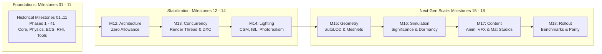

# AxleEngine Master Development Roadmap

This is the canonical master execution roadmap for AxleEngine.
The entire engine lifecycle is governed by a unified **Milestone** architecture spanning **Milestones 01 through 18**. Each Milestone manages its sequential **Phases**.

Detailed task checklists, work breakdown packages, and verification criteria live strictly within each Milestone's dedicated `PLAN.md` under [`docs/milestones/`](docs/milestones/README.md). Active technical milestones (Milestones 12–18) also maintain a companion `ARCHITECTURE.md` establishing subsystem designs, data contracts, and technology limits.

---

## 1. Master Milestones Directory

| Milestone | Milestone Name | Scope & Status | Technical Documents |
| :---: | :--- | :--- | :---: |
| **01** | **Core Foundations & Physics Integration** | **Completed:** Physics engine setup, UI telemetry overlay, scene transforms, vehicle mechanics (Phases 1–4). | [Plan](docs/milestones/MILESTONE_01_FOUNDATIONS/PLAN.md) |
| **02** | **Simulation Lifecycle & Viewport Tooling** | **Completed:** Play/Pause/Stop simulation loop, 3D viewport navigation, transform gizmos, obstacle playground (Phases 5–7). | [Plan](docs/milestones/MILESTONE_02_SIMULATION_VIEWPORT/PLAN.md) |
| **03** | **Asset Pipeline, Serialization & Scripting** | **Completed:** Assimp asset ingest, JSON serialization, PBR materials, `.axle` assemblies, C++ scripting (Phases 8–13). | [Plan](docs/milestones/MILESTONE_03_ASSETS_SERIALIZATION_SCRIPTING/PLAN.md) |
| **04** | **Scene Graph, Hot-Reloading & Multithreading** | **Completed:** EnTT ECS hierarchy, hierarchy tree UI, reflection inspector, script hot-reload DLL, enkiTS jobs (Phases 14–19). | [Plan](docs/milestones/MILESTONE_04_SCENE_GRAPH_MULTITHREADING/PLAN.md) |
| **05** | **Component Architecture & Standalone Runtime** | **Completed:** Component vehicle architecture, decoupled renderer, standalone `AxleRuntime.exe`, VFS cooker (Phases 20–23). | [Plan](docs/milestones/MILESTONE_05_COMPONENT_ARCHITECTURE_RUNTIME/PLAN.md) |
| **06** | **High-Fidelity Rendering, PBR & Audio** | **Completed:** Material flyweight, soft shadows, HDR skybox IBL, miniaudio 3D spatial acoustics (Phases 24–28). | [Plan](docs/milestones/MILESTONE_06_RENDERING_PBR_AUDIO/PLAN.md) |
| **07** | **Terrain, Spline Tracks & Skeletal Systems** | **Completed:** Spline track & terrain modular plugins, skeletal animation CPU evaluation (Phases 29–30). | [Plan](docs/milestones/MILESTONE_07_TERRAIN_SPLINES_ANIMATION/PLAN.md) |
| **08** | **Visual Effects, Modern RHI & Cross-Platform** | **Completed:** CPU particle system, NVIDIA NRI modern RHI (D3D12/Vulkan), Forward+ viewport, Canvas2D UI (Phases 31–34). | [Plan](docs/milestones/MILESTONE_08_VFX_RHI_CROSSPLATFORM/PLAN.md) |
| **09** | **Production Hardening & Unified Asset Architecture** | **Completed:** Vulkan 1.3 backend parity, unified `.axleasset` format, raw media ingestion pipeline (Phases 35–37). | [Plan](docs/milestones/MILESTONE_09_PRODUCTION_HARDENING_VULKAN/PLAN.md) |
| **10** | **Complete Visual Tooling Ecosystem Foundations** | **Completed:** Visual material studio, embedded 3D material preview, dynamic HLSL shader reflection (Phases 38–40). | [Plan](docs/milestones/MILESTONE_10_TOOLING_ECOSYSTEM/PLAN.md) |
| **11** | **Modern RHI-Primary Rendering Foundation** | **Completed:** RHI-primary rendering architecture, GPU safety, device lifetime management (Phase 41). | [Plan](docs/milestones/MILESTONE_11_RHI_PRIMARY_FOUNDATION/PLAN.md) |
| **12** | **Architecture Foundation & Boundary Hardening** | **Completed:** Zero-allowance layer enforcement, enkiTS multithreading, Jolt physics decoupling, NRI device epochs, `RenderWorld` snapshot, Plugin SDK, VFS identity, pak cooker. **Open Gates:** 3 final release acceptance gates (Phase 42.10). | [Plan](docs/milestones/MILESTONE_12_ARCHITECTURE_FOUNDATION/PLAN.md) · [Architecture](docs/milestones/MILESTONE_12_ARCHITECTURE_FOUNDATION/ARCHITECTURE.md) |
| **13** | **Render Concurrency & Shader Compilation Pipeline** | **Completed:** Decoupled Render Thread, transient VRAM memory aliasing, DXC Material Graph compiler & pipeline caching (Phases 43.1–43.2). **Deferred:** Asynchronous parallel command recording rollout (Phase 43.3). | [Plan](docs/milestones/MILESTONE_13_RENDER_CONCURRENCY/PLAN.md) · [Architecture](docs/milestones/MILESTONE_13_RENDER_CONCURRENCY/ARCHITECTURE.md) |
| **14** | **Lighting & Material Fidelity** | **Completed:** CSM 4-cascade, HDR/IBL, Point/Spot local shadow atlas, grounded fixtures (Phases 44.1–44.3). **Queued:** Kulla-Conty GGX, GTAO, Froxel Volumetric Fog, DDGI Probes, LTC Area Lights, TAA, SSS (Phases 44.4–44.17). | [Plan](docs/milestones/MILESTONE_14_LIGHTING_MATERIALS/PLAN.md) · [Architecture](docs/milestones/MILESTONE_14_LIGHTING_MATERIALS/ARCHITECTURE.md) |
| **15** | **Scalable Geometry & Virtual Geometry** | **Proposed:** Offline algorithmic autoLOD pipeline via `meshoptimizer` (Phase 45.1) and Nanite-style continuous virtual geometry with Task/Mesh Shaders (Phase 45.2). | [Plan](docs/milestones/MILESTONE_15_GEOMETRY_VISIBILITY/PLAN.md) · [Architecture](docs/milestones/MILESTONE_15_GEOMETRY_VISIBILITY/ARCHITECTURE.md) |
| **16** | **Simulation Scale & Logic LOD** | **Proposed:** Significance evaluation tiers, deterministic staggered modulo scheduler, spatial hash grid, 0% CPU spatial dormancy bubble, kinematic physics bypass (Phases 46.1–46.4). | [Plan](docs/milestones/MILESTONE_16_SIMULATION_SCALE/PLAN.md) · [Architecture](docs/milestones/MILESTONE_16_SIMULATION_SCALE/ARCHITECTURE.md) |
| **17** | **Content Authoring Studios & Tooling** | **Proposed:** Skeletal Animation Studio (Phase 47.1), Visual FX Studio & GPU Particles (Phase 47.2), Material Graph UI Canvas (Phase 47.3), Packaging Cooker & Asset Linter (Phase 47.4). | [Plan](docs/milestones/MILESTONE_17_CONTENT_TOOLING/PLAN.md) · [Architecture](docs/milestones/MILESTONE_17_CONTENT_TOOLING/ARCHITECTURE.md) |
| **18** | **Performance Profiling, Parity & Master Rollout** | **Proposed:** Standardized benchmark matrix, automated multi-backend image parity (PSNR/SSIM), GPU timestamp telemetry, simulated device-loss recovery, final production scorecard (Phases 48.1–48.6). | [Plan](docs/milestones/MILESTONE_18_PERFORMANCE_ROLLOUT/PLAN.md) · [Architecture](docs/milestones/MILESTONE_18_PERFORMANCE_ROLLOUT/ARCHITECTURE.md) |

---

## 2. High-Level Lifecycle & Strategic Overview

### 2.1. Historical Foundations (Milestones 01 through 11)
- **Status:** 100% Completed.
- Encapsulates the initial engine build-up from a basic OpenGL/ImGui window to a modern multi-backend architecture utilizing EnTT ECS, Jolt Physics 3D, NVIDIA NRI (Direct3D 12 and Vulkan), and preliminary authoring viewports.

### 2.2. Architectural Hardening & Concurrency (Milestones 12 through 14)
- **Status:** Baseline Completed; final release gates and photorealism queued.
- Hardened the engine against technical debt: enforced zero-allowance layered architecture (`check_architecture.py`), decoupled physics and rendering threads, implemented transient VRAM memory aliasing, introduced the DXC Material Graph compiler, and grounded PBR direct/ambient lighting (CSM and split-sum IBL).

### 2.3. Next-Gen Scale, Content Studios & Production Rollout (Milestones 15 through 18)
- **Status:** Proposed & Fully Planned.
- Targets AAA geometric throughput (autoLOD and Task/Mesh Shaders), vast entity simulation scaling (significance tiers and spatial hibernation), end-to-end visual authoring tools (Animation Studio, Visual FX Studio, and Material Graph Node Canvas), concluding with exhaustive benchmark verification across Direct3D 12, Vulkan, and OpenGL.

---

## 3. Governance & Contribution Principles

1. **Single Source of Authority**: `ROADMAP.md` is the only execution authority. All work is ordered by Milestone and executed through its sequential child Phases.
2. **Dedicated Plan Files**: Granular checklists, work breakdown packages, and commit histories live within each Milestone's [`PLAN.md`](docs/milestones/).
3. **Dedicated Architecture Files**: Active technical milestones maintain a companion [`ARCHITECTURE.md`](docs/milestones/) defining technical contracts, data models, and fallback policies.
4. **Evidence Archiving**: Verification and test reports are recorded under [`docs/reviews/`](docs/reviews/). Historical design archives live under [`docs/archive/`](docs/archive/).
