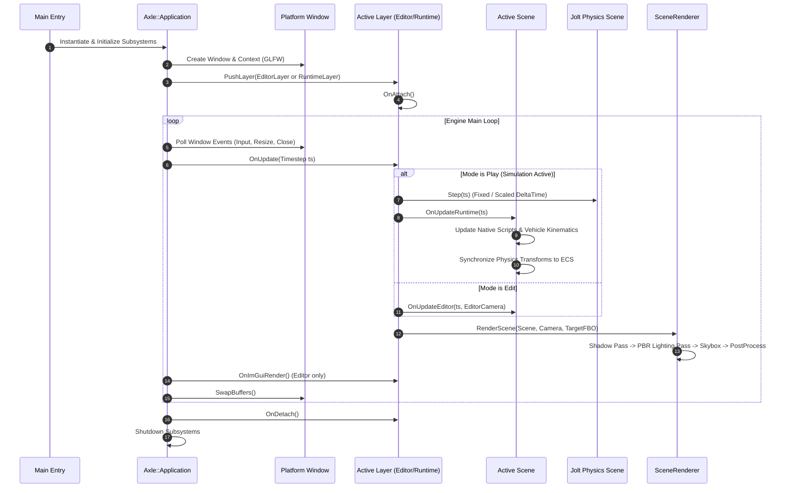

# 🏛️ AxleEngine System Architecture

AxleEngine is a **modern, modular, general-purpose 3D game engine** developed in **C++20**. Designed from the ground up for high-performance physics-driven games, sandboxes, and simulations, AxleEngine blends the ergonomics of commercial game engines (such as Godot and Unity) with cache-friendly **Data-Oriented Design (DOD)** and native C++ execution speed.

---

## 🏗️ Layered Architecture Stack

AxleEngine is organized into a strictly layered architecture. Dependencies flow strictly **downward**; higher layers depend on lower layers, and lower layers never include or depend on higher layers.

```plaintext
┌─────────────────────────────────────────────────────────────────────────────┐
│ LEVEL 4: APPLICATIONS & TOOLS                                               │
│ • AxleEditor.exe (WYSIWYG Docking IDE, ImGuizmo, Live Script Tuning)        │
│ • AxleRuntime.exe (Standalone Game Launcher, Zero Editor Overhead)          │
│ • AxleTests.exe (Automated Headless CI/CD Test Suite - 32 Verified Suites)  │
├─────────────────────────────────────────────────────────────────────────────┤
│ LEVEL 3: GAMEPLAY SYSTEMS & DOMAIN TOOLKITS                                 │
│ • Engine/Scene: EnTT ECS, Entity, Hierarchy Graph, ParallelECS, Serialization│
│ • Engine/Vehicle: Advanced Vehicle Drivetrain, Powertrain & Audio Synthesis │
│ • AxleScripts.dll: User Gameplay Scripts Module (Hot-Reloadable Dynamic Lib)│
├─────────────────────────────────────────────────────────────────────────────┤
│ LEVEL 2: ENGINE SUBSYSTEMS                                                  │
│ • Engine/Renderer: OpenGL 4.5 Core, PBR BRDF, Shadow Mapping, Skybox, Mesh  │
│ • Engine/Physics:  Jolt Physics Bridge, Multithreaded Scene, Rigid Bodies   │
│ • Engine/Audio:    miniaudio 3D Spatial Audio Engine, Doppler, Sound Sources│
│ • Engine/Asset:    AssetManager, UUID .meta Pipeline, Binary Cache (.axlebin│
│ • Engine/Project:  Project Management (.axleproj), Virtual Asset Paths      │
│ • Engine/UI:       ImGui Abstraction, Viewport FBO, Content Browser, Tree   │
├─────────────────────────────────────────────────────────────────────────────┤
│ LEVEL 1: PLATFORM ABSTRACTION                                               │
│ • Engine/Platform: GLFW Window Lifecycle, Input Polling, Dynamic DLL Loader │
├─────────────────────────────────────────────────────────────────────────────┤
│ LEVEL 0: FOUNDATION & UTILITIES                                             │
│ • Engine/Core: Application Loop, LayerStack, enkiTS JobSystem, Log, Timestep│
└─────────────────────────────────────────────────────────────────────────────┘
```

---

## 🧩 Core Architectural Principles

### 1. Data-Oriented Design via Entity Component System (ECS)
AxleEngine uses [EnTT](https://github.com/skypjack/entt) as its primary ECS backplane. Game entities are lightweight 64-bit integer handles (`entt::entity`), while data is stored in contiguous, cache-friendly component pools.
* **Zero Virtual Method Overhead in Bulk Data**: Thousands of physics objects or mechanical parts can be iterated contiguously in memory with maximum SIMD vectorization.
* **Safe Scriptable Wrapper**: For gameplay scripts requiring intuitive object-oriented lifecycles (e.g. Player Controller, Camera, Vehicle), the `ScriptableEntity` interface wraps the underlying ECS handle with zero runtime memory penalty.

### 2. Strict Modular Isolation & Zero Raw Graphics Leaks
No subsystem outside `Engine/Renderer` is permitted to include raw OpenGL headers or issue raw graphics commands (`gl*`).
* Rendering requests from `Engine/Scene` or `Editor` go through high-level rendering abstractions (`Axle::SceneRenderer`, `Axle::Renderer`, `Axle::RenderCommand`).
* Swapping the rendering backend (e.g., to Vulkan or Direct3D 12) requires modifications only inside `Engine/Renderer`.

### 3. Persistent Lock-Free Multi-Threading (`enkiTS`)
AxleEngine completely avoids creating ad-hoc threads or maintaining multiple uncoordinated thread pools.
* A single unified `Axle::JobSystem` (powered by `enkiTS`) initializes persistent worker threads matching the host machine's hardware thread count.
* Both **Jolt Physics** (via `JobSystemEnkiTS`) and bulk **ECS systems** (via `ParallelECS::ForEach`) dispatch their workloads into the same unified scheduler, preventing CPU core thrashing and thread oversubscription.

### 4. Dual Runtime Target: Editor IDE vs Standalone Player
The engine explicitly separates development tools from shipping games:
* `AxleEditor.exe`: Links `Axle::UI`, ImGui, and ImGuizmo to provide a full multi-window development IDE with real-time viewport picking, live inspection, and hot-reloading.
* `AxleRuntime.exe`: Stripped of all ImGui, editor panels, and debug tooling. It boots directly into cooked project packages (`Data.axlepak`) for maximum FPS, minimal memory footprint, and instantaneous launch times.

---

## 🔄 Application & Simulation Lifecycle

The execution lifecycle of an AxleEngine application is orchestrated by `Axle::Application` and its `Axle::LayerStack`:



### Simulation State Management
In `AxleEditor`, simulation state is managed through a **Safe 3-State Lifecycle**:
1. **Edit Mode (`Stop`)**: The scene is in authoring mode. Jolt physics bodies are idle or uncreated. Viewport gizmos allow dragging and positioning entities.
2. **Play Mode (`F5`)**: The editor creates a **deep ephemeral clone** of the editor scene with UUID remapping. Physics simulations, vehicle motors, audio, and gameplay scripts execute inside the runtime clone.
3. **Pause / Step Mode (`F6` / `O`)**: Simulation pauses, allowing single-frame advance (1/60s) to inspect physics reactions and collision impulses.
4. **Restoration (`F7` / `Esc`)**: The runtime scene is safely dismantled and destroyed. The original editor scene is restored with **zero lingering transform drift** or altered state.

---

## 💾 Memory & Resource Management Strategy

* **RAII & Smart Pointers**: All heap-allocated resources are managed via standard RAII wrappers (`std::unique_ptr` and `std::shared_ptr`). Raw pointers are strictly non-owning.
* **UUID-based Asset Referencing**: Every asset (mesh, material, texture, scene, audio clip) possesses a permanent 64-bit `Axle::UUID` declared in its companion `.meta` file. Changing filenames or directories does not break scene references.
* **Flyweight Shared Assets**: Heavy GPU resources (Textures, Shaders, Materials, Meshes) are managed by `Axle::AssetManager` through centralized cache maps (`TextureCache`, `MaterialCache`, `MeshCache`). Multiple entities referencing the same material or mesh share a single GPU allocation.
* **Binary Flat Caching (`.axlebin`)**: Human-readable 3D meshes (`.axle`) are automatically compiled into flat binary caches with microsecond load times. Modifying text automatically re-bakes the binary cache on the next run.
* **Monolithic Virtual Packaging (`.axlepak`)**: For shipping distributions, the `AssetCooker` serializes all referenced assets into a single compressed binary package served transparently by `Axle::FileSystem` in memory.
