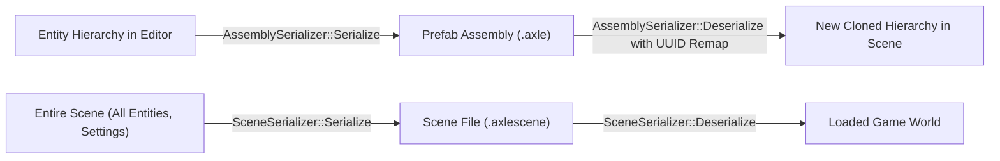

# 🌿 Entity Component System (ECS) & Scene Graph Guide

AxleEngine adopts a **Hybrid Data-Oriented / Scene Graph Architecture** centered on [EnTT](https://github.com/skypjack/entt). This document describes the component schema, entity relationship traversal, matrix propagation, prefab assemblies, and multithreaded processing.

---

## 🏛️ ECS Architecture & Entity Representation

* **`entt::entity`**: An entity is a lightweight 64-bit integer identifier index in the `entt::registry`.
* **`Axle::Entity`**: A lightweight value-type wrapper holding an `entt::entity` and a pointer to its owning `Axle::Scene`. It provides convenient helper methods:
  ```cpp
  Axle::Entity entity = scene->CreateEntity("Player");
  entity.AddComponent<Axle::MeshInstance3D>("assets/models/Hero.axlemesh");
  auto& tc = entity.GetComponent<Axle::TransformComponent>();
  tc.Translation = glm::vec3(0.0f, 1.0f, 0.0f);
  ```

---

## 📋 Standard Component Reference

All standard engine components are declared in [`Engine/Scene/include/Axle/Components.hpp`](file:///d:/WorkSpace/AxleEngine/Engine/Scene/include/Axle/Components.hpp).

### 1. Identity & Spatial Transforms
| Component | Key Fields | Purpose |
| :--- | :--- | :--- |
| `TagComponent` | `std::string Tag` | Human-readable name used in the Editor hierarchy and runtime queries. |
| `TransformComponent` | `glm::vec3 Translation`<br/>`glm::quat Rotation`<br/>`glm::vec3 Scale` | Local transform relative to parent. Provides `GetTransform()` to calculate local $4 \times 4$ transformation matrix. |
| `HierarchyComponent` | `entt::entity Parent`<br/>`std::vector<entt::entity> Children`<br/>`bool InheritTransform` | Encodes parent-child relationships in the Scene Graph. |

### 2. Rendering & Environment
| Component | Key Fields | Purpose |
| :--- | :--- | :--- |
| `MeshInstance3D` | `std::string AssetPath`<br/>`PatternMode`, `Color1`, `Color2` | Binds a 3D geometry mesh (`.axle`, `.axlemesh`, `.obj`) or procedural primitive (Cube, Sphere, Cylinder, Plane). |
| `MaterialComponent` | `UUID MaterialHandle`<br/>`PBR Parameters` | Material assignment using Flyweight pattern referencing `.axlemat` / `.amat` assets, or inline override values. |
| `CameraComponent` | `float FOV, NearClip, FarClip`<br/>`bool Primary` | Marks the entity as a rendering viewpoint. `Primary = true` indicates the active gameplay camera. |
| `DirectionalLightComponent` | `glm::vec3 Color`<br/>`float Intensity`<br/>`bool CastShadows`<br/>`float ShadowOrthoSize` | Sunlight emitter supporting real-time cascaded soft shadow mapping. |
| `PointLightComponent` | `glm::vec3 Color`<br/>`float Intensity, Radius, Falloff` | Omnidirectional local light source. |
| `SpotLightComponent` | `glm::vec3 Color`<br/>`float Intensity, Range, InnerAngle, OuterAngle` | Conical spotlight source (vehicle headlights, streetlamps, flashlights). |
| `SkyboxComponent` | `SkyboxType Type`<br/>`std::string HDRPath`<br/>`Atmosphere Colors` | Procedural atmospheric Rayleigh/Mie scattering or HDR cubemap image-based lighting (IBL). |

### 3. Jolt Physics 3D (Decoupled Body & Shape Model)
AxleEngine separates physical **dynamics** from **geometric shapes** (similar to Godot's `RigidBody3D` + `CollisionShape3D`):
| Component | Key Fields | Purpose |
| :--- | :--- | :--- |
| `RigidBody3D` | `BodyMotionType MotionType`<br/>`float Mass, LinearDamping, AngularDamping` | Governs physics movement (`Static`, `Kinematic`, `Dynamic`), mass distribution, and velocity integration. |
| `CollisionShape3D` | `CollisionShapeType ShapeType`<br/>`glm::vec3 HalfExtent`<br/>`float Radius, HalfHeight`<br/>`float Friction, Restitution`<br/>`bool IsTrigger` | Geometric collision boundary (Box, Sphere, Capsule, Cylinder, Cone, ConvexHull, MeshShape). |

### 4. Audio Subsystem
| Component | Key Fields | Purpose |
| :--- | :--- | :--- |
| `AudioListenerComponent` | `bool Active` | 3D audio listener ear anchor (typically attached to the Primary Camera). |
| `AudioSourceComponent` | `std::string ClipPath`<br/>`float Volume, Pitch`<br/>`bool Loop, Spatialized`<br/>`float MinDistance, MaxDistance` | 3D or 2D audio emitter with spatial distance attenuation and Doppler effects. |

### 5. Native Gameplay Scripting
| Component | Key Fields | Purpose |
| :--- | :--- | :--- |
| `NativeScriptComponent` | `std::string ScriptName`<br/>`ScriptableEntity* Instance`<br/>`Field Value Buffers` | Binds a C++ gameplay class inheriting `ScriptableEntity` with live reflected fields in the Editor inspector. |

### 6. Vehicle Gameplay Toolkit
| Component | Key Fields | Purpose |
| :--- | :--- | :--- |
| `VehicleComponent` | `float ChassisMass, MaxEngineTorque`<br/>`float MaxRPM, MinRPM`<br/>`glm::vec3 CenterOfMassOffset` | Drivetrain data container for motorized multi-wheeled vehicles. |
| `WheelComponent` | `float Radius, Width`<br/>`float SpringFrequency, SpringDamping`<br/>`bool CanSteer, IsDriven, HasHandbrake` | Attached to child wheel entities for suspension modeling and tire traction. |
| `VehicleAudioComponent` | `EnginePowerClipPath`, `EngineCoastClipPath`<br/>`TireSquealClipPath`, `SuspensionThudClipPath` | Synthesizes realistic vehicle acoustics dynamically driven by Jolt wheel telemetry. |

---

## 🌳 Parent-Child Hierarchy & Scene Graph Matrix Propagation

Entities can be nested hierarchically to form complex articulated models (such as vehicles, turrets, robots, character rigs):

```
Root: Tank (Transform, RigidBody3D)
 ├── Child: Turret (Transform, Hierarchy)
 │    └── Child: Barrel (Transform, Hierarchy)
 ├── Child: Track_Left (Transform, Hierarchy)
 └── Child: Track_Right (Transform, Hierarchy)
```

### World Transform Calculation
When computing final global positions:
$$\mathbf{M}_{\text{World}} = \mathbf{M}_{\text{Parent World}} \times \mathbf{M}_{\text{Local}}$$

Where $\mathbf{M}_{\text{Local}}$ is computed from `TransformComponent`:
$$\mathbf{M}_{\text{Local}} = \mathbf{T}(\text{Translation}) \times \mathbf{R}(\text{Rotation}) \times \mathbf{S}(\text{Scale})$$

### Traversal Helpers in C++
The `Entity` and `ScriptableEntity` classes provide $O(1)$ and hierarchical query utilities:
```cpp
// Traverse immediate children
for (auto child : entity.GetChildren()) {
    // Process child
}

// Find child entity by tag name (cached in OnCreate() for zero-cost runtime access)
Axle::Entity turret = entity.FindChildByTag("Turret");
if (turret) {
    auto& tc = turret.GetComponent<Axle::TransformComponent>();
    tc.Rotation = glm::angleAxis(glm::radians(targetAngle), glm::vec3(0, 1, 0));
}
```

---

## 📦 Prefab Assemblies (`.axle`) vs Scene Serialization (`.axlescene`)

AxleEngine provides two complementary serialization systems:



### 1. Prefab Assembly (`.axle`)
* Encapsulates a self-contained entity hierarchy (Root + all children).
* Used for reusable machines, vehicles, modular props, and character templates.
* **UUID Remapping**: When deserializing an assembly into an existing scene, all entity UUIDs and internal cross-references are automatically re-mapped, guaranteeing zero ID collisions when spawning multiple copies of the same prefab.

### 2. Scene File (`.axlescene`)
* Encapsulates the entire level state: all root entities, environment settings (Sunlight, Skybox, Shadows), and camera positions.
* Human-readable, git-friendly YAML structured text format.

---

## ⚡ Multithreaded Processing via `ParallelECS`

For operations involving thousands of entities (e.g. bulk mechanical simulation, particle updates, or procedural physics queries), AxleEngine provides `Axle::ParallelECS`:

```cpp
#include <Axle/ParallelECS.hpp>

// Distributes iteration across all CPU cores via enkiTS worker threads
Axle::ParallelECS::ForEach<Axle::TransformComponent, Axle::RigidBody3D>(
    scene->GetRegistry(),
    [](entt::entity e, Axle::TransformComponent& tc, Axle::RigidBody3D& rb) {
        if (rb.MotionType == Axle::BodyMotionType::Dynamic) {
            // High-performance cache-friendly batch calculation
        }
    }
);
```
