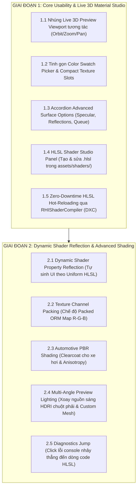

# 🎨 AxleEngine Material & HLSL Shader Studio - Unity & Godot Parity Specification

> **Tài liệu đặc tả kỹ thuật & Kiến trúc lộ trình**  
> **Mục tiêu**: Nâng cấp hệ sinh thái Material Inspector và HLSL Shader Studio của AxleEngine đạt độ hoàn thiện, tính linh hoạt và trải nghiệm người dùng tương đương **Unity (URP Lit / ShaderLab)** và **Godot 4.x (StandardMaterial3D / Built-in Shader Editor)**.

---

## 1. Phân tích Hiện trạng & Ma trận So sánh (Gap Analysis)

| Tiêu chí | Unity (URP Lit) | Godot 4 (StandardMaterial3D) | AxleEngine (Hiện tại) | Mục tiêu Chuẩn hóa |
| :--- | :--- | :--- | :--- | :--- |
| **3D Material Preview** | Viewport 3D tương tác: Xoay 360° (chuột trái), xoay ánh sáng HDRI (chuột phải), Zoom (lăn chuột) | Viewport 3D tương tác: Xoay mẫu vật, đổi môi trường ánh sáng | Chỉ có 4 nút bấm chọn mesh, **chưa nhúng khung nhìn 3D** vào Inspector | Nhúng live 3D Viewport tương tác đa chiều ngay trong Inspector |
| **Color & Texture UX** | Ô màu Swatch nhỏ gọn mở Color Picker popup, ô texture vuông nhỏ kèm nút chọn nhanh | Swatch popup, kéo thả texture trực quan | 4 ô số `[255][214][0][255]` thô sơ, texture input dài dòng | Swatch popup chuẩn Unity, Texture slot vuông compact |
| **Shader Source Authoring** | Tạo & sửa `.shader` / `.hlsl` trong `Assets/Shaders/`, hot-reload tự động | Tab Shader Editor tích hợp sẵn dưới đáy màn hình, sửa code trực tiếp | Chưa có Editor chuyên dụng, phải sửa ngoài IDE | **HLSL Studio Panel** tích hợp trong Editor, hot-reload qua DXC |
| **Dynamic UI Generation** | Đọc khối `Properties { ... }` sinh UI tự động | Đọc `uniform ... : hint_*` sinh UI tự động | **Hardcode 100% C++** trong `AssetInspector.cpp` | **Dynamic Shader Property Reflection** tự sinh UI theo HLSL |
| **Texture Channel Packing** | Mask Map (Metallic, AO, Detail, Smoothness) | ORM Texture (Occlusion = R, Roughness = G, Metallic = B) | Chỉ nhận các texture map độc lập, tốn 5 samplers | Bổ sung chế độ **Packed ORM Map (R-AO, G-Rough, B-Metal)** |
| **Automotive PBR Shading** | Clearcoat (Sơn bóng 2 lớp), Anisotropy (Kim loại phay xước) | Clearcoat, Anisotropy, Rim, Subsurface | Chỉ có PBR cơ bản (Albedo, Normal, Roughness, Metallic) | Bổ sung **Clearcoat & Anisotropy** chuyên dụng cho xe hơi |

---

## 2. Lộ trình 2 Giai đoạn (2-Phase Parity Roadmap)



---

## 3. Chi tiết Kỹ thuật - Giai đoạn 1: Core Usability & Live 3D Material Studio

Mục tiêu của Giai đoạn 1 là **giải quyết triệt để sự thô sơ về mặt thị giác**, đưa trải nghiệm biên tập Material và Shader lên mức tiện dụng, chuyên nghiệp.

### 3.1. Nhúng Live 3D Preview Viewport vào Material Inspector
* **Vị trí**: Đặt ngay trong tab Inspector của Material (phía dưới hoặc phía trên nhóm Surface Inputs).
* **Cơ chế render**:
  - Tận dụng `AssetPreviewPanel`: Render một quả cầu / lập phương mẫu vật với vật liệu hiện tại qua `RHISceneRenderer` vào một Texture Target riêng (`m_PreviewTextureID`).
  - Hiển thị texture qua `ImGui::Image()` với kích thước vuông chuẩn (ví dụ: `200x200` hoặc co giãn theo chiều rộng cửa sổ).
* **Tương tác chuột**:
  - **Chuột trái (Left Drag)**: Xoay mẫu vật 360 độ (Yaw / Pitch) quanh tâm.
  - **Lăn chuột (Scroll Wheel)**: Thu phóng camera xem cận cảnh độ nhám (Roughness) và chi tiết vân Normal Map.
  - **Nút Mesh Selector**: Chuyển đổi nhanh 4 hình mẫu: `[Sphere]`, `[Cube]`, `[Cylinder]`, `[Plane]`.

### 3.2. Tinh gọn Color Swatch & Texture Inputs UX
* **Base Color / Emission Color**:
  - Loại bỏ hoàn toàn 4 ô nhập số RGBA `[255][214][0][255]`.
  - Thay thế bằng ô Swatch chuẩn Unity: sử dụng cờ `ImGuiColorEditFlags_NoInputs | ImGuiColorEditFlags_NoLabel | ImGuiColorEditFlags_AlphaBar`.
  - Khi click vào ô màu, hiển thị popup bảng chọn màu chuyên nghiệp (HSV Wheel / RGB sliders).
* **Compact Texture Slot**:
  - Mỗi texture slot (Base Map, Normal Map, Roughness Map, Metallic Map, Occlusion Map) có:
    - Thumbnail thu nhỏ hình vuông (`24x24 px`) hiển thị ảnh texture đã gán.
    - Nhãn tên texture gọn gàng hoặc `None (Texture2D)`.
    - Nút `[+]` mở cửa sổ duyệt file hoặc kéo thả trực tiếp từ Content Browser.
    - Nút `[X]` xóa nhanh texture để trả về giá trị số mặc định.

### 3.3. Bổ sung Nhóm Advanced Surface Options
Mở rộng thêm accordion **Advanced Options** tương đương Unity URP:
* **Specular Highlights**: Checkbox bật/tắt phản xạ chói lóa từ nguồn sáng điểm/hướng (mặc định: `true`).
* **Environment Reflections**: Checkbox bật/tắt phản xạ từ bầu trời IBL/HDRI (mặc định: `true`).
* **Render Queue Offset**: Hộp số điều chỉnh thứ tự vẽ (Geometry: `2000`, AlphaTest: `2450`, Transparent: `3000`).
* **Cast Shadows & Receive Shadows**: Tùy chọn đổ bóng và nhận bóng trên bề mặt.

### 3.4. HLSL Shader Studio Panel (Tích hợp trong Editor)
* **Dockable Panel**: Tạo panel `HLSL Studio` có thể dock vào cùng nhóm với Scene View, Game View hoặc Content Browser.
* **Tạo file nhanh trong Game Source**:
  - Content Browser: Chuột phải trong thư mục `assets/shaders/` -> `Create > HLSL Shader`.
  - Tự động sinh template file `.hlsl` chuẩn AxleEngine với đầy đủ `struct VSInput`, `struct PSInput`, `cbuffer MaterialConstants`, hàm `VSMain` và `PSMain`.
* **Trình soạn thảo mã nguồn**:
  - Hỗ trợ số dòng (line numbers), thụt đầu dòng tự động, tô màu cú pháp (Syntax Highlighting cho từ khóa HLSL: `float4`, `cbuffer`, `Texture2D`, `SamplerState`, `mul`, `saturate`, ...).

### 3.5. Zero-Downtime HLSL Hot-Reloading qua `RHIShaderCompiler`
* Phím tắt `Ctrl + S` hoặc nút `[ Recompile (F5) ]` trên toolbar của HLSL Studio.
* Trình biên dịch DXC biên dịch file HLSL sang cả **Direct3D 12 DXIL** và **Vulkan SPIR-V**.
* Nếu thành công: Engine tự động nạp bytecode mới vào `RHIPipelineCache`, cập nhật Pipeline State Object (PSO) ngay trên GPU mà **không cần khởi động lại Editor**.
* Nếu thất bại: Hiển thị thông báo lỗi chi tiết (file, dòng, ký tự, nguyên nhân) ở thanh trạng thái bên dưới panel.

---

## 4. Chi tiết Kỹ thuật - Giai đoạn 2: Dynamic Shader Reflection & Advanced Shading

Mục tiêu của Giai đoạn 2 là **xóa bỏ hoàn toàn việc hardcode C++**, đưa hệ thống đạt sự linh hoạt vô hạn và chất lượng hình ảnh sánh ngang Unity HDRP và Godot 4.

### 4.1. Dynamic Shader Property Reflection (Tự sinh UI theo Shader)
* **Nguyên lý hoạt động**:
  - Khi một shader HLSL được biên dịch qua DXC, ta truy xuất interface `IDxcContainerReflection` / `ID3D12ShaderReflection`.
  - Reflection API cung cấp danh sách toàn bộ các biến trong `cbuffer MaterialConstants`, kiểu dữ liệu (`float`, `float3`, `float4`, `int`), offset trong buffer và các tài nguyên `Texture2D` / `SamplerState`.
  - Hỗ trợ cú pháp comment metadata trên đầu biến:
    ```hlsl
    cbuffer MaterialConstants : register(b1) {
        // [Label("Base Color"), Color]
        float4 u_BaseColor;

        // [Label("Dissolve Threshold"), Range(0.0, 1.0)]
        float u_DissolveThreshold;

        // [Label("Rim Power"), Slider(0.1, 10.0)]
        float u_RimPower;
    };
    ```
* **Render UI động trong `AssetInspector`**:
  - Duyệt danh sách reflection metadata đã trích xuất:
    - Nếu kiểu là `Color` -> vẽ Color Swatch popup picker.
    - Nếu có thẻ `Range(min, max)` -> vẽ `ImGui::SliderFloat`.
    - Nếu là `Texture2D` -> vẽ Compact Texture Slot.
  - Nhờ đó, bất kỳ custom shader nào người dùng tạo trong game đều **ngay lập tức có giao diện điều khiển chuyên nghiệp** trên Inspector mà không cần sửa code engine.

### 4.2. Texture Channel Packing (Packed ORM Map)
* **Chuẩn gộp kênh phổ biến nhất trong ngành đồ họa game**:
  - **Kênh R (Red)**: Ambient Occlusion (Bóng tự che khuất).
  - **Kênh G (Green)**: Roughness (Độ nhám bề mặt).
  - **Kênh B (Blue)**: Metallic (Tính kim loại).
* **Tích hợp UI**:
  - Tùy chọn chuyển đổi: `Map Mode: [ Separate Maps | Packed ORM Map ]`.
  - Ở chế độ `Packed ORM Map`, chỉ cần 1 slot texture duy nhất thay vì 3 slot riêng rẽ. Tiết kiệm 2 Texture Samplers trên GPU và giảm 60% lượng VRAM tiêu tốn.

### 4.3. Automotive PBR Shading (Clearcoat & Anisotropy)
Dành riêng cho thế mạnh mô phỏng phương tiện của AxleEngine:
* **Clearcoat (Lớp vecni bóng hai tầng)**:
  - Bổ sung 2 thông số: `Clearcoat Strength` (0.0 -> 1.0) và `Clearcoat Roughness` (0.0 -> 1.0).
  - Mô phỏng lớp sơn phủ trong suốt bảo vệ bên ngoài thân xe thể thao, tạo vệt chói sắc nét thứ hai độc lập với độ nhám kim loại bên dưới.
* **Anisotropy (Phản xạ dị hướng)**:
  - Bổ sung `Anisotropy Strength` và `Anisotropy Direction Map`.
  - Tạo hiệu ứng phản xạ kéo dài hình nón trên mâm xe hợp kim nhôm phay xước hoặc đĩa phanh thép.

### 4.4. Multi-Angle Preview Lighting & Custom Mesh Preview
* **Điều khiển ánh sáng tương tác**:
  - **Chuột phải (Right Drag)** trong khung Preview: Xoay hướng nguồn sáng Directional Light / góc quay bầu trời HDRI.
  - Cho phép quan sát vệt sáng specular quét qua bề mặt quả cầu mà không cần xoay vật thể.
* **Custom Mesh Preview**:
  - Thêm tùy chọn `[Custom Mesh...]` trong Mesh Selector.
  - Cho phép kéo bất kỳ file `.axlemesh` nào từ Content Browser (ví dụ thân xe `SportsCar_Chassis.axlemesh`) vào khung preview để xem trực tiếp chất liệu trên thân xe thật trước khi áp vào Scene.

### 4.5. Diagnostics Jump & Syntax Auto-complete trong HLSL Studio
* Bắt sự kiện double-click trên danh sách lỗi biên dịch (Compile Error List):
  - Tự động nhảy con trỏ text editor đến đúng dòng và cột bị lỗi trong file `.hlsl`.
  - Đánh dấu highlight dòng có lỗi màu đỏ nhạt để lập trình viên sửa ngay.
* Tích hợp bảng gợi ý từ khóa (Autocomplete) cho các hàm HLSL intrinsic: `saturate`, `lerp`, `mul`, `dot`, `cross`, `normalize`, `reflect`, `sample`.

---

## 5. Kế hoạch Kiểm thử Tự động (Automated Test Strategy)

Mỗi tính năng khi triển khai đều đi kèm với các bài kiểm thử tự động tương ứng trong `AxleTests.exe`:

* **Test Step 104 (Giai đoạn 1 Verification)**:
  1. Kiểm thử render headless của Material Preview Viewport (kết xuất texture buffer hợp lệ, camera orbit transform math).
  2. Kiểm thử serialize / deserialize các trường mới trong `.axleasset` (Specular toggle, Environment reflection toggle, Render Queue offset).
  3. Kiểm thử biên dịch HLSL runtime qua `RHIShaderCompiler` đối với file shader mới trong `assets/shaders/`.
* **Test Step 105 (Giai đoạn 2 Verification)**:
  1. Kiểm thử trích xuất Reflection Metadata từ bytecode DXC (tên biến, kiểu dữ liệu, buffer offset).
  2. Kiểm thử gộp kênh Packed ORM texture sampling trong shader PBR.
  3. Kiểm thử Clearcoat & Anisotropy push constants packing và PSO generation.

---

## 6. Kết luận & Cam kết Kiến trúc
Bằng cách phân tách thành 2 giai đoạn rõ ràng:
- **Giai đoạn 1** giải quyết ngay vấn đề thẩm mỹ, khả năng xem trước (Preview) và công cụ viết shader trực tiếp.
- **Giai đoạn 2** nâng tầm engine lên chuẩn sản xuất AAA hiện đại với cơ chế Dynamic Reflection tự động và Shading xe hơi cao cấp.
AxleEngine sẽ hoàn toàn tự tin cạnh tranh sòng phẳng với Unity và Godot về hệ sinh thái Material & Shader.
