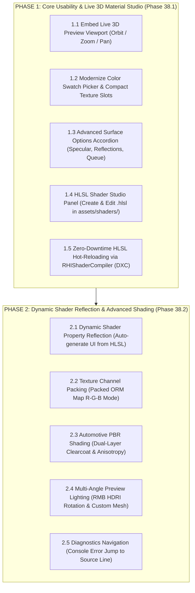

# 🎨 AxleEngine Material & HLSL Shader Studio - Unity & Godot Parity Specification

> **Architectural Specification & Implementation Roadmap**  
> **Objective**: Elevate AxleEngine's Material Inspector and HLSL Shader Studio to achieve full feature parity, ergonomics, and production fidelity matching **Unity (URP Lit / ShaderLab)** and **Godot 4.x (StandardMaterial3D / Built-in Shader Editor)**.

---

## 1. Gap Analysis & Comparison Matrix

| Evaluation Criteria | Unity (URP Lit) | Godot 4 (StandardMaterial3D) | AxleEngine (Current) | Target Standard |
| :--- | :--- | :--- | :--- | :--- |
| **3D Material Preview** | Interactive 3D Viewport: 360° orbit (LMB), rotate environment/HDRI (RMB), zoom (scroll wheel) | Interactive 3D Viewport: Rotate sample mesh, change lighting environment | 4 sample mesh buttons, **no 3D viewport embedded** in Inspector | Embedded live 3D viewport with multi-axis orbit/zoom and environment rotation |
| **Color & Texture UX** | Compact color swatch popup, square texture slot with inline modifier and ping button | Swatch popup, direct texture drag-and-drop | Cluttered 4-box RGBA `[255][214][0][255]`, verbose path labels | Compact color swatch popup, square thumbnail texture slot with quick clear `[X]` |
| **Shader Authoring** | Create & edit `.shader` / `.hlsl` in `Assets/Shaders/`, automatic hot-reload | Built-in bottom dock Shader Editor with inline diagnostics | No specialized in-editor shader editor, external IDE required | Dockable **HLSL Studio Panel** in Editor with zero-downtime DXC hot-reload |
| **Dynamic UI Generation** | Parses `Properties { ... }` block to generate UI controls dynamically | Parses `uniform ... : hint_*` to generate UI controls dynamically | **100% hardcoded C++** in `AssetInspector.cpp` | **Dynamic Shader Property Reflection** generated from HLSL bytecode/annotations |
| **Texture Channel Packing** | Mask Map (Metallic, AO, Detail, Smoothness) | ORM Texture (Occlusion = R, Roughness = G, Metallic = B) | Separate independent texture maps (wastes 5 texture samplers) | Support **Packed ORM Map (R: AO, G: Roughness, B: Metallic)** |
| **Automotive PBR Shading** | Clearcoat (dual-layer paint), Anisotropy (brushed metal) | Clearcoat, Anisotropy, Rim, Subsurface | Standard PBR only (Albedo, Normal, Roughness, Metallic) | Add **Clearcoat & Anisotropy** tailored for automotive workflows |

---

## 2. Two-Phase Implementation Roadmap



---

## 3. Technical Breakdown - Phase 1: Core Usability & Live 3D Material Studio

The primary goal of Phase 1 is to **eliminate visual clunkiness and mock UI artifacts**, establishing a robust, responsive authoring environment for materials and shaders.

### 3.1. Embed Live 3D Preview Viewport into Material Inspector
* **Placement**: Integrated directly within the Material Inspector tab (either at the header or bottom of the property stack).
* **Rendering Architecture**:
  - Leverage `AssetPreviewPanel`: Render the sample sphere / cube / cylinder using the active material through `RHISceneRenderer` into a dedicated offscreen texture target (`m_PreviewTextureID`).
  - Render the resulting texture in ImGui via `ImGui::Image()` with an aspect-locked square frame (`200x200 px` or responsive to panel width).
* **Mouse Interactions**:
  - **Left Mouse Button (Drag)**: Orbit camera 360° (Yaw / Pitch) around the preview mesh.
  - **Scroll Wheel**: Smooth zoom to inspect microfacet roughness and normal map fidelity up close.
  - **Mesh Selector Buttons**: Seamlessly swap between `[Sphere]`, `[Cube]`, `[Cylinder]`, and `[Plane]`.

### 3.2. Modernize Color Swatch & Compact Texture Slots
* **Base Color / Emission Color**:
  - Completely eliminate the disjointed 4-element numeric boxes `[255][214][0][255]`.
  - Replace with a Unity-standard color swatch button using `ImGuiColorEditFlags_NoInputs | ImGuiColorEditFlags_NoLabel | ImGuiColorEditFlags_AlphaBar`.
  - Clicking the swatch opens an interactive HSV/RGB color picker popup.
* **Compact Texture Slot**:
  - Each texture slot (Base Map, Normal Map, Roughness Map, Metallic Map, Occlusion Map) provides:
    - A square `24x24 px` thumbnail preview box showing the bound texture.
    - Clean asset name display or placeholder `None (Texture2D)`.
    - Drop target accepting texture files dragged from Content Browser.
    - Quick-clear button `[X]` to unbind the texture and revert to scalar defaults.

### 3.3. Advanced Surface Options Accordion
Add an expandable **Advanced Options** group matching Unity URP Lit:
* **Specular Highlights**: Toggle checkbox (enables/disables specular highlights from punctual/directional lights).
* **Environment Reflections**: Toggle checkbox (enables/disables reflections from IBL / skybox).
* **Render Queue Offset**: Numeric input to adjust draw ordering (Opaque/Geometry: `2000`, AlphaTest: `2450`, Transparent: `3000`).
* **Cast & Receive Shadows**: Toggles for shadow casting and shadow reception.

### 3.4. In-Editor HLSL Shader Studio Panel
* **Dockable Workspace**: Provide an `HLSL Studio` panel that docks seamlessly alongside Scene View, Game View, or Console.
* **Project Game Source Authoring**:
  - Right-click inside Content Browser in `assets/shaders/` -> `Create > HLSL Shader`.
  - Automatically synthesizes a clean, standard AxleEngine PBR template shader with `VSInput`, `PSInput`, `cbuffer MaterialConstants`, `VSMain`, and `PSMain`.
* **Integrated Code Editor**:
  - Multi-line editor featuring line numbers, auto-indentation, and syntax highlighting for HLSL keywords (`float4`, `cbuffer`, `Texture2D`, `SamplerState`, `mul`, `saturate`, etc.).

### 3.5. Zero-Downtime HLSL Hot-Reloading via `RHIShaderCompiler`
* Shortcut `Ctrl + S` or toolbar button `[ Recompile (F5) ]`.
* DXC compiler processes the HLSL source into both **Direct3D 12 DXIL** and **Vulkan SPIR-V**.
* On compilation success: Engine swaps the bytecode in `RHIPipelineCache`, instantly updating the GPU Pipeline State Object (PSO) without restarting the editor.
* On compilation failure: Clear diagnostic logs (file, line number, column, error description) appear in the Shader Studio output console.

---

## 4. Technical Breakdown - Phase 2: Dynamic Shader Reflection & Advanced Shading

The objective of Phase 2 is to **completely eliminate hardcoded C++ material schemas**, providing unlimited authoring flexibility and AAA rendering fidelity matching Unity HDRP and Godot 4.

### 4.1. Dynamic Shader Property Reflection
* **Working Principle**:
  - When an HLSL shader compiles via DXC, the engine queries the `IDxcContainerReflection` / `ID3D12ShaderReflection` interface.
  - The reflection API provides all variables within `cbuffer MaterialConstants`, their types (`float`, `float3`, `float4`, `int`), byte offsets, and bound texture/sampler registers.
  - Annotation comments define UI presentation metadata:
    ```hlsl
    cbuffer MaterialConstants : register(b1) {
        // [Label("Base Color"), Color]
        float4 u_BaseColor;

        // [Label("Dissolve Threshold"), Range(0.0, 1.0)]
        float u_DissolveThreshold;

        // [Label("Rim Power"), Slider(0.1, 10.0)]
        float u_RimPower;
    };
    ```
* **Dynamic UI Generation in `AssetInspector`**:
  - Iterates through extracted reflection metadata:
    - `Color` type -> creates Color Swatch popup picker.
    - `Range(min, max)` attribute -> creates `ImGui::SliderFloat`.
    - `Texture2D` type -> creates Compact Texture Slot.
  - Enables custom gameplay shaders (e.g., forcefields, dissolves, holographic banners) to immediately present a tailored UI without touching engine C++ code.

### 4.2. Texture Channel Packing (Packed ORM Map)
* **Industry Standard Packing**:
  - **Red Channel (R)**: Ambient Occlusion.
  - **Green Channel (G)**: Roughness.
  - **Blue Channel (B)**: Metallic.
* **Inspector & Pipeline Integration**:
  - Mode toggle: `Map Mode: [ Separate Maps | Packed ORM Map ]`.
  - In `Packed ORM Map` mode, a single 2D texture replaces three separate maps, saving 2 texture samplers on GPU and cutting texture memory traffic by ~60%.

### 4.3. Automotive & Advanced PBR Shading
Tailored for AxleEngine's high-performance automotive simulation:
* **Dual-Layer Clearcoat**:
  - Exposes `Clearcoat Strength` (0.0 -> 1.0) and `Clearcoat Roughness` (0.0 -> 1.0).
  - Simulates the protective clear lacquer layer over metallic automotive car paint, creating sharp secondary specular highlights over the base metallic coat.
* **Anisotropy**:
  - Exposes `Anisotropy Strength` and `Anisotropy Direction Map`.
  - Produces elongated highlights on brushed aluminum alloy wheels, brake rotors, and woven carbon fiber composite panels.

### 4.4. Multi-Angle Preview Lighting & Custom Mesh Preview
* **Lighting Orbit**:
  - **Right Mouse Button (Drag)** in preview viewport: Orbit directional sun angle and HDRI environment.
  - Allows evaluating anisotropic reflections and specular sheen across grazing angles without altering the model orientation.
* **Custom Game Mesh Preview**:
  - Add `[Custom Mesh...]` to the sample mesh switcher.
  - Enables dragging actual game models (such as `SportsCar_Chassis.axlemesh`) directly into the turntable preview.

### 4.5. Diagnostics Jump & Autocomplete in HLSL Studio
* Double-clicking a compilation error in the output list automatically jumps the cursor to the corresponding line and column in `HLSLStudioPanel`.
* Error lines receive an unobtrusive red highlight.
* Context-aware autocomplete for standard HLSL intrinsics: `saturate`, `lerp`, `mul`, `dot`, `cross`, `normalize`, `reflect`, `sample`.

---

## 5. Automated Testing Strategy

Every feature is backed by dedicated automated regression test suites in `AxleTests.exe`:

* **Test Step 104 (Phase 1 Verification)**:
  1. Headless render verification for Material Preview Viewport (offscreen framebuffer allocation, orbit camera transform math).
  2. AST serialization roundtrip for new `.axleasset` fields (Specular toggle, Environment reflection toggle, Render Queue offset).
  3. Runtime compilation of custom HLSL shader files located in `assets/shaders/` via `RHIShaderCompiler`.
* **Test Step 105 (Phase 2 Verification)**:
  1. Reflection metadata extraction from DXC bytecode (variable names, types, buffer offsets).
  2. Packed ORM texture sampling in forward PBR shader.
  3. Clearcoat & Anisotropy push constants packing and PSO generation.

---

## 6. Architectural Conclusion
By executing this 2-phase roadmap:
- **Phase 1** establishes visual polish, interactive 3D preview, and direct in-editor shader authoring.
- **Phase 2** unlocks dynamic property reflection, packed textures, and AAA automotive shading fidelity.
AxleEngine will offer a material and shader authoring experience fully comparable to Unity and Godot.
