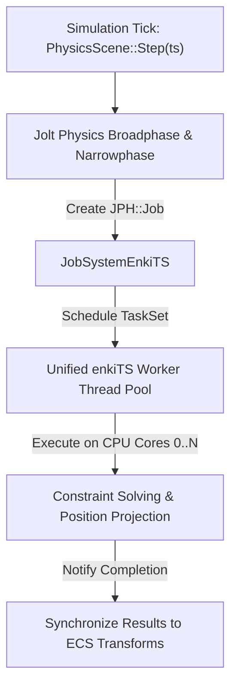

# ⚡ Physics Engine & Simulation Guide (Jolt Physics Bridge)

AxleEngine integrates [Jolt Physics](https://github.com/jrouwe/JoltPhysics) as its primary 3D physics and collision detection engine. Jolt was selected for its modern multi-threaded architecture, exceptional numerical stability, SIMD optimization, and robust constraint solvers.

---

## 🏛️ Physics Architecture & Multithreaded Scheduling

Unlike traditional physics integrations that spawn independent, uncoordinated thread pools, AxleEngine routes all Jolt Physics solver and collision detection jobs directly into the engine's unified **enkiTS** task scheduler via [`Axle::JobSystemEnkiTS`](file:///d:/WorkSpace/AxleEngine/Engine/Physics/include/Axle/JobSystemEnkiTS.hpp):



This architecture completely eliminates thread oversubscription, context-switching overhead, and lock contention between physics and other engine subsystems.

---

## 🪨 Rigid Body Dynamics (`RigidBody3D`)

Rigid bodies represent physical objects participating in forces, gravity, and collisions.

### Motion Types
1. **`BodyMotionType::Static`**:
   * Mass is mathematically infinite ($0.0$).
   * Never moves in response to collisions or forces.
   * Ideal for ground terrain, buildings, road ramps, and static environment obstacles.
2. **`BodyMotionType::Kinematic`**:
   * Velocity is explicitly driven by scripts or animations.
   * Unaffected by external forces or gravity, but exerts full physical push impulses on dynamic bodies it touches.
   * Ideal for moving elevators, sliding doors, and mechanical pistons.
3. **`BodyMotionType::Dynamic`**:
   * Fully simulated by Jolt's Newtonian integrator.
   * Responds to gravity, linear forces, rotational torques, and contact impulses.
   * Configurable linear and angular damping to simulate air resistance.

```cpp
auto entity = scene->CreateEntity("DynamicCrate");
auto& rb = entity.AddComponent<Axle::RigidBody3D>();
rb.MotionType = Axle::BodyMotionType::Dynamic;
rb.Mass = 45.0f;
rb.LinearDamping = 0.05f;
rb.AngularDamping = 0.05f;
```

---

## 📐 Collision Geometries (`CollisionShape3D`)

AxleEngine decouples geometric shapes from dynamics, allowing any shape to be paired with any motion type:

| Shape Type | Parameters | Best Suited For |
| :--- | :--- | :--- |
| **`Box`** | `HalfExtent` ($x, y, z$) | Crates, walls, rectangular vehicle chassis, platforms. |
| **`Sphere`** | `Radius` | Balls, projectiles, smooth debris. (Fastest collision query). |
| **`Capsule`** | `Radius`, `HalfHeight` | Character controllers, humanoid limbs. Eliminates snagging on floor edges. |
| **`Cylinder`** | `Radius`, `HalfHeight` | Barrels, columns, wheel approximations. |
| **`ConvexHull`** | Vertex array | Arbitrary dynamic irregular convex meshes (e.g., rocks, custom debris). |
| **`MeshShape`** | Triangle list | Complex static terrain and race track surfaces (Static only). |

### Surface Properties
* **`Friction`**: Coulomb friction coefficient ($0.0$ to $1.0+$). Governs grip between touching surfaces.
* **`Restitution`**: Coefficient of restitution ($0.0$ = completely inelastic, $1.0$ = perfectly elastic bounce).
* **`IsTrigger`**: When `true`, physical penetration is allowed while contact events are dispatched (ideal for pickup zones, checkpoints, and sensor volumes).

---

## 🎯 Raycasting & Anti-Clipping Queries

AxleEngine provides fast multi-threaded raycasting through `Axle::PhysicsScene`:

```cpp
Axle::RayCastHit hit;
glm::vec3 rayOrigin = cameraPos;
glm::vec3 rayDirection = cameraForward * 100.0f;

if (physicsScene->RayCast(rayOrigin, rayDirection, hit)) {
    glm::vec3 hitPoint = hit.Position;
    glm::vec3 surfaceNormal = hit.Normal;
    Axle::BodyID hitBody = hit.BodyID;
    float hitDistance = hit.Fraction * 100.0f;
}
```

### Camera Spring-Arm Anti-Clipping
The dynamic third-person chase camera (`VehicleChaseCamera.hpp`) casts a spherical probe from the vehicle anchor toward the desired camera position:
* If the probe hits a static wall or obstacle, the distance is clamped immediately before the obstruction, preventing the camera from clipping inside walls or terrain.

---

## 🏎️ Vehicle Physics Integration (High-Level Gameplay Toolkit)

The vehicle module in [`Engine/Vehicle`](file:///d:/WorkSpace/AxleEngine/Engine/Vehicle) leverages Jolt's specialized `VehicleConstraint`:

$$F_{\text{suspension}} = -k (\Delta x) - c (\dot{x})$$

* **$k$ (Spring Frequency)**: Controls suspension stiffness (typically $1.5\text{ Hz}$ for street cars, $3.0\text{ Hz}$ for formula cars).
* **$c$ (Damping Ratio)**: Controls oscillation dissipation ($0.5$ to $0.8$ for critical damping).
* **Ackermann Steering Geometry**: Angles the inner wheel steeper than the outer wheel during turns to match the vehicle's turning radius:
  $$\delta_{\text{inner}} = \arctan\left(\frac{L}{R - W/2}\right), \quad \delta_{\text{outer}} = \arctan\left(\frac{L}{R + W/2}\right)$$
* **Tire Slip & Traction**: Longitudinal slip ($\kappa$) and lateral slip angle ($\alpha$) are evaluated against friction curves to calculate acceleration traction, braking grip, and drift breakaway.
