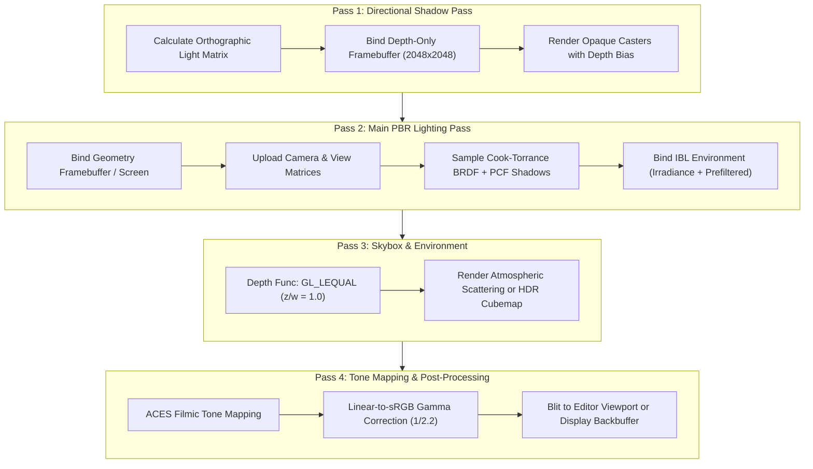
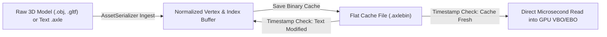

# 🎨 Rendering Architecture & Graphics Pipeline

AxleEngine features a high-performance **PBR (Physically Based Rendering) Forward+ Pipeline** built strictly on **OpenGL 4.5 Core Profile**. The rendering subsystem is completely decoupled from the Editor and Scene, ensuring identical visual fidelity in both the WYSIWYG Editor and the standalone game runtime.

---

## 🏛️ Pipeline Overview & Multi-Pass Execution

All rendering operations for a scene are driven by [`Axle::SceneRenderer`](file:///d:/WorkSpace/AxleEngine/Engine/Scene/include/Axle/SceneRenderer.hpp). Every frame traverses four distinct rendering passes:



---

## ☀️ Real-Time Soft Shadows (Vogel Spiral & Hardware PCF)

AxleEngine utilizes a 16-tap **Vogel Spiral / Poisson Disk** soft shadow sampling technique coupled with hardware bilinear depth comparisons:

1. **Hardware Comparison Mode**:
   Depth textures are configured with:
   ```cpp
   glTexParameteri(GL_TEXTURE_2D, GL_TEXTURE_COMPARE_MODE, GL_COMPARE_REF_TO_TEXTURE);
   glTexParameteri(GL_TEXTURE_2D, GL_TEXTURE_COMPARE_FUNC, GL_LEQUAL);
   ```
   This triggers hardware-accelerated 2x2 bilinear percentage-closer filtering directly on GPU texture units during sampling (`sampler2DShadow`).
2. **16-Tap Vogel Spiral Sampling**:
   Instead of a rigid grid (which causes obvious diagonal banding and staircase artifacts), 16 samples are distributed in a golden-ratio spiral:
   $$\theta_i = i \times 2.399963 \text{ rad}, \quad r_i = \sqrt{\frac{i + 0.5}{16}}$$
   Samples are jittered using interleaved spatial gradient noise per screen pixel to produce smooth, filmic shadow penumbras.
3. **Slope-Scaled Normal Bias**:
   Shadow acne and light leaking on steep surfaces are eliminated using slope-scaled normal offset pushing:
   $$\text{Bias} = \max(\text{ShadowBias} \times (1.0 - \mathbf{N} \cdot \mathbf{L}), \; \text{ShadowBiasMin})$$

---

## 💎 Physically Based Rendering (PBR) Shading Model

Surfaces are shaded using the industry-standard **Cook-Torrance Microfacet Specular BRDF**:

$$f_r = k_d f_{\text{Lambert}} + k_s \frac{D \cdot F \cdot G}{4 (\mathbf{N} \cdot \mathbf{V})(\mathbf{N} \cdot \mathbf{L})}$$

### 1. Normal Distribution Function ($D$)
Uses the **Trowbridge-Reitz GGX** formulation:
$$D_{\text{GGX}}(\mathbf{N}, \mathbf{H}, \alpha) = \frac{\alpha^2}{\pi ((\mathbf{N} \cdot \mathbf{H})^2 (\alpha^2 - 1) + 1)^2}$$
where roughness $\alpha = \text{Roughness}^2$.

### 2. Geometric Shadowing / Masking ($G$)
Uses the **Smith-Schlick GGX** formulation with separable view and light shadowing terms:
$$G(\mathbf{N}, \mathbf{V}, \mathbf{L}, k) = G_1(\mathbf{N}, \mathbf{V}, k) \cdot G_1(\mathbf{N}, \mathbf{L}, k)$$
$$G_1(\mathbf{N}, \mathbf{X}, k) = \frac{\mathbf{N} \cdot \mathbf{X}}{(\mathbf{N} \cdot \mathbf{X})(1 - k) + k}, \quad k = \frac{(\text{Roughness} + 1)^2}{8}$$

### 3. Fresnel Reflectance ($F$)
Uses the **Fresnel-Schlick** approximation:
$$F(\mathbf{V}, \mathbf{H}, F_0) = F_0 + (1 - F_0)(1 - (\mathbf{V} \cdot \mathbf{H}))^5$$
For dielectrics (plastic, rubber, wood), base reflectance is fixed at $F_0 = 0.04$. For metals (chrome, gold, car paint), $F_0$ is linearly interpolated by metallic factor:
$$F_0 = \text{mix}(\text{vec3}(0.04), \; \text{Albedo}, \; \text{Metallic})$$

---

## 🌌 Atmospheric Skybox & Image-Based Lighting (IBL)

AxleEngine supports two distinct environmental skybox pipelines:
1. **Procedural Atmospheric Scattering**:
   * Analytical Rayleigh and Mie atmospheric scattering equations evaluated in real time based on Sun elevation and azimuth.
   * Produces realistic day-night cycles: golden sunrise/sunset horizon warming, sharp sun disk with anti-aliasing corona, and twilight star fields.
2. **HDR Cubemaps & IBL (Image-Based Lighting)**:
   * Loads high-dynamic-range panoramic images (`.hdr`, `.exr`) and projects them into seamless 6-face cubemaps.
   * **Diffuse Irradiance Map**: Pre-computed hemisphere convolution for realistic ambient indirect bounce lighting.
   * **Pre-filtered Specular Map**: Convolved across mipmap levels for roughness-dependent reflections.
   * **2D BRDF LUT**: Fast $256 \times 256$ lookup texture storing Fresnel scale and bias.

---

## ⚡ Binary Mesh Cache Architecture (`.axlebin`)

Parsing human-readable 3D formats (such as `.obj` or `.gltf`) at runtime wastes significant CPU cycles parsing text floats and reconstructing index buffers.



* **Flat Binary Structure**:
  * Magic Header (`AXBM`) + Version
  * Vertex Count + Raw Stride Float Array
  * Index Count + Raw 32-bit Uint Array
  * Pre-computed AABB Bounding Box (`Min`, `Max`, `Size`)
* **Instant Load Times**: Reading an `.axlebin` directly populates host memory and transfers to OpenGL `glBufferData` in **under 1 millisecond**, completely eliminating scene loading hitches.

---

## 🎬 ACES Filmic Tone Mapping & Gamma Correction

PBR lighting accumulates high radiant intensity values ($> 1.0$) that cannot be natively displayed on standard sRGB monitors. AxleEngine applies the **Narkowicz ACES Filmic Tone Mapping** curve:

$$f(x) = \frac{x(2.51x + 0.03)}{x(2.43x + 0.59) + 0.14}$$

Followed by linear-to-sRGB display gamma conversion:
$$\text{Color}_{\text{sRGB}} = \text{Color}_{\text{Linear}}^{1 / 2.2}$$
