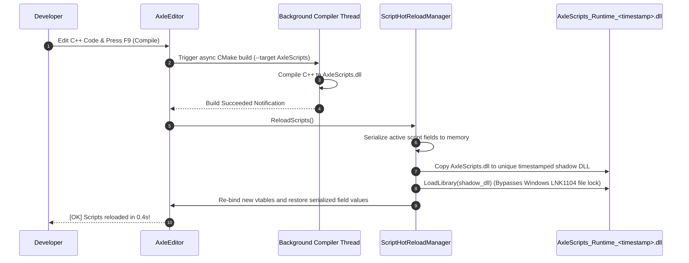

# ⚙️ C++ Native Scripting & Live Hot-Reload Guide

AxleEngine adopts a high-performance **Hybrid ECS / C++ Native Scripting Architecture**. By writing gameplay code directly in native C++20, your game achieves zero language-bridge overhead, direct SIMD vectorization, and seamless integration with Jolt Physics and EnTT ECS—all while maintaining the ergonomic component-attachment workflows of Unity and Unreal Engine.

---

## 🏛️ Scripting Architecture Overview

```plaintext
┌────────────────────────────────────────────────────────────────────────────────────────┐
│                              AXLE ENGINE SCRIPTING STACK                               │
├───────────────────────────────────┬────────────────────────────────────────────────────┤
│    LAYER A: MACHINE CONTROLLERS   │            LAYER B: MECHANICAL SYSTEMS             │
│      (OOP - ScriptableEntity)     │            (DOD - Pure EnTT Component)             │
├───────────────────────────────────┼────────────────────────────────────────────────────┤
│ • Low entity count (1 - 50)       │ • Massive bulk entity count (100 - 50,000 parts)   │
│ • Vehicles, Player Camera, Turrets│ • Mechanical Hinges, Pistons, Rotors, Debris       │
│ • Intuitive OnCreate / OnUpdate   │ • Batch memory iteration via registry.view().each()│
│ • Unity-like Component Attachment │ • 100% Cache-friendly, Zero vtable, Maximum SIMD   │
└───────────────────────────────────┴────────────────────────────────────────────────────┘
```

User scripts reside in `Editor/assets/scripts/` and compile into a standalone dynamic shared library: **`AxleScripts.dll`**.

---

## 📜 The `ScriptableEntity` Base Class

Every gameplay script inherits from `Axle::ScriptableEntity` ([`Engine/Scene/include/Axle/ScriptableEntity.hpp`](file:///d:/WorkSpace/AxleEngine/Engine/Scene/include/Axle/ScriptableEntity.hpp)).

### Standard Lifecycle Hooks
```cpp
#pragma once
#include <Axle/ScriptableEntity.hpp>
#include <Axle/ScriptRegistry.hpp>
#include <Axle/Input/Input.hpp>

class DroneController : public Axle::ScriptableEntity {
public:
    // 1. Called once when the entity is instantiated in Play Mode
    void OnCreate() override {
        // Cache child components or entity references for O(1) runtime access
        m_Propeller = FindChildByTag("Propeller");
    }

    // 2. Called every frame during Play Mode simulation
    void OnUpdate(Axle::Timestep ts) override {
        if (Axle::Input::IsKeyPressed(Axle::KeyCode::Space)) {
            // Apply upward force
            if (HasComponent<Axle::RigidBody3D>()) {
                // Manipulate physics
            }
        }
    }

    // 3. Optional: Called during the ImGui viewport rendering pass
    void OnImGuiRender() override {
        // Render custom floating HUDs or debug overlays
    }

    // 4. Called when the simulation stops or entity is destroyed
    void OnDestroy() override {
        // Cleanup runtime state
    }

private:
    Axle::Entity m_Propeller;
};
```

---

## 🔍 Static Reflection via `AXLE_SCRIPT_FIELDS`

AxleEngine includes a lightweight, macro-driven static reflection system that automatically surfaces class variables as interactive controls in the Editor Inspector:

```cpp
class DroneController : public Axle::ScriptableEntity {
public:
    // Expose tunable properties
    float FlightSpeed = 15.0f;
    int BatteryLevel = 100;
    bool TurboMode = false;
    glm::vec3 HoverOffset = { 0.0f, 2.5f, 0.0f };
    std::string CallSign = "Valkyrie-1";
    Axle::UUID TargetBeacon = 0;

    // Macro reflection block (MUST be declared under 'public:')
    AXLE_SCRIPT_FIELDS(DroneController,
        AXLE_FIELD(FlightSpeed, 1.0f, 50.0f, "Maximum flight speed in m/s"),
        AXLE_FIELD(BatteryLevel, 0, 100, "Remaining battery percentage"),
        AXLE_FIELD(TurboMode, "Enable afterburner thrusters"),
        AXLE_FIELD(HoverOffset, "Target hovering height offset"),
        AXLE_FIELD(CallSign, "Radio handle for the drone"),
        AXLE_FIELD_ENTITY(TargetBeacon, "Reference to leader beacon entity")
    )
};

// Register script with the central registry
AXLE_REGISTER_SCRIPT(DroneController);
```

### Supported Reflected Types:
1. `AXLE_FIELD(var, min, max, tooltip)`: Floats and Integers with interactive drag sliders and bounding limits.
2. `AXLE_FIELD(var, tooltip)`: Bools (checkboxes), `glm::vec3` (3-axis colored sliders), and `std::string` (text inputs).
3. `AXLE_FIELD_ENTITY(var, tooltip)`: 64-bit Entity UUIDs. Renders an interactive Entity Reference slot with drag-and-drop support from the Scene Hierarchy tree.

> [!IMPORTANT]
> The `AXLE_SCRIPT_FIELDS` macro **must always be placed under `public:` visibility**. AxleEngine's C++20 concept requires public access to `RegisterFields()`:
> ```cpp
> template<typename T>
> concept HasScriptFields = requires(ScriptFieldRegistry& reg) { T::RegisterFields(reg); };
> ```

---

## 🔄 Dynamic In-Editor Script Hot-Reloading (`F9`)

AxleEngine allows you to modify C++ code and see changes in the running editor without restarting:



---

## 🛠️ Step-by-Step: Creating a New Script

### Step 1: Create the Script Template
In the **Content Browser** panel, navigate to your scripts directory (e.g., `assets/scripts/`), right-click blank space, and select **`Create -> C++ Script (.hpp)`**. Name your script `TurretController.hpp`.

### Step 2: Implement Logic & Reflection
Open the generated file in your preferred IDE (Visual Studio, VS Code, CLion):
```cpp
#pragma once
#include <Axle/ScriptableEntity.hpp>
#include <Axle/ScriptRegistry.hpp>
#include <Axle/Input/Input.hpp>

class TurretController : public Axle::ScriptableEntity {
public:
    float RotationSpeed = 90.0f;
    float MaxPitch = 45.0f;

    void OnUpdate(Axle::Timestep ts) override {
        if (Axle::Input::IsKeyPressed(Axle::KeyCode::Left)) {
            auto& tc = GetComponent<Axle::TransformComponent>();
            tc.Rotation = glm::angleAxis(glm::radians(RotationSpeed * ts.GetSeconds()), glm::vec3(0, 1, 0)) * tc.Rotation;
        }
    }

    AXLE_SCRIPT_FIELDS(TurretController,
        AXLE_FIELD(RotationSpeed, 10.0f, 360.0f, "Turret yaw rotation speed in degrees/sec"),
        AXLE_FIELD(MaxPitch, 0.0f, 85.0f, "Maximum barrel elevation pitch")
    )
};

AXLE_REGISTER_SCRIPT(TurretController);
```

### Step 3: Compile and Attach
1. In AxleEditor, press **`F9`** or click the **`[🔨 Compile]`** toolbar button.
2. Select any entity in the **Scene Hierarchy**.
3. In the **Properties** panel, click **`+ Add Component -> Scripts -> TurretController`** (or drag `TurretController.hpp` directly from the Content Browser onto the entity in the 3D Viewport).
4. Tune `RotationSpeed` via the slider in the Inspector.
5. Press **`F5` (Play)** to test your script live!
