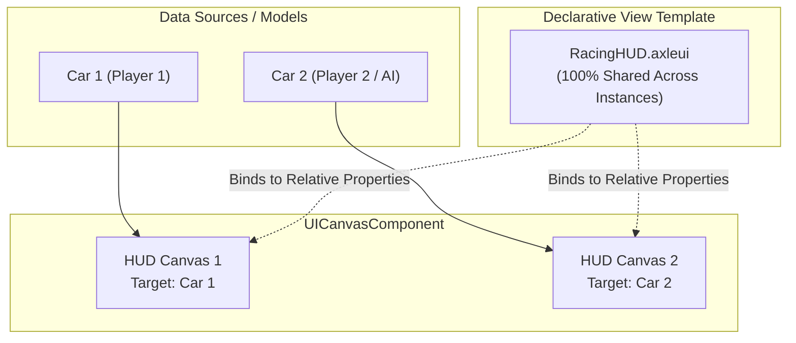

# UI Canvas Architecture & Scoped Data Binding Specification

**Document Version:** 1.0.0  
**Target Subsystem:** `Engine/UI`, `Engine/Scene`, `Editor`  
**Related Documents:** `Phase34_QML_Canvas2D_Guide.md`, `ARCHITECTURE.md`, `ECS_AND_SCENE_GRAPH.md`

---

## 1. Executive Summary & Problem Analysis

AxleEngine's 2D Canvas UI subsystem provides hardware-accelerated declarative interface rendering via `.axleui` markup and `UICanvasComponent`. While the rendering pipeline operates with high visual fidelity and 180+ FPS throughput, user testing and architectural analysis have revealed four key areas requiring enhancement:

1. **Global Data Collision (The Multi-Instance Problem):**
   - `UIDataContext` is currently scoped at the global `Scene` level.
   - Gameplay scripts publish metrics using fixed global keys (e.g., `"Vehicle.SpeedKmh"`).
   - If multiple vehicles or entities exist in a scene (e.g., Player vs. AI racers, Split-Screen, or Multiplayer), scripts overwrite each other's telemetry, causing UI flicker and state corruption.
   - Hardcoding entity IDs into `.axleui` files destroys UI reusability across instances.

2. **Scene Hierarchy Visual Pollution:**
   - Expanding `UICanvas` on the Scene Hierarchy expands the internal DOM tree (30+ micro-nodes: `Row`, `Column`, `Rectangle`, `Text`, etc.).
   - This clutters the 3D spatial hierarchy and buries world objects (`Car`, `Track`, `Lights`, `Camera`).

3. **Manual Asset Path Input:**
   - In the Inspector, `Asset Path` is currently a raw `ImGui::InputText`. Users must memorize or manually type file paths rather than selecting from project assets.

4. **Component Registry Discovery:**
   - In `EntityInspector.cpp`, the category list omits `"User Interface"`. As a result, users cannot discover `UICanvasComponent` in the Add Component menu unless they manually type in the search bar.

---

## 2. Core Architectural Design



---

### 2.1. Scoped Data Context & Target Entity (MVVM Pattern)

To allow unlimited entity instances without data collisions while reusing the exact same `.axleui` markup, AxleEngine adopts a **Two-Tier Scoped Binding Architecture**:

1. **Relative Property Paths in `.axleui`:**
   Template files omit global namespace prefixes (`Vehicle.*`) and bind directly to relative properties of the target model:
   ```qml
   Text {
       id: "speed_readout"
       text: "{SpeedKmh}"
       fontSize: 36
   }
   RadialGauge {
       id: "tachometer"
       value: "{RPMNormalized}"
       color: "{IsRedline ? #FF1E42FF : #00F5D4FF}"
   }
   ```

2. **`TargetEntity` Specification on `UICanvasComponent`:**
   `UICanvasComponent` gains explicit target binding:
   ```cpp
   struct UICanvasComponent {
       std::string AssetPath;
       UUID TargetEntityID = 0; // 0 = Auto / Primary Player Vehicle
       int32_t SortOrder = 0;
       bool Visible = true;
       std::shared_ptr<UIDocument> Document = nullptr;

       void SetTargetEntity(Entity entity);
       Entity GetTargetEntity(Scene* scene) const;
   };
   ```

3. **Hierarchical Binding Resolution (`UIDocument::EvaluateBindings`):**
   When resolving a property `{SpeedKmh}`:
   - **Tier 1 (Local Scoped Context):** The engine resolves the target entity's components (e.g., `VehiclePhysicsComponent` or associated `NativeScriptComponent`). If found, it reads the local value.
   - **Tier 2 (Global Scene Context Fallback):** If not found in the target entity, it falls back to the Scene's global `UIDataContext` for truly global metrics (`Engine.FPS`, `MatchTime`, `ServerPing`).

4. **Zero-Overhead Runtime Vehicle Switching:**
   When a player enters a different vehicle during gameplay:
   ```cpp
   // Immediate single-pointer redirect (sub-microsecond execution, zero allocation)
   hudCanvas.SetTargetEntity(newVehicleEntity);
   ```
   No file re-parsing, texture reallocation, or UI recreation occurs. All gauges, needles, and readouts seamlessly bind to the new vehicle on the subsequent frame.

5. **Inspector Binding Modes:**
   - **`Auto Primary Vehicle` (Default):** Dynamically tracks `scene->GetPrimaryRuntimeVehicle()`.
   - **`Explicit Entity`:** Points to a specific UUID (ideal for Split-Screen Player 2 or Spectator Cameras).

---

### 2.2. Scene Hierarchy UX & DOM Decoupling

Following the architectural standards of Unreal Engine (Widget Blueprints) and Unity (UI Toolkit Canvas):

- **Single-Row Representation:** The Scene Hierarchy treats `UICanvas` as an atomic scene entity, identical to `Directional Light` or `Main Camera`.
- **DOM Suppression:** Internal layout micro-nodes (`Row`, `Column`, `Rectangle`, `Text`) are no longer expanded inside the 3D spatial hierarchy.
- **Dedicated Editing Surfaces:** Fine-grained widget inspection, layout tweaking, and QML editing are routed to:
  1. The **UI Canvas Designer** panel (`.axleui` visual workspace with live mock telemetry).
  2. The **Inspector Panel**, which displays the canvas document summary, reference resolution, and document dirty status.

---

### 2.3. Searchable Asset Picker for `AssetPath`

The raw string input field in `EntityInspector.cpp` is replaced by an interactive **Searchable Asset Picker**:

```
┌───────────────────────────────────────────────────────────────┐
│ UI Canvas Component                                           │
├───────────────────────────────────────────────────────────────┤
│ Asset Path:    [ 📄 assets/ui/RacingHUD.axleui     ▼ ] [ 🔍 ] │
│                                                               │
│   ┌── SEARCHABLE POPUP (Opens on Click) ───────────────────┐  │
│   │ 🔍 Filter .axleui: [ racing                           ]│  │
│   ├────────────────────────────────────────────────────────┤  │
│   │  [ None / Clear ]                                      │  │
│   │  📄 RacingHUD.axleui      (assets/ui/RacingHUD.axleui) │  │
│   │  📄 PauseMenu.axleui      (assets/ui/PauseMenu.axleui) │  │
│   └────────────────────────────────────────────────────────┘  │
│                                                               │
│ Target Entity: [ 🎯 Primary Vehicle (Auto)         ▼ ]        │
│ Sort Order:    [ 0 ]                                          │
│ [X] Visible                                                   │
└───────────────────────────────────────────────────────────────┘
```

- **Project Scanning:** Discovers all `.axleui` files across `assets/` and `Editor/assets/`.
- **Interactive Search:** Real-time character filtering.
- **Automatic Loading:** Selecting an item immediately updates `AssetPath` and invokes `uic.Document->LoadFromFile()`.
- **Drag & Drop Retained:** Dragging an `.axleui` item from the Content Browser into the field remains fully functional.

---

### 2.4. Component Registry Category Exposure

In [`Engine/UI/src/EntityInspector.cpp`](file:///d:/WorkSpace/AxleEngine/Engine/UI/src/EntityInspector.cpp#L2442), the hardcoded list of root categories is updated:

```cpp
// Before:
const std::vector<std::string> categories = { "Rendering", "Physics", "Scripts", "Audio/VFX" };

// After:
const std::vector<std::string> categories = { "Rendering", "Physics", "Scripts", "Audio/VFX", "User Interface" };
```

This immediately surfaces:
`Add Component -> User Interface -> UICanvasComponent`

---

## 3. Technical Implementation Roadmap

### Phase 1: Hierarchy Cleanliness & Add Component Registration
1. Add `"User Interface"` to category vector in `EntityInspector.cpp`.
2. Remove auto-expansion of internal UI DOM nodes in `SceneHierarchyPanel.cpp`.
3. Verify clean, single-row display of `UICanvas` in the Scene Hierarchy.

### Phase 2: Searchable Asset Picker for `AssetPath`
1. Implement directory scanning utility for `.axleui` files.
2. Build an `ImGui::BeginCombo` / popup search filter inside `EntityInspector.cpp`.
3. Connect selection callback to `uic.Document->LoadFromFile()`.

### Phase 3: Scoped Data Target & Runtime Switch Engine API
1. Add `UUID TargetEntityID = 0;` and helper methods to `UICanvasComponent` in `Components.hpp`.
2. Enhance `UIDocument::EvaluateBindings` in `UIDocument.cpp` to resolve target entity properties before scene globals.
3. Expose `Target Entity` dropdown selector in `EntityInspector.cpp` (Auto Primary vs. Explicit Entity).
4. Update `EditorLayer.cpp` Edit-Mode mock telemetry injection to support scoped targets.

### Phase 4: Automated Verification & Unit Test Suite
1. Run automated build with `cmake --build build --config Release`.
2. Execute full regression test suite: `AxleTests.exe --summary`.
3. Verify zero memory leaks, zero command allocator degradation, and 100% test pass rate.

---

## 4. API Reference & Code Examples

### 4.1. Updating Scoped Telemetry from Gameplay C++
```cpp
// In RacingHUD.hpp (attached to Car or Canvas):
void RacingHUD::OnUpdate(Axle::Timestep ts) {
    auto targetEntity = GetEntity(); // or resolve from UICanvasComponent::GetTargetEntity()

    if (auto* pv = GetVehiclePhysics()) {
        auto& localCtx = targetEntity.GetLocalUIDataContext();
        localCtx.Set("SpeedKmh", static_cast<int32_t>(std::round(pv->GetSpeedKmh())));
        localCtx.Set("RPMNormalized", pv->GetRPMNormalized());
        localCtx.Set("GearString", pv->GetGearString());
        localCtx.Set("IsRedline", pv->GetRPM() >= pv->GetRedlineRPM());
    }
}
```

### 4.2. Runtime Vehicle Switch in Gameplay
```cpp
void PlayerController::OnEnterVehicle(Axle::Entity enteredVehicle) {
    if (auto hud = m_Scene->FindEntityByName("UICanvas")) {
        auto& uic = hud.GetComponent<Axle::UICanvasComponent>();
        uic.SetTargetEntity(enteredVehicle);
        uic.Visible = true;
    }
}
```

