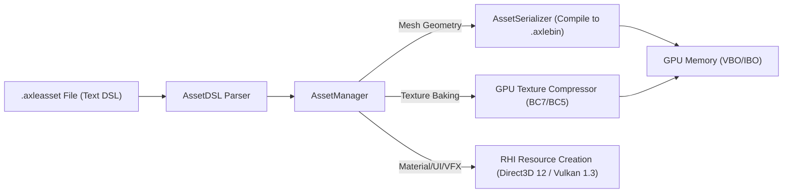

# Unified `.axleasset` Specification & 3-Tier Architecture

## 1. Overview & 3-Tier Engine File System

AxleEngine standardizes its asset architecture into an explicit, clean 3-tier hierarchy:

```
AxleEngine Project
├── Tier 1: World & Level (.axlescene)
│   └── Scene / World State: Complete entity tree in entt::registry, transforms, lighting, environment, cameras.
│
├── Tier 2: Entity Prefabs & Assemblies (.axle)
│   └── Prefabs / Mechanical Assemblies: Car chassis, engine subparts, wheel hierarchies, multi-part props.
│
└── Tier 3: Unified Component Resources (.axleasset)  <-- THE UNIFIED DECLARATIVE ASSET FORMAT
    ├── Material { ... }            // PBR Surface Materials (Car Paint, Rubber, Glass, Chrome)
    ├── Canvas { ... }              // 2D Declarative UI (HUD, Pause Menu, Dialogs)
    ├── ParticleEmitter { ... }     // Visual Effects (VFX: Smoke, Flame, Sparks, Dust)
    ├── Mesh { ... }                // 3D Geometry (Auto-baked to .axlebin cache for GPU)
    ├── Texture { ... }             // GPU Texture Descriptor (sRGB/Linear, Anisotropic 16x, BC7, Skybox HDR)
    ├── Terrain { ... }             // Ground & Track Maps (Heightmap, Splatmap, Layers)
    └── PhysicsMaterial { ... }     // Surface Friction & Restitution
```

---

## 2. EnTT ECS Integration (Pure Flyweight Pattern)

In AxleEngine's EnTT ECS architecture:
- **Entities** remain lightweight 32-bit integer IDs.
- **Components** store only runtime states and an `AssetHandle` (UUID) or path referencing the `.axleasset`:

```cpp
struct MaterialComponent {
    UUID MaterialHandle = 0; // AssetHandle (0 = inline / custom / unlinked)
    std::shared_ptr<RHI::RHIMaterial> RHIMaterialAsset = nullptr; // Shared GPU asset pointer
    // Local overrides active only when unlinked
};

struct UICanvasComponent {
    std::string AssetPath; // Points to "RacingHUD.axleasset"
    std::shared_ptr<UIDocument> Document;
};

struct ParticleEmitterComponent {
    std::string AssetPath; // Points to "ExhaustSmoke.axleasset"
    ParticleEmitterConfig Config;
};

struct MeshInstance3D {
    std::string AssetPath; // Points to "SportsCar_Chassis.axleasset"
    std::shared_ptr<RHI::RHIMesh> RHIMeshAsset = nullptr;
};
```

This guarantees:
1. **Zero Data Duplication:** 100 car entities can share a single `CarPaint.axleasset` in GPU memory.
2. **Instant Hot-Reloading:** Editing a `.axleasset` file updates all 100 entities simultaneously without touching `entt::registry`.
3. **Optional Inlining:** Individual entities can still customize parameters locally when unlinked (`MaterialHandle == 0`).

---

## 3. Unified DSL Grammar (`AssetDSL`)

All `.axleasset` files share 100% identical syntax:
- **Root Block:** Declares asset type (`Material`, `Canvas`, `ParticleEmitter`, `Mesh`, `Texture`, `Terrain`, `PhysicsMaterial`).
- **Properties:** `property: value`
- **Colors:** Hex string (`"#RRGGBB"` / `"#RRGGBBAA"`) or float array (`[r, g, b, a]`).
- **Vectors / Ranges:** `[x, y]` or `[min, max]`.
- **Comments:** `// single-line` and `/* multi-line */`.

### Declarative Schemas

#### A. Material (`CarPaint.axleasset`)
```c
Material {
    name: "SilverCarPaint"
    shader: "ForwardPBR"

    // Base Color & Texture
    albedoColor: "#EAEBF5"
    albedoMap: "textures/car_d.png"

    // Surface Microfacet
    metallic: 0.92
    roughness: 0.14
    normalMap: "textures/car_n.png"
    normalStrength: 1.0

    // Emission & UV Scaling
    emissionColor: "#000000"
    emissionIntensity: 0.0
    uvScale: [1.0, 1.0]
}
```

#### B. 2D UI (`RacingHUD.axleasset`)
```c
Canvas {
    name: "RacingHUD"
    referenceResolution: [1920, 1080]

    Rectangle {
        id: "speedometer_panel"
        anchor: "BottomRight"
        margin: [0, 0, 40, 40]
        size: [300, 120]
        color: "#080C16CC"
        cornerRadius: 16
        borderWidth: 1.0
        borderColor: "#38BDF844"

        Text {
            id: "speed_value"
            text: "{Vehicle.Speed}"
            fontSize: 48
            color: "#38BDF8"
        }
    }
}
```

#### C. VFX (`ExhaustFlame.axleasset`)
```c
ParticleEmitter {
    name: "ExhaustFlame"
    maxParticles: 500
    emissionRate: 80.0
    lifetime: [0.15, 0.40]
    speed: [4.0, 10.0]

    shape: "Cone"
    coneAngle: 0.35
    radius: 0.05

    startColor: "#FF4500"
    endColor: "#33000000"
    texture: "textures/particles/flame.png"
    blendMode: "Additive"
}
```

#### D. Mesh Geometry (`SportsCar_Chassis.axleasset`)
```c
Mesh {
    name: "SportsCar_Chassis"
    bounds: [1.90, 0.91, 4.40]
    material: "assets/materials/GoldMetallic.axleasset"

    // Auto-compiled to cache/SportsCar_Chassis.axlebin for instantaneous GPU streaming
    vertices: [
        [-0.9500, 0.0955, -1.7890],
        [-0.7551, 0.0955, -1.7890]
    ]
    indices: [
        [0, 1, 2], [2, 3, 0]
    ]
}
```

#### E. Terrain & Ground (`TrackSurface.axleasset`)
```c
Terrain {
    name: "MonacoGround"
    size: [1024, 1024]
    heightScale: 60.0
    heightmap: "textures/tracks/monaco_height.png"

    layers: [
        "assets/materials/AsphaltRoad.axleasset",
        "assets/materials/CurbsRedWhite.axleasset"
    ]
}
```

#### F. Physics Material (`AsphaltRoad.axleasset`)
```c
PhysicsMaterial {
    name: "AsphaltRoad"
    friction: 0.95
    restitution: 0.05
}
```

#### G. GPU Texture & Skybox HDR (`Car_Albedo.axleasset` / `SunsetSkybox.axleasset`)
```c
// 1. Surface PBR Texture Descriptor
Texture {
    name: "Car_Albedo"
    source: "textures/car_body_diffuse.png"

    // GPU Loading & Color Space
    type: "Color"              // "Color" (sRGB), "NormalMap" (Linear), "Data" (ORM / Roughness)
    filter: "Anisotropic16x"   // "Point", "Linear", "Anisotropic16x"
    wrapU: "Repeat"            // "Repeat", "Clamp", "Mirror"
    wrapV: "Repeat"

    // GPU Optimization
    generateMips: true
    maxResolution: 2048        // Automatic downscale clamp on lower-tier hardware
    compression: "BC7"         // Automatic bake to GPU compressed binary cache
}

// 2. High Dynamic Range (HDR) Environment Skybox & IBL
Texture {
    name: "SunsetSkybox"
    source: "textures/skybox/industrial_sunset.hdr"
    type: "CubemapHDR"
    exposure: 1.2
    generatePrefilter: true    // Auto-compute specular IBL cubemap mips
}
```

---

## 4. Pipeline & Caching Strategy



1. **Lightweight Assets (Material, UI, VFX, Physics):** Parsed directly into C++ structs in sub-millisecond time.
2. **Heavy Geometry (Mesh):** Automatically compiled into `.axlebin` binary cache upon save. Runtime loads directly from `.axlebin` with zero text-parsing overhead.
3. **Hybrid Texture Loading:**
   - **Direct File Mode:** Simple UI icons and test textures can directly reference `.png` / `.jpg` strings without creating a separate wrapper file.
   - **Descriptor Mode:** High-fidelity PBR textures reference a `Texture { ... }` `.axleasset` for explicit color-space (sRGB vs Linear), Anisotropic 16x filtering, BC7 compression, and HDR Skybox IBL generation.
4. **Single Clean Standard:** Pure `.axleasset` format for all component resources. Zero legacy technical debt, no dual-extension clutter; all existing assets are migrated cleanly to `.axleasset`.

