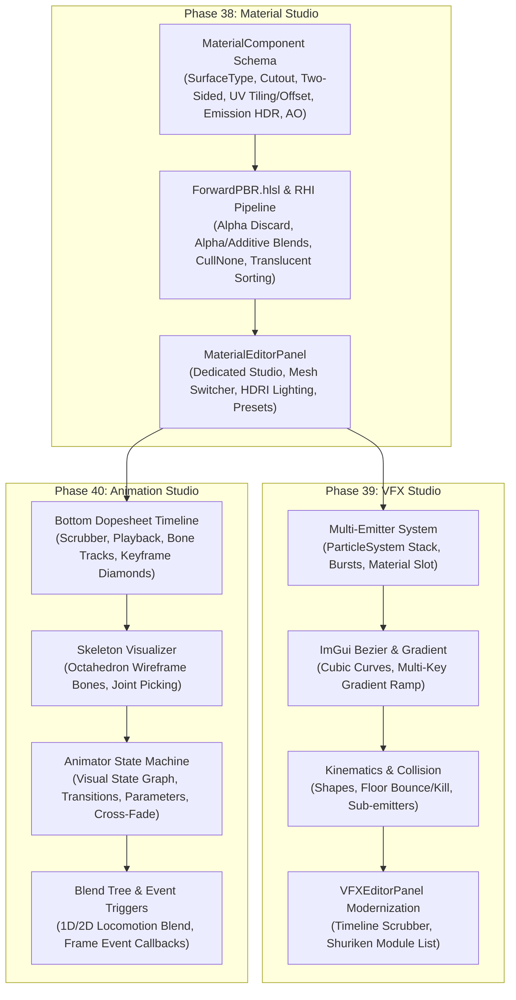

# 🎨 Visual Editor Ecosystem Architecture & Specification
**Material ➔ VFX ➔ Animation (Milestone 10)**

---

## 1. Executive Summary & Design Philosophy
AxleEngine's core runtime features multi-backend RHI (Direct3D 12 & Vulkan via NVIDIA NRI), an EnTT-powered ECS, high-performance Jolt Physics, and the unified `.axleasset` declarative DSL. However, authoring rich assets (materials, particle effects, and skeletal animations) previously relied on basic inspector inputs or lacked dedicated visual tooling.

Milestone 10 unifies the authoring workflow around a proven, highly productive hybrid model:
- **Unity's Authoring Workflow**:
  - **Material Studio**: Standard PBR inputs, Surface Options (Opaque, Cutout, Transparent, Additive), culling controls, UV tiling/offset, and live 3D turntable preview.
  - **Shuriken-style VFX Studio**: Checkbox-driven module stacks (`Emission`, `Shape`, `Velocity over Lifetime`, `Size over Lifetime`, `Color over Lifetime`, `Collision`), featuring interactive cubic Bezier curve editors and multi-key gradient color ramps.
  - **Animator State Machine**: Visual node graph (`Idle`, `Walk`, `Run`, `Jump`) with directed transitions, cross-fade durations, and parameter conditions.
- **Godot's Compact Layout**:
  - Bottom dock housing the **Dopesheet / Animation Timeline** alongside **Console** and **Content Browser**, preserving maximum 3D viewport canvas.
  - Dedicated asset editor tabs opening on double-click from the Content Browser.

---

## 2. System Dependency Architecture



---

## 3. Phase 38: Visual Material Studio & Multi-Pass Surface Pipeline

### 3.1 Data Schema & DSL Expansion
The `MaterialComponent` and `.axleasset` format are extended with first-class surface rendering properties:

```dsl
Material "CarGlassWindshield" {
    SurfaceType: "Transparent"    // Options: Opaque, Cutout, Transparent, Additive
    CullMode: "Back"              // Options: Back, Front, None (Two-Sided)
    AlphaCutoff: 0.50             // Active when SurfaceType is Cutout
    DepthWrite: false             // Typically false for Transparent & Additive
    
    UVTiling: [ 1.00, 1.00 ]
    UVOffset: [ 0.00, 0.00 ]
    
    AlbedoColor: #1A334D99
    Albedo: "textures/glass_tint.png"
    Roughness: 0.05
    Metallic: 0.10
    Normal: ""
    NormalStrength: 1.00
    
    Occlusion: "textures/glass_ao.png"
    OcclusionStrength: 1.00
    
    EmissionColor: #000000FF
    EmissionIntensity: 0.00
}
```

### 3.2 HLSL Shader & RHI Forward Pipeline
In `Engine/Resources/Shaders/ForwardPBR.hlsl`:
- **UV Transformation**:
  $$\text{uv} = \text{inUV} \times \text{u\_UVTiling} + \text{u\_UVOffset}$$
- **Alpha Cutout Discard**:
  $$\text{if } (\text{u\_SurfaceType} == \text{CUTOUT} \ \&\& \ \text{albedo.a} < \text{u\_AlphaCutoff}) \ \text{discard};$$
- **Translucency & Blending**:
  - Configure `RHIPipelineDesc::BlendDesc`:
    - `Opaque`: Blend disabled.
    - `Transparent`: Source `SRC_ALPHA`, Dest `ONE_MINUS_SRC_ALPHA`, BlendOp `ADD`.
    - `Additive`: Source `ONE`, Dest `ONE`, BlendOp `ADD`.
- **Culling**:
  - `Two-Sided`: `RHIRasterizerDesc::CullMode = None`.
- **Lighting Enhancements**:
  - Direct & Ambient lighting modulated by Ambient Occlusion: $L_{\text{ambient}} \times \text{AO}$.
  - Emission HDR scaling: $E = C_{\text{emission}} \times I_{\text{intensity}}$.
- **Translucent Sorting**:
  - In `SceneRenderer`, separate render queues: draw all `Opaque` and `Cutout` objects first (writing depth), then sort `Transparent` and `Additive` objects back-to-front by distance to camera before drawing (with depth write disabled).

### 3.3 Material Studio UI Layout
- **Access**: Double-clicking any `.axleasset` (Material) or `.axlemat` in the Content Browser opens or focuses the `MaterialEditorPanel`.
- **Viewports**:
  - Interactive turntable sphere with orbital camera controls (`RMB + drag`).
  - Primitive mesh dropdown: Sphere, Cube, Cylinder, Plane, Teapot.
  - HDRI Environment switcher: Neutral Studio, Sunny Sky, Sunset, Night.
- **Inspector Sections**:
  - `Surface Options`: Surface Type, Render Face (Culling), Alpha Cutoff slider, Depth Write checkbox.
  - `Surface Inputs`: Base Map (Albedo color + texture), Tiling/Offset sliders, Metallic/Roughness sliders + texture slots, Normal map + strength slider, Occlusion map + strength, Emission HDR color + intensity.
  - `Toolbar`: Save, Revert, and 1-Click PBR Presets (Car Paint, Gold, Chrome, Glass, Rubber, LED Taillight, Foliage Two-Sided).

---

## 4. Phase 39: Visual Particle & VFX Studio (Unity Shuriken Style)

### 4.1 Multi-Emitter System Architecture
A single `.axleasset` VFX asset now represents a `ParticleSystem` containing one or more `Emitter` stacks:

```dsl
ParticleEmitter "CampfireVFX" {
    Emitter "FlameCore" {
        Capacity: 250
        RateOverTime: 45.0
        Lifetime: [ 0.8, 1.4 ]
        Speed: [ 2.0, 3.5 ]
        Shape: "Cone"
        ConeAngle: 15.0
        ConeRadius: 0.3
        
        Material: "materials/M_FlameAdditive.axleasset"
        SizeOverLifetime: "Curve_FlameSize"
        ColorOverLifetime: "Gradient_FlameColor"
    }
    Emitter "Sparks" {
        Capacity: 100
        RateOverTime: 12.0
        Bursts: [
            { Time: 0.0, Count: 15 }
        ]
        Lifetime: [ 1.2, 2.5 ]
        Speed: [ 4.0, 7.0 ]
        Shape: "Point"
        CollisionMode: "Bounce"
        BounceRestitution: 0.6
        Material: "materials/M_SparkAdditive.axleasset"
    }
}
```

### 4.2 ImGui Custom Visual Controls
- **Bezier Curve Editor**: 4-point cubic Bezier spline with interactive control handles in ImGui. Evaluates:
  $$B(t) = (1-t)^3 P_0 + 3(1-t)^2 t P_1 + 3(1-t) t^2 P_2 + t^3 P_3, \quad t \in [0, 1]$$
- **Gradient Bar Editor**: Interactive horizontal gradient bar with top markers for Alpha and bottom markers for Color. Supports clicking to add keys, dragging to reposition, and picking RGB colors.

### 4.3 Kinematics, Collision & Sub-Emitters
- **Shapes**: Point, Sphere, Cone, Box, Circle, Mesh Surface.
- **Collision**: Raycast / floor plane tests with `Bounce` elasticity or `Kill` on contact.
- **Sub-Emitters**: Trigger sub-emitter playback on particle `Birth`, `Collision`, or `Death`.

---

## 5. Phase 40: Skeletal Animation Studio & Visual State Machine

### 5.1 Dopesheet & Timeline Scrubber (Bottom Dock)
- Positioned in the bottom dock alongside the Content Browser and Console (Godot style).
- **Controls**: Play, Pause, Step Backward/Forward, Loop toggle, FPS selector (24, 30, 60), Time/Frame scrubber.
- **Tracks**: Bone hierarchy tree (Root, Spine, Arms, Legs) with expandable sub-tracks (`Position`, `Rotation`, `Scale`).
- **Keyframes**: Diamond handles (`◆`) with box-selection, dragging, duplicate (`Ctrl+C`/`Ctrl+V`), and delete.

### 5.2 3D Skeleton Visualizer
- In the 3D Viewport, selected skinned entities render an overlay skeleton:
  - Bone meshes: Wireframe diamond octahedrons connecting joint $A$ to joint $B$.
  - Joint nodes: Color-coded spheres indicating joint hierarchy depth.
  - Interactive selection: Clicking a bone in the Viewport highlights its corresponding track in the Dopesheet.

### 5.3 Animator State Machine & Blend Trees
- **Visual Node Graph**:
  - State nodes (`Idle`, `Walk`, `Run`, `Jump_Start`, `Jump_Loop`, `Jump_Land`, `Attack`).
  - Directed transition arrows with configurable cross-fade duration (e.g. `0.25s`) and `Has Exit Time`.
  - Parameters panel (`Float Speed`, `Bool IsGrounded`, `Trigger Jump`).
- **Blend Trees**:
  - 1D Blend Tree: Smooth interpolation between `Idle`, `Walk`, `Run` based on a single `Speed` parameter without foot sliding.
  - 2D Blend Tree: Cartesian directional blending for 8-way strafing locomotion (`Forward`, `StrafeRight`).
- **Animation Events**:
  - Keyframe event markers triggering C++ script callbacks (`PlayFootstepSound`, `SpawnSlashVFX`, `EnableHitbox`).

---

## 6. Verification & Automated Test Suites
- **Step 101 (`AxleTests.exe --step101`)**: Validates Material DSL round-trip, Cutout alpha testing, Two-sided culling, and RHI blend states.
- **Step 102 (`AxleTests.exe --step102`)**: Validates Bezier curve evaluation, gradient evaluation, multi-emitter bursts, and sub-emitter triggers.
- **Step 103 (`AxleTests.exe --step103`)**: Validates Animator State Machine transitions, cross-fade weight blending, 1D/2D blend trees, and animation events.
