# Class Relationships: Current System

Reviewed: 2026-11-01. These diagrams show key relationships rather than every extracted type; see the [class index](CLASS_INDEX.md) for the wider declaration inventory.

## Notation

- `Base <|-- Derived`: inheritance.
- `Owner *-- Value`: value or exclusive ownership.
- `Holder o-- Shared`: shared resource retention.
- `A --> B`: association/reference without an ownership claim.
- `A ..> B`: API use, creation or argument dependency.
- Multiplicity describes members/containers, not guaranteed runtime population. External types may use shortened labels.

## 1. Application and products

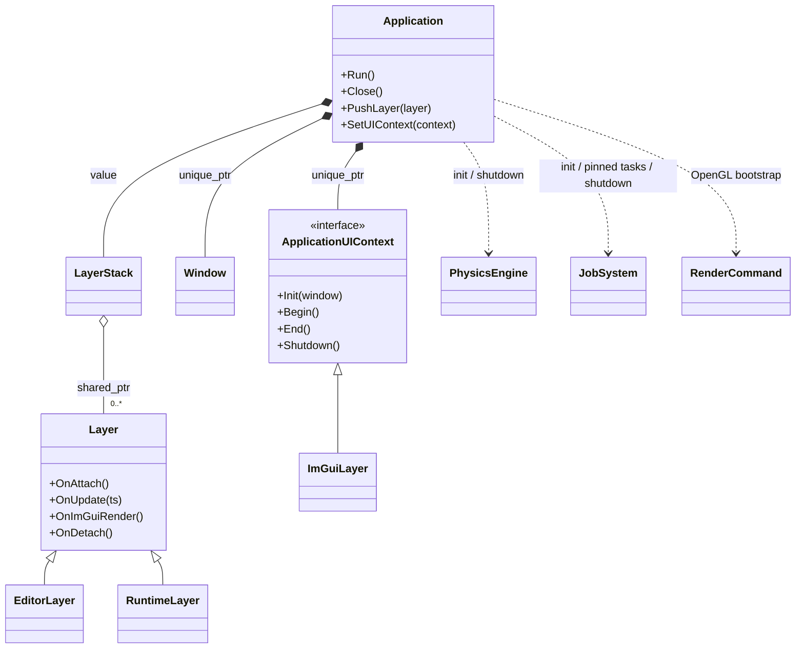

Application exclusively owns Window/UIContext and contains LayerStack; the stack retains shared layers. EditorLayer and RuntimeLayer derive from Layer, not Application.

Sources: [Engine/Core/include/Axle/Application.hpp](../../Engine/Core/include/Axle/Application.hpp), [Engine/Core/include/Axle/LayerStack.hpp](../../Engine/Core/include/Axle/LayerStack.hpp), [Engine/UI/include/Axle/ImGuiLayer.hpp](../../Engine/UI/include/Axle/ImGuiLayer.hpp).

## 2. Editor composition and contexts

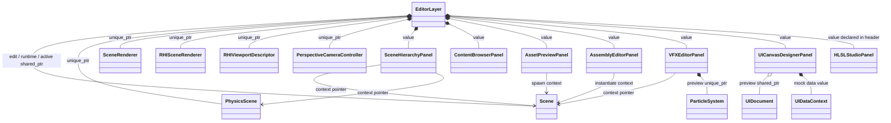

Editor owns panel values and scene/controller references. Panel context pointers observe the active scene and are updated on play/stop. Preview tools may own independent rendering resources.

Sources: [Editor/src/EditorLayer.hpp](../../Editor/src/EditorLayer.hpp), [Engine/UI/include/Axle/AssetPreviewPanel.hpp](../../Engine/UI/include/Axle/AssetPreviewPanel.hpp), [Engine/UI/include/Axle/VFXEditorPanel.hpp](../../Engine/UI/include/Axle/VFXEditorPanel.hpp).

## 3. ECS storage and entity facade

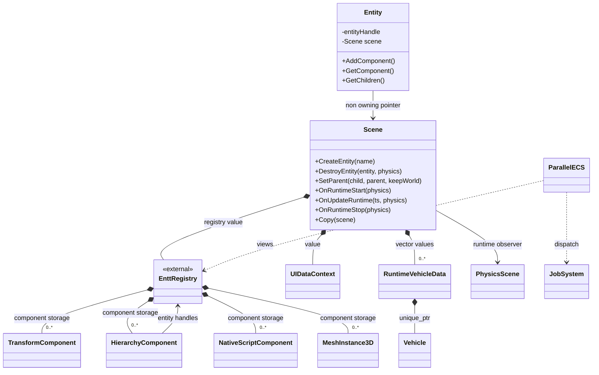

Scene owns the registry and runtime vehicle records. Entity is a non-owning facade. Hierarchy links store entity handles; they do not own another registry.

Sources: [Engine/Scene/include/Axle/Scene.hpp](../../Engine/Scene/include/Axle/Scene.hpp), [Engine/Scene/include/Axle/Entity.hpp](../../Engine/Scene/include/Axle/Entity.hpp), [Engine/Scene/include/Axle/Components.hpp](../../Engine/Scene/include/Axle/Components.hpp).

## 4. Native scripting

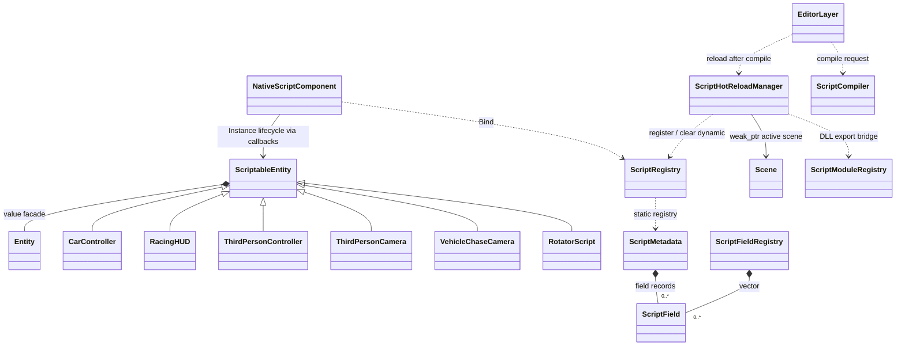

NativeScriptComponent manages instance lifecycle through callbacks despite using a raw pointer. Script metadata/registration differs between host and DLL builds. Sample projects also contain some script names shown here.

Sources: [Engine/Scene/include/Axle/ScriptableEntity.hpp](../../Engine/Scene/include/Axle/ScriptableEntity.hpp), [Engine/Scene/include/Axle/ScriptRegistry.hpp](../../Engine/Scene/include/Axle/ScriptRegistry.hpp), [Engine/Scene/include/Axle/ScriptModule.hpp](../../Engine/Scene/include/Axle/ScriptModule.hpp), [Editor/src/Scripts/ScriptsModule.cpp](../../Editor/src/Scripts/ScriptsModule.cpp).

## 5. Physics, jobs and vehicles

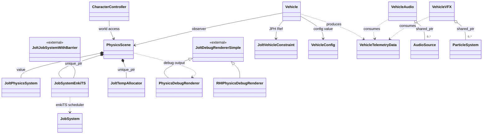

Vehicle observes PhysicsScene and holds Jolt references. VehicleAudio/VFX consume telemetry; Vehicle does not directly own them. The RHI debug renderer also privately inherits an initialization helper omitted from this overview.

Sources: [Engine/Physics/include/Axle/PhysicsScene.hpp](../../Engine/Physics/include/Axle/PhysicsScene.hpp), [Engine/Physics/include/Axle/JobSystemEnkiTS.hpp](../../Engine/Physics/include/Axle/JobSystemEnkiTS.hpp), [Engine/Vehicle/include/Axle/Vehicle.hpp](../../Engine/Vehicle/include/Axle/Vehicle.hpp).

## 6. Parallel OpenGL and RHI rendering

```mermaid
classDiagram
    SceneRenderer ..> Scene : render argument
    SceneRenderer o-- Shader : shared_ptr
    SceneRenderer o-- ShadowMap : shared_ptr
    SceneRenderer o-- Skybox : shared_ptr
    SceneRenderer o-- SkinningPipeline : shared_ptr
    SceneRenderer o-- ParticleRenderer : shared_ptr
    RHISceneRenderer ..> Scene : render argument
    RHISceneRenderer --> RHIDevice : device observer
    RHISceneRenderer ..> RHIMeshRegistry : mesh lookup
    RHISceneRenderer *-- RHIParticleRenderer : unique_ptr
    RHISceneRenderer *-- RHIPhysicsDebugRenderer : unique_ptr
    RHISceneRenderer *-- RHIObjectPicker : unique_ptr
    RHISceneRenderer ..> SceneRenderSettings : shared settings type
    SceneRenderer ..> SceneRenderSettings : settings argument
    MeshInstance3D o-- VertexArray : OpenGL shared_ptr
    MeshInstance3D o-- RHIMesh : RHI shared_ptr
    MeshInstance3D o-- RHIMaterial : RHI shared_ptr
    MaterialComponent o-- Material : shared_ptr
```

The scene renderers are independent concrete classes, not a base/derived pair. RHISceneRenderer owns its particle/debug/picker helpers. Components retain both OpenGL and RHI resources.

Sources: [Engine/Scene/include/Axle/SceneRenderer.hpp](../../Engine/Scene/include/Axle/SceneRenderer.hpp), [Engine/Scene/include/Axle/RHISceneRenderer.hpp](../../Engine/Scene/include/Axle/RHISceneRenderer.hpp), [Engine/Scene/include/Axle/Components.hpp](../../Engine/Scene/include/Axle/Components.hpp).

## 7. RHI resource dependencies

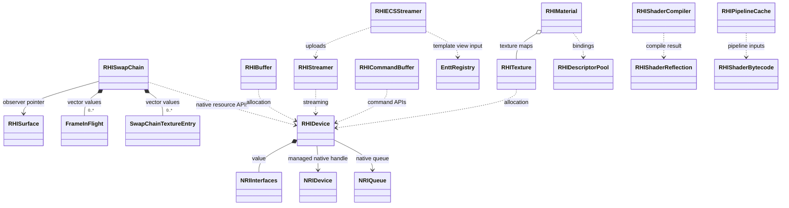

Dotted arrows indicate API use, not retained members. Native device/queue labels abbreviate NRI types. Wrappers may manage native handles explicitly.

Sources: [Engine/RHI/include/Axle/RHI/RHIDevice.hpp](../../Engine/RHI/include/Axle/RHI/RHIDevice.hpp), [Engine/RHI/include/Axle/RHI/RHISwapChain.hpp](../../Engine/RHI/include/Axle/RHI/RHISwapChain.hpp), [Engine/RHI/include/Axle/RHI/RHIECSStreamer.hpp](../../Engine/RHI/include/Axle/RHI/RHIECSStreamer.hpp).

## 8. Asset registry, DSL and packages

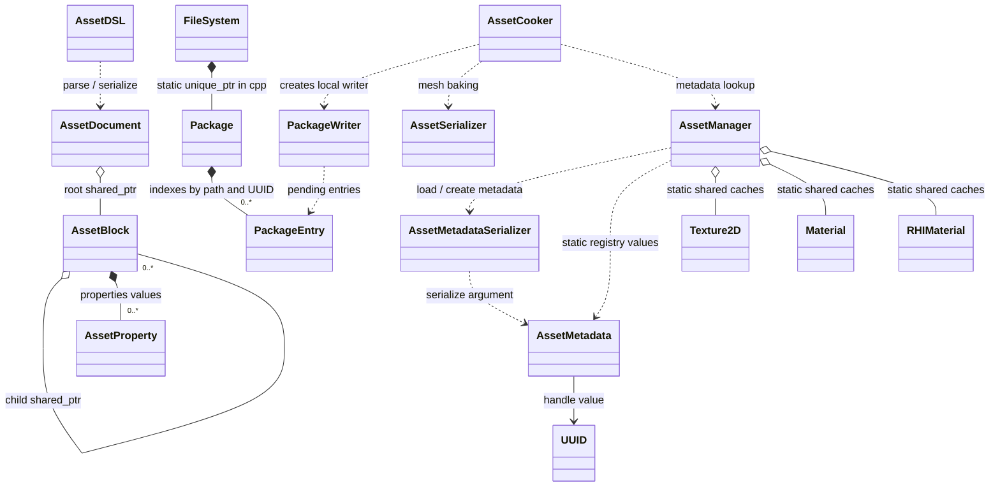

AssetManager caches are static, process-wide shared references. FileSystem owns the mounted Package through an implementation-level static unique_ptr. Package indexes store entry values rather than a single shared entry object.

Sources: [Engine/Asset/include/Axle/AssetManager.hpp](../../Engine/Asset/include/Axle/AssetManager.hpp), [Engine/Asset/include/Axle/AssetDSL.hpp](../../Engine/Asset/include/Axle/AssetDSL.hpp), [Engine/Core/src/FileSystem.cpp](../../Engine/Core/src/FileSystem.cpp), [Engine/Core/include/Axle/Package.hpp](../../Engine/Core/include/Axle/Package.hpp).

## 9. Animation

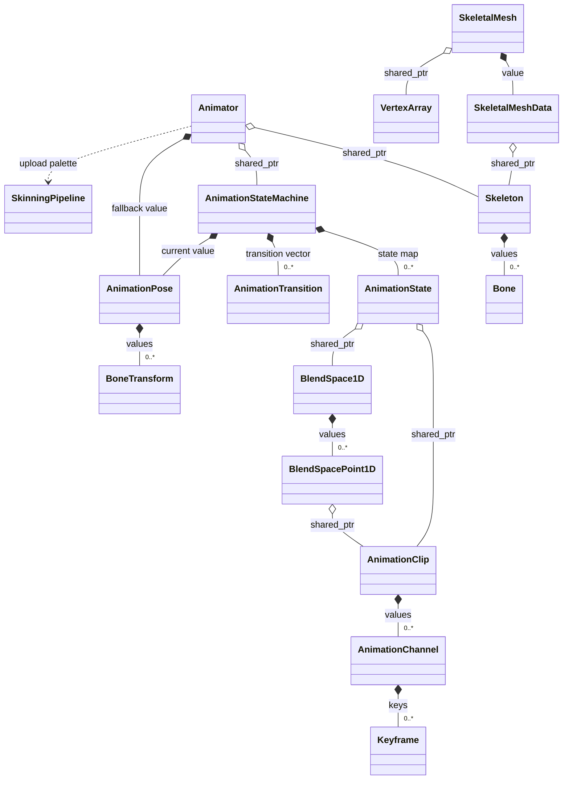

Animator holds shared skeleton/state machine references and a fallback pose. The state machine owns its current pose. AnimationState references clips/blend spaces; it does not inherit from them.

Sources: [Engine/Animation/include/Axle/Animator.hpp](../../Engine/Animation/include/Axle/Animator.hpp), [Engine/Animation/include/Axle/AnimationStateMachine.hpp](../../Engine/Animation/include/Axle/AnimationStateMachine.hpp), [Engine/Animation/include/Axle/SkeletalMesh.hpp](../../Engine/Animation/include/Axle/SkeletalMesh.hpp).

## 10. Audio and particle simulation

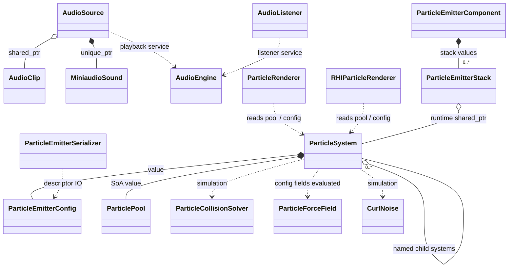

Particle renderers consume simulation state rather than inheriting from ParticleSystem. Force evaluation uses ParticleForceField records from config. MiniaudioSound denotes ma_sound.

Sources: [Engine/Audio/include/Axle/AudioSource.hpp](../../Engine/Audio/include/Axle/AudioSource.hpp), [Engine/VFX/include/Axle/ParticleSystem.hpp](../../Engine/VFX/include/Axle/ParticleSystem.hpp), [Engine/VFX/src/ParticleSystem.cpp](../../Engine/VFX/src/ParticleSystem.cpp), [Engine/Scene/include/Axle/Components.hpp](../../Engine/Scene/include/Axle/Components.hpp).

## 11. UI arena, tree and binding

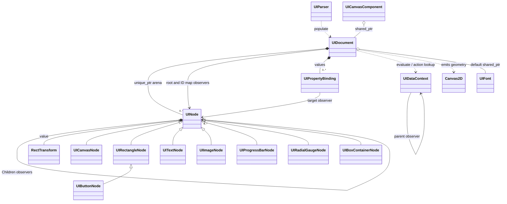

UIDocument owns all nodes in its arena. Parent/children, root, ID lookup and binding targets are observers. Reload/clear must rebuild references into the node arena.

Sources: [Engine/UI/include/Axle/UI/UIDocument.hpp](../../Engine/UI/include/Axle/UI/UIDocument.hpp), [Engine/UI/include/Axle/UI/UINode.hpp](../../Engine/UI/include/Axle/UI/UINode.hpp), [Engine/UI/include/Axle/UI/UIDataContext.hpp](../../Engine/UI/include/Axle/UI/UIDataContext.hpp).

## 12. Spline, terrain and serializer extensions

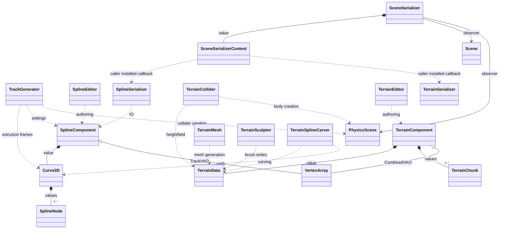

Serializer callbacks are installed by callers in Editor/Runtime; these edges do not establish a Scene target dependency on plugin libraries. Geometry/collider creation is still backend/world specific.

Sources: [Plugins/Spline/include/AxleSpline/SplineComponent.hpp](../../Plugins/Spline/include/AxleSpline/SplineComponent.hpp), [Plugins/Terrain/include/AxleTerrain/TerrainComponent.hpp](../../Plugins/Terrain/include/AxleTerrain/TerrainComponent.hpp), [Engine/Scene/include/Axle/SceneSerializer.hpp](../../Engine/Scene/include/Axle/SceneSerializer.hpp), [Runtime/src/RuntimeLayer.cpp](../../Runtime/src/RuntimeLayer.cpp).

## 13. Project and standalone runtime

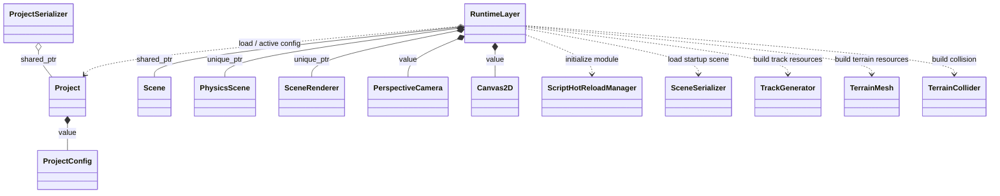

RuntimeLayer owns SceneRenderer, not RHISceneRenderer. ProjectSerializer retains a shared Project; active project state is static.

Sources: [Engine/Project/include/Axle/Project.hpp](../../Engine/Project/include/Axle/Project.hpp), [Engine/Project/include/Axle/ProjectSerializer.hpp](../../Engine/Project/include/Axle/ProjectSerializer.hpp), [Runtime/src/RuntimeLayer.hpp](../../Runtime/src/RuntimeLayer.hpp).

## 14. HLSL Studio

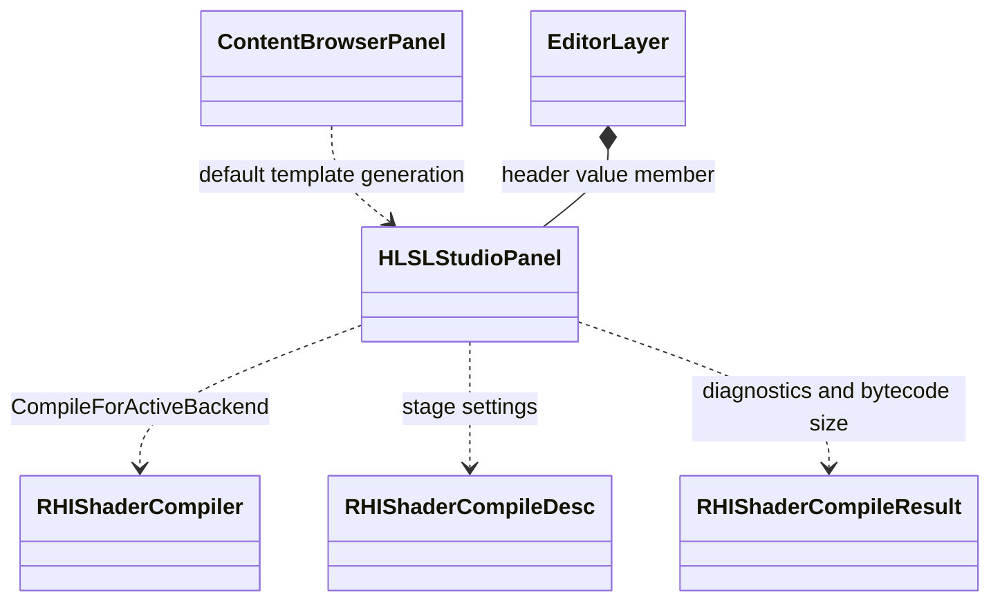

EditorLayer wires content-browser and inspector open callbacks and renders the panel. CompileForActiveBackend validates the selected shader stages; pipeline replacement is a separate concern.

Sources: [Engine/UI/include/Axle/HLSLStudioPanel.hpp](../../Engine/UI/include/Axle/HLSLStudioPanel.hpp), [Engine/UI/src/HLSLStudioPanel.cpp](../../Engine/UI/src/HLSLStudioPanel.cpp), [Editor/src/EditorLayer.cpp](../../Editor/src/EditorLayer.cpp).
