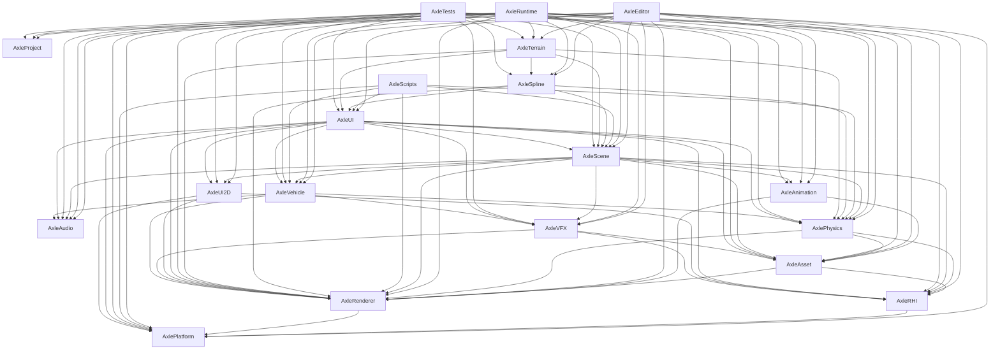

# Current Dependency Map

Reviewed: 2026-11-01. Link dependencies, build-order constraints and textual include edges are different relationships. This report keeps them separate.

## 1. Direct target links

Extracted from first-party target_link_libraries calls. Platform conditions/generator expressions and ThirdParty internals are not fully evaluated. PUBLIC propagates usage requirements; PRIVATE static linkage may still contribute final link requirements.

| Target | Scope | Dependencies | Definition |
|---|---|---|---|
| `AxleEditor` | PRIVATE | `Axle::Core`, `Axle::Platform`, `Axle::RHI`, `Axle::Renderer`, `Axle::Audio`, `Axle::Asset`, `Axle::UI`, `Axle::Physics`, `Axle::Scene`, `Axle::Vehicle`, `Axle::Project`, `Axle::Spline`, `Axle::Terrain`, `Axle::Animation`, `Axle::VFX` | [Editor/CMakeLists.txt](../../Editor/CMakeLists.txt) |
| `AxleScripts` | PRIVATE | `Axle::Core`, `Axle::Platform`, `Axle::Renderer`, `Axle::Scene`, `Axle::Physics`, `Axle::Vehicle`, `Axle::UI` | [Editor/CMakeLists.txt](../../Editor/CMakeLists.txt) |
| `AxleTests` | PRIVATE | `Axle::Core`, `Axle::Platform`, `Axle::RHI`, `Axle::Renderer`, `Axle::Audio`, `Axle::Asset`, `Axle::UI`, `Axle::UI2D`, `Axle::Physics`, `Axle::Scene`, `Axle::Vehicle`, `Axle::Project`, `Axle::Spline`, `Axle::Terrain`, `Axle::Animation`, `Axle::VFX` | [Editor/CMakeLists.txt](../../Editor/CMakeLists.txt) |
| `AxleAnimation` | PUBLIC | `Axle::Core`, `Axle::Renderer`, `Axle::Asset` | [Engine/Animation/CMakeLists.txt](../../Engine/Animation/CMakeLists.txt) |
| `AxleAsset` | PUBLIC | `Axle::Core`, `Axle::Renderer`, `Axle::RHI` | [Engine/Asset/CMakeLists.txt](../../Engine/Asset/CMakeLists.txt) |
| `AxleAudio` | PUBLIC | `Axle::Core` | [Engine/Audio/CMakeLists.txt](../../Engine/Audio/CMakeLists.txt) |
| `AxleCore` | PUBLIC | `spdlog::spdlog`, `glfw`, `enkiTS` | [Engine/Core/CMakeLists.txt](../../Engine/Core/CMakeLists.txt) |
| `AxlePhysics` | PUBLIC | `Axle::Core`, `Axle::Renderer`, `Axle::RHI`, `Axle::Asset`, `Jolt` | [Engine/Physics/CMakeLists.txt](../../Engine/Physics/CMakeLists.txt) |
| `AxlePlatform` | PUBLIC | `Axle::Core` | [Engine/Platform/CMakeLists.txt](../../Engine/Platform/CMakeLists.txt) |
| `AxlePlatform` | PRIVATE | `glfw` | [Engine/Platform/CMakeLists.txt](../../Engine/Platform/CMakeLists.txt) |
| `AxlePlatform` | PRIVATE | `comdlg32` | [Engine/Platform/CMakeLists.txt](../../Engine/Platform/CMakeLists.txt) |
| `AxleProject` | PUBLIC | `Axle::Core` | [Engine/Project/CMakeLists.txt](../../Engine/Project/CMakeLists.txt) |
| `AxleRenderer` | PUBLIC | `Axle::Core`, `Axle::Platform` | [Engine/Renderer/CMakeLists.txt](../../Engine/Renderer/CMakeLists.txt) |
| `AxleRenderer` | PRIVATE | `glad` | [Engine/Renderer/CMakeLists.txt](../../Engine/Renderer/CMakeLists.txt) |
| `AxleRHI` | PUBLIC | `Axle::Core`, `Axle::Platform`, `NRI` | [Engine/RHI/CMakeLists.txt](../../Engine/RHI/CMakeLists.txt) |
| `AxleScene` | PUBLIC | `Axle::Core`, `Axle::RHI`, `Axle::Renderer`, `Axle::Animation`, `Axle::Physics`, `Axle::Vehicle`, `Axle::Asset`, `Axle::Audio`, `Axle::VFX`, `Axle::UI2D` | [Engine/Scene/CMakeLists.txt](../../Engine/Scene/CMakeLists.txt) |
| `AxleUI2D` | PUBLIC | `Axle::Core`, `Axle::Platform`, `Axle::Renderer`, `Axle::RHI` | [Engine/UI/CMakeLists.txt](../../Engine/UI/CMakeLists.txt) |
| `AxleUI` | PUBLIC | `Axle::UI2D`, `Axle::Core`, `Axle::Platform`, `Axle::Renderer`, `Axle::Asset`, `Axle::Physics`, `Axle::Scene`, `Axle::Vehicle`, `Axle::Audio`, `Axle::VFX`, `Axle::RHI` | [Engine/UI/CMakeLists.txt](../../Engine/UI/CMakeLists.txt) |
| `AxleUI` | PRIVATE | `glfw`, `glad` | [Engine/UI/CMakeLists.txt](../../Engine/UI/CMakeLists.txt) |
| `AxleUI` | PRIVATE | `d3d12`, `dxgi`, `d3dcompiler` | [Engine/UI/CMakeLists.txt](../../Engine/UI/CMakeLists.txt) |
| `AxleUI` | PRIVATE | `Vulkan::Vulkan` | [Engine/UI/CMakeLists.txt](../../Engine/UI/CMakeLists.txt) |
| `AxleVehicle` | PUBLIC | `Axle::Core`, `Axle::Physics`, `Axle::Renderer`, `Axle::Audio`, `Axle::VFX`, `Jolt` | [Engine/Vehicle/CMakeLists.txt](../../Engine/Vehicle/CMakeLists.txt) |
| `AxleVFX` | PUBLIC | `Axle::Core`, `Axle::Renderer`, `Axle::RHI`, `Axle::Asset` | [Engine/VFX/CMakeLists.txt](../../Engine/VFX/CMakeLists.txt) |
| `AxleVFX` | PRIVATE | `glad` | [Engine/VFX/CMakeLists.txt](../../Engine/VFX/CMakeLists.txt) |
| `AxleSpline` | PUBLIC | `Axle::Core`, `Axle::Renderer`, `Axle::Physics`, `Axle::Scene`, `Axle::UI` | [Plugins/Spline/CMakeLists.txt](../../Plugins/Spline/CMakeLists.txt) |
| `AxleTerrain` | PUBLIC | `Axle::Core`, `Axle::Renderer`, `Axle::Physics`, `Axle::Scene`, `Axle::UI`, `Axle::Spline` | [Plugins/Terrain/CMakeLists.txt](../../Plugins/Terrain/CMakeLists.txt) |
| `AxleRuntime` | PRIVATE | `Axle::Core`, `Axle::Platform`, `Axle::Renderer`, `Axle::Audio`, `Axle::Asset`, `Axle::Physics`, `Axle::Vehicle`, `Axle::Scene`, `Axle::Project`, `Axle::UI2D`, `Axle::Spline`, `Axle::Terrain`, `Axle::Animation`, `Axle::VFX` | [Runtime/CMakeLists.txt](../../Runtime/CMakeLists.txt) |

## 2. Engine target graph

A → B means A declares a direct link to B. Common Core edges are omitted from the drawing; the table retains them. UI and UI2D are separate targets.

## 3. Build order

add_dependencies does not mean inheritance or a runtime call.

| Target | Build prerequisites | Definition |
|---|---|---|
| `AxleEditor` | `AxleScripts`, `AxleRuntime` | [Editor/CMakeLists.txt](../../Editor/CMakeLists.txt) |
| `AxleTests` | `AxleEditor` | [Editor/CMakeLists.txt](../../Editor/CMakeLists.txt) |
| `AxleTests` | `AxleScripts` | [Editor/CMakeLists.txt](../../Editor/CMakeLists.txt) |
| `AxleRuntime` | `AxleScripts` | [Runtime/CMakeLists.txt](../../Runtime/CMakeLists.txt) |

## 4. Cross-directory includes

Includes are textual, including inactive preprocessor branches. This is not a call graph. Engine/UI combines two targets, so directory-level edges cannot by themselves establish target cycles.

| Consumer module | Included module | Include occurrences | Example |
|---|---|---:|---|
| Editor | Engine/Animation | 8 | [Editor/src/Tests/TestCommon.hpp:53](../../Editor/src/Tests/TestCommon.hpp#L53) → `Axle/Skeleton.hpp` |
| Editor | Engine/Asset | 15 | [Editor/src/EditorLayer.cpp:1](../../Editor/src/EditorLayer.cpp#L1) → `Axle/TextureDescriptor.hpp` |
| Editor | Engine/Audio | 2 | [Editor/src/EditorLayer.cpp:18](../../Editor/src/EditorLayer.cpp#L18) → `Axle/AudioEngine.hpp` |
| Editor | Engine/Core | 18 | [Editor/assets/scripts/CarController.hpp:7](../../Editor/assets/scripts/CarController.hpp#L7) → `Axle/Log.hpp` |
| Editor | Engine/Physics | 10 | [Editor/assets/scripts/VehicleChaseCamera.hpp:9](../../Editor/assets/scripts/VehicleChaseCamera.hpp#L9) → `Axle/PhysicsScene.hpp` |
| Editor | Engine/Platform | 14 | [Editor/assets/scripts/CarController.hpp:5](../../Editor/assets/scripts/CarController.hpp#L5) → `Axle/Input.hpp` |
| Editor | Engine/Project | 5 | [Editor/src/EditorLayer.cpp:15](../../Editor/src/EditorLayer.cpp#L15) → `Axle/Project.hpp` |
| Editor | Engine/RHI | 30 | [Editor/src/EditorLayer.cpp:30](../../Editor/src/EditorLayer.cpp#L30) → `Axle/RHI/RHIDevice.hpp` |
| Editor | Engine/Renderer | 21 | [Editor/src/EditorLayer.cpp:5](../../Editor/src/EditorLayer.cpp#L5) → `Axle/RenderCommand.hpp` |
| Editor | Engine/Scene | 61 | [Editor/assets/scripts/CarController.hpp:2](../../Editor/assets/scripts/CarController.hpp#L2) → `Axle/ScriptableEntity.hpp` |
| Editor | Engine/UI | 37 | [Editor/src/EditorLayer.cpp:35](../../Editor/src/EditorLayer.cpp#L35) → `Axle/UI/RectTransformGizmo.hpp` |
| Editor | Engine/VFX | 10 | [Editor/src/Tests/Test_Milestone9.cpp:20](../../Editor/src/Tests/Test_Milestone9.cpp#L20) → `Axle/ParticleEmitterSerializer.hpp` |
| Editor | Engine/Vehicle | 5 | [Editor/assets/scripts/RacingHUD.hpp:8](../../Editor/assets/scripts/RacingHUD.hpp#L8) → `Axle/Vehicle.hpp` |
| Editor | Plugins/Spline | 11 | [Editor/src/EditorLayer.cpp:19](../../Editor/src/EditorLayer.cpp#L19) → `AxleSpline/SplineComponent.hpp` |
| Editor | Plugins/Terrain | 15 | [Editor/src/EditorLayer.cpp:24](../../Editor/src/EditorLayer.cpp#L24) → `AxleTerrain/TerrainPlugin.hpp` |
| Engine/Animation | Engine/Core | 4 | [Engine/Animation/include/Axle/AnimationPose.hpp:2](../../Engine/Animation/include/Axle/AnimationPose.hpp#L2) → `Axle/Types.hpp` |
| Engine/Animation | Engine/Renderer | 3 | [Engine/Animation/include/Axle/Animator.hpp:6](../../Engine/Animation/include/Axle/Animator.hpp#L6) → `Axle/SkinningPipeline.hpp` |
| Engine/Asset | Engine/Core | 21 | [Engine/Asset/include/Axle/AssetCooker.hpp:2](../../Engine/Asset/include/Axle/AssetCooker.hpp#L2) → `Axle/Types.hpp` |
| Engine/Asset | Engine/Platform | 1 | [Engine/Asset/src/AssetManager.cpp:3](../../Engine/Asset/src/AssetManager.cpp#L3) → `Axle/Window.hpp` |
| Engine/Asset | Engine/RHI | 1 | [Engine/Asset/include/Axle/AssetManager.hpp:8](../../Engine/Asset/include/Axle/AssetManager.hpp#L8) → `Axle/RHI/RHIMaterial.hpp` |
| Engine/Asset | Engine/Renderer | 4 | [Engine/Asset/include/Axle/AssetManager.hpp:6](../../Engine/Asset/include/Axle/AssetManager.hpp#L6) → `Axle/Texture2D.hpp` |
| Engine/Audio | Engine/Core | 10 | [Engine/Audio/include/Axle/AudioClip.hpp:2](../../Engine/Audio/include/Axle/AudioClip.hpp#L2) → `Axle/Types.hpp` |
| Engine/Core | Engine/Physics | 1 | [Engine/Core/src/Application.cpp:6](../../Engine/Core/src/Application.cpp#L6) → `Axle/PhysicsEngine.hpp` |
| Engine/Core | Engine/Platform | 2 | [Engine/Core/include/Axle/Application.hpp:6](../../Engine/Core/include/Axle/Application.hpp#L6) → `Axle/Window.hpp` |
| Engine/Core | Engine/Renderer | 1 | [Engine/Core/src/Application.cpp:5](../../Engine/Core/src/Application.cpp#L5) → `Axle/RenderCommand.hpp` |
| Engine/Physics | Engine/Asset | 1 | [Engine/Physics/include/Axle/PhysicsMaterial.hpp:3](../../Engine/Physics/include/Axle/PhysicsMaterial.hpp#L3) → `Axle/AssetDSL.hpp` |
| Engine/Physics | Engine/Core | 18 | [Engine/Physics/include/Axle/CharacterController.hpp:2](../../Engine/Physics/include/Axle/CharacterController.hpp#L2) → `Axle/Types.hpp` |
| Engine/Physics | Engine/Platform | 1 | [Engine/Physics/src/PhysicsDebugRenderer.cpp:3](../../Engine/Physics/src/PhysicsDebugRenderer.cpp#L3) → `Axle/Window.hpp` |
| Engine/Physics | Engine/RHI | 7 | [Engine/Physics/include/Axle/RHIPhysicsDebugRenderer.hpp:4](../../Engine/Physics/include/Axle/RHIPhysicsDebugRenderer.hpp#L4) → `Axle/RHI/RHICommon.hpp` |
| Engine/Physics | Engine/Renderer | 4 | [Engine/Physics/include/Axle/PhysicsDebugRenderer.hpp:3](../../Engine/Physics/include/Axle/PhysicsDebugRenderer.hpp#L3) → `Axle/Shader.hpp` |
| Engine/Platform | Engine/Core | 5 | [Engine/Platform/include/Axle/Events.hpp:2](../../Engine/Platform/include/Axle/Events.hpp#L2) → `Axle/Types.hpp` |
| Engine/Project | Engine/Core | 5 | [Engine/Project/include/Axle/Project.hpp:2](../../Engine/Project/include/Axle/Project.hpp#L2) → `Axle/Types.hpp` |
| Engine/RHI | Engine/Core | 19 | [Engine/RHI/include/Axle/RHI/RHICommon.hpp:2](../../Engine/RHI/include/Axle/RHI/RHICommon.hpp#L2) → `Axle/Types.hpp` |
| Engine/RHI | Engine/Platform | 2 | [Engine/RHI/include/Axle/RHI/RHISurface.hpp:3](../../Engine/RHI/include/Axle/RHI/RHISurface.hpp#L3) → `Axle/Window.hpp` |
| Engine/Renderer | Engine/Core | 30 | [Engine/Renderer/include/Axle/Buffer.hpp:2](../../Engine/Renderer/include/Axle/Buffer.hpp#L2) → `Axle/Types.hpp` |
| Engine/Renderer | Engine/Platform | 6 | [Engine/Renderer/src/Cubemap.cpp:6](../../Engine/Renderer/src/Cubemap.cpp#L6) → `Axle/Window.hpp` |
| Engine/Scene | Engine/Animation | 8 | [Engine/Scene/include/Axle/Components.hpp:12](../../Engine/Scene/include/Axle/Components.hpp#L12) → `Axle/SkeletalMesh.hpp` |
| Engine/Scene | Engine/Asset | 5 | [Engine/Scene/src/AssemblySerializer.cpp:4](../../Engine/Scene/src/AssemblySerializer.cpp#L4) → `Axle/AssetSerializer.hpp` |
| Engine/Scene | Engine/Audio | 2 | [Engine/Scene/include/Axle/Components.hpp:9](../../Engine/Scene/include/Axle/Components.hpp#L9) → `Axle/AudioSource.hpp` |
| Engine/Scene | Engine/Core | 39 | [Engine/Scene/include/Axle/AssemblySerializer.hpp:2](../../Engine/Scene/include/Axle/AssemblySerializer.hpp#L2) → `Axle/Types.hpp` |
| Engine/Scene | Engine/Physics | 10 | [Engine/Scene/include/Axle/AssemblySerializer.hpp:5](../../Engine/Scene/include/Axle/AssemblySerializer.hpp#L5) → `Axle/PhysicsScene.hpp` |
| Engine/Scene | Engine/Platform | 2 | [Engine/Scene/src/SceneRenderer.cpp:5](../../Engine/Scene/src/SceneRenderer.cpp#L5) → `Axle/Window.hpp` |
| Engine/Scene | Engine/RHI | 22 | [Engine/Scene/include/Axle/Components.hpp:30](../../Engine/Scene/include/Axle/Components.hpp#L30) → `Axle/RHI/RHIMaterial.hpp` |
| Engine/Scene | Engine/Renderer | 18 | [Engine/Scene/include/Axle/Components.hpp:4](../../Engine/Scene/include/Axle/Components.hpp#L4) → `Axle/VertexArray.hpp` |
| Engine/Scene | Engine/UI | 3 | [Engine/Scene/include/Axle/Components.hpp:20](../../Engine/Scene/include/Axle/Components.hpp#L20) → `Axle/UI/UIDocument.hpp` |
| Engine/Scene | Engine/VFX | 9 | [Engine/Scene/include/Axle/CharacterVFX.hpp:5](../../Engine/Scene/include/Axle/CharacterVFX.hpp#L5) → `Axle/ParticleSystem.hpp` |
| Engine/Scene | Engine/Vehicle | 5 | [Engine/Scene/include/Axle/Components.hpp:11](../../Engine/Scene/include/Axle/Components.hpp#L11) → `Axle/VehicleAudio.hpp` |
| Engine/UI | Engine/Asset | 18 | [Engine/UI/include/Axle/AssetPreviewPanel.hpp:3](../../Engine/UI/include/Axle/AssetPreviewPanel.hpp#L3) → `Axle/AssetSerializer.hpp` |
| Engine/UI | Engine/Audio | 9 | [Engine/UI/src/AssetInspector.cpp:11](../../Engine/UI/src/AssetInspector.cpp#L11) → `Axle/AudioEngine.hpp` |
| Engine/UI | Engine/Core | 41 | [Engine/UI/include/Axle/AssemblyEditorPanel.hpp:2](../../Engine/UI/include/Axle/AssemblyEditorPanel.hpp#L2) → `Axle/Types.hpp` |
| Engine/UI | Engine/Physics | 7 | [Engine/UI/include/Axle/AssemblyEditorPanel.hpp:7](../../Engine/UI/include/Axle/AssemblyEditorPanel.hpp#L7) → `Axle/PhysicsScene.hpp` |
| Engine/UI | Engine/Platform | 10 | [Engine/UI/include/Axle/ImGuiLayer.hpp:4](../../Engine/UI/include/Axle/ImGuiLayer.hpp#L4) → `Axle/Window.hpp` |
| Engine/UI | Engine/RHI | 10 | [Engine/UI/include/Axle/HLSLStudioPanel.hpp:3](../../Engine/UI/include/Axle/HLSLStudioPanel.hpp#L3) → `Axle/RHI/RHIShader.hpp` |
| Engine/UI | Engine/Renderer | 23 | [Engine/UI/include/Axle/AssemblyEditorPanel.hpp:4](../../Engine/UI/include/Axle/AssemblyEditorPanel.hpp#L4) → `Axle/Framebuffer.hpp` |
| Engine/UI | Engine/Scene | 33 | [Engine/UI/include/Axle/AssemblyEditorPanel.hpp:3](../../Engine/UI/include/Axle/AssemblyEditorPanel.hpp#L3) → `Axle/AssemblySerializer.hpp` |
| Engine/UI | Engine/VFX | 8 | [Engine/UI/include/Axle/CurveEditorWidget.hpp:3](../../Engine/UI/include/Axle/CurveEditorWidget.hpp#L3) → `Axle/VFXCommon.hpp` |
| Engine/UI | Engine/Vehicle | 5 | [Engine/UI/src/EntityInspector.cpp:6](../../Engine/UI/src/EntityInspector.cpp#L6) → `Axle/Vehicle.hpp` |
| Engine/VFX | Engine/Asset | 1 | [Engine/VFX/src/ParticleEmitterSerializer.cpp:2](../../Engine/VFX/src/ParticleEmitterSerializer.cpp#L2) → `Axle/AssetDSL.hpp` |
| Engine/VFX | Engine/Core | 6 | [Engine/VFX/include/Axle/ParticleRenderer.hpp:3](../../Engine/VFX/include/Axle/ParticleRenderer.hpp#L3) → `Axle/Types.hpp` |
| Engine/VFX | Engine/Platform | 1 | [Engine/VFX/src/ParticleRenderer.cpp:3](../../Engine/VFX/src/ParticleRenderer.cpp#L3) → `Axle/Window.hpp` |
| Engine/VFX | Engine/RHI | 12 | [Engine/VFX/include/Axle/RHIParticleRenderer.hpp:10](../../Engine/VFX/include/Axle/RHIParticleRenderer.hpp#L10) → `Axle/RHI/RHICommon.hpp` |
| Engine/VFX | Engine/Renderer | 7 | [Engine/VFX/include/Axle/ParticleRenderer.hpp:4](../../Engine/VFX/include/Axle/ParticleRenderer.hpp#L4) → `Axle/Shader.hpp` |
| Engine/Vehicle | Engine/Audio | 2 | [Engine/Vehicle/include/Axle/VehicleAudio.hpp:5](../../Engine/Vehicle/include/Axle/VehicleAudio.hpp#L5) → `Axle/AudioSource.hpp` |
| Engine/Vehicle | Engine/Core | 9 | [Engine/Vehicle/include/Axle/Vehicle.hpp:2](../../Engine/Vehicle/include/Axle/Vehicle.hpp#L2) → `Axle/Types.hpp` |
| Engine/Vehicle | Engine/Physics | 2 | [Engine/Vehicle/include/Axle/Vehicle.hpp:5](../../Engine/Vehicle/include/Axle/Vehicle.hpp#L5) → `Axle/PhysicsScene.hpp` |
| Engine/Vehicle | Engine/VFX | 2 | [Engine/Vehicle/include/Axle/VehicleVFX.hpp:6](../../Engine/Vehicle/include/Axle/VehicleVFX.hpp#L6) → `Axle/ParticleSystem.hpp` |
| Plugins/Spline | Engine/Core | 7 | [Plugins/Spline/include/AxleSpline/Curve3D.hpp:2](../../Plugins/Spline/include/AxleSpline/Curve3D.hpp#L2) → `Axle/Types.hpp` |
| Plugins/Spline | Engine/Physics | 4 | [Plugins/Spline/include/AxleSpline/SplineComponent.hpp:5](../../Plugins/Spline/include/AxleSpline/SplineComponent.hpp#L5) → `Axle/PhysicsScene.hpp` |
| Plugins/Spline | Engine/Renderer | 3 | [Plugins/Spline/include/AxleSpline/SplineComponent.hpp:4](../../Plugins/Spline/include/AxleSpline/SplineComponent.hpp#L4) → `Axle/VertexArray.hpp` |
| Plugins/Spline | Engine/Scene | 3 | [Plugins/Spline/include/AxleSpline/SplineEditor.hpp:3](../../Plugins/Spline/include/AxleSpline/SplineEditor.hpp#L3) → `Axle/Entity.hpp` |
| Plugins/Terrain | Engine/Core | 13 | [Plugins/Terrain/include/AxleTerrain/TerrainChunk.hpp:3](../../Plugins/Terrain/include/AxleTerrain/TerrainChunk.hpp#L3) → `Axle/Types.hpp` |
| Plugins/Terrain | Engine/Physics | 4 | [Plugins/Terrain/include/AxleTerrain/TerrainCollider.hpp:4](../../Plugins/Terrain/include/AxleTerrain/TerrainCollider.hpp#L4) → `Axle/PhysicsScene.hpp` |
| Plugins/Terrain | Engine/Renderer | 4 | [Plugins/Terrain/include/AxleTerrain/TerrainChunk.hpp:4](../../Plugins/Terrain/include/AxleTerrain/TerrainChunk.hpp#L4) → `Axle/VertexArray.hpp` |
| Plugins/Terrain | Engine/Scene | 4 | [Plugins/Terrain/include/AxleTerrain/TerrainEditor.hpp:4](../../Plugins/Terrain/include/AxleTerrain/TerrainEditor.hpp#L4) → `Axle/Entity.hpp` |
| Plugins/Terrain | Plugins/Spline | 5 | [Plugins/Terrain/include/AxleTerrain/TerrainSplineCarver.hpp:4](../../Plugins/Terrain/include/AxleTerrain/TerrainSplineCarver.hpp#L4) → `AxleSpline/SplineComponent.hpp` |
| Runtime | Engine/Asset | 1 | [Runtime/src/RuntimeLayer.cpp:6](../../Runtime/src/RuntimeLayer.cpp#L6) → `Axle/AssetSerializer.hpp` |
| Runtime | Engine/Audio | 1 | [Runtime/src/RuntimeLayer.cpp:9](../../Runtime/src/RuntimeLayer.cpp#L9) → `Axle/AudioEngine.hpp` |
| Runtime | Engine/Core | 7 | [Runtime/src/Main.cpp:1](../../Runtime/src/Main.cpp#L1) → `Axle/Application.hpp` |
| Runtime | Engine/Physics | 1 | [Runtime/src/RuntimeLayer.hpp:7](../../Runtime/src/RuntimeLayer.hpp#L7) → `Axle/PhysicsScene.hpp` |
| Runtime | Engine/Platform | 2 | [Runtime/src/RuntimeLayer.hpp:13](../../Runtime/src/RuntimeLayer.hpp#L13) → `Axle/Input.hpp` |
| Runtime | Engine/Project | 1 | [Runtime/src/RuntimeLayer.hpp:9](../../Runtime/src/RuntimeLayer.hpp#L9) → `Axle/Project.hpp` |
| Runtime | Engine/Renderer | 3 | [Runtime/src/RuntimeLayer.cpp:5](../../Runtime/src/RuntimeLayer.cpp#L5) → `Axle/PrimitiveMesh.hpp` |
| Runtime | Engine/Scene | 6 | [Runtime/src/RuntimeLayer.cpp:4](../../Runtime/src/RuntimeLayer.cpp#L4) → `Axle/SceneSerializer.hpp` |
| Runtime | Engine/UI | 2 | [Runtime/src/RuntimeLayer.hpp:15](../../Runtime/src/RuntimeLayer.hpp#L15) → `Axle/UI/Canvas2D.hpp` |
| Runtime | Engine/Vehicle | 1 | [Runtime/src/RuntimeLayer.hpp:5](../../Runtime/src/RuntimeLayer.hpp#L5) → `Axle/Vehicle.hpp` |
| Runtime | Plugins/Spline | 3 | [Runtime/src/RuntimeLayer.cpp:10](../../Runtime/src/RuntimeLayer.cpp#L10) → `AxleSpline/SplineComponent.hpp` |
| Runtime | Plugins/Terrain | 4 | [Runtime/src/RuntimeLayer.cpp:13](../../Runtime/src/RuntimeLayer.cpp#L13) → `AxleTerrain/TerrainComponent.hpp` |
| Samples | Engine/Core | 3 | [Samples/TestProject/assets/scripts/CarController.hpp:7](../../Samples/TestProject/assets/scripts/CarController.hpp#L7) → `Axle/Log.hpp` |
| Samples | Engine/Physics | 1 | [Samples/TestProject/assets/scripts/VehicleChaseCamera.hpp:9](../../Samples/TestProject/assets/scripts/VehicleChaseCamera.hpp#L9) → `Axle/PhysicsScene.hpp` |
| Samples | Engine/Platform | 6 | [Samples/TestProject/assets/scripts/CarController.hpp:5](../../Samples/TestProject/assets/scripts/CarController.hpp#L5) → `Axle/Input.hpp` |
| Samples | Engine/Scene | 11 | [Samples/TestProject/assets/scripts/CarController.hpp:2](../../Samples/TestProject/assets/scripts/CarController.hpp#L2) → `Axle/ScriptableEntity.hpp` |
| Samples | Engine/Vehicle | 2 | [Samples/TestProject/assets/scripts/RacingHUD.hpp:8](../../Samples/TestProject/assets/scripts/RacingHUD.hpp#L8) → `Axle/Vehicle.hpp` |

## 5. Architectural interpretation

- Core uses Platform/Renderer/Physics through Application and explicit include paths. These reverse source dependencies are absent from its target link list.
- Renderer OpenGL and RHI are parallel targets; Renderer does not declare a link to RHI.
- Scene → UI2D and UI → Scene do not form a target cycle because UI2D and UI differ.
- Runtime → Spline/Terrain → UI is a transitive tooling dependency; its binary impact requires linker-map inspection.
- Editor → Runtime → Scripts is build ordering. Runtime also stages its executable into the Editor output folder.

Survey totals: **114 direct Axle target edges** and **92 cross-module include pairs**.
