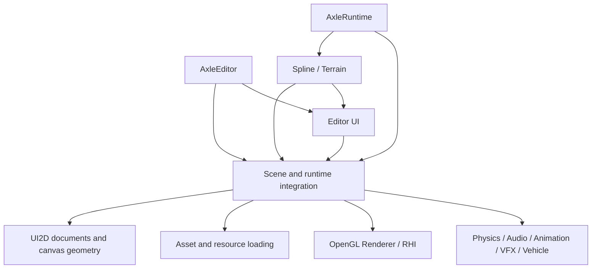

# AxleEngine Architecture Overview

Reviewed: **2026-11-01**. AxleEngine is organized into subsystem libraries and application targets. It has a modular foundation, but its current implementation does **not** yet enforce a strictly layered dependency graph.

The complete [architecture and design documentation](README.md) separates current behavior from the proposed layered architecture:

| Reference | Contents |
|---|---|
| [SAD](SAD.md) | Context, module boundaries, dependencies, deployment and assessment |
| [SDD](SDD.md) | Class responsibilities, ownership, contracts and lifecycle |
| [Class relationships](CLASS_RELATIONSHIPS.md) | UML diagrams by subsystem |
| [Execution flows](RUNTIME_FLOWS.md) | Startup, simulation, scripting, assets and UI |
| [Dependency map](DEPENDENCY_MAP.md) | CMake links, build ordering and source includes |
| [Target architecture](TARGET_LAYERED_ARCHITECTURE.md) | Proposed layering and migration acceptance criteria |
| [Verification](VERIFICATION.md) | Evidence and limits of the source review |

For a prioritized evaluation, read the [current architecture assessment](ASSESSMENT.md).

## Current subsystem structure

This is a selected dependency view, not a strict layer assignment. Most modules have their own CMake target and include/src directories. Spline and Terrain are static libraries combining runtime and editor code.

## Important current boundaries

- Core includes Application, which uses Platform, Renderer and Physics. Its public include paths expose those higher-level headers. Axle::Foundation is currently an alias of AxleCore rather than an independent foundation library.
- Scene combines entity/component storage, hierarchy, simulation integration, scripts, serialization and rendering. It is not an isolated ECS-only module.
- UI2D and UI are separate targets in Engine/UI. Scene links UI2D; the editor UI target links Scene. These do not form a target cycle.
- Runtime links Spline/Terrain, whose public dependencies include editor UI. Runtime stages engine resources and depends on the production scripts target defined under Editor; project assets come from explicit export. It is therefore not yet independent at build level.
- Renderer is the OpenGL path. RHI wraps NRI and exposes native types; several higher subsystems retain both rendering paths.

## Application and simulation lifecycle

Application owns the window and optional UI context, holds a LayerStack and drives events, jobs, layer updates, UI hooks and buffer swapping. EditorLayer and RuntimeLayer compose application behavior through Layer hooks.

Editor Play clones the edit scene into a separate registry while preserving entity UUIDs. Stop tears down runtime state, restores the edit scene and physics bodies, and rebinds panel contexts. Registry handles are distinct from persistent UUID identity.

Current Editor Play calls Scene::OnUpdateRuntime before PhysicsScene::Step; standalone Runtime calls Step before OnUpdateRuntime. The editor applies simulation speed to physics separately. The sequence diagrams document these differences rather than presenting one idealized shared loop.

## Rendering and UI

Editor selects its backend through command-line/project settings and RHISwitcher, then uses SceneRenderer or RHISceneRenderer. Runtime Main uses Application's default OpenGL configuration and RuntimeLayer owns SceneRenderer. Backend parity between these products is not established by their shared subsystem names.

HLSL Studio is connected to editor open callbacks and compiles selected stages through RHIShaderCompiler. Canvas2D produces CPU geometry and statistics; EndCanvas does not itself issue GPU commands. Editor ImGui previews are a separate integration path.

## Ownership, concurrency and data

Use RAII and explicit owners. Entity and panel contexts observe Scene; Scene owns its registry. Shared resources use shared references. Some GPU/OS wrappers own raw native handles and explicitly destroy them, so raw pointer syntax alone is not an ownership policy.

JobSystem centralizes enkiTS scheduling, including Jolt work through JobSystemEnkiTS. ScriptCompiler has an additional worker thread, whose completion callback currently performs reload/editor state updates directly. Thread ownership is a design concern to address during modularization.

AssetManager combines UUID metadata and shared resource caches. Missing metadata generates a new UUID, while .gitignore currently excludes .meta files. PackageWriter writes uncompressed chunks and a table of contents; AssetCooker traverses an asset directory and stages distribution files.

## Direction for modular layering

The proposed design extracts Application from Core, separates SceneData from subsystem bridges, splits runtime/editor plugins, separates asset identity from resource loading/tools, and establishes Renderer-to-RHI boundaries. CMake target checks and include checks must both enforce the policy. These changes are proposals; this documentation update does not implement a refactor.
