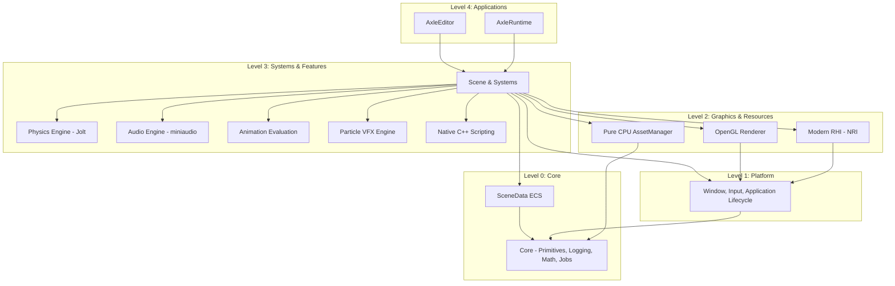

# AxleEngine Architecture Overview

Reviewed: **2026-11-06** (post OPT-03). AxleEngine is organized into subsystem libraries and application targets with a progressively enforced layered dependency graph.

The complete [architecture and design documentation](README.md) details current subsystem contracts and target layering:

| Reference | Contents |
|---|---|
| [SAD](SAD.md) | Context, module boundaries, dependencies, deployment and assessment |
| [SDD](SDD.md) | Class responsibilities, ownership, contracts and lifecycle |
| [Class relationships](CLASS_RELATIONSHIPS.md) | UML diagrams by subsystem |
| [Execution flows](RUNTIME_FLOWS.md) | Startup, simulation, scripting, assets and UI |
| [Dependency map](DEPENDENCY_MAP.md) | CMake links, build ordering and source includes |
| [Target architecture](TARGET_LAYERED_ARCHITECTURE.md) | Layered architecture and migration acceptance criteria |
| [Verification](VERIFICATION.md) | Evidence and limits of the source review |

For a prioritized evaluation, read the [current architecture assessment](ASSESSMENT.md).

## Subsystem structure

## Subsystem boundaries (post OPT-03)

- **Clean Level-0 Core (`Engine/Core`)**: Contains primitive types, assertions, logging, GUIDs, math utilities, and job scheduling. It has zero upward dependencies on `Platform`, `Renderer`, `Scene`, or `Physics`.
- **Platform Application (`Engine/Platform`)**: Owns window management, event loops, and the top-level `Application` lifecycle.
- **Scene data (`Engine/SceneData`)**: A real Core-only library owns registry/entity lifetimes, basic components, hierarchy, explicit transform evaluation, commands, generic copy codecs and structural document loading with passive system sections.
- **Scene composition (`Engine/Scene`)**: Scene inherits the same SceneData registry and installs concrete codecs and physics/script/audio/character/render bridges. Editor Play has its own runtime physics world; source authored values remain separate from runtime IDs and instances. See the [OPT-02/03 review](../reviews/OPT_02_03_CODEX_REVIEW.md).
- **Unified Simulation Driver**: Both Editor Play mode and standalone Runtime step simulation through the shared `SimulationDriver` and `SimulationClock`, executing deterministic discrete phases (`FixedControls` $\to$ `Physics` $\to$ `PostStepSync` $\to$ `FrameScripts` $\to$ `AnimationVFX` $\to$ `LatePresentation`). Defect `ECSJ-05` (divergent Editor vs Runtime update order) is resolved.
- **Pure CPU Asset Pipeline (`Engine/Asset`)**: `AssetManager` is decoupled from GPU device resources. Native assets embed persistent 64-bit UUIDs directly; raw assets use canonical root-relative paths. Companion `.meta` sidecars are completely eliminated.

## Application and simulation lifecycle

`Application` owns the display window and UI context, holds a `LayerStack`, and drives window events, tick updates, UI hooks, and buffer swapping. `EditorLayer` and `RuntimeLayer` compose application behavior through `Layer` hooks.

Editor Play clones the authoring scene into an isolated runtime `SceneData` while preserving persistent entity UUIDs. Stopping Play mode tears down runtime state, releases physics bodies, and restores the edit scene.

Both Editor and Runtime share the `SimulationClock` (fixed 60Hz tick accumulation with overload protection cap) and `SimulationInputAdapter` (edge-latched inputs across variable frames). Single-frame stepping executes identically across both targets.

## Rendering and UI

- Editor selects its graphics backend (OpenGL vs Modern RHI/NRI) via startup flags and project configuration.
- Runtime supports both standard OpenGL and RHI pipelines.
- Canvas2D produces CPU geometry and drawing commands; UI layout documents are parsed through `UIParser`.
- ImGui renders editor chrome, docking, viewports, and custom script inspector controls.

## Ownership, concurrency and data

- **Ownership**: Explicit RAII throughout. Scene owns its registry; `Entity` is a non-owning handle.
- **Concurrency**: `JobSystemEnkiTS` manages parallel work across available CPU cores. EnTT parallel view iterations (`ParallelECS`) handle chunk iteration safely with explicit tombstone skipping. Structural entity mutations are recorded via `SceneCommandBuffer` and executed at deterministic frame boundaries.
- **Asset Pipeline**: Pure CPU asset descriptors are indexed by UUID and path. `PackageWriter` writes shipping `.axlepak` archives, and `AssetCooker` prepares distribution assets.
