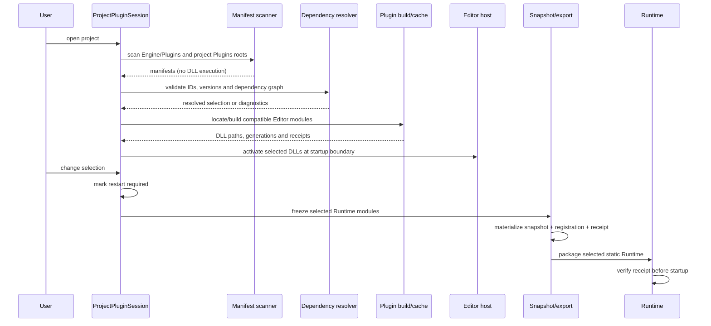
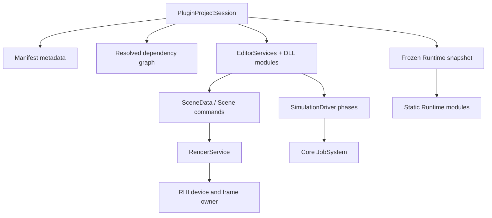

# Plugin flow

Updated: **2026-11-09**

This flow separates Editor DLL activation from selected static Runtime
composition and keeps export bound to one project snapshot.

## Ownership rules

Plugins do not own a second scheduler, fixed clock, GPU device, presentation
loop or parallel entity database. A missing plugin or stale receipt is an
explicit product error. The built-in Engine Vehicle is retired; a future Vehicle
plugin must use these same contracts.
