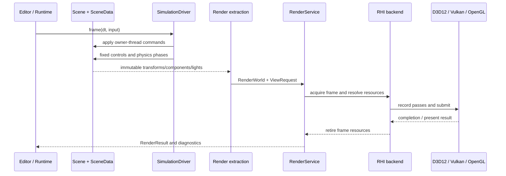
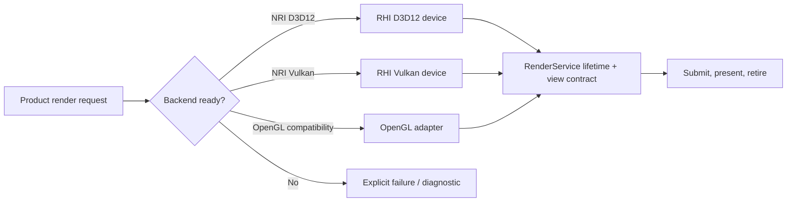

# Render flow

Updated: **2026-11-09**

This flow shows the implemented ownership seams and the remaining OPT-10
acceptance boundary. Renderer extracts immutable data; RHI owns native device and
GPU lifetimes; OpenGL is an explicit compatibility backend.

## Backend selection

A failed native backend is not silently converted into a different backend for a
native acceptance claim. Physics debug data reaches this flow through
`PhysicsDebug`; Physics itself remains graphics-independent.
