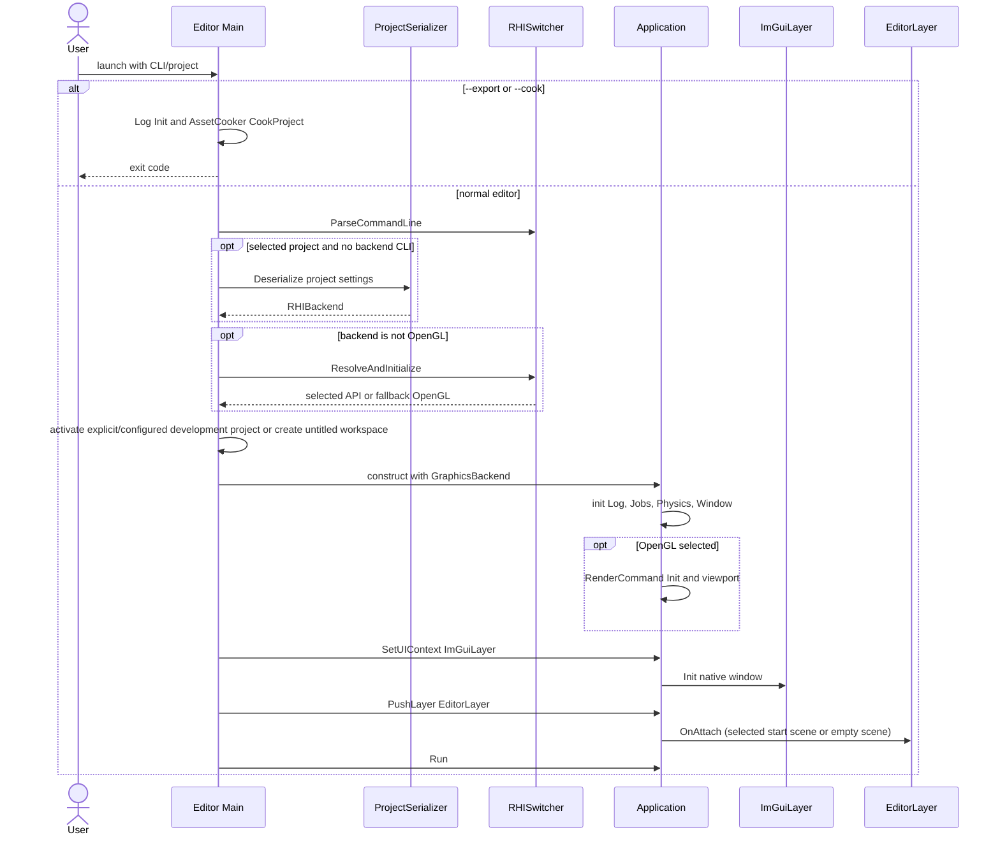
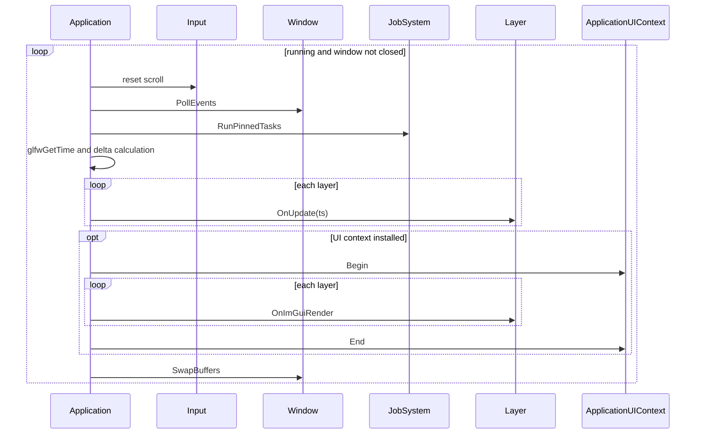
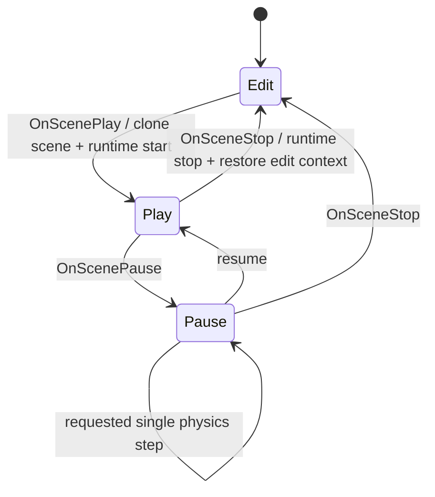
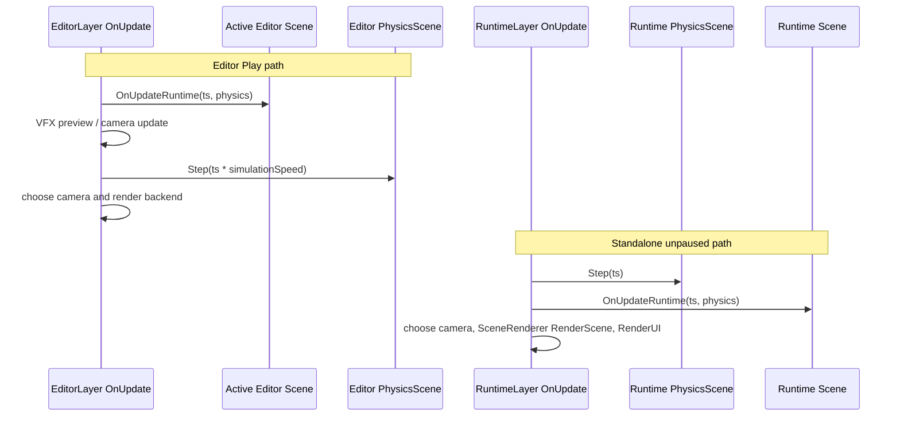
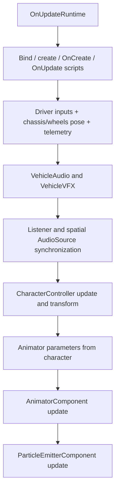
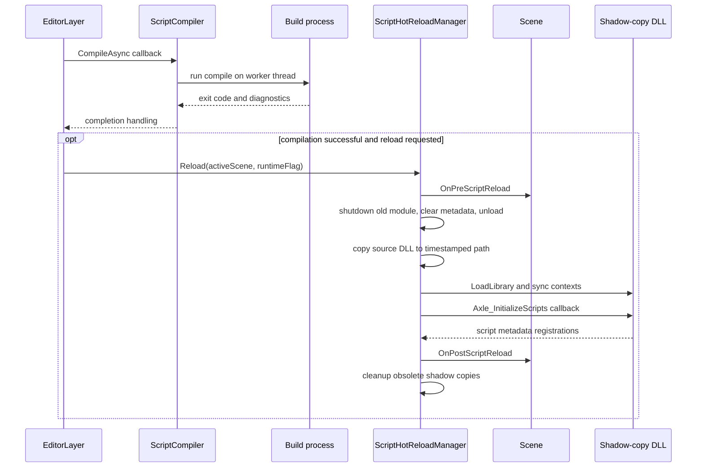
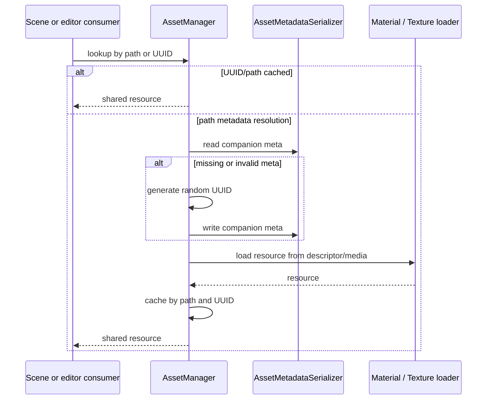
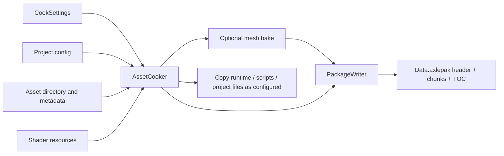

# Execution Flows: Current System

> **Dated source snapshot:** this survey predates the 2026-11-04 Vehicle
> retirement and later sample cleanup. It is retained for architectural context,
> not current API/feature support. Follow the [optimization roadmap](../ROADMAP.md)
> for execution; unavailable source paths below are historical references.

Reviewed: 2026-11-01; startup paths updated 2026-11-03. Diagrams preserve architecture-relevant call order while omitting widget and command-level details. They describe source paths; execution success was not measured.

## 1. Editor startup and backend selection



Editor Main handles cook/export before normal UI startup and requires an explicit project for cooking. Development startup selects the build-configured Samples project unless overridden by an explicit project or `--empty-project`. Empty mode has zero entities/assets; nearby project discovery is disabled. Backend settings come from CLI/project with fallback. UI backend availability and headless device capabilities are different concerns.

Sources: [Editor/src/Main.cpp](../../Editor/src/Main.cpp), [Engine/Core/src/Application.cpp](../../Engine/Core/src/Application.cpp), [Engine/Core/src/LayerStack.cpp](../../Engine/Core/src/LayerStack.cpp).

## 2. Shared application loop



Layer updates run before the optional UI frame. For native RHI paths, UI/RHI integration performs additional command/presentation work; the common SwapBuffers call does not mean every backend presents through OpenGL.

Sources: [Engine/Core/src/Application.cpp](../../Engine/Core/src/Application.cpp), [Engine/UI/src/ImGuiLayer.cpp](../../Engine/UI/src/ImGuiLayer.cpp).

## 3. Editor play, pause and stop


```mermaid
sequenceDiagram
    participant EL as EditorLayer
    participant Copy as Scene Copy
    participant Runtime as Runtime Scene
    participant Panels
    participant Reload as ScriptHotReloadManager
    EL->>EL: CompileAndHotReloadAssets
    EL->>Copy: Copy editor scene
    Copy-->>EL: new runtime Scene
    Note over Copy: preserve entity UUIDs; remap registry handles/references as needed
    EL->>EL: active scene = runtime scene
    EL->>Panels: SetContext and clear selection
    EL->>Reload: sync input and ImGui context
    EL->>Runtime: OnRuntimeStart physics
    Note over EL: state = Play
    EL->>Runtime: OnRuntimeStop on stop
    EL->>EL: release runtime and restore editor scene
    EL->>Panels: restore edit context
```

Scene::Copy preserves UUID identity and creates new registry handles. On stop, the editor restores its original Scene, restores physics bodies and panel contexts. A requested paused step in the surveyed update branch advances physics; it does not invoke the Play-only Scene update there.

Sources: [Editor/src/EditorLayer.cpp](../../Editor/src/EditorLayer.cpp), [Engine/Scene/src/Scene.cpp](../../Engine/Scene/src/Scene.cpp).

## 4. Different Editor and Runtime update order



Editor Play calls OnUpdateRuntime before Step and scales physics time separately. Runtime calls Step before OnUpdateRuntime. These are observed sequences, not a recommended shared simulation contract.

Sources: [Editor/src/EditorLayer.cpp](../../Editor/src/EditorLayer.cpp), [Runtime/src/RuntimeLayer.cpp](../../Runtime/src/RuntimeLayer.cpp).

## 5. Inside Scene runtime update



PhysicsScene::Step is outside this method. Rendering/transform helpers also run through separate paths; this diagram is not a complete GPU/frame graph.

Sources: [Engine/Scene/src/Scene.cpp](../../Engine/Scene/src/Scene.cpp).

## 6. Standalone loading and shutdown

```mermaid
sequenceDiagram
    participant Main as Runtime Main
    participant App as Application
    participant RL as RuntimeLayer
    participant FS as FileSystem
    participant Proj as Project
    participant Ser as SceneSerializer
    participant Scene
    Main->>App: construct default graphics spec
    Note over Main,App: default backend OpenGL; no RHISwitcher bootstrap here
    Main->>App: PushLayer RuntimeLayer
    App->>RL: OnAttach
    RL->>RL: init Audio, scripts, Canvas, PhysicsScene, SceneRenderer
    RL->>FS: try package candidates
    RL->>Proj: load requested or discovered project
    RL->>RL: resolve configured StartScene only
    RL->>Ser: configure script and plugin callbacks
    alt scene found and parsed
        Ser->>Scene: create entities/components
        RL->>RL: rebuild spline/terrain VAOs and colliders
    else no authored start scene
        RL->>Scene: retain empty scene
    end
    RL->>Scene: OnRuntimeStart
    Main->>App: Run
    App->>RL: OnDetach during shutdown
    RL->>Scene: OnRuntimeStop
    RL->>RL: reset scene/physics/renderer and shutdown scripts/audio
```

Runtime uses the default OpenGL application specification. It installs plugin serializer callbacks, rebuilds authored procedural geometry/colliders, and retains an empty scene when no configured start scene loads. AssetManager::Init is not directly called in the inspected RuntimeLayer startup. SetupPauseMenu is defined but has no call in that file; this diagram does not assume it runs.

Sources: [Runtime/src/Main.cpp](../../Runtime/src/Main.cpp), [Runtime/src/RuntimeLayer.cpp](../../Runtime/src/RuntimeLayer.cpp).

## 7. Windows script compilation and reload



CompileAsync invokes completion on the worker thread; the editor callback calls reload directly. The logical sequence does not imply a main-thread handoff. Copy/load/export failures after unloading the old DLL are not guaranteed to roll back.

Sources: [Engine/Scene/src/ScriptCompiler.cpp](../../Engine/Scene/src/ScriptCompiler.cpp), [Engine/Scene/src/ScriptHotReloadManager.cpp](../../Engine/Scene/src/ScriptHotReloadManager.cpp), [Editor/src/Scripts/ScriptsModule.cpp](../../Editor/src/Scripts/ScriptsModule.cpp), [Editor/src/EditorLayer.cpp](../../Editor/src/EditorLayer.cpp).

## 8. Asset metadata, resources and cooking




A missing/invalid companion metadata file causes a new UUID. AssetCooker traverses the asset directory rather than an established referenced-asset closure. PackageWriter currently writes uncompressed data.

Sources: [Engine/Asset/src/AssetManager.cpp](../../Engine/Asset/src/AssetManager.cpp), [Engine/Asset/src/AssetCooker.cpp](../../Engine/Asset/src/AssetCooker.cpp), [Engine/Core/src/Package.cpp](../../Engine/Core/src/Package.cpp).

## 9. Runtime UI binding and geometry

```mermaid
sequenceDiagram
    participant RL as RuntimeLayer RenderUI
    participant Comp as UICanvasComponent
    participant Doc as UIDocument
    participant Context as Scoped UIDataContext
    participant Canvas as Canvas2D
    RL->>RL: collect visible canvases and sort
    RL->>RL: process input against existing documents
    RL->>Canvas: BeginCanvas viewport
    loop each sorted canvas
        alt Document absent
            RL->>Doc: create and LoadFromFile
        else document exists
            RL->>Doc: CheckAndHotReload
        end
        RL->>Comp: GetDataSourceEntity
        RL->>Context: parent = scene context; copy reflected script fields
        RL->>Doc: EvaluateBindings scoped context
        RL->>Doc: UpdateLayout viewport
        RL->>Doc: Render Canvas
        Doc->>Canvas: DrawRect / DrawText / sprites etc.
    end
    RL->>Canvas: EndCanvas
    Note over Canvas: retains CPU vertices/indices and statistics; no GPU submit in EndCanvas
```

Input processing occurs before this frame creates/loads/layouts missing documents. Scoped contexts combine scene values with reflected script fields. EndCanvas retains CPU geometry/statistics without submitting GPU work in this path.

Sources: [Runtime/src/RuntimeLayer.cpp](../../Runtime/src/RuntimeLayer.cpp), [Engine/UI/src/UI2D/UIDocument.cpp](../../Engine/UI/src/UI2D/UIDocument.cpp), [Engine/UI/src/UI2D/Canvas2D.cpp](../../Engine/UI/src/UI2D/Canvas2D.cpp).
