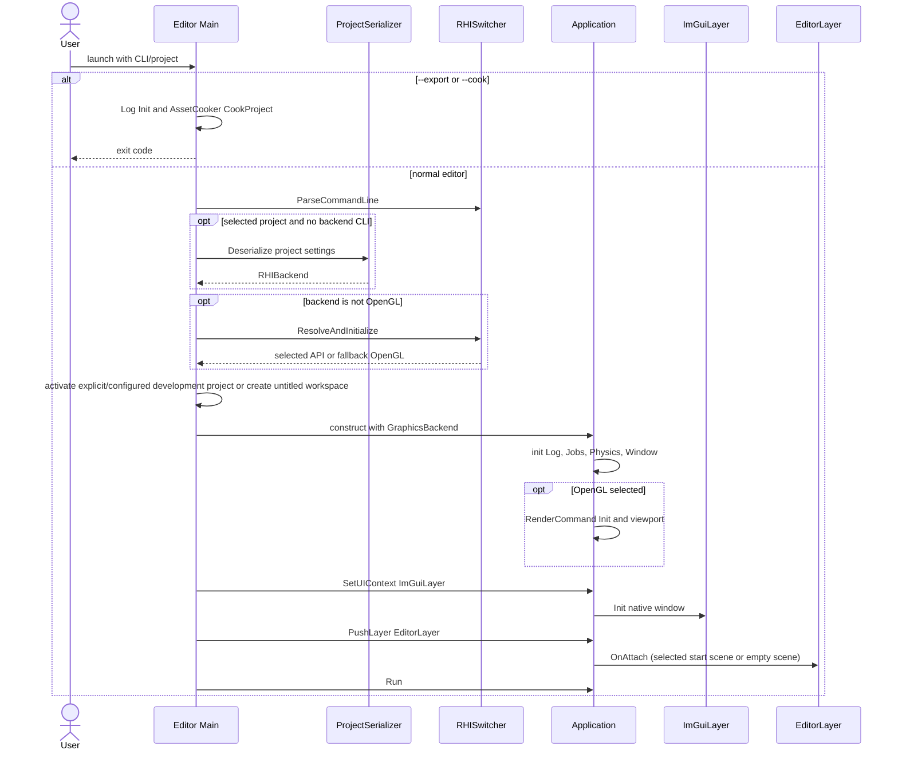
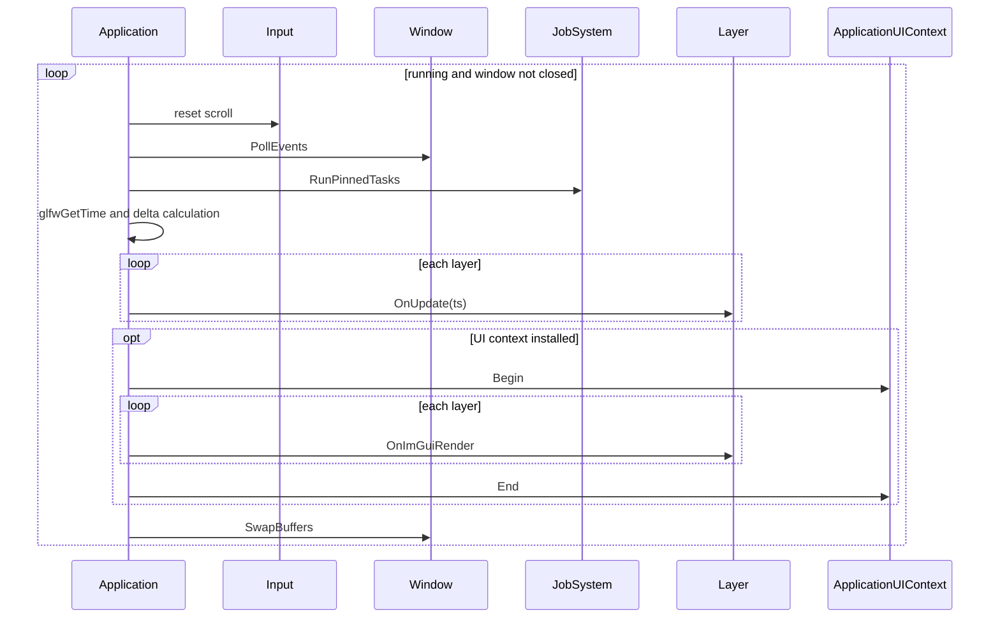
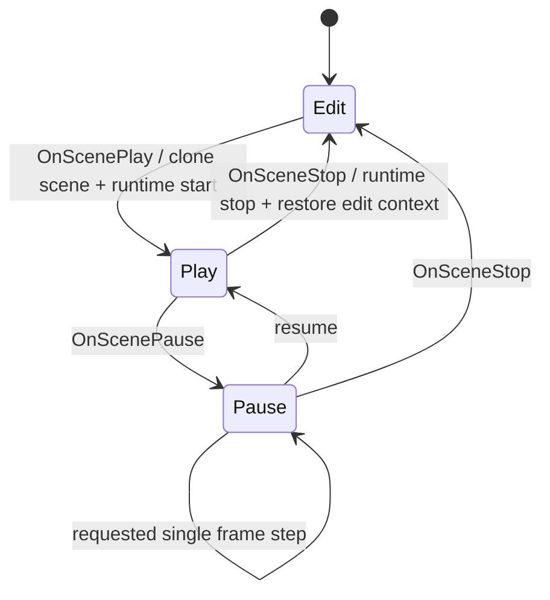
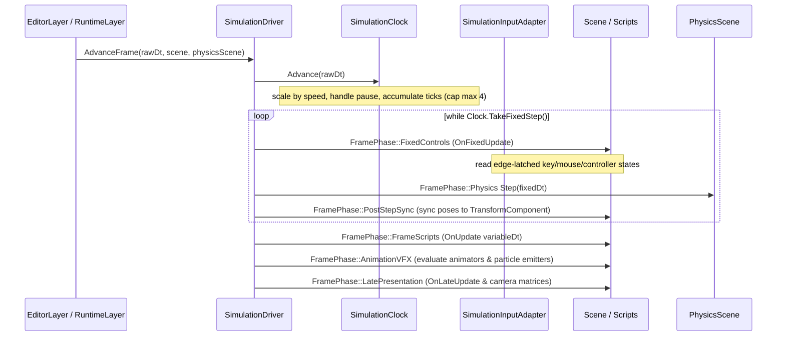
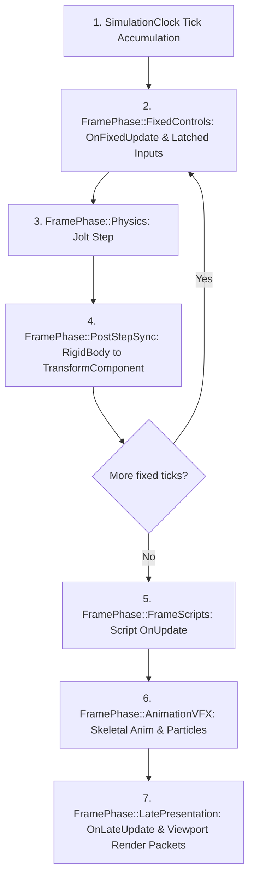
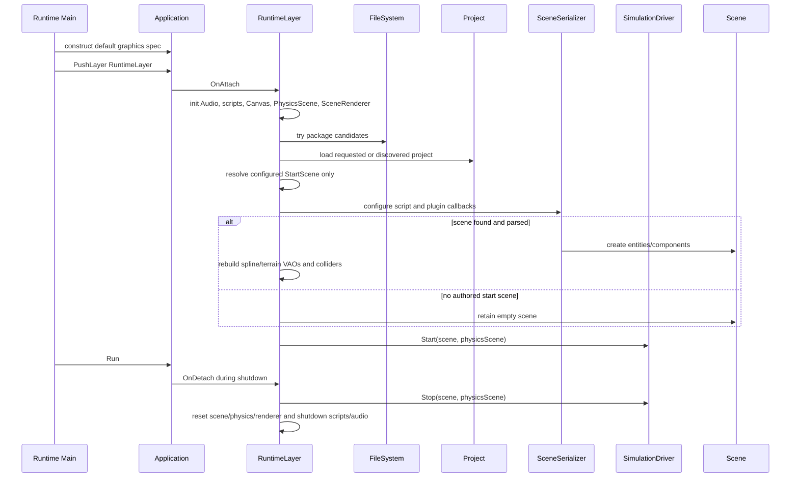
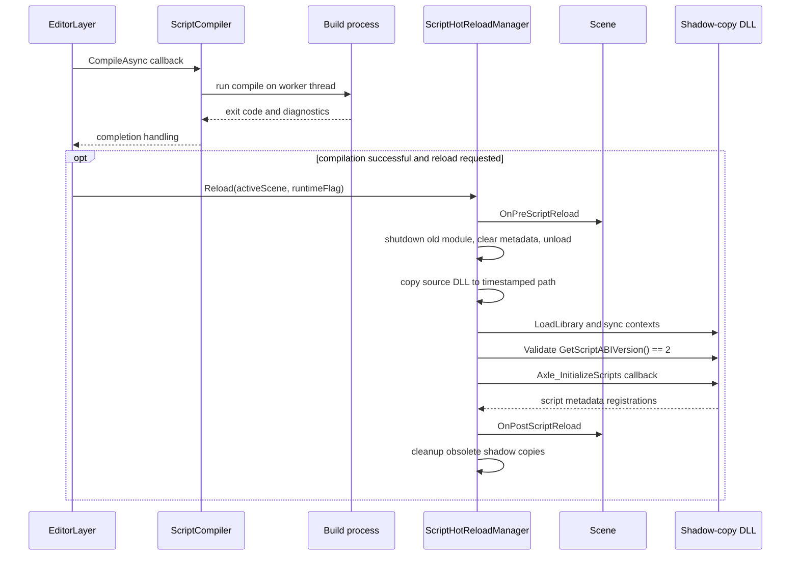
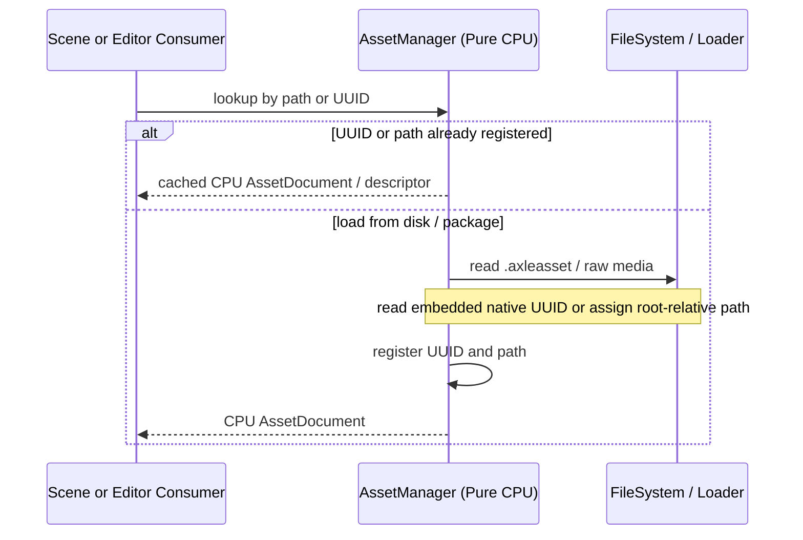
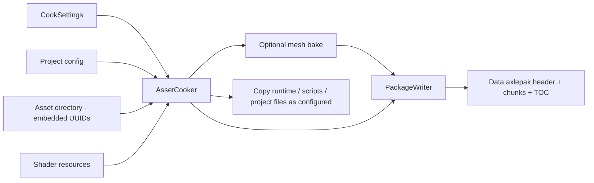

# Execution Flows: Current System

Reviewed: **2026-11-06** (post OPT-03). Diagrams describe current runtime sequence and subsystem interactions across Editor and Runtime targets.

## 1. Editor startup and backend selection



Editor Main handles cook/export before normal UI startup and requires an explicit project for cooking. Development startup selects the build-configured Samples project unless overridden by an explicit project or `--empty-project`. Backend settings come from CLI/project with fallback.

Sources: [Editor/src/Main.cpp](../../Editor/src/Main.cpp), [Engine/Platform/src/Application.cpp](../../Engine/Platform/src/Application.cpp), [Engine/Platform/src/LayerStack.cpp](../../Engine/Platform/src/LayerStack.cpp).

## 2. Shared application loop



Layer updates run before the optional UI frame. For native RHI paths, UI/RHI integration performs additional command/presentation work; the common SwapBuffers call does not mean every backend presents through OpenGL.

Sources: [Engine/Platform/src/Application.cpp](../../Engine/Platform/src/Application.cpp), [Engine/UI/src/ImGuiLayer.cpp](../../Engine/UI/src/ImGuiLayer.cpp).

## 3. Editor play, pause and stop


```mermaid
sequenceDiagram
    participant EL as EditorLayer
    participant Copy as Scene Copy
    participant Runtime as Runtime Scene
    participant Panels
    participant Driver as SimulationDriver
    participant Reload as ScriptHotReloadManager
    EL->>EL: CompileAndHotReloadAssets
    EL->>Copy: Copy editor scene
    Copy-->>EL: new runtime Scene
    Note over Copy: preserve entity UUIDs; remap registry handles/references as needed
    EL->>EL: active scene = runtime scene
    EL->>Panels: SetContext and clear selection
    EL->>Reload: sync input and ImGui context
    EL->>Driver: Start(runtimeScene, physicsScene)
    Note over EL: state = Play
    EL->>Driver: Stop(runtimeScene, physicsScene) on stop
    EL->>EL: release runtime and restore editor scene
    EL->>Panels: restore edit context
```

Scene::Copy preserves UUID identity and creates new registry handles. On stop, the editor restores its original Scene, restores physics bodies and panel contexts. Single-step execution delegates to `SimulationDriver::StepSingleFrame()`.

Sources: [Editor/src/EditorLayer.cpp](../../Editor/src/EditorLayer.cpp), [Engine/Scene/src/Scene.cpp](../../Engine/Scene/src/Scene.cpp), [Engine/Scene/src/Simulation/SimulationDriver.cpp](../../Engine/Scene/src/Simulation/SimulationDriver.cpp).

## 4. Unified SimulationDriver frame flow (shared Editor & Runtime)

Both Editor Play mode and standalone Runtime step simulation via the shared `SimulationDriver`:



The unified driver resolves legacy defect `ECSJ-05`. Editor single-step executes exactly one fixed tick (60Hz) followed by presentation, identical to standalone Runtime behavior.

Sources: [Engine/Scene/include/Axle/Simulation/SimulationDriver.hpp](../../Engine/Scene/include/Axle/Simulation/SimulationDriver.hpp), [Engine/Scene/include/Axle/Simulation/SimulationClock.hpp](../../Engine/Scene/include/Axle/Simulation/SimulationClock.hpp), [Engine/Scene/include/Axle/Simulation/SimulationInputAdapter.hpp](../../Engine/Scene/include/Axle/Simulation/SimulationInputAdapter.hpp).

## 5. Discrete simulation phases



Retired Vehicle components are eliminated from the update pipeline. General rigid bodies and `CharacterController` are synchronized deterministically during `FixedControls` and `PostStepSync`.

Sources: [Engine/Scene/src/Simulation/SimulationDriver.cpp](../../Engine/Scene/src/Simulation/SimulationDriver.cpp).

## 6. Standalone loading and shutdown



Runtime uses the clean Platform `Application` specification. It loads packages or project scenes, initializes audio/physics, and runs simulation via `SimulationDriver`.

Sources: [Runtime/src/Main.cpp](../../Runtime/src/Main.cpp), [Runtime/src/RuntimeLayer.cpp](../../Runtime/src/RuntimeLayer.cpp).

## 7. Windows script compilation and reload



Script compilation runs asynchronously on a worker thread. Shadow copying avoids Windows DLL file locks (`LNK1104`). The runtime validates `AXLE_SCRIPT_ABI_VERSION = 2` before registering script types.

Sources: [Engine/Scene/src/ScriptCompiler.cpp](../../Engine/Scene/src/ScriptCompiler.cpp), [Engine/Scene/src/ScriptHotReloadManager.cpp](../../Engine/Scene/src/ScriptHotReloadManager.cpp), [Editor/src/Scripts/ScriptsModule.cpp](../../Editor/src/Scripts/ScriptsModule.cpp), [Editor/src/EditorLayer.cpp](../../Editor/src/EditorLayer.cpp).

## 8. Pure CPU asset registry and package cooking




Native descriptors embed 64-bit UUIDs directly; raw assets use root-relative paths. `AssetManager` is a pure CPU registry without GPU dependencies. GPU caches (`MaterialCache`, `RHIMaterial`) reside in renderer bridges.

Sources: [Engine/Asset/src/AssetManager.cpp](../../Engine/Asset/src/AssetManager.cpp), [Engine/Asset/src/AssetCooker.cpp](../../Engine/Asset/src/AssetCooker.cpp), [Engine/Core/src/Package.cpp](../../Engine/Core/src/Package.cpp).

## 9. Runtime UI binding and geometry

```mermaid
sequenceDiagram
    participant RL as RuntimeLayer RenderUI
    participant Comp as UICanvasComponent
    participant Doc as UIDocument
    participant Context as Scoped UIDataContext
    participant Canvas as Canvas2D
    RL->>RL: collect visible canvases and sort
    RL->>RL: process input against existing documents
    RL->>Canvas: BeginCanvas viewport
    loop each sorted canvas
        alt Document absent
            RL->>Doc: create and LoadFromFile
        else document exists
            RL->>Doc: CheckAndHotReload
        end
        RL->>Comp: GetDataSourceEntity
        RL->>Context: parent = scene context; copy reflected script fields
        RL->>Doc: EvaluateBindings scoped context
        RL->>Doc: UpdateLayout viewport
        RL->>Doc: Render Canvas
        Doc->>Canvas: DrawRect / DrawText / sprites etc.
    end
    RL->>Canvas: EndCanvas
    Note over Canvas: retains CPU vertices/indices and statistics; no GPU submit in EndCanvas
```

Input processing occurs before creating or updating canvas layouts. Scoped data contexts combine scene state with reflected script variables. `Canvas2D` outputs CPU vertices and indices for batch submission.

Sources: [Runtime/src/RuntimeLayer.cpp](../../Runtime/src/RuntimeLayer.cpp), [Engine/UI/src/UI2D/UIDocument.cpp](../../Engine/UI/src/UI2D/UIDocument.cpp), [Engine/UI/src/UI2D/Canvas2D.cpp](../../Engine/UI/src/UI2D/Canvas2D.cpp).
