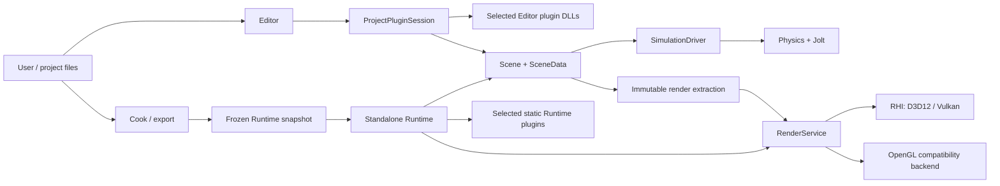
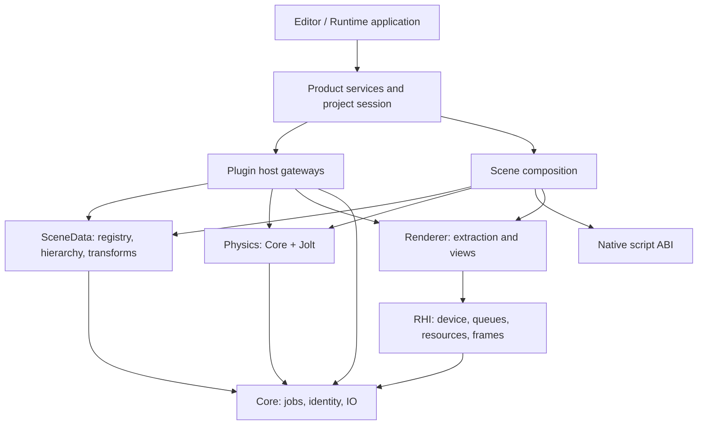

# Software Architecture Document: OPT-01..OPT-10 architecture

Updated: **2026-11-09**

This SAD describes the architecture delivered through OPT-09 and enforced by
OPT-10. Package status is owned by [`docs/ROADMAP.md`](../ROADMAP.md). Current
verification and open acceptance gates are owned by
[`OPT_10_ARCHITECTURE_ACCEPTANCE.md`](../reviews/OPT_10_ARCHITECTURE_ACCEPTANCE.md).
The document describes current ownership and contracts; it does not release
OPT-11 or deferred feature expansion.

## 1. System context

AxleEngine has two products. The Editor hosts authoring tools and selected
plugin DLLs. The Runtime is built from a frozen project snapshot and statically
includes only the selected Runtime plugin modules. Both products use the same
CPU scene/simulation contracts and the same rendering service boundary.

## 2. Architectural decisions

1. `Core` is the lowest first-party layer. It owns jobs, owner-scoped
   completion, UUID/identity helpers and atomic file IO.
2. `SceneData` owns registry storage, hierarchy, transforms and generic
   extension persistence. It has no renderer, UI, Jolt or plugin implementation
   dependency.
3. `Asset` owns CPU formats, discovery and import/cook interpretation. Native
   assets embed UUIDs; raw external resources use canonical root-relative paths.
4. `Scene` composes SceneData, scripts, physics and plugin callbacks through the
   shared simulation driver. Editor and Runtime do not invent separate clocks.
5. `Physics` links Core and Jolt only. `PhysicsDebug` is the higher-level adapter
   that turns Jolt debug primitives into renderer-facing work.
6. `Renderer` owns extraction, render-world/view requests and ECS streaming.
   `RHI` owns native device/resource/frame lifetimes and cannot depend upward on
   Renderer, Scene, EnTT or Jolt.
7. Plugins use existing jobs, simulation phases, persistence and render services.
   They do not create a scheduler, fixed clock, device or presentation owner.
8. The built-in Engine Vehicle module is retired. Future Vehicle, Spline and
   Terrain implementations are plugin features and remain deferred after the
   current OPT-10 boundary.

## 3. Layered ownership

Arrows show ownership or allowed use, not a mandatory execution order. The
architecture checker validates both CMake target edges and source include edges;
unresolved dynamic composition is treated as a coverage error.

## 4. Product and artifact boundaries

The Editor resolves plugin manifests, validates dependencies, builds or locates
compatible DLLs, and activates them at a safe startup boundary. Export resolves
the same project selection into a materialized snapshot, generated registration
and a matching receipt. The packaged Runtime refuses a missing or mismatched
selection instead of silently loading a different product.

## 5. Acceptance boundary

OPT-10 has delivered the architecture checker hardening, graphics-debug
separation, stress target and acceptance runner. Final acceptance remains open
for the native UI and product/export gates recorded in the current acceptance
report. Historical architecture surveys and feature plans are references only;
they do not override this status.
