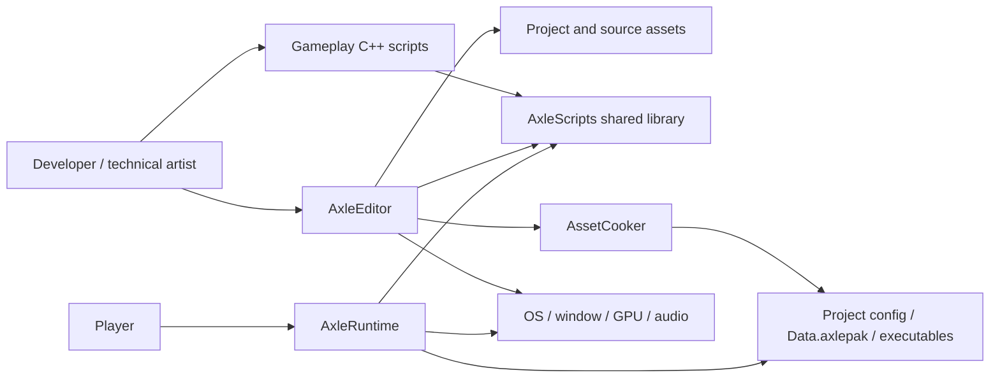
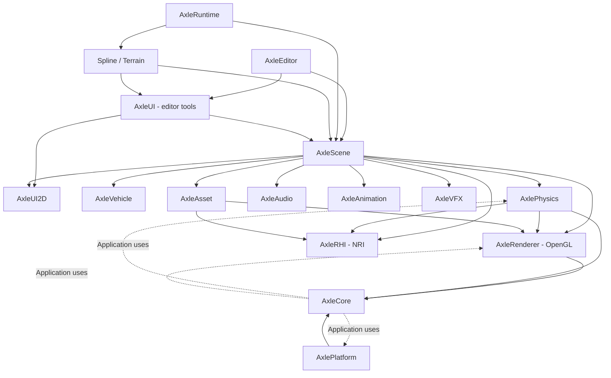
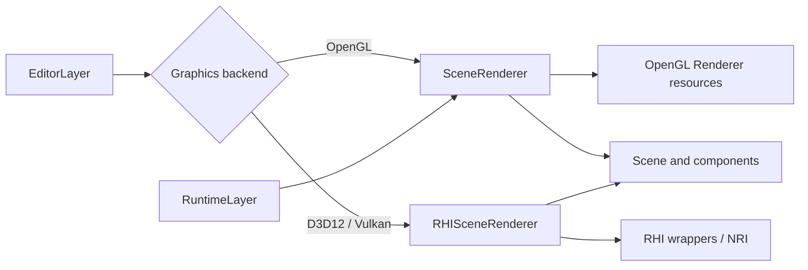
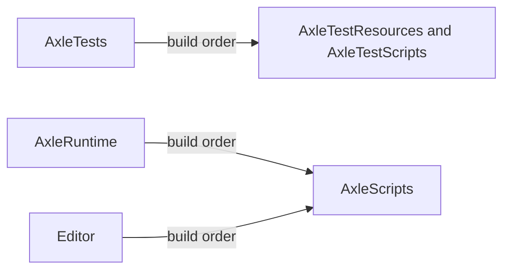

# Software Architecture Document: Current System

> **Dated source snapshot:** this survey predates the 2026-11-04 Vehicle
> retirement and later sample cleanup. It is retained for architectural context,
> not current API/feature support. Follow the [optimization roadmap](../ROADMAP.md)
> for execution; unavailable source paths below are historical references.

Status: **AS-IS**, reviewed 2026-11-01. Proposed changes are documented separately in [Target Layered Architecture](TARGET_LAYERED_ARCHITECTURE.md).

## 1. Purpose and system context

AxleEngine is a C++20 3D engine with an authoring editor, a standalone player, EnTT entity/component storage, native C++ scripts, OpenGL rendering and an NRI-based RHI path, Jolt physics, miniaudio, animation, VFX and UI2D. Vehicle, spline and terrain features supply domain-specific functionality.

Source-visible workflows include project/scene editing, model and asset ingestion, assembly authoring, play/pause/stop, script compilation and reload, material/HLSL/VFX/UI editing, cooking packages and running a startup scene.



Evidence: [Editor entry point](../../Editor/src/Main.cpp), [Runtime entry point](../../Runtime/src/Main.cpp), [AssetCooker](../../Engine/Asset/src/AssetCooker.cpp), [script exports](../../Editor/src/Scripts/ScriptsModule.cpp).

## 2. Physical organization

```text
Engine/
  Core/        Application, jobs, logging, VFS and packages
  Platform/    Window, input, events and OS utilities
  Renderer/    OpenGL resources and render commands
  RHI/         NRI resources, commands, pipelines and streaming
  Asset/       Metadata, resource caches, DSL, import and cooking
  Physics/     Jolt worlds, characters, jobs and debug renderers
  Audio/       miniaudio wrappers
  Animation/   Skeletons, clips, poses, states and skeletal meshes
  VFX/         Particle simulation and OpenGL/RHI renderers
  Vehicle/     Vehicle physics, telemetry, audio and VFX
  Scene/       ECS, components, simulation, rendering and scripts
  Project/     Project configuration and serialization
  UI/          Separate UI2D and editor UI targets in one directory
  Resources/   Shader resources
Editor/        Editor application, scripts, tests and sample assets
Runtime/       Standalone player
Plugins/       Spline and Terrain static libraries
Samples/       Sample project and gameplay scripts
assets/        Additional source assets and generated shader cache
ThirdParty/    Vendored libraries and Git submodules
docs/          Guides, specifications and architecture documentation
```

Most modules separate `include/` from `src/` and expose `Axle::...` CMake aliases. These are useful organizational boundaries, but the current source dependency graph does not enforce strict layering.

## 3. Module responsibilities and boundaries

| Target | Current responsibility | Boundary consideration |
|---|---|---|
| AxleCore | Types, UUID, logging, jobs, LayerStack, FileSystem, Package, Application | Application uses Platform, Renderer and Physics; Foundation is an alias of the same target |
| AxlePlatform | GLFW window/input, event records, file dialogs | Public interfaces expose native window types and backend selection |
| AxleRenderer | OpenGL commands, buffers, VAOs, shaders, textures, materials, shadows, skybox and skinning | Separate from the RHI target; not currently a renderer layered exclusively on RHI |
| AxleRHI | NRI device/surface/swapchain, shader compilation/reflection, GPU resources, barriers, pipelines, descriptors and streaming | Public APIs expose NRI types; includes light/material and ECS streaming concepts |
| AxleAsset | Metadata registry, texture/material caches, mesh conversion, DSL and cooking | Identity, GPU resource loading and authoring tools share one target |
| AxlePhysics | Jolt world/body operations, character controller, job adapter and debug rendering | Links Renderer, RHI and Asset for integration/debug responsibilities |
| AxleAudio | Engine, clip, source and listener | Relatively small subsystem primarily linked to Core |
| AxleAnimation | Skeletons, clips, blending, state machine, animator and skeletal import | CPU evaluation is combined with VAO creation and shader palette upload |
| AxleVFX | SoA particle pools, emitters, forces/collision, serialization and two renderers | Simulation and graphics share a target |
| AxleVehicle | Jolt vehicle controller, telemetry, vehicle audio and effects | Domain toolkit is a mandatory Scene dependency in current CMake |
| AxleScene | Registry/entity/hierarchy, components, copy, simulation, serializers, scripts and scene renderers | Broad integration layer, not an isolated ECS foundation |
| AxleProject | ProjectConfig, active project and serialization | Active project is process-wide static state |
| AxleUI2D | Document/node/parser, layout, binding, font and canvas geometry | Canvas2D generates CPU geometry; EndCanvas does not submit GPU work |
| AxleUI | ImGui integration, panels, inspectors, previews and HLSL Studio | Editor tooling is reachable through plugin and script dependencies |
| AxleSpline | Curves, track geometry/collision, serialization and editor tools | Runtime/editor code is built into one static library |
| AxleTerrain | Heightfields, chunks/LOD, mesh/collision, sculpting, spline carving and editor tools | Depends on Spline and editor UI |

See the [complete dependency map](DEPENDENCY_MAP.md) for direct link edges and examples of cross-module includes.

## 4. Important current dependencies



Solid arrows show selected direct target links. Dashed Core arrows show source dependencies exposed through include paths rather than corresponding target links. Checking only CMake link edges would miss these upward dependencies.

Scene links UI2D, while AxleUI links Scene. This is not a target cycle: UI2D and UI are different libraries even though they share `Engine/UI`.

Runtime links Spline/Terrain, which publicly link AxleUI. This establishes a transitive tooling dependency. Whether all editor object code survives the final link requires binary/linker-map inspection; static linkage alone does not establish binary size.

## 5. Rendering paths and backend selection



Editor Main reads command-line/project backend settings and initializes RHISwitcher with fallback before constructing Application. EditorLayer owns both scene renderer types and their corresponding viewport resources.

Runtime Main constructs Application using its default OpenGL backend. RuntimeLayer owns SceneRenderer, not RHISceneRenderer. Editor backend support is therefore not evidence that the standalone executable uses an identical backend-selection path.

MeshInstance3D retains both OpenGL VAO and RHI mesh/material references. Scene, Physics and VFX contain parallel rendering paths. This is a transitional architecture with duplicated backend integration responsibilities.

HLSLStudioPanel is now wired through EditorLayer callbacks and rendering. It compiles source through RHIShaderCompiler for the active backend. Successful panel compilation alone does not establish replacement of every existing scene pipeline or parity across all backends.

## 6. Processes, threads and resource lifetime

- Editor and Runtime are separate executables. AxleScripts is a shared library loaded into the application process; Windows reload uses a timestamped shadow copy.
- Engine libraries and Spline/Terrain are static libraries. Their directory name does not imply dynamic plugin discovery or loading.
- Application exclusively owns Window and ApplicationUIContext, contains LayerStack by value, and exposes a process-wide instance pointer. LayerStack retains shared Layer references.
- EditorLayer retains edit/runtime/active scenes with shared pointers and owns physics/rendering controllers exclusively. RuntimeLayer retains Scene, owns PhysicsScene/SceneRenderer, and contains Canvas2D by value.
- Scene owns its EnTT registry and runtime vehicle data. Entity is a handle plus a non-owning Scene pointer.
- JobSystem uses enkiTS. JobSystemEnkiTS adapts Jolt jobs to that scheduler. ScriptCompiler additionally uses a dedicated worker thread to execute the build process.
- CompileAsync invokes its completion callback on its worker thread; the Editor callback performs reload and updates editor state directly. No main-thread dispatch is present in this path. Future design must explicitly establish scene/script/UI thread ownership.
- GPU wrappers may own raw native NRI handles and release them in Shutdown/destructors. Raw pointer syntax alone does not establish non-ownership.

## 7. Persistent data and assets

| Format | Current use |
|---|---|
| .axleproj | Project, asset directory, startup scene and backend configuration |
| .axlescene | Text scene/entity/component serialization |
| .axleasset | Typed asset DSL; domain loaders interpret blocks/properties |
| .axle/.axlemesh/.axlebin | Assembly/mesh descriptors and binary mesh caches; schema depends on the loader |
| .meta | Companion UUID/type/path metadata |
| .axlepak | Header, data chunks and table of contents indexed by path/UUID |
| .axleui | Legacy UI paths/format still present alongside canvas .axleasset descriptors |
| .axleterrain | Terrain data; surveyed terrain payloads are binary |
| .vert/.frag/.hlsl | Shader families for the graphics paths |

FileSystem reads a mounted package entry first when available, then resolves disk/resource paths. AssetManager combines process-wide metadata maps and shared resource caches; Project also stores static active state. These conveniences complicate independent contexts and test isolation.

Asset metadata identity must remain stable. Current `.gitignore` excludes `*.meta`, while AssetManager generates a new random UUID when metadata is missing/invalid. UUID-based references can therefore change on a fresh checkout. This is a source-visible risk, not a claim that a specific asset failure was reproduced.

PackageWriter currently writes uncompressed chunks and sets CompressedSize equal to Size. AssetCooker traverses the asset directory; it is not established as a referenced-assets-only dependency-closure cooker.

## 8. Build and deployment

Root CMake configures C++20, dependencies, all engine modules, both plugins and both applications. There are no top-level first-party options for independently disabling Editor, Tests or Vehicle/Terrain.



Editor/default builds exclude Runtime and test executables. Runtime is built on demand by standalone export and stages scripts plus engine resources into its own output directory. Editor stages engine resources and Windows x64 DXC DLLs. Tests independently stage fixtures and a fixture script DLL under the build tree. Project assets are not bundled into Editor/Runtime by post-build steps. See [build workflows](../guides/BUILD_WORKFLOWS.md).

Windows DLL/OS paths and DXC staging require platform-specific review before claiming a working Linux distribution. This documentation does not validate a platform build.

## 9. Quality assessment

| Attribute | Useful foundation | Current limitation |
|---|---|---|
| Modularity | Subsystem targets and include/src organization | Upward Core dependencies; broad Scene; plugins pull tooling |
| Extensibility | ECS, script factories/reflection and serializer callbacks | Component lifecycle/copy/serialization/inspection needs coordinated manual updates |
| Testability | Extensive functional test sources and headless helpers | Test build depends on Editor; global state and graphics contexts complicate isolation |
| Portability | Platform wrappers and NRI path | Native types/Windows reload/staging; different Runtime bootstrap |
| Performance design | EnTT, particle SoA, enkiTS and caches | No benchmark evidence collected by this review |
| Data integrity | Persistent UUID metadata and separate edit/runtime scenes | Metadata ignored by Git; identity handling needs clean-checkout verification |
| Maintainability | Many guides and subsystem APIs | Historical claims drift from implementation; integration files are large |

## 10. Design implications

Keep the subsystem decomposition, but move application orchestration out of Core, separate Scene data from integration, split runtime/editor plugin targets, isolate asset identity from GPU/loading/tools, and define the Renderer/RHI boundary. Enforce dependencies using both target and include checks. The [target design](TARGET_LAYERED_ARCHITECTURE.md) expands these recommendations; no engine refactor is implemented by these documents.
