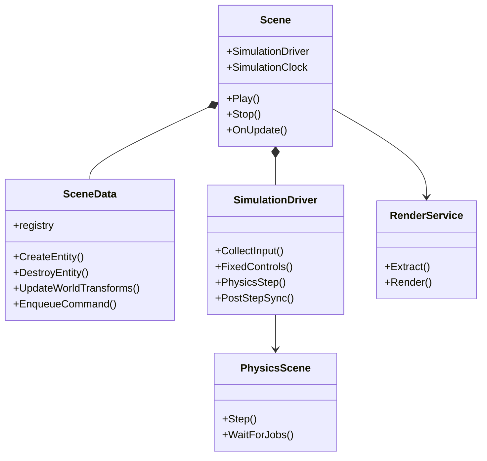
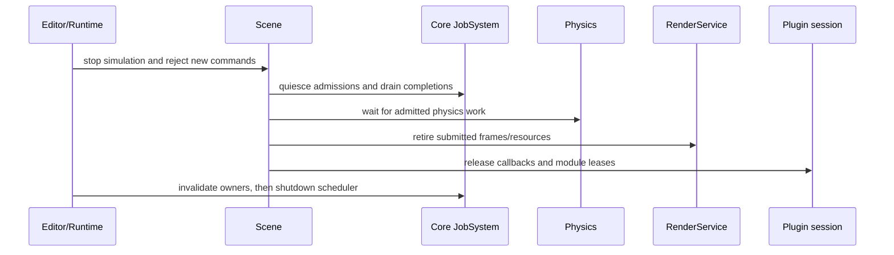

# Software Design Description: OPT-01..OPT-10 contracts

Updated: **2026-11-09**

This SDD names the current owners, data flow and lifetime contracts. For
execution order see [`docs/ROADMAP.md`](../ROADMAP.md); for measured evidence
see [`ARCHITECTURE_ACCEPTANCE.md`](../guides/ARCHITECTURE_ACCEPTANCE.md) and the
[`OPT-10 acceptance record`](../reviews/OPT_10_ARCHITECTURE_ACCEPTANCE.md).

## 1. Core and persistence

`Axle::Core` provides `JobSystem`, owner-scoped completion (`OperationOwner`,
`OwnerToken`), UUID/identity helpers and atomic file operations. A caller keeps
an owner token alive until its callback work is complete; shutdown invalidates
owners, drains admitted work and then tears down the scheduler. Native asset
UUIDs are embedded in the asset file. Raw resources are addressed by canonical
root-relative paths. No legacy Vehicle reader or sidecar identity registry is
part of the current contract.

## 2. SceneData and Scene

`SceneData` owns the EnTT registry, entity hierarchy, local/world transforms,
command buffering and generic extension records. `Scene` owns composition and
lifecycle: it binds scene data to scripts, Physics, plugins and rendering while
using one `SimulationDriver` and `SimulationClock` for Editor Play and Runtime.

Structural edits go through `SceneCommandBuffer` and scene lifetime/epoch
validation. Worker jobs publish immutable results; Editor/UI mutation remains on
the owner thread.

## 3. Physics and debug rendering

`Axle::Physics` depends on Core and Jolt only. It owns the physics world,
submission records and job bridge. It exposes physics state and Jolt debug
primitives without including Renderer or RHI. `Axle::PhysicsDebug` is the
higher-level adapter used by Scene/rendering consumers. This keeps debug drawing
above the Physics boundary and avoids a graphics dependency in Physics.

## 4. Rendering contracts

Renderer extracts immutable values from SceneData and plugin-owned components
into a `RenderWorld`/view request. `RenderService` selects an explicit backend:
NRI D3D12, NRI Vulkan or the maintained OpenGL compatibility adapter. RHI owns
native device, command, resource, queue and presentation lifetimes. Submitted
work retains code and resources until the corresponding CPU/GPU retirement
point. See [Render flow](RENDER_FLOW.md).

## 5. Plugin contracts

A plugin manifest declares identity, version, module kind, dependencies and
schema registration. The project session resolves the manifest graph before
activation. Editor modules run as shared-host DLLs. Selected Runtime modules
are statically composed from the frozen export snapshot. Plugin callbacks use
existing Core jobs, SceneData commands, SimulationDriver phases and RenderService
views; they cannot create a competing scheduler, clock, renderer or presentation
owner. See [Plugin flow](PLUGIN_FLOW.md).

## 6. Persistence and missing plugins

Scene and assembly persistence stores generic extension type/schema metadata and
uses the shared atomic save path. A missing plugin is reported as an explicit
readiness or selection error. The current clean-engine policy does not preserve
or migrate retired Vehicle payloads.

## 7. Lifetime and shutdown order

The concrete application teardown may add UI and platform steps, but it must
preserve the owner, physics and GPU retirement constraints above.

## 8. Deferred scope

Advanced material/VFX/animation authoring, full Vehicle/Spline/Terrain feature
sets and OPT-11 rendering expansion are deferred. Their archived plans are
historical design references; they do not release implementation work.
