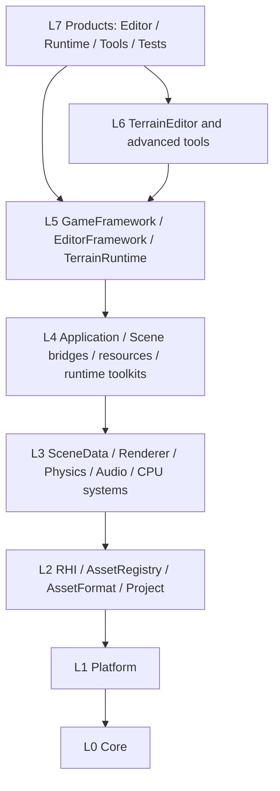
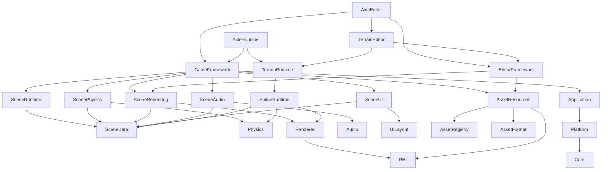
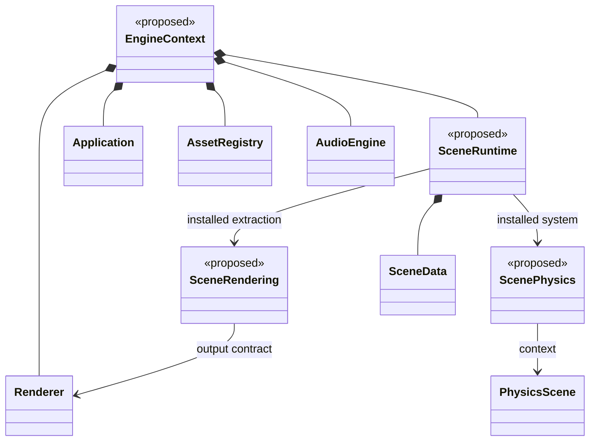

# Proposed Modular Layered Architecture

Status: **TO-BE — design proposal, not implemented**. Current targets and dependencies are described in [SAD](SAD.md) and [Dependency Map](DEPENDENCY_MAP.md).

**Rendering execution priority (2026-11-03):** The detailed
[RHI-primary rendering architecture](../design/RHI_PRIMARY_RENDERER_ARCHITECTURE.md)
and [Phase 41 package plan](../design/RHI_PRIMARY_RENDERER_IMPLEMENTATION_PLAN.md)
specialize this proposal for the user's current highest priority. They define
incremental implementation gates; this broader module proposal remains unimplemented.

## 1. Objectives and rules

Allow products to select engine capabilities without pulling in the editor or every gameplay toolkit. Each module should have a coherent responsibility, explicit public API, dependency policy and lifetime owner.

1. Keep the engine dependency graph acyclic. Dependencies point toward lower layers.
2. Modules within a layer do not link to each other. Place a bridge above the systems it integrates, or adjust the layer assignment to match the real dependency.
3. Higher layers may directly use lower foundation services; calls need not traverse every intervening layer.
4. Represent build boundaries with CMake targets, not directory names alone.
5. Separate CPU data/algorithms, graphics resources and authoring tools where independent use or testing benefits.
6. Introduce interfaces/callbacks/data contracts at useful seams, rather than adding an abstract interface to every class.
7. Keep domain toolkits optional. Generic Scene data should not require Vehicle or Terrain.

## 2. Proposed layers

| Layer | Candidate modules | Allowed engine dependencies |
|---|---|---|
| L0 Foundation | Core | None; selected foundation third-party libraries are allowed |
| L1 Platform | Platform | L0 |
| L2 Low-level services | RHI, AssetRegistry, AssetFormat, Project | L0–L1 |
| L3 Subsystems | SceneData, Renderer, Physics, Audio, AnimationCPU, VFXSimulation, UILayout | L0–L2 |
| L4 Integration/toolkits | Application, SceneRuntime, SceneRendering, ScenePhysics, SceneAudio, SceneAnimation, SceneVFX, UIRendering, SceneUI, AssetResources, VehicleRuntime, SplineRuntime | L0–L3 |
| L5 Composition/authoring | GameFramework, EditorFramework, TerrainRuntime, VehicleIntegration, SplineEditor | L0–L4 |
| L6 Advanced tooling | TerrainEditor, product-specific authoring | L0–L5 |
| L7 Products | AxleEditor, AxleRuntime, CookerCLI, test executables | Selected lower modules; Runtime excludes editor modules |

These layers express a dependency policy, not a requirement for eight runtime abstraction hops. Modules may be combined when independent boundaries have no value, provided the resulting graph remains valid.

TerrainRuntime sits above SplineRuntime because current terrain carving uses spline data. An alternative is to extract TerrainSplineCarving as a separate bridge; placing mutually dependent functionality at the same layer would not solve the dependency problem.



## 3. Important target dependencies



This is a selected-edge design view. GameFramework coordinates peer L4 adapters instead of making them link to one another. For example, composition can install a resource-lookup callback/data contract into SceneRendering without a same-layer link to AssetResources. Application owns loop/window orchestration and lifecycle hooks; product composition chooses actual subsystem services.

## 4. Responsibility boundaries

| Module | Owns/provides | Must not require |
|---|---|---|
| Core | Types, UUID, jobs, logging, IO/package primitives | Window, concrete physics/rendering, editor or material-domain concepts |
| Platform | OS/window/input/time/library services | Scene and gameplay toolkits |
| RHI | Device/queue/resource/pipeline/command/swapchain | EnTT, scene entities, PBR material domain or gameplay lights |
| AssetRegistry | UUID/path/type identity and metadata | GPU objects and editor widgets |
| AssetFormat | DSL syntax/tree and format version contracts | GPU upload and scene lifecycle |
| SceneData | Registry/entity, identity, transforms, hierarchy and extension storage | Concrete Vehicle, physics, audio, script compiler or renderer |
| Physics | Simulation/body/query APIs and vendor bridge | OpenGL/RHI debug graphics or ECS components |
| Renderer | Render data, mesh/material/light GPU representation and passes | Editor panels and concrete ECS storage |
| AnimationCPU | Clips, blending, states and poses | VAOs and shader palette upload |
| VFXSimulation | Pools, emission, forces and world-query contracts | Concrete graphics backend |
| UILayout | Documents, layout, binding and CPU drawing data | ImGui, graphics backend or Vehicle-specific key aliases |
| Scene bridges | ECS extraction/synchronization for a subsystem | Product/editor workflows |
| EditorFramework | Selection, commands, panels, inspection and previews | Being linked by standalone Runtime |

Vendor types need not all be hidden in the first step. Isolate them at documented boundaries and migrate incrementally. Move the EnTT streaming adapter above RHI so low-level GPU code does not depend on ECS.

## 5. Ownership proposal



EngineContext is a proposed composition owner. Installed system references do not imply same-layer target links: use lower-level contracts or callbacks. Detailed implementation must establish where those contracts live and who owns each installed object.

Shutdown must stop jobs/GPU submissions, release scene instances and resources, and only then destroy devices/platform services. Explicit ownership should gradually replace reliance on unrelated global shutdown order.

## 6. ECS and component extension

Keep foundation components small. Put domain components in their integration/toolkit modules so generic entity consumers do not include every subsystem. Retain serializer callbacks as a useful migration seam.

Consider component descriptors for copy/serialization/inspection only after concrete use cases are defined. Preserve entity UUIDs across edit/runtime clones while remapping registry handles and typed references. Preserve asset identity through source control.

## 7. Shared simulation contract


This sequence is a proposal, not current behavior. Editor and Runtime should share scheduling semantics. Define how pause, stepping and simulation speed affect physics, scripts, animation and VFX before relocating the existing update functions. Script compile completion should hand off scene/UI mutation to the owning thread.

## 8. Build contract

Illustrative configuration only:

```cmake
option(AXLE_BUILD_EDITOR "Build editor tools" ON)
option(AXLE_BUILD_RUNTIME "Build standalone player" ON)
option(AXLE_BUILD_TESTS "Build tests" ON)
option(AXLE_ENABLE_VEHICLE "Enable vehicle toolkit" ON)
option(AXLE_ENABLE_SPLINE "Enable spline toolkit" ON)
option(AXLE_ENABLE_TERRAIN "Enable terrain toolkit" ON)

target_link_libraries(AxleScenePhysics
    PUBLIC Axle::SceneData Axle::Physics
    PRIVATE Axle::Core
)
```

Use PUBLIC only when the public API requires a dependency; use PRIVATE for implementation needs. PRIVATE linkage of a static library can still contribute requirements to the final executable link. Avoid exporting unrelated vendor include paths/definitions through every consumer.

Validate optional-feature dependencies such as Terrain→Spline explicitly. Define gameplay scripts for the game project rather than under Editor. Stage test resources with a dedicated target instead of requiring the IDE executable.

## 9. Architecture acceptance checks

| Check | Acceptance criterion |
|---|---|
| Target graph | No cycles or upward engine edges |
| Include graph | No hidden upper-layer dependencies through include paths |
| Public API | Only own include roots and API-required usage requirements are exported |
| Runtime-only build | Configure/build succeeds with Editor disabled |
| Optional gameplay | SceneData builds without Vehicle/Terrain |
| Headless use | Core, registry/ECS and CPU tests need no graphics context |
| Tooling separation | No transitive Runtime→editor-module path |
| Backend boundary | Native graphics calls live within the selected implementation boundary |
| Identity | Clean checkout preserves asset UUIDs and references |
| Simulation parity | Editor and standalone use the same declared scheduling semantics |

These checks require future implementation. The documentation update does not install an enforcement system or claim the checks currently pass.

## 10. Incremental migration

| Step | Candidate change | Evidence required before proceeding |
|---|---|---|
| 1 | Extract Application from Core and remove reverse includes | Core can build/test independently; application lifecycle unchanged |
| 2 | Split Spline/Terrain runtime/editor and scripts configuration | Runtime builds with Editor disabled |
| 3 | Separate test/resource staging from Editor | Headless test targets build without IDE |
| 4 | Extract SceneData/bridges and shared scheduling | Play/pause/step/copy and standalone behavior tests |
| 5 | Split registry/format/resources/import/cooking | Clean-checkout identity and loading validation |
| 6 | Unify Renderer→RHI and isolate CPU systems | Backend/resource lifetime and actual submission tests |
| 7 | Enforce target/include policy in CI | New forbidden dependencies fail review/checks |

Apply these changes in reviewable stages after the design is agreed. No step is performed by this document.
