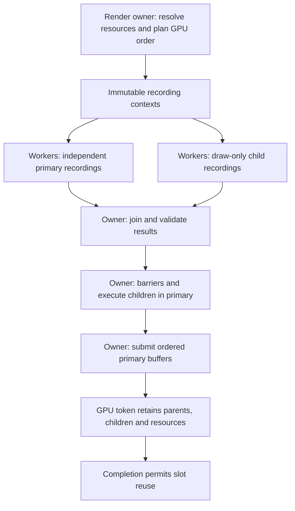

# OPT-11 C11-04 Hybrid Recording: Architecture, NRI Extension and Delivery Plan

**Date:** 2026-11-10.
**Status:** Detailed design and delivery gates, not an implementation or PASS claim.
The live exchange owns the released scope. This document creates no remote fork,
changes no vendor source and does not release C11-05.

**Engine planning baseline:** `aa13a4b`.
**Pinned NRI baseline:** `6998e3fbbaed1b132f386a9d49743a2481003487`
(local header version 190).

Related contracts:

- [OPT-11 execution plan](OPT_11_EXECUTION_PLAN.md)
- [OPT-11 architecture and algorithms](OPT_11_ARCHITECTURE_AND_ALGORITHMS.md)
- [C11-04 primary-batch delivery](OPT_11_C11_04_DELIVERY.md)
- [C11-05 safety plan](OPT_11_C11_05_SAFETY_PLAN.md)
- [NRI integration contract](NRI_INTEGRATION_CONTRACT.md)

## 1. Decision and order relative to C11-05

**Priority update, 2026-11-10:** the user selected C11-05 before full hybrid after
discussing its unproven incremental benefit over worker primary recording.
Secondary/bundle execution and the NRI fork are deferred. Preserve this document
as the future design, not a prerequisite blocking C11-05.

Preserve the accepted independent-primary path as the reference. Do not change
recording ownership and native memory reuse in the same implementation package.
The selected sequence is now:

```text
C11-05 pure planner and unaliased transient resources on the accepted owner path
  -> C11-05 placed resources, interval packing and alias barrier proof
  -> measure whether worker primary recording resolves the CPU bottleneck
  -> optional Vulkan secondary / D3D12 bundle experiments and hybrid integration
  -> combined hybrid + aliasing validation before enabling that combination
```

Secondary execution is not a prerequisite for parallel primary recording. NRI
already exposes primary command buffers and array submission. AxleEngine must
first provide worker-local ownership/state tracking to use that functionality
safely. A primary-only result is a useful milestone but is not delivery of the
requested hybrid feature.

If either secondary backend remains unsupported, report that row explicitly and
leave hybrid acceptance open. Do not rename CPU packet preparation or primary
batch submission as native secondary execution.

## 2. Verified starting point and missing pieces

The repository currently provides:

- `RHIPrimaryCommandBatch`: independent allocators and owner-controlled submission;
- `RHIRecordingPlan`: dependency validation and deterministic CPU batches;
- an owner-thread RHI resource service, tentative state journal and GPU leases;
- native primary-batch verification recorded for D3D12 and Vulkan.

The current batch tests include empty native recordings. They establish the
recording/submission lifecycle, not rendered image parity or worker throughput.
Rerun and extend these tests against new source rather than reusing old PASS claims.

Missing contracts and their implementation locations:

| Missing contract | Planned owner |
| --- | --- |
| Secondary/bundle creation and execution | Small NRI extension, backend implementations and validation layer |
| Render-context inheritance and allowed operations | NRI extension descriptors plus RHI typed encoder |
| Exclusive worker recording permission | RHI recording context tied to epoch, frame slot and worker |
| Declared resource states without global mutation | Immutable plan and worker-local journal |
| Descriptor/constant storage isolation | Frame-owned arenas and stable descriptor ranges |
| Parent-child resource lifetime | RHI resource service and frame completion record |
| Choosing primary versus child recording | Renderer scheduler with explicit capability gates |
| Real output and performance evidence | Native fixtures and representative renderer integration |

Source seams to inspect before implementation:

- `Engine/RHI/include/Axle/RHI/RHICommandBuffer.hpp` and `src/RHICommandBuffer.cpp`;
- `Engine/RHI/include/Axle/RHI/RHIParallelRecording.hpp` and its implementation;
- `Engine/RHI/include/Axle/RHI/RHIResource.hpp` and `src/RHIResource.cpp`;
- `Engine/RHI/src/RHIDevice.cpp`, `RHIFrameContext.cpp`, `RHIDescriptorPool.cpp`;
- `Engine/Renderer/include/Axle/RenderGraph.hpp` and `src/RenderGraph.cpp`;
- `Engine/Scene/src/RHISceneRenderer.cpp`;
- `ThirdParty/NRI/Source/{VK,D3D12,Validation}` and interface registration.

The pinned Vulkan allocator hardcodes primary level. Its Begin path supplies no
secondary inheritance info, and its dynamic rendering setup has no child-content
mode. The D3D12 allocator derives direct/compute/copy type from its queue; the
graphics accessor does not currently accept bundle type. These paths need real
implementation changes, not only new public function pointers.

## 3. Scope and architecture

The first hybrid implementation is graphics-only, one graphics queue, fixed
attachments per render scope and one child execution per child generation.
Compute, copy, clear, resolve, readback, UI and unknown plugin callbacks remain on
the owner/primary path initially. Nested child execution, multi-queue scheduling,
simultaneous reuse and automatic command-buffer caching are later work.



Ownership rules:

1. The owner resolves resources and transitive leases, creates frame storage,
   freezes descriptors and publishes immutable work before dispatch.
2. Each active worker owns one recording context and its allocator/pool exclusively.
   Frame slots retain these objects until both CPU recording and GPU use finish.
3. Workers access resolved handles through their context, never mutable global
   lookup maps, allocation caches, `Submit`, `Present` or `WaitIdle`.
4. Worker permission is scoped to recording. Do not weaken `CanSubmit()` or remove
   the global owner check to make worker calls succeed.
5. The owner joins CPU tasks, validates results, records parent execution and
   commits submitted state only after successful queue submission.
6. Parent recordings pin child generations and their transitive dependencies.

## 4. NRI fork and extension strategy

Use a narrow extension tentatively named `AxleCommandExecutionInterface`. The name
and signatures are design proposals, not existing NRI APIs. Keep existing
`CoreInterface` callers working and avoid changing its structure layout if possible.
Backend implementations, validation wrappers, extension registration and interface
size/version checks must be updated together.

The extension must expose these concepts:

| Concept | Required semantics |
| --- | --- |
| Capability query | Graphics child support, restrictions and extension version |
| Child allocator/context creation | Correct native allocator type, queue family and exclusive recording ownership |
| Child creation | Explicit primary/graphics-child identity; child cannot be directly queue-submitted |
| Child Begin | Immutable attachment signature and recording flags |
| Parent rendering Begin | Explicit inline or child-content mode; no accidental unsupported mixing |
| Execute children | Ordered executable children, valid context, same device and compatible render scope |
| End/reset/destroy | Lifecycle checks and normal NRI cleanup conventions |

The portable initial child vocabulary is intentionally small: bind graphics
pipeline/layout/resources, set constants, bind vertex/index buffers and draw.
Attachment setup, barriers and viewport/scissor policy are explicit in the parent
contract. Unsupported operations return a diagnostic before native recording.

Fork maintenance procedure:

1. Start from the exact pinned commit and capture a clean build baseline.
2. Maintain the extension in focused commits with original copyright/license files.
3. Keep upstream synchronization separate from feature changes. Upgrade only for
   a demonstrated dependency; revalidate all extension backends after an upgrade.
4. Commit vendor changes in the NRI repository before updating the Engine submodule
   pointer. Record upstream base, fork head, extension version and toolchain.
5. A clean checkout must be able to obtain the fork commit. Local nested commits
   alone are not distributable. Configure a reachable fork URL and publish only
   when the user requests the remote operation; do not leave a public upstream URL
   pointing at an unpublished private commit as a reproducible delivery claim.
6. Build NRI and Engine from the same headers/binary revision. Check extension
   absence/version mismatch and preserve the primary fallback.

Creating a remote fork or pushing is separate from this document-writing task.

## 5. Backend implementation contracts

### 5.1 Vulkan graphics secondary

- Allocate child buffers at `VK_COMMAND_BUFFER_LEVEL_SECONDARY` from a pool
  exclusively assigned to an active worker/frame slot.
- Begin with the correct usage and inheritance structures. Initially require
  supported dynamic rendering and supply color formats, depth/stencil formats,
  rasterization samples and view mask. Do not silently enter legacy render-pass
  compatibility paths without a separate implementation and proof.
- Begin the parent rendering scope in secondary-content mode where required,
  then call `vkCmdExecuteCommands` in planned order.
- The secondary binds its required pipeline/descriptors and Vulkan dynamic state;
  do not assume that the primary supplies arbitrary state to it.
- Treat parent binding caches as invalid after child execution and rebind before
  subsequent inline operations. Split rendering scopes rather than relying on
  optional mixed inline/secondary features in the first version.
- Track parent-child pending lifetime, forbid direct secondary queue submission,
  and forbid pool reset while any associated recording or GPU execution uses it.

### 5.2 D3D12 graphics bundles

- Create allocator and list as `D3D12_COMMAND_LIST_TYPE_BUNDLE`; audit native
  accessors, pipeline setup and descriptor methods that currently assume direct,
  compute or copy list types.
- Execute only from a compatible direct list with `ExecuteBundle`.
- Keep barriers, clear/copy/resolve operations, attachment binding and
  viewport/scissor setup on the parent. Reject them in the child encoder.
- Parent and bundle descriptor heaps must match. Use non-overlapping descriptor
  ranges within compatible frame heaps, not arbitrary separate shader-visible
  heaps per worker. Allocate ranges before dispatch; freeze them through GPU use.
- Bind the required graphics pipeline/root state under an explicit contract;
  apply the actual D3D12 inheritance rules and invalidate Engine caches after
  execution so following work cannot rely on stale assumptions.
- Retain bundle allocators, command lists, descriptor ranges and resources through
  parent completion. Bundle reuse optimizations are excluded initially.

Vulkan secondary and D3D12 bundles are related execution mechanisms with different
restrictions. Their common graphics child contract is a deliberately restricted
intersection, with backend-specific setup hidden below Renderer.

### 5.3 NRI validation requirements

Validate wrong level, illegal child operations, context mismatch, wrong device or
queue family, recording/executable/pending state, parent-child ownership, direct
child submission and premature reset/destruction. Audit validation-side caches
for shared mutation during concurrent calls on distinct command buffers. API
support without validation integration is an experimental fixture, not production.

## 6. AxleEngine recording context and state journal

Proposed values, not final ABI:

```cpp
struct RecordingContext {
    DeviceEpoch Epoch;
    FrameSlotId Slot;
    RecordingId Id;
    RecordingKind Kind; // Primary or GraphicsChild
    WorkerId Worker;
    RenderSignature Signature;
    ResourceManifest Resources;
    StateContract States;
    DescriptorRange Descriptors;
    RecordingLease Pins;
};

struct RecordingResult {
    RecordingId Id;
    Status Result;
    CommandGeneration Commands;
    LocalStateJournal Journal;
    RecordingLease Pins;
};
```

Contexts must own or retain every object their immutable views reference. They
carry an exclusive recording token, not a shared mutable service pointer. Mutable
wrappers must not move, reset or disappear while a worker holds their context.

The owner prepares entry/exit states for a predetermined GPU execution order.
Workers build only local state entries from declared resources. They never read
or mutate another worker's journal or the global committed-state map.

For initial draw-only children, owner-side transitions establish all declared
resource states before the rendering scope. Children do not record barriers.
For independent primary workers, entry states and barriers are planned before
dispatch, and local exit states are validated in submit order. A state mismatch
rejects the frame; patching journal numbers cannot repair a barrier already
encoded with the wrong native state.

Parent adoption merges child pins and usage metadata at the execute position.
PrepareSubmission must include those child dependencies without treating the
child as an independent queue-submit item. Commit state only after submit success.
Recordings abandoned before submit drop pins after all CPU jobs finish and parent
references are detached. Ambiguous submit quarantines the entire transitive set.

## 7. Deterministic scheduling and hybrid selection

Start with explicit pass annotations and a configured minimum work threshold.
Do not add adaptive heuristics before correctness and measurement establish a
useful cost model.

```text
resolve declared resources and hazards on owner
fix a deterministic topological GPU execution order
freeze descriptors, constants, entry/exit states and resource manifests

for each planned pass:
    if unknown callback/thread contract or unsupported operation:
        select owner-serial primary
    else if independent pass suited to a complete command buffer:
        select worker primary when its backend/context gate passes
    else if graphics draw range and child support/context gate passes:
        split into stable contiguous draw ranges
        select worker children inside one compatible parent rendering scope
    else:
        select primary or CPU-preparation fallback

dispatch bounded worker jobs with exclusive contexts
join jobs; validate every expected result exactly once
on failure: abandon the unsubmitted frame after workers finish
on success: assemble barriers/parents and submit in planned GPU order
```

Sort results by planned recording ID, never worker completion time. Preserve
transparent draw order; use contiguous ranges without reordering draw semantics.
Initially exclude passes with unresolved cross-range storage hazards, queries or
callbacks. CPU recording concurrency is separate from GPU execution concurrency.

Submitting buffers in an array is not a replacement for required execution and
memory barriers. Emit and validate inter-pass synchronization explicitly.

Fallback is selected before recording. A recoverable pre-submit failure may be
retried as a newly prepared serial frame after complete CPU cleanup. Never reuse
a partially recorded frame or retry an ambiguous native submission.

## 8. CPU and GPU lifecycle

```text
Prepared -> Dispatched -> Recording -> Executable -> AdoptedByParent
     |           |             |                         |
     +-----------+-------------+-> Abandoned              v
                                                    Submitted -> Completed
                                                        |
                                                        v
                                                   Quarantined
```

For primary jobs, Executable is adopted directly into the submit set rather than
into a parent. CPU task completion does not permit frame-slot reset if a GPU
token or executable parent still references that slot.

Stop admission before shutdown/restart. Cancellation is cooperative; do not free
a context because a timeout expired while native recording still uses it. Keep
device/module/storage owners alive until tasks exit. Report a stuck job and
follow the device/session failure policy rather than claiming bounded teardown
by forcibly destroying live objects. Never terminate native recording threads.

## 9. Commit packages and exit gates

These H identifiers are local subdivisions of C11-04, not new roadmap packages.
Each package contains its own tests/evidence and one coherent behavior. Update
Gemini at a completed package or phase boundary as requested by the user.

| Package | Deliverable | Required exit evidence |
| --- | --- | --- |
| H00 | Contract, exact vendor base, effective flags and baseline | Existing Debug/Release render tests and native primary reference recorded |
| H01 | Immutable contexts, exclusive recording permission, local journals and descriptor ranges | CPU ownership, stale epoch, resource manifest, journal ordering and cancellation tests |
| H02 | Real worker primary recording through existing NRI | Non-empty D3D12/Vulkan recordings, shared-resource hazards, readback parity and completion retirement |
| H03 | Fork extension API, registration and validation scaffolding | Extension/version negotiation, unavailable-backend fallback and matching source/binary builds |
| H04 | Vulkan draw-only secondary implementation and fixture | Actual worker secondary draws executed by primary; clean validation, negative cases and readback parity |
| H05 | D3D12 bundle implementation and fixture | Actual worker bundle draws executed by direct list; matching heaps, legal state, negative cases and readback parity |
| H06 | Renderer hybrid scheduler and a real consumer | One frame exercises primary plus child execution; deterministic output and truthful effective-mode diagnostics |
| H07 | Correctness/performance matrix, repairs and final review | Final-source gates, independent correction review and explicit backend support decision |

Suggested commit themes: `feat(rhi): add isolated recording contexts`,
`feat(rhi): record primary work on workers`, `feat(nri): add graphics child extension`,
`feat(nri): implement Vulkan graphics secondary commands`,
`feat(nri): implement D3D12 graphics bundles`, and
`feat(renderer): schedule hybrid graphics recording`.

H04/H05 vendor commits and their Engine fixtures may require separate nested-repo
commits; record both hashes. Do not accept a fork commit that cannot be built by
the Engine fixture at its pinned revision.

## 10. Verification, failure injection and performance

| Area | Required checks |
| --- | --- |
| Ownership | Wrong worker/context use, two jobs on one allocator, owner-only submit/present/reset, blocked mutable descriptor writes |
| Planning | Missing/duplicate result, cycles, unsupported pass operations, stable ordering and transparent order |
| Native children | Non-empty draws, attachment format/sample mismatch, illegal commands, child direct submit rejection and post-execute state rebind |
| Lifetimes | Release/resize resources while jobs run, parent abandoned, parent reset, descriptor reuse, frame-slot pressure and stale epoch |
| Failures | Allocator/create/Begin/End failure, job exception, canceled job, failed parent recording and ambiguous submit |
| Backend | D3D12 debug layer and NRI validation; Vulkan validation and NRI validation; report unavailable layers as NOT RUN |
| Regression | Existing RenderUnitTests/RHIStatePolicy, appropriate resource/frame suites, Debug/Release and architecture check |

Use real textures, pipelines, descriptors and buffers. Compare serial owner,
worker primary, graphics child and hybrid paths using the same input. Freeze
readback tolerance before examining results; include color/depth/blending where
supported and multiple views with distinct constants. Test empty recordings only
as lifecycle controls, never as proof of rendering correctness.

Correctness/negative tests may use validation. Run timed measurements separately
with matching validation settings and without per-frame WaitIdle. Record CPU
preparation, worker recording, owner assembly, join wait, queue submit, GPU time,
frame latency and memory/descriptor cost. Use small and large workloads, warm-up,
repeated runs, worker-count variations and median/tail statistics. Do not promise
speedup; enable child mode only where evidence justifies its overhead.

Any allocation or recording failure before submit cancels the frame without
partial publication. Any ambiguous submit stops retries and retains all parent,
child and resource leases under the RHI device failure policy. Presentation
failure after submit does not undo those GPU uses.

## 11. Handoff to C11-05 and combined alias safety

Before native aliasing starts, freeze these interfaces: resource-use manifests,
entry/exit state contracts, parent-child pin adoption, completion retirement and
the deterministic GPU order used by both scheduler and graph allocator.

A transient's lifetime includes every primary/child use and declared export.
Worker completion time is never its GPU last use. Expand lifetimes across child
draw ranges at least to their parent scope in the initial conservative model.

For the initial single-queue model, interval packing is valid only when required
execution/memory dependencies and alias transitions establish an actual
happens-before relation between occupants. Topological indices or a QueueSubmit
array alone are not synchronization proof. An alias event stays on the owner
outside child drawing; workers never insert alias barriers or reuse memory.

C11-05 should first run with worker and child modes disabled, establish the
unaliased reference, then enable modes incrementally. Required combined rows are:

| Recording | Allocation | Purpose |
| --- | --- | --- |
| Owner serial | Committed unaliased | Reference |
| Worker primary | Committed unaliased | Recording foundation |
| Hybrid | Committed unaliased | Child correctness |
| Owner serial | Aliased | C11-05 memory/barrier proof |
| Worker primary | Aliased | Primary journal/alias integration |
| Hybrid | Aliased | Final combined proof |

Run each supported row on D3D12 and Vulkan. Keep C11-05 aliasing disabled for
unsupported/unverified combinations even if standalone hybrid passed.

## 12. Completion and stop conditions

Hybrid completion requires a real consumer using both primary and graphics child
recording, positive backend proof, transitive lifetime safety, truthful fallback,
correct readback and measured performance. A declaration-only extension or CPU
preparation scheduler does not satisfy it.

Stop the affected mode/backend for illegal commands, state divergence, stale
leases, premature allocator reuse, image differences, validation errors,
unresolved job cleanup or ambiguous submission. Keep the accepted primary path
available. Missing checks stay NOT RUN and block that mode's acceptance.

Final delivery records implementation commits, fork base/head, submodule pin,
changed consumers, exact rebuilt targets/commands, logs, GPU/driver/layer identity,
image differences, timings, memory cost and remaining gates. Preserve original
primary-batch acceptance separately from new hybrid acceptance.

## 13. Primary technical references

Reviewed for this design on 2026-11-10. Pin source revisions again at implementation
time; online main branches may change.

- [NRI public interface](https://github.com/NVIDIA-RTX/NRI/blob/main/Include/NRI.h):
  primary creation/submission, native object access and synchronization contract.
- [Vulkan command buffer specification](https://docs.vulkan.org/spec/latest/chapters/cmdbuffers.html):
  levels, pool synchronization, secondary execution and parent-child lifecycle.
- [Vulkan dynamic rendering inheritance](https://docs.vulkan.org/refpages/latest/refpages/source/VkCommandBufferInheritanceRenderingInfo.html):
  attachment signature supplied to graphics secondaries.
- [Microsoft command lists and bundles](https://learn.microsoft.com/en-us/windows/win32/direct3d12/recording-command-lists-and-bundles):
  allocator types, legal commands, state and descriptor-heap restrictions.
