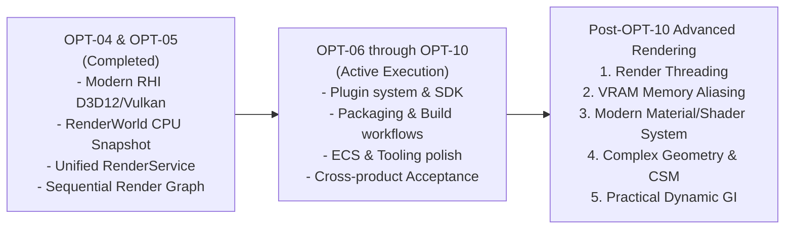

# Post-OPT-10 Advanced Rendering Architecture Roadmap

## 1. Executive Summary & Strategic Positioning

With the completion of **OPT-04** (Modern RHI Device & GPU Lifetime Foundation) and **OPT-05** (Unified Rendering across Editor, Previews, and Standalone Runtime), AxleEngine has established a modern, data-driven, and unified rendering foundation:
- Pure CPU extraction into an immutable snapshot ([`RenderWorld`](file:///d:/WorkSpace/AxleEngine/Engine/Renderer/include/Axle/RenderWorld.hpp)).
- Centralized execution and target leasing coordinator ([`RenderService`](file:///d:/WorkSpace/AxleEngine/Engine/Scene/include/Axle/RenderService.hpp)).
- Strict rendering and color pipeline contracts ([`RenderContracts.hpp`](file:///d:/WorkSpace/AxleEngine/Engine/Renderer/include/Axle/RenderContracts.hpp)).
- Modern RHI (D3D12 and Vulkan via NRI) as the first-class backend, with OpenGL as a non-destructive fallback.

Per project strategy, the immediate engineering focus remains on completing the core architectural stabilization sequence (**OPT-06 through OPT-10**). This document defines the formal technical roadmap for **five advanced rendering criteria** to be implemented following the acceptance of OPT-10.

---

## 2. Technical Specifications of the 5 Advanced Pillars

### Pillar 1: Render Threading (Decoupled Game & Render Threads)

* **Objective:** Decouple Game/Simulation Thread from GPU Command Generation, eliminating frame hitching caused by CPU game logic, script execution, or physics simulation.
* **Technical Design:**
  1. **Exploiting Immutable `RenderWorld` Snapshots:**
     - `ExtractRenderWorld(const Scene&)` runs on the Main Thread in sub-millisecond time, copying only flat, immutable Plain Old Data (POD) arrays.
     - Upon extraction completion, the Main Thread enqueues `std::shared_ptr<const RenderWorld>` into a lock-free `ThreadSafeQueue` consumed by the dedicated **Render Thread**.
  2. **Double Buffering (1-Frame Latency Pipeline):**
     - While the Render Thread records commands and executes `RenderService::RenderView` for Frame $N$, the Main Thread concurrently advances Simulation, ECS, and Physics for Frame $N+1$.
  3. **Parallel Command Recording:**
     - Leverage NRI's multi-threaded command allocator support to split scene passes across worker jobs, merging into the primary command queue prior to submission.
  4. **Presentation & Window Synchronization:**
     - Decouple OS message pumping (Win32 message loop on Main Thread) from swapchain presentation fences handled on the Render Thread.
* **Key Components:** `Engine/Scene/RenderService`, `Engine/Platform/Application`, `Engine/RHI`.

---

### Pillar 2: VRAM Memory Aliasing (Render Graph Suballocation)

* **Objective:** Reduce intermediate Render Target VRAM consumption by 40%–60% across post-processing, offscreen views, and transient G-Buffer passes.
* **Technical Design:**
  1. **Placed Resources & Heap Management:**
     - Exploit DirectX 12 Placed Resources (`ID3D12Heap` via `CreatePlacedResource`) and Vulkan Memory Suballocation (`vkBindImageMemory` on overlapping offsets).
     - Utilize NRI's existing memory heap abstraction for hardware-agnostic allocation.
  2. **Topological Lifetime Analysis in RenderGraph:**
     - The RenderGraph compiler analyzes each declared pass to extract the strict lifespan interval `[FirstPassIndex, LastPassIndex]` of every transient target.
     - Targets with disjoint lifespan intervals (e.g., `RefractionCopyTarget` concluding at the transparent pass vs. `ToneMappingTarget` beginning at post-processing) are assigned overlapping physical VRAM offsets.
  3. **Aliasing Barriers & Cache Coherency:**
     - Automatically emit `D3D12_RESOURCE_BARRIER_TYPE_ALIASING` and Vulkan image memory barriers between transitions to guarantee clean GPU cache invalidation.
* **Key Components:** `Engine/Renderer/RenderGraph`, `Engine/RHI/RHIResourceFactory`.

---

### Pillar 3: Modern Material & Shader System (Cross-Compilation & Node Graph)

* **Objective:** Replace manual, hand-authored shader variants with an extensible, node-based visual authoring graph and industry-standard multi-target cross-compilation.
* **Technical Design:**
  1. **Cross-Compilation Pipeline:**
     - Integrate **Slang** (or **DXC + SPIRV-Cross**) as the central engine shader compiler.
     - Single canonical authoring in modern Slang/HLSL with automatic compilation targets:
       - **DXIL** for DirectX 12.
       - **SPIR-V** for Vulkan.
       - **GLSL 4.50** for OpenGL Compatibility fallback.
  2. **Node-Based Visual Material Editor (UI):**
     - Integrate a lightweight, open-source node graph UI (`ImGui Node Editor` or `imnodes`) into the AxleEditor workspace (`Editor/src/Panels/MaterialNodeEditorPanel`).
     - Standard node library: Arithmetic, Vector Math, Texture Sample, Normal Unpack, Fresnel, Masking, and Standard PBR Output.
  3. **Abstract Syntax Tree (AST) Code Generation:**
     - The visual graph compiler translates connected nodes into HLSL/Slang function blocks, injecting them into canonical PBR surface shader templates before registration in `CustomProgramCache`.
* **Key Components:** `Editor/MaterialEditor`, `Engine/Renderer/ShaderCompiler`, `Engine/Asset/MaterialAsset`.

---

### Pillar 4: Complex Geometry & Modern Shadows (GPU-Driven & CSM)

* **Objective:** Enable rendering of dense scenes with 100,000+ mesh instances while delivering high-fidelity exterior sun shadows without perspective aliasing, supported by an end-to-end two-tier automated LOD and continuous virtual geometry pipeline.
* **Technical Design:**
  1. **Two-Tier Automated LOD & Virtual Geometry Pipeline:**
     - **Tier 1 (Automated Offline LOD via `meshoptimizer`):**
       - Integrated into Asset Cooker during `.fbx`/`.gltf` import.
       - Runs `meshopt_simplify` to generate discrete fallback LOD levels (LOD1 at 50%, LOD2 at 25%, LOD3 at 10%) automatically with zero manual authoring in DCC tools (Blender/Maya).
       - Used for skinned/skeletal meshes, animated foliage, transparent assets, and legacy hardware/mobile fallback, smoothly transitioned using screen-space dither cross-fading.
     - **Tier 2 (Continuous Meshlet Virtual Geometry / Nanite-Style):**
       - Bakes dense static meshes into clusters of up to 64 vertices and 126 primitives (`meshopt_buildMeshlets`).
       - Builds a Directed Acyclic Graph (DAG) cluster hierarchy with locked shared boundary loops to guarantee watertight, crack-free transitions.
       - Driven in real-time by **Task Shaders (Amplification)** and **Hardware Mesh Shaders** on D3D12 and Vulkan via NRI.
       - Evaluates projected screen-space pixel error per cluster to select continuous LOD level dynamically with zero popping.
  2. **Cascaded Shadow Maps (CSM):**
     - Split the primary camera view frustum into 3 to 4 depth cascades.
     - Model each cascade as an independent [`ViewRequest`](file:///d:/WorkSpace/AxleEngine/Engine/Renderer/include/Axle/ViewRequest.hpp) with an orthographic projection and depth-only target.
     - Implement Percentage-Closer Filtering (PCF 5x5) or Poisson Disk Sampling with cascade blend bands.
  3. **GPU-Driven Pipeline:**
     - Upload scene transforms, bounding spheres, and material IDs into a unified GPU Instance Buffer (Structured Buffer).
     - Execute a **Task Shader / Compute Shader** culling pass:
       - Frustum Culling against view planes.
       - Backface and Cone Culling.
       - Occlusion Culling against a Hierarchical-Z (Hi-Z) pyramid.
     - Emit surviving instances/meshlets directly into hardware mesh shader pipelines or Indirect Draw Argument buffers dispatched via `ExecuteIndirect` (D3D12) / `vkCmdDrawIndexedIndirect` (Vulkan).
* **Key Components:** `Engine/Scene/RHISceneRenderer`, `Engine/Renderer/ShadowPass`, `Engine/Asset/AssetCooker`, `Engine/RHI/RHIMeshShader`.

---

### Pillar 5: Practical Dynamic Global Illumination (Dynamic GI)

* **Objective:** Provide realistic indirect diffuse bounce and specular reflections in real-time within accessible hardware budgets (e.g., RTX 2060 / 3060 tier).
* **Technical Design:**
  1. **Tier 1: Screen-Space Techniques (SSGI & SSR):**
     - **Screen-Space Reflections (SSR):** Ray-march depth and normal buffers from G-Buffer/Pre-Z passes for crisp surface reflections.
     - **Screen-Space Ambient Occlusion / Ground Truth AO (SSAO/GTAO):** High-performance local contact shadowing.
     - Realized as modular compute passes plugged directly into `RenderService`.
  2. **Tier 2: Dynamic Diffuse Global Illumination (DDGI):**
     - Construct an axis-aligned grid of Irradiance & Depth Probes enclosing the active player area.
     - Each probe encodes radiance and visibility using spherical harmonics ($L_1$/$L_2$).
     - Asynchronous compute or hardware ray tracing updates probe radiance, injecting smooth, multi-bounce indirect lighting on dynamic scene changes.
* **Key Components:** `Engine/Scene/RenderService`, `Engine/Renderer/GIPasses`.

---

## 3. Phased Implementation Roadmap (Post-OPT-10)

Execution will proceed in four sequential phases prioritized by return on visual fidelity and computational efficiency:

| Phase | Package Identifier | Technical Scope | Primary Deliverable |
|---|---|---|---|
| **Phase A** | `ADV-RENDER-01` | **Cascaded Shadow Maps (CSM)** & **SSAO / SSR** | Immediate visual fidelity upgrade; crisp directional shadows and contact depth. |
| **Phase B** | `ADV-RENDER-02` | **Render Threading** & **VRAM Memory Aliasing** | Massive CPU throughput scaling, stutter elimination, and 50% VRAM reduction. |
| **Phase C** | `ADV-RENDER-03` | **Material Node Editor** & **Slang Compiler** | Technical Artist empowerment; visual shader graph authoring with multi-target compilation. |
| **Phase D** | `ADV-RENDER-04` | **GPU-Driven Culling (Hi-Z)** & **Dynamic DDGI** | Large-scale exterior rendering (100k+ instances) and dynamic indirect bounce lighting. |
