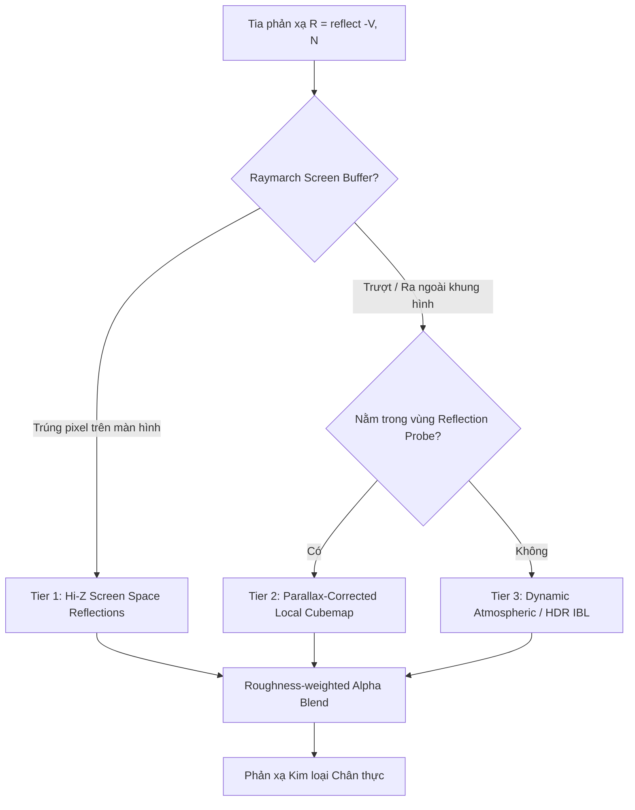
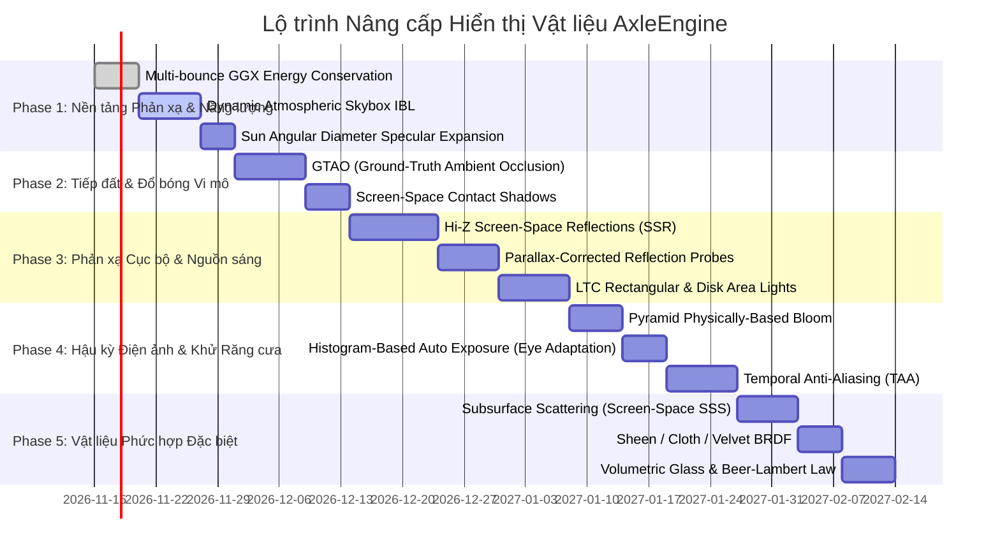

# AxleEngine: Kỹ thuật Nâng cao Chất lượng Hiển thị Vật liệu & Lộ trình Triển khai Đồ họa Điện ảnh (Photorealistic Fidelity Roadmap)

**Tài liệu kỹ thuật & Thiết kế kiến trúc Rendering**  
*Mã tài liệu:* `DOC-RENDERING-PBR-FIDELITY-2026`  
*Trạng thái:* Hoàn chỉnh / Đề xuất kiến trúc  
*Mục tiêu:* Đưa chất lượng hiển thị vật liệu PBR của AxleEngine từ mức cơ bản (punctual lights, flat ambient) lên chuẩn đồ họa điện ảnh (AAA Photorealism) tương đương Unreal Engine 5, Frostbite và Blender EEVEE Next.

---

## 1. Tổng quan & Tầm nhìn Kiến trúc (Executive Summary)

### 1.1. Hiện trạng của AxleEngine
Hệ thống rendering hiện tại của AxleEngine (`RHISceneRenderer.cpp`, `ForwardPBR.hlsl`) đã sở hữu nền tảng PBR tiêu chuẩn:
- **Cook-Torrance BRDF:** GGX Distribution ($D$), Smith Joint Height-Correlated Masking-Shadowing ($G$), Fresnel-Schlick ($F$).
- **Tham số mở rộng:** Anisotropy (dòng chảy sợi kim loại), Clearcoat (lớp phủ bóng xe hơi), Thin Refraction (kính mỏng).
- **Chiếu sáng:** Cascaded Shadow Maps (CSM 4-cascade PCF 5x5), Local Shadow Atlas (Point/Spot lights), Split-Sum IBL (khi dùng Cubemap HDR).

### 1.2. Khoảng cách chất lượng so với chuẩn điện ảnh (The Fidelity Gap)
| Vấn đề quan sát được | Nguyên nhân kỹ thuật trong mã nguồn | Hệ quả thị giác |
| :--- | :--- | :--- |
| **Kim loại như nhựa đục** | `Procedural Atmospheric Skybox` chưa render cubemap động; shader fallback về ambient hằng số đơn sắc `(0.35, 0.47, 0.62)`. | Không có phản xạ môi trường, biến kim loại thành mô hình nhựa Blinn-Phong thập niên 1980. |
| **Vật thể bay lơ lửng** | Thiếu bóng tiếp xúc vi mô (No Contact Shadows / No GTAO). | Chân đế vật thể không bám sàn, mất cảm giác trọng lượng và tiếp đất. |
| **Không phản chiếu sàn** | Thiếu phản xạ cục bộ (No Screen-Space Reflections / No Reflection Probes). | Quả cầu đứng trên sàn caro lớn nhưng đáy quả cầu không hề phản chiếu các ô vuông của sàn. |
| **Điểm sáng mặt trời trơ trọi** | Mặt trời và đèn là nguồn sáng điểm toán học kích thước bằng 0 (infinitesimal punctual lights). | Kim loại chỉ có 1 chấm tròn pixel đơn điệu thay vì các dải sáng mềm mại (softbox highlights). |
| **Kim loại nhám bị xỉn màu** | GGX chuẩn bị mất $20\% - 40\%$ năng lượng khi `roughness` tăng do bỏ qua phản xạ đa lớp (single-bounce only). | Nhôm xước, vàng mờ bị sạm đen như bùn đất. |
| **Răng cưa & lấp lánh specular** | Thiếu bộ lọc khử răng cưa thời gian (No Temporal Anti-Aliasing - TAA). | Các mép sáng kim loại bị nhấp nháy (shimmering/flicker) khi camera chuyển động. |

---

## 2. Chi tiết các Kỹ thuật Nền tảng Cần thiết (Deep Dive: Technical Specifications)

### Nhóm I: Hệ thống Phản xạ Môi trường Đa tầng (Multi-Tier Reflection System)
Kim loại thuần ($metallic = 1.0$) có $kD = 0$, nghĩa là $100\%$ vẻ đẹp của nó phụ thuộc vào **sự tương phản của ảnh phản xạ**.

1. **Tier 1: Hi-Z Screen-Space Reflections (Hi-Z SSR):**
   - Xây dựng kim tự tháp Hierarchical-Z (Hi-Z Mip Chain) từ Depth Buffer.
   - Raymarching trong không gian màn hình với bước nhảy thông minh theo mip level, giảm số mẫu từ $100+$ mẫu xuống còn $15 - 20$ mẫu/pixel.
   - Phản xạ chính xác sàn nhà caro, các bức tường, và các vật thể đặt kế bên.
   - Hỗ trợ **Roughness PDF sampling** (bề mặt càng nhám thì vệt phản xạ càng nhòe rộng tự nhiên).
2. **Tier 2: Parallax-Corrected Local Reflection Probes:**
   - Khi tia phản xạ đi ra ngoài mép màn hình (off-screen) hoặc bị vật khác che khuất, SSR sẽ bị đứt đoạn.
   - Đặt các hộp Box/Sphere Reflection Probe tĩnh/động trong scene. Sử dụng thuật toán Parallax Correction (Ray-Box Intersection) để nắn tọa độ cubemap khớp chính xác với kích thước căn phòng.
3. **Tier 3: Dynamic Atmospheric Skybox IBL:**
   - Nâng cấp `Procedural Atmospheric Skybox`: Thay vì dùng fallback màu đơn sắc phẳng, render bầu trời khí quyển thủ tục vào một dynamic cubemap $128 \times 128 \times 6$, chạy compute pass tính Irradiance + Prefilter. Kim loại sẽ phản chiếu ngay đường chân trời và vòm trời xanh ngắt dù không nạp file `.hdr`.

---

### Nhóm II: Đổ bóng Tiếp xúc & Chiếu sáng Gián tiếp (Contact Shadows & GI)
1. **GTAO (Ground-Truth Ambient Occlusion):**
   - Dựa trên thuật toán của Jimenez et al. (Activision / Blizzard).
   - Tích phân trực tiếp hình học bán cầu che khuất (horizon-based integration), vượt trội hoàn toàn so với SSAO truyền thống.
   - Tái tạo hoàn hảo các nếp bóng tiếp xúc cực kỳ sắc sảo ở chân quả cầu chạm sàn và các khe kẽ cơ khí.
2. **Screen-Space Contact Shadows (Micro-Shadows):**
   - Bổ sung bước raymarching ngắn ($16 - 32$ bước) trên Depth buffer hướng về phía Mặt Trời trước khi tra cứu Shadow Map cascade.
   - Loại bỏ hoàn toàn lỗi hở bóng (*shadow detachment / peter-panning*) và bóng răng cưa ở khoảng cách gần.

---

### Nhóm III: Nguồn sáng Diện tích (Area Lights & Realistic Sun)
1. **LTC Area Lights (Linearly Transformed Cosines):**
   - Thuật toán của Eric Heitz (Frostbite / Unity HDRP).
   - Biến đổi hàm phân bố cosine tiêu chuẩn qua ma trận $3 \times 3$ để khớp với hàm phân bố GGX của vật liệu ở mọi độ nhám (`roughness`).
   - Cho phép tạo **Đèn Softbox chữ nhật (Rect Light)**, đèn đĩa (Disk Light). Khi soi vào kim loại, phản xạ là các dải sáng mềm mại, uốn lượn theo bề mặt vật thể.
2. **Mặt trời có Bán kính Góc (Sun Angular Radius Approximation):**
   - Mặt trời thực tế có góc mở $\approx 0.53^\circ$.
   - Mở rộng specular cone của Directional Light theo phương pháp Karis (Epic Games 2013) để điểm phản chiếu mặt trời không phải là 1 điểm pixel sắc nhọn vô lý, mà là một vầng sáng tròn có độ mờ mềm mại theo độ nhám.

---

### Nhóm IV: Bổ sung Mô hình Vi cấu trúc Vật liệu Nâng cao (Advanced PBR Shading)
1. **Bù trừ mất mát năng lượng (Multi-Bounce GGX / Kulla-Conty Approximation):**
   - Công thức Cook-Torrance chuẩn chỉ tính tia sáng nảy 1 lần (Single-bounce). Khi độ nhám tăng, các tia sáng bị kẹt lại giữa các vi mặt và biến mất, làm vật liệu thô ráp bị tối sầm.
   - Thêm thuật toán bổ sung năng lượng Kulla-Conty:
     $$f_{\text{add}} = \frac{(1 - E_{\text{ss}})(1 - E_{\text{ss}, v})}{\pi (1 - E_{\text{avg}})} \cdot \frac{F_{\text{avg}}}{1 - F_{\text{avg}} (1 - E_{\text{avg}})}$$
   - Giúp vàng nhám, nhôm mờ, đồng thô giữ được màu sắc rực rỡ và độ phản quang trung thực.
2. **Tán xạ dưới bề mặt (Subsurface Scattering - SSS):**
   - Cho da người, sáp nến, ngọc bích, nhựa đục/nhựa composite.
   - Sử dụng **Screen-Space SSS (Separable Gaussian)**: Blur màu khuếch tán trong không gian màn hình theo biên dạng khuếch tán ánh sáng (diffusion profile).
3. **Lớp nhung/Vải lụa (Sheen / Cloth / Charlie BRDF):**
   - Mô phỏng hiện tượng tán xạ ngược (retro-reflection) trên các sợi tơ cực nhỏ ở góc nhìn nghiêng (grazing angle) cho vải nhung, nhung kẻ, da lộn.
4. **Hấp thụ thể tích & Khúc xạ sâu (Beer-Lambert Absorption):**
   - Cho kính màu, ngọc, chất lỏng dày: Ánh sáng đi xuyên qua khối kính càng sâu thì màu sắc càng đậm theo định luật $T = e^{-\sigma_a \cdot d}$.

---

### Nhóm V: Hậu kỳ Điện ảnh & Máy ảnh Quang học (Cinematic Post-Processing)
1. **Pyramid Physically-Based Bloom:**
   - Dùng chuỗi lọc downsample/upsample 6 tầng (Dual Kawase / Gaussian Blur pyramid).
   - Các điểm kim loại phản xạ ánh sáng mặt trời mạnh ($HDR > 10.0$) sẽ tạo ra quầng sáng lóe (Glare/Bloom) mềm mại, tự nhiên như ống kính điện ảnh Anamorphic.
2. **Histogram-based Auto Exposure (Eye Adaptation):**
   - Tính toán biểu đồ tần số độ sáng (Luminance Histogram $64 - 256$ bin) qua compute shader.
   - Mô phỏng cơ chế điều tiết con ngươi mắt người: khi nhìn vào vùng tối, camera tự nâng sáng; khi nhìn vào điểm kim loại chói lóa, camera tự hạ sáng để không bị cháy hình.
3. **Temporal Anti-Aliasing (TAA):**
   - Kết hợp khung hình hiện tại với khung hình trước đó qua History Buffer và Motion Vectors.
   - Khử triệt để hiện tượng răng cưa và nhấp nháy specular (specular aliasing/flicker) trên kim loại khi camera di chuyển.
4. **Depth of Field (DoF):**
   - Tạo hiệu ứng xóa phông Bokeh quang học ở tiền cảnh và hậu cảnh, làm nổi bật đường nét tinh xảo của vật liệu cận cảnh.

---

## 3. Lộ trình Triển khai Chi tiết (Phased Implementation Roadmap)

### Chi tiết các Giai đoạn

#### **Giai đoạn 1: Quick Wins — Nền tảng Phản xạ & Năng lượng (Ưu tiên cao nhất)**
* **Mục tiêu:** Xử lý triệt để cảm giác "nhựa đục" của kim loại và cứu lại độ rực rỡ của vật liệu nhám.
* **Hạng mục thực hiện:**
  1. `ForwardPBR.hlsl`: Tích hợp **Multi-bounce GGX** (sử dụng 2D LUT pre-integrated hoặc công thức xấp xỉ của Kulla-Conty).
  2. `RHIEnvironment.cpp`: Bổ sung pass bake **Dynamic Cubemap cho Procedural Atmospheric Skybox**. Khi người dùng tạo một scene mới chỉ có bầu trời khí quyển, hệ thống tự động sinh Irradiance & Prefilter để kim loại luôn có phản xạ bầu trời sống động.
  3. `ForwardPBR.hlsl`: Mở rộng đốm sáng mặt trời theo đường kính góc thực ($0.53^\circ$).

#### **Giai đoạn 2: Tiếp đất & Đổ bóng Vi mô (Contact & Micro-Shadows)**
* **Mục tiêu:** Triệt tiêu cảm giác vật thể trôi nổi trên sàn.
* **Hạng mục thực hiện:**
  1. Tạo render pass `GTAOPass.cpp` / shader `GTAO.hlsl`: Chạy trên Linear Depth + Normals với spatial bilateral filter.
  2. Tích hợp GTAO vào ambient diffuse và ambient specular trong `ForwardPBR.hlsl`.
  3. Bổ sung **Contact Shadows pass** cho Directional Light để các mép tiếp xúc giữa quả cầu và sàn có bóng đổ dính sát vào chân vật thể.

#### **Giai đoạn 3: Phản xạ Cục bộ & Nguồn sáng Diện tích (Local Reflections & Area Lights)**
* **Mục tiêu:** Kim loại phản chiếu rõ sàn caro, các vật thể bên cạnh và đón nhận ánh sáng tản mềm của đèn studio.
* **Hạng mục thực hiện:**
  1. Xây dựng `HiZBuffer.cpp`: Tạo depth pyramid cho Viewport.
  2. Tạo render pass `ScreenSpaceReflections.cpp` / `SSR.hlsl`: Raymarching Hi-Z với cone-tracing theo độ nhám (`roughness`).
  3. Bổ sung component `ReflectionProbeComponent`: Cho phép artist đặt probe cục bộ, bake cubemap tĩnh với kích thước hộp giới hạn (Bounding Box Parallax Correction).
  4. Mở rộng `LightComponent` với type `RectLight`: Viết shader LTC (`LTC_Evaluate(...)`) tra bảng ma trận LTC $64 \times 64$ để hiển thị đèn softbox studio chữ nhật.

#### **Giai đoạn 4: Hậu kỳ Điện ảnh & Khử Răng cưa (Cinematic Post-Processing)**
* **Mục tiêu:** Mang lại cảm xúc thị giác như một thước phim điện ảnh quay bằng ống kính quang học cao cấp.
* **Hạng mục thực hiện:**
  1. Viết `BloomPass.cpp` / `Bloom.hlsl`: Pyramid downsample/upsample với threshold thông minh và tint color.
  2. Viết `AutoExposurePass.cpp`: Compute shader quét độ sáng khung hình, điều chỉnh exposure mượt mà theo thời gian thực (smooth eye adaptation).
  3. Viết `TAAPass.cpp`: Jittering ma trận chiếu (Halton sequence 8x/16x), history reprojection, neighborhood color clamping (YCoCg) để triệt tiêu hoàn toàn rung giật specular highlight trên kim loại.

#### **Giai đoạn 5: Vật liệu Phức hợp Đặc biệt (Advanced Shading Models)**
* **Mục tiêu:** Hoàn thiện bảng vật liệu cho mọi thể loại game/ứng dụng (nhân vật, thời trang, nội thất, cơ khí).
* **Hạng mục thực hiện:**
  1. **Subsurface Scattering (SSS):** Separable blur cho da mặt, sáp, nhựa composite.
  2. **Sheen/Cloth BRDF:** Lớp nhung mờ cho quần áo, thảm, ghế xe hơi.
  3. **Volumetric Glass Absorption:** Kính màu dày với định luật Beer-Lambert.

---

## 4. Tiêu chuẩn Nghiệm thu & Đo lường Chất lượng (Fidelity KPI & Acceptance Criteria)

| Tiêu chuẩn kiểm thử | Phương pháp kiểm tra | Điều kiện ĐẠT (PASS) |
| :--- | :--- | :--- |
| **Bảo toàn Năng lượng Kim loại** | So sánh màu sắc giữa $roughness = 0.05$ và $roughness = 0.8$ của vật liệu vàng/bạc. | Vàng thô ở $roughness = 0.8$ không bị sẫm đen/xỉn màu; tổng năng lượng phản xạ duy trì $\ge 95\%$ so với lý thuyết. |
| **Phản xạ Sàn caro** | Đặt quả cầu kim loại $metallic = 1.0, roughness = 0.05$ tiếp xúc sàn caro. | Nhìn thấy rõ hình ảnh phản chiếu của các ô vuông caro trên nửa dưới của quả cầu (qua SSR hoặc Reflection Probe). |
| **Tiếp đất Vật thể** | Quan sát chân tiếp xúc giữa quả cầu và sàn tại điểm $Y = 0$. | Xuất hiện bóng tiếp xúc tự nhiên (Contact Shadow / GTAO crevice), không có hiện tượng hở viền sáng (light leaking) hay lơ lửng. |
| **Phản xạ Đèn Studio** | Tạo 1 đèn Rect Light giả lập Softbox $2\text{m} \times 1\text{m}$. | Bề mặt quả cầu kim loại xuất hiện vệt sáng hình chữ nhật cong mềm mại ôm theo khối cầu. |
| **Độ ổn định Specular** | Di chuyển camera quanh quả cầu kim loại với tốc độ trung bình. | Không có hiện tượng nhấp nháy pixel (specular flicker/crawling) trên đường viền phản xạ khi bật TAA. |
| **Hiệu năng (Performance Budget)** | Chạy toàn bộ chuỗi pass trên GPU tầm trung (RTX 3060 / RX 6600 ở độ phân giải 1440p). | Tổng thời gian render khung hình (Frame Time) $\le 12.0\text{ms}$ ($\ge 80\text{ FPS}$). |

---

## 5. Kết luận & Khuyến nghị Bắt đầu

Để giải quyết ngay cảm giác **"kim loại trông cứ nhựa nhựa"** mà người dùng vừa phản hồi mà không làm xáo trộn kiến trúc lớn:
1. **Bước thực hiện ngay lập tức:** Triển khai **Giai đoạn 1.2 (Dynamic Atmospheric Skybox IBL)**. Đây là nguyên nhân trực tiếp nhất khiến quả cầu trong scene hiện tại bị bôi màu xám phẳng.
2. **Bước tiếp theo:** Bổ sung **GTAO** (Giai đoạn 2.1) để vật thể gắn kết hoàn toàn với sàn nhà.
3. **Bước đột phá thị giác:** Triển khai **SSR** và **LTC Area Lights** (Giai đoạn 3) để đưa AxleEngine sánh ngang các engine thương mại hàng đầu hiện nay.
