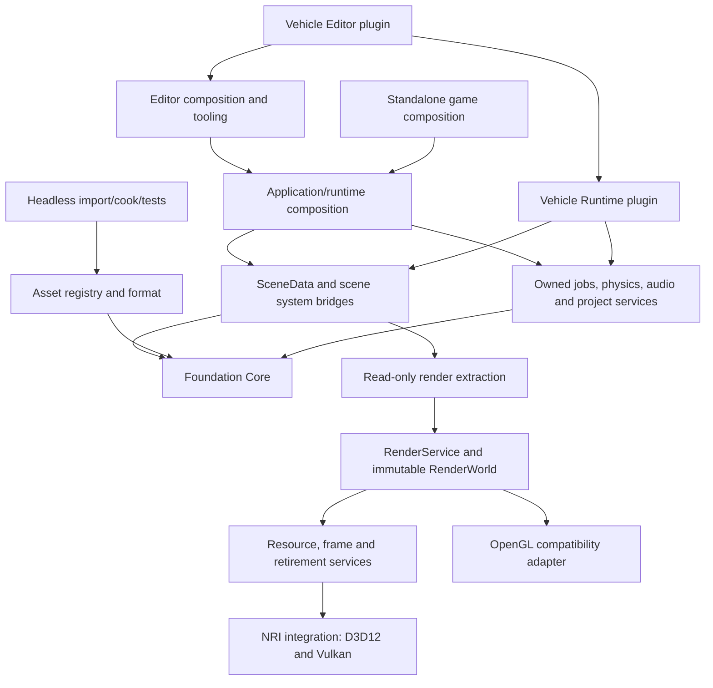

# Architecture Foundation Master Plan

> **Execution:** follow [OPT-00..11](../ROADMAP.md). This document is a
> technical contract, not a separate phase queue. Old Phase/G labels and
> source-audit baselines are retained for traceability. Early Vehicle retirement
> is delivered; independent review and new plugin implementation remain open.

Date: **2026-11-04**. Source baseline:
**cb200d373550b6dd4f7e12d483a161012d863a27**.
Status: **technical contract; execution/progress is tracked in [docs/ROADMAP.md](../ROADMAP.md)**.

The latest user priority is to make the architecture clean before expanding
features. This coordinator combines NRI/RHI standardization, EnTT/enkiTS
correctness, complete Vehicle/plugin extraction and the supporting foundation
boundaries required by the earlier architecture assessment. It supersedes older
cross-track priority statements; it does not turn plans into implementation tasks.
The [exchange](../agents/CODEX_GEMINI_EXCHANGE.json) records actual assignments.

## 1. Reading order and authority

| Document | Authoritative responsibility |
| --- | --- |
| [Optimization roadmap](../ROADMAP.md) | Single execution order, OPT phases and package progress |
| This master plan | Fixed architecture decisions, cross-plan prerequisites, AF contracts and overall exit |
| [Architecture assessment](../architecture/ASSESSMENT.md) | Historical A1..A12 source observations; recheck current delivery status |
| [EnTT/enkiTS review](../architecture/ENTT_ENKITS_REVIEW.md) | ECSJ-01..05 findings and actual native reproduction limits |
| [ECS/jobs refactor plan](ENTT_ENKITS_REFACTOR_PLAN.md) | EJ package internals, threading, bridge lifetime, ECS and simulation clocks |
| [NRI integration contract](NRI_INTEGRATION_CONTRACT.md) | Pinned vendor boundary, interface readiness, device/resource/frame and product rules |
| [Rendering architecture](RHI_PRIMARY_RENDERER_ARCHITECTURE.md) and [P41 plan](RHI_PRIMARY_RENDERER_IMPLEMENTATION_PLAN.md) | RenderService/RenderWorld contracts and P41 package internals |
| [Plugin architecture](PLUGIN_SYSTEM_ARCHITECTURE.md) and [PLG plan](PLUGIN_SYSTEM_IMPLEMENTATION_PLAN.md) | Discovery, Editor DLL/static Runtime, Plugins window, fresh Vehicle and product packaging |

Keep existing identifiers: **Phase 41 / P41** is rendering/NRI; **Phase 42 / EJ**
is ECS/jobs normalization; **Phase 43 / PLG** is plugin/project composition and
Vehicle replacement. These labels formalize the previously proposed numbering
for historical navigation. The OPT sequence replaces them as the work queue. They are domains, not a command to finish every
Phase 41 feature before touching a Phase 42 safety prerequisite. AF-00..05 are
cross-cutting foundation packages, not a fourth feature phase.

Domain documents retain their source baselines and acceptance history. Package
contracts remain there; do not copy 74 definitions into another competing list.
This coordinator adds six uncovered foundation packages, giving **80 packages**
across the complete combined backlog. **73 belong to the architecture-first exit;
seven rendering feature/full-phase packages remain deferred.** No package is
marked implemented by this documentation task.

## 2. Fixed decisions

- Keep EnTT, enkiTS, Jolt and NRI. Normalize the Engine integration; no automatic
  vendor upgrade, replacement ECS or second physics/task pool.
- Use NRI for D3D12/Vulkan. OpenGL is a separate compatibility adapter, not a
  fabricated NRI backend. Null/dummy rendering is never physical GPU acceptance.
- One application-owned runtime service context; one registry and simulation
  owner per scene; one resource/frame/presentation owner per rendering device.
- Core and generic scene/asset data do not require a window, GPU, Editor or Vehicle.
- Editor plugin modules use DLLs against shared host services. Shipping Runtime
  statically links only the project's resolved Runtime modules and scripts.
- Engine plugins and project-local plugins share one SDK and lifecycle. Selected
  means explicit choices plus visible required dependencies; discovery is metadata-only.
- Version one changes plugin selection via build if necessary and process restart.
  Live plugin unloading/hot swapping is deferred. Existing script reload has its
  own safe barrier and ABI contract; it is not permission to hot-unload plugins.
- Vehicle may be implemented freshly against Jolt. Its old C++ API/handling need
  not be preserved. Old authored files remain intact and unknown data is preserved.
- No new general shadows/IBL/skinning/networking/AI feature scope is needed to
  establish the architecture. Preserve available behavior through explicit
  compatibility and capability reporting; never claim missing parity has passed.

## 3. Current evidence and uncovered work

The review already reproduced four offending ECS/jobs behaviors and one bridge
drain control. That is historical evidence, not a current fix. Existing isolated
tests/CTest and on-demand Runtime build separation were delivered earlier; keep
them rather than reimplementing the obsolete A9 finding wholesale.

Current source still needs these additional boundaries:

| Concern | Source evidence | Owner in this program |
| --- | --- | --- |
| Stable authored asset identity | [AssetManager](../../Engine/Asset/src/AssetManager.cpp) generates UUID on missing/invalid metadata; [.gitignore](../../.gitignore) ignores metadata | AF-01 |
| Core bootstrap/upward dependencies | [Core CMake](../../Engine/Core/CMakeLists.txt), [Application](../../Engine/Core/src/Application.cpp) | AF-02, then PLG-05 host linkage |
| Scene data integrates concrete systems/resources | [Scene](../../Engine/Scene/include/Axle/Scene.hpp), [Components](../../Engine/Scene/include/Axle/Components.hpp), [Scene target](../../Engine/Scene/CMakeLists.txt) | AF-03, EJ mutation/phase semantics, PLG extension implementations |
| Asset identity/import/cook/GPU coupling | [Asset target](../../Engine/Asset/CMakeLists.txt) | AF-04 and P41-11 GPU resource path |
| NRI device/resource readiness and submission | [RHIDevice](../../Engine/RHI/src/RHIDevice.cpp), [RHITexture](../../Engine/RHI/src/RHITexture.cpp), [RHICommandBuffer](../../Engine/RHI/src/RHICommandBuffer.cpp) | NRI contract + P41 |
| Runtime UI needs real submission | [Canvas2D](../../Engine/UI/src/UI2D/Canvas2D.cpp), [Runtime UI caller](../../Runtime/src/RuntimeLayer.cpp) | P41-19 architecture clarification, not a new UI authoring project |
| Optional toolkits/Editor leak into products | [Runtime target](../../Runtime/CMakeLists.txt), [Spline](../../Plugins/Spline/CMakeLists.txt), [Terrain](../../Plugins/Terrain/CMakeLists.txt), [scripts](../../Editor/CMakeLists.txt) | PLG-19..23, final P41-26 reconciliation |
| Boundary enforcement | Target/include graphs and runtime artifact checks | AF-00 scaffolding, AF-05 enforcement/exit |

Moving files without changing target/include/lifetime dependencies does not satisfy
these boundaries. Conversely, do not split every class into a separate library
when it provides no independent test/build/lifetime value.

## 4. Target architecture and one owner for each shared facility

Arrows are logical usage, not a mandate for one target per box. Editor Runtime
modules import the shared runtime host; Editor modules additionally import the
tooling host. Shipping builds use the same supported APIs with static composition.
No consumer links private static copies of active Engine state into its DLL.

| Facility | Implement once in | Reused by |
| --- | --- | --- |
| Owner-thread queue, operation generations and scheduler admission | EJ-01..03 | Script compiler, plugin build/restart and external producers |
| Jolt/enki submission lifetime and waits | EJ-05..07 | Current physics, fresh Vehicle and future physics integrations |
| Scene commands, transforms and fixed runtime driver | EJ-08..14 | Editor Play, Runtime and PLG scene systems |
| Data-only scene boundaries | AF-03 | EJ driver, render extraction and PLG component descriptors |
| Authored asset identity/CPU format | AF-01/04 | Serializers, importers, source control, cooker and plugin content |
| Device generations, resource leases, submission and presentation | P41-01..13 | Scene, previews, thumbnails, UI, debug and plugin render contributions |
| Native implementation details | NRI adapter or approved native UI bridge | Runtime/Editor host, not generic Scene or arbitrary panels |
| DLL discovery/SDK/module registration | PLG-01..13 | Vehicle, Spline, Terrain and project plugins |
| Static selection and export receipt | PLG-21..23 | Player, scripts, plugin content and packaged metadata |

CPU task completion and GPU completion remain different token/epoch domains.
A finished enki job is not proof the GPU is done; a submitted fence does not
protect CPU-recorded/unsubmitted UI references by itself. Plugin code leases
must span every callback/destructor/resource that still needs that DLL.

## 5. Sequential execution order

Use **[OPT-00..11 in the optimization roadmap](../ROADMAP.md)** for the only
execution order and package progress checklist. The previous W0..W9 wave queue
is superseded. Domain G gates remain contract groupings, not another work queue.

The roadmap serializes all 80 existing packages without changing their IDs or
internal prerequisites. OPT-00 verifies the delivered early Vehicle retirement;
OPT-01..10 covers the 73-package architecture exit; OPT-11 retains the seven
deferred rendering feature/full-phase packages. The graph in section 6 and the
three domain dependency tables remain technical constraints on any reorder.

P41-25 initially provides generic physics debug without requiring a new Vehicle
plugin. OPT-07 later adds plugin contributions and verifies retained lifetimes.
Do not introduce a circular requirement that rendering must wait for Vehicle.
Run relevant tests with each package; final acceptance consolidates evidence.

## 6. Cross-plan prerequisite edges

These edges supplement, not replace, the three canonical dependency tables.
`Requires` means an accepted API/equivalent with current evidence, not merely a
documented proposal. Internal prerequisites still apply. Earlier accepted work
can satisfy a node only with a recorded mapping, never by guessing it is similar.

| Consumer | Requires | Reason |
| --- | --- | --- |
| P41-01 | AF-02 | Device/context services have one startup/shutdown owner |
| P41-05 | AF-01 | GPU identity is derived from stable authored identity, not regenerated UUIDs |
| P41-11 | AF-04 | CPU decode/registry boundary exists before the GPU upload/cache owner |
| P41-12 | AF-03, EJ-10 | Extraction reads clean scene data and completed transforms |
| P41-19 | EJ-14 | Runtime rendering consumes the same simulation driver as Editor |
| P41-25 | EJ-14 | Debug uses explicit edit/Play physics contexts and the shared lifecycle |
| PLG-05 | AF-02, EJ-07, P41-05, P41-06 | Shared hosts do not duplicate service/resource or task lifetime |
| PLG-07 | AF-03, EJ-09, EJ-10 | Plugin scene instances respect mutation, storage and transform ownership |
| PLG-08 | AF-01, AF-03 | Codecs retain identity and unknown data through generic data boundaries |
| PLG-09 | EJ-14, P41-12, P41-13 | Register into the accepted simulation/extraction services, not another scheduler |
| PLG-11 | EJ-03 | Reuse owner-scoped immutable process/request completion contracts |
| PLG-12 | EJ-04, EJ-07 | Build/restart cannot outlive scene/DLL/job teardown |
| PLG-15 | EJ-06 | Fresh Vehicle relies on a proven Jolt wrapper wait/lifetime boundary |
| PLG-16 | P41-25 | Vehicle tools contribute debug data to an existing generic consumer |
| PLG-18 | P41-06, P41-16 | Vehicle VFX/audio integration reuses retained resource/preview lifetime |
| PLG-19 | AF-03, P41-04, P41-12 | Generated tracks use generic scene/mesh identity and extraction |
| PLG-21 | EJ-04, EJ-11, AF-02 | Script modules use the accepted ABI, host services and callback phases |
| PLG-22 | P41-19, AF-03, AF-04 | Static player uses renderer/runtime/data services without Editor modules |
| PLG-23 | AF-01, P41-19 | Packaged identities, render resources and exact player are consistent |
| P41-26 | PLG-22, AF-02, AF-03, AF-04 | Final boundaries verify existing shared ownership and selected product split |
| PLG-24 | EJ-15 | Native plugin acceptance includes the current job/ECS stress evidence |
| EJ-16 | P41-20, PLG-23 | Final seam review uses exercised renderer capabilities and actual export |

Foundation packages have their own dependencies:

| Package | Requires | Execution phase |
| --- | --- | --- |
| AF-00 | none | OPT-01 |
| AF-01 | AF-00 | OPT-01 |
| AF-02 | AF-00, EJ-07 | OPT-03 |
| AF-03 | AF-01, AF-02, EJ-10 | OPT-03 |
| AF-04 | AF-01, AF-02 | OPT-03 |
| AF-05 | AF-03, AF-04, EJ-17, PLG-25, P41-20, P41-25, P41-26 | OPT-10 |

Validate the union graph before accepting a sequencing change. Do not introduce
P41-26 -> PLG-22 -> P41-26 or EJ-16 -> PLG-25 -> EJ-17 -> EJ-16 by making every
package depend on every final report. Evidence can be reused without making its
producer depend on the report that later summarizes it.

## 7. Additional foundation packages

### AF-00 - Shared baseline and architecture checks

Create one baseline inventory with target/include graph, asset identity policy,
source/vendor revisions, build workflows and current acceptance gaps. Preserve
existing standalone tests and clean sample/startup behavior. EJ-00 owns job/ECS
fault fixtures; P41-00 owns render failure probes; PLG-00 owns plugin/legacy feature
inventory. Reuse shared fixture/process/log infrastructure, not three copies.

Introduce architecture-check tooling with an explicit temporary baseline allowance
for existing violations. New violations fail from the start; allowances expire at
their owning package's cutover. Do not bless a whole directory permanently.

- **Files:** architecture check scripts/config, Tests harness integration, baseline report.
- **Evidence:** intentional forbidden-edge/failure fixtures fail; current allowed
  graph and actual test execution results are distinguishable; Debug/Release assertions stay active.
- **Exit:** reproducible current evidence and a measurable violation inventory;
  no speculative performance score or production move.

### AF-01 - Stable asset identity and safe persistence

Use source-controlled authored metadata as the initial source of asset UUID
identity. Preserve existing UUIDs rather than replacing them with path hashes.
Remove blanket ignore for authored project/plugin metadata; keep generated test,
cache and intermediate metadata scoped to ignored workspaces. Builtin primitives
use canonical builtin identities. Define schema/version handling and canonical
project/plugin roots without embedding absolute machine paths.

Missing metadata for a genuinely new import can allocate and atomically persist
an ID once. Corrupt metadata or a missing sidecar for an already-referenced asset
must produce a recovery diagnostic rather than silently regenerate identity.
Detect duplicate UUIDs and preserve references during rename/move/copy with an
explicit new-identity-versus-relocation policy. Do not scan a developer's generated
metadata and blindly commit it as authoritative.

Add atomic project/scene/assembly metadata persistence at the relevant shared IO
seam; serializer/codec owners retain their own schema and unknown-data policies.
Failure leaves the prior valid file intact. This is not a universal serializer rewrite.

- **Files:** AssetManager/metadata serializer, ignore rules, affected save helpers,
  source fixtures and clean-checkout identity tests.
- **Evidence:** fresh temporary checkout/copy resolves serialized references;
  rename/move preserves identity; duplicates/corrupt sidecars/save failures are visible.
- **Exit:** repeatable identities before large module/asset relocation and export.

### AF-02 - Foundation, Application and explicit service ownership

Extract Application/window/backend bootstrap from Core into composition. Core keeps
types, math usage where needed, logging, jobs and IO primitives without GLFW,
Renderer or Physics include/link requirements. Keep one application service owner,
with per-project/per-scene state subordinate to it; use non-inline shared accessors
only where a global facade remains useful.

EJ-07 supplies safe job/shutdown semantics. This package establishes the module
and object graph; PLG-05 later supplies actual DLL hosts/imports. Do not perform
that extraction again as a separate plugin-framework rewrite. Migrate touched
services selectively rather than mechanically injecting an interface into every class.

- **Files:** Core/Application/Platform composition, Project/service state accessors,
  affected target usage requirements and independent Core tests.
- **Evidence:** Core builds/tests without window/GPU/physics startup; application
  startup/teardown remains runnable; no cyclic target or hidden upward include path.
- **Exit:** a single explicit lifetime graph ready for NRI and plugin host ownership.

### AF-03 - Scene data and system bridge boundaries

Make generic scene data own registry/entity identity, transforms/hierarchy and
passive extension storage. Move concrete physics/controller/script/audio/render/
Vehicle integration to bridge/toolkit ownership. Authored component values must
not require live GPU resources, Jolt IDs or DLL-owned runtime instances to parse.

Preserve EJ-09/10 mutation and transform rules. Keep transitional product-facing
Scene adapters only until their real callers migrate. Component copy/remap/codecs
and adapters operate on the same SceneData registry; no second registry is kept
in sync with a legacy facade. Lifecycle ownership remains singular. The codecs
are explicit lifecycle seams; PLG-07/08 installs actual plugin descriptors there.
P41-12 owns rendering extraction. Move EnTT streaming and PBR/light policy out of
low-level RHI instead of adding reverse includes to make a new target compile.

- **Files:** Scene/Entity/Components/serialization target boundaries, integration
  bridges and current RHI ECS consumers; focused data/headless tests.
- **Evidence:** generic scene construction/copy/hierarchy/unknown-section load can
  build/run without GPU, concrete Vehicle or Editor; adapters preserve working workflows.
- **Exit:** data and runtime integration boundaries exist in code and build graph.

### AF-04 - Asset registry/format versus resources and tools

Separate CPU registry/metadata/format definitions from import/conversion tools,
GPU resources/cache and cook composition. Use stable IDs/decoded descriptions
between them. An identity-only tool must not link Renderer merely because it uses
AssetManager. Import/cook providers declare required features/resources instead
of one target linking every toolkit.

P41-11 implements the single GPU upload/cache path using these CPU APIs. PLG-23
implements exact selected export; do not create alternate GPU caches or cookers
in this package. Preserve material/VFX/animation codecs and authored identities.

- **Files:** Asset targets/headers, touched resource-manager callers, import/cook
  composition and headless registry/format/import fixtures.
- **Evidence:** registry/format and bounded import tests run without graphics
  context; source/import interpretation and asset UUID remain stable through the split.
- **Exit:** CPU asset tools and GPU resource ownership are independently testable.

### AF-05 - Architecture acceptance and enforcement

Close baseline allowances only when their consumers migrate. Enforce target and
include boundaries, selected-only plugin configuration/linking, data-only tests,
Runtime-with-Editor-disabled and shared-host state identity. Run real native UI,
DLL, Jolt, D3D12/Vulkan/GL and packaged-player checks relevant to delivered capability.

Keep advanced rendering feature checks open. Capability gaps are declared and
may require startup compatibility selection or an explicit unsupported result;
they are not silently omitted from authored projects. Native failure injection,
missing plugins and stale artifact/export behavior are part of acceptance.

- **Files:** CI/check configuration, canonical acceptance report, maintained
  architecture/build/plugin/asset guides and coordination state.
- **Evidence:** all section 11 rows pass with current command/log/hardware identity;
  intentional violation fixtures fail; required unavailable checks remain NOT RUN.
- **Exit:** 73-package architecture scope accepted with zero unapproved boundaries;
  no claim that all 80 packages or every renderer feature is complete.

## 8. NRI/RHI scope and integration

Read the [NRI contract](NRI_INTEGRATION_CONTRACT.md) before changing wrappers.
The checked vendor revision is `6998e3fbbaed1b132f386a9d49743a2481003487`,
with `NRI_VERSION 190` in its local public header. Pin exact headers/library/build
options in artifact identities. Do not upgrade NRI while debugging ownership
unless a separately justified and tested vendor change is assigned.

| Rendering group | Existing owner | Required result |
| --- | --- | --- |
| Device/readiness/errors/primitives | P41-01..04 | Real queue/interfaces/context readiness; checked native creation; canonical CPU mesh identity |
| Resources/leases/states/frame/present | P41-05..10 | Generation/epoch-safe resources, recording + GPU retirement, one submission/presentation owner |
| Decode/upload/cache/extraction | P41-11..12 with AF-03/04 | CPU data independent of native device; one upload path and immutable RenderWorld |
| Render service and GL adapter | P41-13..14 | Product API above NRI; explicit GL fallback with equivalent resource resolution |
| Consumers | P41-15..20 and P41-25 | Editor/Runtime/previews/thumbnails/debug/UI share services and declare supported features |
| Final product boundary | P41-26 with PLG-22 | No Runtime-to-Editor link or ECS policy inside low-level RHI |

P41-19 explicitly includes an actual Runtime Canvas submission adapter: CPU layout
geometry alone is insufficient. Upload/texture/font-atlas/clip/blend/color behavior
must reach a real GPU target and player UI. Reuse the same frame/resource services;
do not ship an ImGui dependency to substitute for missing in-game UI rendering.
This restores the existing UI workflow, not a new UI authoring feature expansion.

P41-21..24 remain the advanced shadow/environment/animation/picking feature track.
Basic render/pick behavior and existing GL regression are retained through declared
compatibility paths while those packages are pending. Architecture exit requires
honest feature selection/diagnostics and stable ownership, not unimplemented
modern visual parity or silent loss of an authored feature.

## 9. EnTT/enkiTS and plugin/Vehicle cutover

EJ packages own the main-thread queue, actual task completion, mutation barriers,
transform publication, script callback ABI and one frame/fixed/late runtime driver.
PLG-09 installs systems into that driver; it does not implement another clock or
reopen resolved pause/step semantics. DLL sharing does not make a registry safe
for arbitrary concurrent mutation. Plugin callbacks and captured destructors retain
code-generation leases until every CPU/GPU/scene reference is released.

For Vehicle:

1. Finish shared host, generic scene codecs/lifecycle, render/debug consumers and
   the external project Counter plugin proof before implementing Vehicle.
2. Create fresh VehicleRuntime/VehicleEditor modules and new stable component IDs.
   Use four-wheel Jolt behavior with declared controls/configuration and headless tests.
3. Prove Inspector/setup, Play/Pause/Step/Stop, reset, copy/remap and submitted debug
   lifetimes through the common APIs, not product-specific Scene methods.
4. Verify the already-delivered early retirement of Engine/Vehicle and its
   built-in ownership/UI wiring. PLG-17 closes remaining cutover and generic
   legacy-data protection gaps; it does not restore or delete the old module again.
5. Restore the scoped existing audio/VFX integrations via telemetry adapters,
   convert Spline/Terrain and scripts, then verify selected static Runtime export.

Old Vehicle API/handling compatibility and automatic conversion are not gates.
Unknown legacy data must remain passive and intact; required unresolved data
blocks Play/cook/export. No sample entities are injected into empty Engine/Editor
startup. No permanent legacy Vehicle fallback remains to make disabled builds pass.

Plugin Settings remains a first-class window with dependency reasons, Desired versus
Active states, Apply/build/restart, logs, cancellation and recovery. A disabled
plugin is listed from its manifest but not configured, compiled or loaded for the
current product selection. A compatible cached DLL may remain on disk; it is not
evidence of selection. Shipping code must be absent when unselected, not simply idle.

## 10. Source ownership and migration discipline

- Keep a runnable product after each accepted package. Use narrow temporary adapters
  with an owner and removal gate, not a simultaneous whole-engine cutover.
- A caller can consume an accepted prerequisite immediately; it cannot invent a
  second service to work around an unimplemented prerequisite.
- Core/Application ownership is extracted in AF-02, linked as hosts in PLG-05 and
  finally verified in P41-26. Those are distinct operations on the same result.
- Scene commands/transforms come from EJ; AF-03 changes their target boundary;
  PLG descriptors and P41 extraction are clients of that boundary.
- AF-04 owns CPU asset contracts; P41 owns GPU cache/leases; PLG owns selected
  build/cook receipts. Asset UUID, ECS entity UUID, enki task identity and GPU
  resource generation must never be conflated.
- Schedule edits to Scene.cpp, Components.hpp, EditorLayer.cpp, RuntimeLayer.cpp
  and root/module CMake with explicit file ownership in the exchange. No concurrent
  source writers or automatic agent implementation assignment from this document.
- Local commits contain one coherent behavior plus its meaningful tests; stage
  explicit files, preserve unrelated work and do not push unless requested.

## 11. Architecture acceptance matrix

| ID | Gate | Required evidence |
| --- | --- | --- |
| FOUND-01 | Identity | Clean temporary checkout/copy and rename/move preserve asset references |
| FOUND-02 | Core | Headless Core target without GLFW/Renderer/Physics initialization or upward includes |
| FOUND-03 | Scene | Generic scene data/serialization/copy without GPU, Vehicle or Editor |
| FOUND-04 | Assets | CPU registry/format/import tool boundary independent of native device |
| FOUND-05 | Threading | Current ECSJ-01/02 fixes plus safe owner invalidation/compile/reload teardown |
| FOUND-06 | Physics jobs | Current ECSJ-03 fix, Init(1), constrained reuse, two worlds and actual enki completion |
| FOUND-07 | ECS | Stable/packed view equivalence, scene-aware commands and completed transform reads |
| FOUND-08 | Simulation | Same tick/input/phase contract in actual Editor/Runtime; pause/step/speed tests |
| FOUND-09 | Native device | D3D12/Vulkan readiness and required interface/queue failures are checked |
| FOUND-10 | Resource/frame | Failed creation, resize/close, abandoned recording and submit/loss preserve valid lifetime |
| FOUND-11 | UI/present | One acquire/submit/present owner; real Runtime Canvas output and Editor UI |
| FOUND-12 | Render consumers | Scene and private views/thumbnails/debug use the common resolution/service |
| FOUND-13 | GL/capabilities | Explicit/fallback GL and unsupported feature diagnostics are honest and reproducible |
| FOUND-14 | DLL ownership | One shared Engine state; plugin-created storage/destructors released before code unload |
| FOUND-15 | Project plugins | External source plugin adds component/system/Inspector without Engine/root CMake edits |
| FOUND-16 | Vehicle | Fresh plugin drives/resets/stops and clones independently in Editor/static player |
| FOUND-17 | Product selection | Empty/Vehicle/Spline/Terrain+Spline/project plugin graphs exclude unselected code/Editor modules |
| FOUND-18 | Export | Same resolution/source snapshot, scripts/content and matching player receipt in actual package |
| FOUND-19 | Persistence/recovery | Unknown component sections and failed saves/builds/reloads preserve recoverable data/state |
| FOUND-20 | Enforcement | Intentional forbidden-edge/artifact fixtures fail; no permanent blanket allowlist |
| FOUND-21 | Regressions | Existing meaningful material/VFX/animation/project/build/physics evidence retained or explicitly remapped |

Run relevant Debug/Release and physical backend/native UI/player gates. CPU-only
tests, a null NRI backend, compile success and old delivery reports cannot substitute
for native evidence. Record unsupported, failed and NOT RUN separately.

Architecture completion means these bounded contracts pass and advanced work can
extend them without changing ownership foundations. It does not mean every future
feature, every platform or arbitrary binary plugin ABI is supported.

## 12. Start package and planning limits

Follow the [optimization roadmap](../ROADMAP.md): OPT-00 retirement review,
then AF-00 + EJ-00 as the first implementation unit in OPT-01. Finish the remaining
OPT-01 baseline/identity packages before OPT-02 (EJ-01..07). No package is assigned
by reading this contract. AF-01 precedes identity-sensitive relocation/export.

No delivery dates or speedup/binary-size claims are invented. Per-package estimates
come after its baseline and API ownership are verified. If a required GPU, native
DLL/UI, clean-checkout or packaged-player environment is unavailable, leave its
acceptance open. Documented APIs are proposals until implemented and tested.

This planning task validates document/source links, package coverage, combined
internal/external dependency acyclicity, sequential OPT ordering and navigation.
It does not run new C++/GPU/physics/player tests, change vendor revisions or mark
existing findings fixed.
