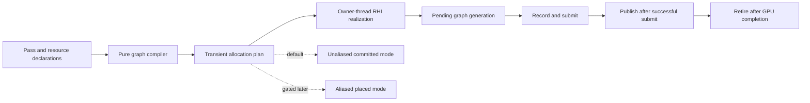

# OPT-11 C11-05 Safety Plan: Transient RenderGraph Allocation and VRAM Aliasing

**Status:** Planning and implementation contract. This document does not release
C11-05 for source implementation.

**Scope:** C11-05 only. C11-06 stress work, C11-07 acceptance, C11-04 secondary
command recording, vendor upgrades and later OPT packages remain outside this
boundary.

**Related contracts:**

- [OPT-11 execution plan](OPT_11_EXECUTION_PLAN.md)
- [OPT-11 architecture and algorithms](OPT_11_ARCHITECTURE_AND_ALGORITHMS.md)
- [NRI integration contract](NRI_INTEGRATION_CONTRACT.md)
- [RHI primary renderer architecture](RHI_PRIMARY_RENDERER_ARCHITECTURE.md)

## 1. Risk posture and decisions

C11-05 crosses four ownership boundaries at once: RenderGraph compilation,
native resource creation, GPU completion and backend-specific memory aliasing.
The implementation must therefore add a safe unaliased path before it attempts
to reuse native memory.

The following decisions are mandatory:

1. Imported resources, swapchain images, UI targets and externally leased
   resources never enter the transient allocator.
2. The first implementation uses one graphics queue. Async compute, queue
   ownership transfer and cross-queue aliasing are out of scope.
3. Graph planning is pure CPU work. It does not call NRI, mutate
   `RHIDevice`, acquire native pointers or modify the published graph.
4. Native creation, binding, view creation, barriers, submit and retirement run
   on the declared render owner thread.
5. `SupportsPlacedResources` and
   `SupportsTransientResourceAliasing` remain false until positive native
   evidence exists for the specific backend. Function-pointer presence and a
   feature bit are not sufficient evidence.
6. OpenGL remains a committed, unaliased fallback.
7. A failed or ambiguous submit never permits immediate memory reuse. The
   affected generation is quarantined or the device epoch is stopped according
   to the existing RHI failure policy.

The supported rollout order is:

```text
pure planner -> committed transient resources -> placement probe
              -> CPU interval plan -> backend barrier proof -> opt-in aliasing
```

## 2. Ownership architecture

The graph layer owns declarations and deterministic plans. The RHI layer owns
native memory and resource lifetimes. The frame/retirement layer owns the
completion token that permits destruction.



### 2.1 RenderGraph layer

`Engine/Renderer` may hold immutable resource descriptions, pass uses, lifetime
records and allocation plans. It must not hold NRI memory pointers or perform
native allocation from `Compile()`.

The existing imported-texture API and its resource leases remain valid. New
transient APIs must preserve existing imported callers rather than replacing
their semantics in the first commit.

### 2.2 RHI realization layer

The RHI factory/allocator is the only native boundary for transient resources.
It converts immutable graph descriptions into `RHITexture`/`RHIBuffer`
generations, memory dependencies and views. Renderer code must not see NRI
memory handles or placement offsets.

The realization transaction runs on the render owner. It creates candidates in
temporary storage and adopts them only after every candidate is valid and the
frame submit succeeds.

### 2.3 Retirement layer

Every published transient generation is retained through the completion token
of the frame that uses it. Abandoned candidates are destroyed without waiting
for a GPU token because they were never submitted. Submitted generations are
retired only after GPU completion or a checked device-loss cleanup path.

The producer and CPU recording jobs receive plans or diagnostics by value. They
do not allocate native resources, emit barriers, submit or present.

## 3. Data contract

The initial planner should introduce explicit graph resource kinds without
changing imported behavior:

```cpp
enum class GraphResourceKind {
    Imported,
    TransientTexture,
    TransientBuffer
};

struct GraphResourceDesc {
    GraphResourceKind Kind;
    TextureDesc Texture;
    BufferDesc Buffer;
    bool ContentsDefined = false;
    bool AllowAlias = false;
};

struct GraphLifetime {
    uint32_t FirstPass = UINT32_MAX;
    uint32_t LastPass = 0;
    uint64_t Size = 0;
    uint64_t Alignment = 1;
    CompatibilityKey Key;
};

struct GraphAllocation {
    uint32_t Resource;
    uint32_t Block;
    uint64_t Offset = 0;
    uint64_t Size = 0;
    uint32_t PreviousOccupant = UINT32_MAX;
};
```

The exact type names may change, but the ownership and invariants may not.

The compatibility key must conservatively include resource kind, memory
location/type, format, dimensions, mip/layer count, sample count, usage flags,
alignment/granularity, dedicated-allocation requirements and queue owner.
Buffers and textures are not compatible by size alone.

The plan must report at least:

- graph generation and backend;
- resource and pass counts;
- allocation mode (`UnaliasedTransient` or `AliasedTransient`);
- requested bytes;
- committed bytes;
- packed peak bytes;
- block count;
- alias event count;
- fallback reason and first error.

## 4. Pure graph compilation algorithm

`Compile()` is deterministic and side-effect free from the caller's point of
view. It produces a candidate plan; it does not publish it.

### 4.1 Declaration validation

Validate before constructing any edge or allocation:

1. Resource IDs and pass IDs are in range.
2. Pass names are non-empty and unique.
3. A pass does not use the same resource twice unless a future explicit
   subresource contract permits it.
4. Dimensions, mip/layer/sample counts and byte-size arithmetic are valid.
5. Layout and access agree. A read layout cannot be declared as write-only and
   a write-only layout cannot be declared as read-only.
6. Attachment load/store declarations are valid for the access mode.
7. A transient resource is not read or loaded before a stored write.
8. Unsupported queue transfers are rejected. The first implementation accepts
   only the single graphics queue.

Imported resources keep their external generation and lease. They are never
converted into transient resources during compilation.

### 4.2 Deterministic dependency graph

Build edges from explicit dependencies and resource hazards. For each resource,
track the latest writer and the set of readers since that writer:

```text
for pass in declaration order:
    validate every use
    for each use of resource r:
        if use reads:
            add edge(lastWriter[r], pass)
            add pass to readers[r]

        if use writes:
            add edge(lastWriter[r], pass)
            add edge(reader, pass) for every reader in readers[r]
            clear readers[r]
            lastWriter[r] = pass

    add explicitly declared dependency edges
deduplicate all edges
```

Run Kahn's algorithm using a min-heap keyed by the original pass index. This
keeps the topological order stable for equal dependency choices. If the output
does not contain every pass, reject the graph as cyclic. The compiler must not
allocate or mutate the last published graph when this occurs.

### 4.3 Lifetime analysis

After the topological order is fixed, scan every transient use:

```text
first = +infinity
last  = -infinity

for ordered pass index i using resource r:
    first = min(first, i)
    last  = max(last, i)
```

The lifetime is the closed interval `[first, last]`. Two resources overlap when
neither `a.last < b.first` nor `b.last < a.first` is true. A transient with no
use is rejected in the first implementation so that declaration mistakes do
not silently consume memory.

All additions and multiplications used to calculate requested, committed and
peak bytes must be checked for overflow.

### 4.4 Unaliased baseline plan

The first supported plan assigns one block to each transient resource. Imported
resources are excluded. `PreviousOccupant` and alias events are empty.

This gives a deliberately conservative baseline:

```text
requested bytes = sum of transient requirements
committed bytes = requested bytes rounded by each allocation requirement
packed peak     = committed bytes
```

The baseline is useful even when aliasing is unavailable. It provides the
reference image, lifetime behavior and memory measurement against which later
aliasing is compared.

## 5. Transaction and generation protocol

The native path uses the following state sequence:

```text
Uncompiled -> Compiled -> Prepared -> Recording -> Submitted
                                      |             |
                                      v             v
                                  Abandoned      Published -> Retired
```

`Poisoned` is a terminal state for a generation whose submit result is
ambiguous or whose native ownership cannot be safely reused.

Rules:

1. `Compile` creates only a plan.
2. `Prepare` creates native candidates and views in a temporary transaction.
3. Any allocation, binding, view or validation failure destroys every candidate
   created by that transaction and preserves the previous published generation.
4. `Record` holds pending leases but does not publish them.
5. Successful submit publishes the graph generation and completion token.
6. A failed submit with ambiguous native acceptance poisons the generation and
   prevents allocator reuse until the checked device policy resolves it.
7. A frame abandoned before submit releases its candidates immediately.
8. A submitted generation retires only after its completion token, or after a
   confirmed device-loss cleanup path.
9. No per-frame `WaitIdle` is added to hide a lifetime error.

## 6. Phased implementation and commit boundary

Each phase is one coherent commit or small package with its own evidence. Do
not combine a later phase with an earlier phase to make a test pass.

### C11-05.0 — release record and baseline

Record the base commit, build directories, backend/device identity, available
validation layers, baseline tests and unavailable checks in the exchange task
card. No source implementation is included.

### C11-05.1 — pure transient planner

Add the resource model, deterministic DAG/hazard compiler, lifetime analysis,
compatibility key, unaliased allocation plan and CPU-focused tests. Preserve all
existing imported RenderGraph behavior. Do not call RHI or add alias barriers.

Suggested commit:

```text
feat(opt11): add pure transient graph planner
```

Exit gate: planner tests pass, existing RenderGraph tests pass, repeated plans
are identical, and imported resources remain untouched.

### C11-05.2 — committed native realization

Use the existing committed `RHITexture::Init` and `RHIBuffer::Init` paths for
transient resources. Add owner-thread realization, leases/dependencies,
pending generations, completion-token retirement and rollback. Keep aliasing
disabled.

Suggested commit:

```text
feat(opt11): realize transient resources with committed allocation
```

Exit gate: D3D12/Vulkan native transient creation and retirement pass where
available; OpenGL remains committed; fault injection never partially publishes
a graph.

### C11-05.3 — placement probe and wrapper

Add a narrow RHI abstraction for memory requirements, alignment, allocation,
buffer placement and texture placement. Verify cleanup under failures. A pointer
check alone must not enable a capability flag.

Suggested commit:

```text
feat(opt11): add transient placement capability probe
```

Exit gate: the true `CreatePlaced*`/bind path and texture path are proven or the
backend remains explicitly unsupported and uses the committed fallback.

### C11-05.4 — CPU interval packing

Add deterministic first-fit interval coloring behind a disabled feature flag.
Sort by `(FirstPass, LastPass, ResourceID)`, retire active entries when
`active.LastPass < next.FirstPass`, reuse only compatible blocks and record the
previous occupant. Imported, dedicated, unresolved-queue and incompatible
resources stay unaliased.

Suggested commit:

```text
feat(opt11): add deterministic transient interval planner
```

Exit gate: pure tests prove no overlap, correct alignment, deterministic block
selection and correct alias event order. Native aliasing is still disabled.

### C11-05.5 — backend alias barrier contract

Add logical `AliasEvent` translation on the render owner only after the pinned
NRI/backend contract is verified. Do not invent a portable merge or barrier API
when the backend does not provide one. A missing contract selects unaliased mode.

Suggested commit:

```text
feat(opt11): add gated transient alias barrier events
```

Exit gate: D3D12 and Vulkan each have independent validation and readback
fixtures, or each backend remains in the unaliased fallback.

### C11-05.6 — integration metrics and handoff

Add diagnostics for requested, committed and aliased bytes, block count,
generation, fallback reason and retirement. Do not add C11-06 stress or C11-07
rollout work here.

Exit gate: the final handoff contains exact commits, commands, backend identity,
validation output, readback comparison, memory measurements and every NOT RUN
row.

## 7. Failure and rollback matrix

| Failure | Required behavior |
| --- | --- |
| Invalid descriptor, ID or access | Reject plan; no native candidate; published generation unchanged |
| Cycle or unsupported queue transfer | Reject plan; report deterministic diagnostic |
| Size/alignment overflow | Reject plan before native mutation |
| Memory requirement unavailable | Select committed fallback or reject; never guess |
| Allocation/create/bind/view failure | Destroy all new resources in reverse/RAII order; preserve previous generation |
| Barrier recording failure before submit | Abandon transaction; release pending leases |
| Submit failure with known non-acceptance | Abandon transaction; preserve previous generation |
| Ambiguous submit or device loss | Stop reuse, quarantine affected leases, transition through device policy |
| Completion timeout or stopping | Bounded drain/cancel; do not wait forever |
| Stale generation or dead lease | Reject frame; do not mutate published state |
| Backend lacks proof | Disable aliasing for that backend; report unaliased bytes |
| Plugin stop/unload | Drain/cancel graph tickets before unloading module code |
| OpenGL path | Committed allocation only; never claim VRAM aliasing |

## 8. Test and evidence matrix

### 8.1 CPU planner tests

- stable topological order;
- explicit dependency and RAW/WAR/WAW edges;
- cycle, undefined resource, duplicate use and invalid access rejection;
- no-use transient rejection;
- closed-interval lifetime boundaries;
- alignment and overflow rejection;
- imported-resource exclusion;
- deterministic unaliased byte statistics;
- disjoint intervals remain unaliased in the baseline;
- pure alias-event ordering and compatibility decisions.

### 8.2 RHI and fault tests

- failure at each allocation/create/bind/view step;
- memory lease and dependency lifetime;
- stale device epoch and stale generation;
- abandoned versus submitted retirement;
- no partial graph publication;
- ambiguous submit poisoning;
- bounded shutdown and device-loss cleanup.

### 8.3 Native backend tests

For D3D12 and Vulkan independently, where the environment supports them:

1. Create a transient texture and buffer through the committed path.
2. Create and bind placed resources only after the placement probe passes.
3. Execute two non-overlapping occupants of a compatible block.
4. Validate alias barrier ordering.
5. Read back the result and compare it with the serial committed path.
6. Capture validation output and requested/committed/aliased peak bytes.
7. Prove a real peak reduction before enabling the backend flag.

Missing GPU, validation layer or readback support is recorded as `NOT RUN`; it
is never silently treated as a pass.

All applicable Debug/Release rendering tests, `RHIStatePolicy` and the
architecture check must be rerun against the final source of each phase.

## 9. Stop gates

Stop at the current phase when any of the following occurs:

- imported or swapchain resources enter the transient allocator;
- planner output is nondeterministic;
- a failed candidate changes the published generation;
- an ambiguous submit permits memory reuse;
- a stale lease or device epoch is accepted;
- validation reports a barrier or placement error;
- readback differs from the unaliased reference;
- cleanup leaks, deadlocks or waits without a finite policy;
- aliasing does not reduce peak memory in the representative workload.

Any P1/P2 lifetime, stale-generation, partial-publication, leak or shutdown
finding blocks that backend. The supported fallback remains unaliased transient
allocation.

## 10. Definition of done

C11-05 is complete only when:

1. The unaliased transient graph path is stable and independently tested.
2. Imported resources and existing RenderGraph callers are unchanged in
   behavior.
3. Native candidates publish transactionally and retire by GPU completion.
4. Placement and alias barriers are capability-gated per backend.
5. D3D12 and Vulkan have separate validation/readback evidence, or are clearly
   marked unsupported with the unaliased fallback active.
6. Memory measurements show requested, committed and aliased peak bytes.
7. The final handoff records commits, tests, hardware, drivers, validation
   output, limitations and all unavailable checks.

No later OPT package is released by this document.
