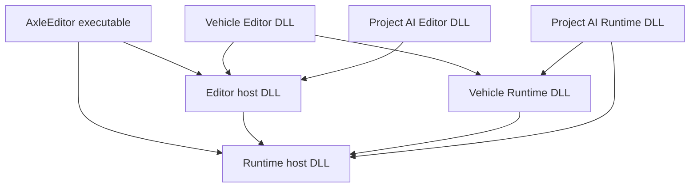

# Project-selected Plugin Architecture

> **Execution:** follow [OPT-00..11](../ROADMAP.md). This document is a
> technical contract, not a separate phase queue. Old Phase/G labels and
> source-audit baselines are retained for traceability. Early Vehicle retirement
> is delivered; acceptance and new plugin implementation remain open.

Date: **2026-11-04**. Source baseline: **3190ab205ace417b81172c0fa92f92e64b5b46f4**.
Status: **design only; no plugin infrastructure or Vehicle replacement implemented**.

The latest user instruction requests detailed documentation before implementation.
The user selected DLL plugins for Editor and static plugin modules for the shipped
Runtime. Replacing the existing Vehicle implementation from scratch is permitted;
preserving its C++ API or exact historical driving behavior is not required.
This document does not authorize deleting source or authored assets during planning.

Read with the [implementation plan](PLUGIN_SYSTEM_IMPLEMENTATION_PLAN.md) and
[implementation guide](PLUGIN_SYSTEM_IMPLEMENTATION_GUIDE.md). The
[exchange](../agents/CODEX_GEMINI_EXCHANGE.json) owns live assignments. Existing
Phase 41 rendering and animation acceptance work remains open. This proposal does
not assign their implementation. The subsequent
[master plan](ARCHITECTURE_FOUNDATION_MASTER_PLAN.md) now coordinates architecture-first
execution and labels this **Phase 43**, retaining the PLG package identifiers.
Its cross-track order supersedes the earlier no-relative-priority planning checkpoint.

## 1. Product contract

1. Engine and project plugins use the same manifest, SDK, registration and build rules.
2. An unselected plugin is discoverable from metadata, but its code is neither built
   by the product build nor loaded. A cached binary from an earlier build may remain
   on disk; discovery does not execute it.
3. The effective selection is the user's explicit choices plus required dependencies.
   Dependencies are visible in the Plugins window, not silently treated as user choices.
4. Editor loads selected Runtime and Editor modules as DLLs. Runtime modules run
   inside Editor Play; Editor modules supply tools and are excluded from the game.
5. Shipping Runtime links selected Runtime modules statically, using generated,
   explicit registration references. No selected plugin DLL is required by the game.
   Graphics-driver and other deliberately external vendor libraries are a separate matter.
6. Enabling a compatible prebuilt plugin requires no Editor relink. Missing or stale
   source modules require a plugin build. Selection changes take effect after restart.
7. DLL loading is not hot reload. Version one never unloads a plugin from a live
   project, swaps component implementations in place or runs both plugin generations.
8. Scene and generic Editor/Runtime code must work with an empty plugin selection.
   No concrete Vehicle, Spline or Terrain header belongs in generic consumers.
9. The old Vehicle is retired. Per the 2026-11-05 user clarification, old data formats,
   passive legacy payload preservation, conversion and historical simulation parity
   are not required. Engine must contain no retired Vehicle compatibility layer.
10. Failed builds or module initialization never replace a known-good active session
    or produce a success-looking export from stale artifacts.

The first supported binary configuration is Windows x64 with the repository's
configured MSVC toolchain. Other platforms require their own loader, ABI and
product acceptance; a portable manifest is not evidence of portable binaries.

## 2. Source audit at the original planning baseline

These are historical source observations at the recorded baseline, not current
build/test results. Vehicle ownership/target/UI rows predate the early retirement
in `fa74981`; OPT-00 reviews that delivery and PLG-17 verifies the final cutover.

| Source at audited baseline | Observed then | Target change |
| --- | --- | --- |
| [Root CMake](../../CMakeLists.txt) | Unconditionally adds Vehicle, Spline, Terrain, Editor and Runtime directories | Product-specific configuration and resolved module selection |
| `Engine/Vehicle/CMakeLists.txt` (retired source path) | Static library contained simulation, audio and VFX | Retirement and compatibility purge delivered; verify clean Engine and new plugin cutover |
| [Core](../../Engine/Core/CMakeLists.txt), [Application](../../Engine/Core/src/Application.cpp) | Static Core includes application composition and uses concrete platform/render/physics services | Establish a valid shared-host boundary before loading DLLs |
| [Scene interface](../../Engine/Scene/include/Axle/Scene.hpp), [implementation](../../Engine/Scene/src/Scene.cpp) | Owns vehicle instances and exposes vehicle queries; creates, updates, copies and renders vehicle state | Generic scene extensions and plugin-owned systems |
| [Components](../../Engine/Scene/include/Axle/Components.hpp) | Vehicle, wheel, audio and VFX component declarations are in the common header | New Vehicle components live in the plugin |
| [Scene serializer](../../Engine/Scene/src/SceneSerializer.cpp) | Built-in Vehicle branches and custom section callbacks coexist | Generic codecs, missing-type preservation, explicit readiness checks |
| [Assembly serializer](../../Engine/Scene/src/AssemblySerializer.cpp) | Built-in Vehicle handling; context argument alone does not establish complete custom callback support | Audit and implement equivalent extension handling for every assembly path |
| [Entity Inspector](../../Engine/UI/src/EntityInspector.cpp), [icons](../../Engine/UI/include/Axle/UIVectorIcons.hpp) | Vehicle-specific controls/add actions/icons are compiled into Engine UI | Owner-scoped Editor registrations |
| [RHI scene renderer](../../Engine/Scene/src/RHISceneRenderer.cpp) | Knows Vehicle instances, debug constraints and Vehicle VFX components | Plugin extraction/debug contributions with retained lifetimes |
| [Spline](../../Plugins/Spline/CMakeLists.txt), [Terrain](../../Plugins/Terrain/CMakeLists.txt) | Static targets mix Runtime algorithms and Editor tooling; Terrain links Spline | Split modules and declare dependencies explicitly |
| [Editor composition](../../Editor/src/EditorLayer.cpp) | Hardcoded plugin serializers, inspector callbacks, mesh/collider rebuilding and vehicle queries | Compose discovered modules through the common API |
| [Project configuration](../../Engine/Project/include/Axle/Project.hpp), [serializer](../../Engine/Project/src/ProjectSerializer.cpp) | No plugin selection schema | Versioned explicit choices, atomic persistence and legacy policy |
| [Project Settings](../../Editor/src/EditorLayer.cpp) | Existing modal edits metadata and RHI; no Plugins window | New first-class Plugins window and settings entry |
| [Runtime target](../../Runtime/CMakeLists.txt), [layer](../../Runtime/src/RuntimeLayer.cpp) | Always links plugins and repeats domain-specific setup | Selected static registration and common scene lifecycle |
| [Runtime build helper](../../Editor/src/RuntimeBuild.cpp) | Builds Runtime in the configured Editor build tree | Separate immutable, project-specific build requests |
| [Scripts build](../../Editor/CMakeLists.txt) | Scripts DLL links static Engine libraries, Vehicle and Editor UI | Correct host ownership and project-declared script dependencies |
| [Cooker](../../Engine/Asset/src/AssetCooker.cpp) | Packages project data and player/scripts artifacts | Bind selection, cooked metadata and exact player provenance |

The vendored [EnTT version](../../ThirdParty/entt/src/entt/config/version.h) is
**3.14.0**. Online documentation may describe a newer release; do not assume its
export macros, reflection behavior or shared-library examples exist locally.

## 3. Discovery, identity and module kinds

Search only the configured Engine `Plugins/` root and the active project's
`Plugins/` root. Scan manifests without loading DLLs or evaluating CMake scripts.
Installing/copying a folder is distinct from enabling it. Do not add every
discovered plugin to the build graph with `EXCLUDE_FROM_ALL`: unselected plugins
must not have their configure scripts evaluated either.

Use a stable namespaced ID independent of directory/display name, for example
`axle.vehicle` and `mygame.racing-ai`. Duplicate IDs across roots are an error with
both paths shown; no implicit project override. Select one installed version per
ID in version one. A version constraint validates that version; this is not a
package downloader or a multi-version solver.

| Kind | Editor | Shipped Runtime |
| --- | --- | --- |
| Runtime module | DLL for simulation, codecs and scene systems | Static library and explicit registration |
| Editor module | DLL; may depend on its Runtime module and Editor SDK | Never configured, built, linked or packaged |
| Content-only plugin | Mount selected content; no C++ build | Cook required selected content; no code module |

Runtime modules may depend only on Engine runtime services and Runtime modules of
other plugins. Editor modules may additionally depend on Editor services and
Editor modules. A Runtime-to-Editor dependency is rejected before CMake generation.
Engine plugins cannot depend on project plugins. Project plugins may depend on
Engine plugins and other project plugins. Both plugin-level and module-level
graphs must be acyclic. Platform support is checked over the full effective graph.

## 4. Proposed files and schemas

Names below are proposed contracts, not existing files, targets or commands.

```text
AxleEngine/
  Engine/Plugin/                 metadata, resolver, lifecycle and registration
  Engine/EditorFramework/        plugin-facing tools; no standalone dependency
  cmake/                        product/module configuration helpers
  Plugins/Vehicle/
    Vehicle.axleplugin
    CMakeLists.txt
    Runtime/include/AxleVehicle/
    Runtime/src/
    Editor/include/AxleVehicleEditor/
    Editor/src/
    Content/                    optional authored assets
MyGame/
  MyGame.axleproj
  Plugins/RacingAI/
    RacingAI.axleplugin
    CMakeLists.txt
    Runtime/
    Editor/
  Intermediate/Plugins/         local resolutions/builds/receipts
```

Use a versioned JSON manifest with a strict parser rather than extending the
project's line-oriented parser into a general JSON/YAML parser. Select a small,
maintained JSON dependency or an existing suitable repository parser during the
schema package; test malformed input. Do not implement ad hoc regex JSON parsing.

```json
{
  "schemaVersion": 1,
  "id": "axle.vehicle",
  "name": "Vehicle",
  "version": "1.0.0",
  "engineApiVersion": 1,
  "description": "Jolt-backed wheeled vehicle simulation and authoring",
  "platforms": ["windows-x64"],
  "dependencies": [],
  "modules": [
    {"name": "VehicleRuntime", "kind": "Runtime", "dependencies": []},
    {"name": "VehicleEditor", "kind": "Editor", "dependencies": ["axle.vehicle/VehicleRuntime"]}
  ],
  "content": []
}
```

For version one, dependency objects require an exact installed semantic version;
range expressions and automatic package retrieval are deferred. A project plugin
can declare, for example:

```json
{
  "schemaVersion": 1,
  "id": "mygame.racing-ai",
  "name": "Racing AI",
  "version": "0.1.0",
  "engineApiVersion": 1,
  "description": "Project-specific vehicle drivers",
  "platforms": ["windows-x64"],
  "dependencies": [{"id": "axle.vehicle", "version": "1.0.0"}],
  "modules": [
    {"name": "RacingAIRuntime", "kind": "Runtime", "dependencies": ["axle.vehicle/VehicleRuntime"]}
  ],
  "content": []
}
```

Module names map to declared build targets, not arbitrary shell strings or
manifest-provided DLL paths. Resolve paths relative to the manifest, canonicalize
them and reject escapes outside the declared plugin root. Load only from the
matching build receipt with scoped dependency search directories.

Keep project metadata in `.axleproj`. Proposed additive fields:

```yaml
Project:
  Name: MyGame
  StartScene: assets/scenes/Main.axlescene
  AssetDirectory: assets
  RHIBackend: Direct3D12
  PluginSelectionVersion: 1
  EnabledPlugins: axle.vehicle,mygame.racing-ai
```

Plugin IDs match `[a-z][a-z0-9]*(?:[.-][a-z0-9]+)*`; display names are separate
UTF-8 strings. Module names use a validated CMake-safe identifier grammar.
The project parser must
distinguish an absent field from a deliberately empty list and reject duplicates.
Persist explicit IDs only. A generated resolution records dependency reasons,
versions, source roots and selected module kinds. Do not write absolute machine
paths or transient build status into the tracked project file.

Use the current versioned project schema and explicit plugin selections. New
projects start with no optional plugins; templates can declare their choices.
Old-format projects need no compatibility selection, legacy parser or automatic
migration. Reject unsupported schemas with a clear diagnostic. Selecting the new
Vehicle plugin does not enable retired Vehicle data. Untitled sessions can inspect
installed plugins but must save a project before Apply/build.

## 5. Selection and artifact states

Maintain separate state, all visible to the window's view model:

| State | Meaning |
| --- | --- |
| Discovered | Manifest is present and readable |
| Draft | Unsaved checkbox edits in this window |
| Desired | Explicit IDs saved in the project |
| Resolved | Valid dependency closure and module build plan |
| Built | Matching artifacts and receipt exist |
| Active | Modules loaded and initialized for this Editor session |

An unchecked Draft checkbox does not unload an Active DLL. An inactive cached DLL
does not make a plugin selected. A saved Desired graph may be pending while the
session runs its last-known-good Active graph. Show that mismatch; block Play and
export until resolved. Never mutate the active session to pretend Apply succeeded.

## 6. Plugins window and user workflows

Provide `Edit > Plugins...`, `Window > Plugins`, and a `Manage Plugins...` button
inside Project Settings, all opening one dockable window. No second settings store.
Use existing Editor styling and stable ImGui IDs; details wrap at narrow widths.

The window contains:

- Search by display name/ID; filters for Engine/Project, Enabled, Pending and Errors.
- Rows showing checkbox, name, source, version and effective status. Dependencies
  show `Required by Terrain` rather than an unexplained forced checkmark.
- A detail pane with description, modules, source folder, required plugins,
  incompatibility diagnostics and build log access.
- A change summary listing user changes and dependency additions/removals.
- `Apply`, `Apply & Restart`, `Revert`, `Rescan`, `Build Missing Modules` and
  `Cancel Build` actions, enabled only when meaningful.

Example state; this is a wireframe, not a screenshot of implemented UI:

```text
Plugins                    Search [                    ]   Source [All]
[x] Vehicle    Engine   1.0.0   Enabled - restart pending
[x] Spline     Engine   1.0.0   Required by Terrain
[x] Terrain    Engine   1.0.0   Build required
[ ] RacingAI   Project  0.1.0   Disabled

Terrain: Runtime + Editor modules | Requires Spline
Changes: enable Terrain; add required Spline
[Apply] [Apply & Restart] [Revert] [Build Missing Modules]
```

Enabling a plugin previews the required closure. Disabling a dependency offers an
explicit dependent-disable transaction or cancellation. Missing, incompatible or
cyclic dependencies block Apply with the complete reason chain. No repeated
confirmation for routine enabling; ask only where dependent changes or unsaved
work need an actual choice.

`Apply` atomically saves a validated Desired selection and marks it pending;
it never claims code is active. `Apply & Restart` first uses the common dirty
document guard for scenes, assemblies, VFX, materials/UI and future registered
documents. Save/Discard/Cancel must be honored, including save failures. It then
builds missing/stale modules on an owned cancellable worker. On success it stages
a complete receipt and restarts into the explicit project and preserved backend.
A compatible prebuilt set skips compilation. The Editor executable is not relinked
for an ordinary plugin selection change.

Build failure/cancellation keeps the old session usable and the Desired selection
visibly pending; it does not quit or publish partial outputs. Build logs and Retry
remain available. Close/build/project-switch races have defined cancellation and
join behavior. During Play, selection can be inspected but Apply/build/restart is
disabled with `Stop Play to change plugins`. During plugin build/export the
configuration is locked or changing it cancels and invalidates the operation.

Rescan discovers metadata only. Source or binary changes never trigger automatic
loading. Asset-only changes use the same restart policy initially, though their
build step may be empty. An unavailable compiler permits compatible prebuilt
modules; otherwise show an actionable build error, not a disabled checkbox with
no explanation.

## 7. DLL host boundary and SDK

Changing `STATIC` to `SHARED` on Vehicle while linking the current Engine static
libraries into both the Editor and plugin is not an acceptable implementation.
It can duplicate active project state, registries, loggers, jobs, device state and
vendor globals. `Project::s_ActiveProject` is currently inline static; auditing only
out-of-line functions does not solve this.

Proposed Editor layout:



The Runtime host owns runtime services and shared state; the Editor host owns
ImGui/tooling state. They contain no concrete optional plugin code. Existing
modules may be aggregated behind these host boundaries before further internal
layering. During migration, legacy product wiring may remain explicitly isolated
until its retirement package; that intermediate host is not accepted as the final
empty-plugin product. Remove required cycle-causing composition edges, particularly
Application-in-Core, instead of adding cyclic shared targets. Full Phase 41 or
every proposed layered target is not a prerequisite.

Use reviewed export/import declarations and host-owned non-inline state accessors.
Do not rely on blanket symbol exports or public transitive static links to create
an SDK. Plugins import shared host services, not static copies. Header-only types
must have identical layouts/configuration. Editor module code uses the host ImGui
context and implementation; it must not compile another ImGui or backend.

The retired Vehicle implementation called Jolt directly. The new design keeps Jolt as the
physics backend and uses one shared Jolt implementation in the Editor dependency
graph, with matching `JPH_SHARED_LIBRARY`/import settings and host initialization.
The vendored Jolt build has shared-library support; scope its build options rather
than turning every third-party target into a DLL globally. Runtime uses its static
vendor variant. A narrower physics facade can replace this vendor-facing SDK later;
implementing a second physics engine is outside this plan.

The loader handshake is a small versioned C ABI: structure sizes, fixed-width
fields, UTF-8 views, status codes, opaque owner handles and function pointers.
It includes Engine SDK/build fingerprint, plugin/module identity and explicit
start/stop entry points. Exceptions and ownership of STL containers do not cross
this handshake. Matching version numbers alone do not establish binary compatibility.

The initial component/Editor SDK remains a **matched-toolchain C++ SDK**, including
EnTT where necessary. It is not a compiler-independent binary ABI. Require exact
SDK fingerprint, architecture, toolset, build configuration, CRT mode, EnTT/Jolt/
ImGui versions and relevant compile definitions. Reject mismatches before calling
initialization. A pre-load sidecar receipt identifies the artifact; validate the
returned descriptor again after loading. Static initializers must not register
features or touch Engine services before the handshake.

Allocation owners supply destroy functions; plugin callbacks, objects, tasks and
resources retain module ownership. Do not pass raw owning pointers with an implied
cross-module `delete`. Do not store unstable numeric EnTT type indices in assets.

## 8. Registration, EnTT and scene ownership

### Implemented facade decision (2026-11-08 correction)

The corrected OPT-06 implementation uses opaque C/POD host tables instead of
exporting Engine C++ classes or vendor SDKs to DLLs. AxleRuntimeHost and
AxleEditorHost own the canonical shared gateway tables; one application-owned
PluginServiceSession supplies their callbacks to its existing Project, Scene,
JobSystem, Jolt and renderer instances. The SDK import targets expose no Engine
static libraries, EnTT, Jolt, enkiTS or ImGui implementation. Physics operations
therefore call the single host Jolt backend through a narrow facade; Editor
controls call the host ImGui implementation/context. A separate shared Jolt
build is unnecessary for this facade because no Jolt types cross the SDK.
This replaces the proposed direct vendor/matched C++ component surface above;
it does not replace Jolt or create another scheduler/renderer.

Each scene still owns one EnTT registry. Native data occupies a host-compiled
wrapper pool keyed by stable type IDs on those same entities. A plugin allocates
its private nontrivial payloads and supplies Create/Destroy/Serialize/Clone and
lifecycle callbacks. No plugin-generated EnTT pool/vtable enters the host.
Descriptors and their code remain pinned by each scene that used them, including
an empty pool. The descriptor takes ownership of a non-null User context only
after registration succeeds, with an explicit DestroyUser callback; the context
must not also be transferred to the immediate generic resource registry.

Session composition must admit modules in resolver dependency order. Scene
phases run all data for an admitted owner before its dependents, with stable
type/entity ordering inside that owner. Stop/destruction run in reverse order.
Hierarchy duplicate/import transactions allocate and remap the complete entity
graph and establish hierarchy/physics before invoking Start. Clone failure rolls
back the whole new graph. Callback failure stops/faults the affected simulation.

SDK access requires both the OS owner thread and zero scheduler task depth;
work stolen by the owner thread still cannot access live ECS/physics/UI. Owner
jobs use the existing JobSystem and its owner-token main-thread completion queue.
Scene instance IDs change on Clear, rejecting completions for a replaced scene.
Unbinding a host installs callable revoked operations, so retained destructors
can safely use a borrowed table after service shutdown. Module Stop/FreeLibrary
and final code retirement run on the loading thread, including worker releases.

Canonical AxlePlugin sections contain type/schema/required/reference metadata and
hex-encoded payload bytes. Missing data remains passive and byte-preserved;
required/incompatible data blocks simulation, and unresolved entity references
block unsafe copying. The scene, generic data document, Assembly and private
Assembly Editor preview paths use the same extension seam. Full product UI/restart and
native rendering/export gates are tracked separately in the OPT-06 review ledger.

Scene continues to own one EnTT registry per scene. Plugins use it for their
typed components; no parallel Vehicle entity database replaces the registry.
An application-owned plugin session creates scene extension instances for edit,
Play, assembly preview and other private scenes. No per-plugin global `Scene*`.

Register owner-scoped descriptors for only the concrete extension needs:

- component serialization, schema version, clone/remap and removal;
- scene attach/detach, runtime start/stop, simulation phases and entity destruction;
- particle/render extraction and debug drawing contributions;
- Editor Inspector/add-component/icon/panel/viewport integrations;
- datasource/actions, asset dependencies and pre-cook validation where needed.

The Engine descriptor registry is not a replacement for EnTT storage. EnTT does
not need this registration to use a component; Engine tooling and persistence do.
Descriptors use stable string IDs, owner IDs and explicit ordering dependencies.
Reject duplicate component codecs, conflicting aliases and phase cycles.
Unregister via scoped tokens; roll back partial startup in reverse order.

Typed pools created by DLL code can retain virtual destructors/function pointers
even after their last component is removed. The DLL remains loaded until every
registry/storage, reflection entry, callback and object that can call it is gone.
Clearing visible entities alone is not proof of safe unload. Version one pins
modules for the session, destroys all dependent scenes/storages at shutdown, then
unloads in reverse dependency order while host/vendor services remain alive.

Copy/duplicate/Play clones create fresh runtime instances, preserve authored UUIDs
where appropriate and remap entity references with an explicit old-to-new mapping.
They never copy Vehicle pointers, Jolt body IDs, task handles or GPU ownership.
Entity destruction recursively cleans plugin-owned bodies/constraints and references
before generic physics destruction; one body has one lifetime owner.

## 9. Simulation and jobs

Use the existing Engine-owned enkiTS JobSystem and Jolt job bridge. Plugin
initialization never creates an independent Engine scheduler or registers a second
Jolt factory. External threads must obey the vendored enkiTS registration/API rules.

Define and test one shared Editor Play/Runtime phase order:

```text
Collect commands -> PrePhysics scripts/input -> Vehicle control preparation
-> fixed Jolt step -> body/wheel synchronization -> telemetry/audio/VFX
-> animation/world transforms -> render/UI extraction
```

The implementation baseline must record current call order first. Relocating the
old functions without separating control preparation from post-step readback can
introduce a frame of input delay. Define fixed dt, accumulator cap, pause, one-step
and resume behavior in the scheduler package; no integration from UI rendering.

EnkiTS schedules tasks; it does not infer component read/write conflicts. Initial
scene structural mutation is on the owning thread at explicit barriers. Parallel
jobs use prepared storage and nonconflicting data ranges; writes to shared types
have declared dependencies. No concurrent component insertion/removal while a
conflicting view/group is iterated. An atomic option does not make a registry
generally thread-safe. Wait for task groups before applying queued commands.

Track tasks and queued main-thread work by plugin/session owner. Closing/restarting
stops submission, drains work and prevents obsolete callbacks mutating a new
project. Module references keep task code/destructors alive through completion.

## 10. Shutdown and failure ordering

1. Freeze new plugin work, actions, frame extraction and build mutations.
2. Stop Play/private simulations and detach script instances while code is loaded.
3. Drain plugin/Jolt jobs and queued callbacks while required services still exist.
4. Release scene systems, physics constraints/bodies and component runtime instances.
5. Retire submitted GPU/UI/audio work, then release the owners/destructors it retains.
6. Destroy all edit/Play/preview registries, histories and deferred component data
   objects that depend on plugin code. Preserve passive raw authored payloads as needed.
7. Remove descriptors, UI registrations, script factories and reflection contexts.
8. Stop modules and unload dependent DLLs before their dependencies; keep the
   Runtime/Editor hosts and Jolt/ImGui alive until the final dependent release.
9. Destroy host services in their checked ownership order.

A partial initialization failure unwinds only successfully installed registrations
and instances. Missing/invalid required modules open a diagnostic/recovery shell
that does not deserialize active typed plugin components or allow Play/export.
Safe mode can inspect manifests and raw data without loading plugin DLLs.
DLL code is trusted native code; this architecture is not a security sandbox.

## 11. Fresh Vehicle plugin and old-code retirement

The user permits a clean implementation. Do not make compatibility wrappers around
`Scene::GetRuntimeVehicle` the permanent seam, mechanically relocate the monolith,
or keep old and new simulation operating on the same chassis.

New plugin responsibilities:

| Module | Initial responsibility |
| --- | --- |
| VehicleRuntime | Authored chassis/wheel configuration, runtime vehicle system, Jolt constraints, controls, wheel poses, telemetry, codecs and clone/remap |
| VehicleEditor | Add/setup vehicle and wheels, tuning Inspector, validation, debug overlays and read-only live telemetry |
| Optional follow-up integrations | Vehicle audio synthesis, tire/exhaust VFX and sample HUD/input/camera features through the common API |

Initial supported vehicle: four-wheel Jolt wheeled constraint, authored wheel
positions/radius/suspension, steering, throttle, brake, handbrake, engine and
transmission settings, reset and chassis/wheel synchronization. Bounds and invalid
inputs must be validated. This is not a custom tire solver, networking, tracked
vehicles, motorcycles, AI driver or realistic handling-parity claim.

Keep authored component data distinct from per-scene runtime state. Use a new
component schema/identity so a legacy `VehicleComponent` is not accidentally
interpreted as compatible. Old data formats require no support, passive payload
storage or migration. Implement current schema operations without a legacy layer.

The old `Engine/Vehicle` and built-in target/components/lifecycle/UI wiring
were retired early in `fa74981`, before plugin implementation. OPT-00 reviews
that delivery; PLG-17 later verifies the cutover against the new plugin and
generic unknown-data contracts. Do not restore the old module. Preserve relevant physics
regressions, replace Vehicle-specific assertions with new public API fixtures and
classify incompatible historical samples; never disable a failing suite merely to
declare the rewrite complete. Audio/VFX feature losses remain explicitly listed
until their follow-up packages pass.

## 12. Spline and Terrain migration

These use the same plugin mechanism; a special static path for them would break
the claim that project selection controls Runtime. Separate curve/mesh/collider/
codec/runtime setup from ImGui sculpting, gizmos and inspectors. Remove direct
product includes and duplicate setup loops in Editor/Runtime. Terrain's Spline
dependency is declared at the actual module level; Runtime cannot drag in
`SplineEditor`. Retain existing authored Spline/Terrain formats unless a deliberate
versioned migration is needed. Both OpenGL and RHI resource paths must remain
honest about current capability; no new rendering parity is claimed here.

## 13. Persistence and missing plugins

Use versioned plugin-owned component sections, stable owner/type IDs and declared
asset/entity references. Built-in scene data remains in Engine codecs. Extend all
scene, assembly, preview, duplication and edit/Play copy paths consistently.

Unrecognized/disabled/malformed plugin payloads are stored passively with exact raw
section bytes and identity, and re-emitted without running unavailable code.
Do not silently drop fields, instantiate placeholders as if simulation were valid,
or deserialize a legacy section through an unrelated new codec.

Preserve raw unknown sections in scene and assembly round trips. Copy keeps them
passive; if a duplicate would require remapping opaque entity references, refuse
that operation with a diagnostic rather than manufacture incorrect references.
Only a registered codec may claim it can remap those references. Required plugin
data blocks Play/cook/export until resolved or explicitly removed by the user.
Any future optional-data exception needs an explicit schema contract.

Old physics deserialization skips built-in Vehicle bodies. Replace that hardcoded
branch with registered body-ownership policy; missing required plugin data must
not accidentally create a generic rigid body for an unresolved chassis.

## 14. Build products, cache and scripts

Build Editor hosts, Editor plugin DLLs and shipping Runtime in distinct product
configurations. Proposed CMake inputs: `AXLE_PRODUCT=Editor|Runtime|Tests`,
`AXLE_PROJECT_FILE`, `AXLE_PLUGIN_RESOLUTION_FILE`. These are not implemented options.
Module linkage follows product policy, not arbitrary user CMake switches that can
contradict the resolution. Runtime never needs to configure the Editor subdirectory.

Use generated builds under `Intermediate/Plugins/<product>/<build-key>/` or a
documented machine cache partitioned by project identity. Key inputs include
canonical resolution, Engine SDK/build identity, platform/architecture, toolset,
CRT/configuration, generator and relevant options. Per-module receipts additionally
bind source/build-input digests and dependency artifact identities. A reused key
does not excuse skipping dependency-aware incremental compilation or source checks.
Do not reuse the Editor build directory for export.

Configure/build runs on a cancellable owned process tree, writes a persistent log
and stages outputs before publication. No shell-composed manifest commands. Serialize
writers to the same artifact location; cancellation never deletes a prior receipt.
Publish a complete receipt atomically only after configure, compile, link and
validation succeed. Restart into an explicit receipt, not a guessed `Release/` path.

The scripts system is part of this boundary. Editor scripts DLLs must import host
services and declare plugin module dependencies; they must not relink static Engine
state or require Editor UI for gameplay. For this first shipping path, compile
project gameplay scripts as a static project module with generated registration,
so shipping scripts can call selected static plugin modules without a second Engine
copy. Preserve existing Editor script reload behavior through the shared host;
script reload must not unload a DLL still owning live plugin callbacks.
Update cooker expectations: an `AxleScripts.dll` is no longer an unconditional
shipping artifact. General binary modding or shipped script DLL reload is deferred.

## 15. Exact export and content policy

Snapshot project bytes, selected graph, script dependencies, relevant scenes/assets,
backend and build inputs before starting export. Validate unknown required data and
dependencies before building. The worker operates on immutable request data rather
than reading a mutable `Project::GetActive()` throughout the operation.

Generate static registration from the resolved Runtime graph in topological order;
explicit factory references prevent linker dead stripping. Build only that graph.
Produce a receipt with plugin/module IDs, versions, source/build identity, hashes,
player path and selected configuration. Cook from the same snapshot, and reject
configuration/source drift or mark the result explicitly bound to the old snapshot
without presenting it as the current project's export. Initial UI disables edits
during the operation to avoid ambiguity.

Write packaged plugin metadata for startup diagnostics, but do not discover/build
source plugins from the shipped game directory. Validate packaged requirements
against the compiled registration list. Package only resolved Runtime code/content;
exclude Editor DLLs, plugin build trees and unselected plugin resources. Selected
content dependencies are explicitly rooted and mounted; missing assets fail cooking.
Project assets with unresolved required plugin ownership fail validation even if a
directory-wide asset scan would otherwise copy them. Full unrelated asset stripping
is not required to prove optional plugin code exclusion.

Package into staging and atomically publish after success; never mix a failed new
player with an earlier `.axlepak`. Shipping plugin selection is build-time only.
Static linkage is a deployment choice, not a guarantee of higher FPS.

## 16. Scope boundaries and interaction with rendering work

Required here: plugin host/SDK, discovery/resolution, owner-scoped lifecycle and
scene hooks, new Plugins window, project builds/restart, fresh Vehicle, Spline/
Terrain module separation, scripts boundary and exact static export.

Deferred: marketplace/download manager, arbitrary binary compatibility, live plugin
unload/hot swap, sandboxing, a generic reflection editor for every C++ type,
networked Vehicle physics and automatic legacy Vehicle conversion. Audio/VFX are
separate feature packages, not silently claimed as part of the initial vehicle.

Reuse current RHI/retirement services and future Phase 41 contracts where delivered.
Plugin work must not invent a competing renderer, lifetime token model or frame
scheduler. If P41 packages land first, adapt the seams to their accepted API. If
plugin work is assigned first, use a bounded adapter and record its replacement
boundary. Overlapping source files require a coordinated handoff in the exchange.

## 17. Completion criteria

- Empty-plugin Editor discovers manifests without compiling/loading plugin code;
  empty-plugin Runtime builds with Editor disabled.
- A project-local test plugin adds a real component, Inspector and runtime system
  through the SDK without editing Engine/product source or root CMake.
- A compatible prebuilt DLL activates after restart without relinking Editor;
  a missing DLL builds and restarts; failures preserve the old session.
- State identity tests prove one project/session, scheduler, physics service,
  ImGui context and device owner across host and plugin boundaries.
- EnTT component storage created in a DLL survives edit/Play/preview copies and
  is destroyed safely before unload, including empty-but-existing pools.
- Fresh Vehicle starts, drives, brakes, resets and stops through the common
  lifecycle in Editor and a packaged static Runtime; parity is measured against
  the new declared fixture, not historical driving behavior.
- Spline/Terrain selection and dependencies work; no Runtime-to-Editor link exists.
- Unknown component data survives scene/assembly save; required unresolved data
  blocks Play/export with a usable diagnostic.
- Link/build evidence proves unselected plugin code and all Editor plugin modules
  are absent from the shipped player, not merely inactive behind a flag.
- Every required CPU, real-DLL, physics, native UI, GPU and packaged-player result
  is recorded separately; unavailable evidence remains NOT RUN.

## 18. External references and limits

- [Unreal modules](https://dev.epicgames.com/documentation/en-us/unreal-engine/unreal-engine-modules): module kinds, dependency graphs and loading concepts.
- [O3DE Gem modules](https://docs.o3de.org/docs/user-guide/programming/gems/overview/): dynamic module lifecycle and static monolithic builds.
- [EnTT across boundaries](https://skypjack.github.io/entt/md_docs_2md_2lib.html): type/reflection context and memory ownership concerns; validate against local 3.14.0.
- [EnTT ECS](https://skypjack.github.io/entt/md_docs_2md_2entity.html): component/system freedom and concurrency constraints.
- [enkiTS](https://github.com/dougbinks/enkiTS): task scheduling and completion semantics; local headers are authoritative for this checkout.

These sources inform the proposal; they do not establish AxleEngine compatibility,
performance or a successful implementation. This planning task runs documentation
checks only, not C++ builds, DLL loading, GPU rendering or native UI acceptance.
