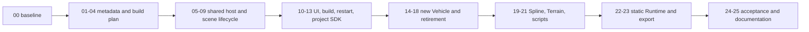

# Plugin System Implementation Plan

> **Execution:** follow [OPT-00..11](../ROADMAP.md). This document is a
> technical contract, not a separate phase queue. Old Phase/G labels and
> source-audit baselines are retained for traceability. Early Vehicle retirement
> is delivered; the roadmap owns current package acceptance and release status.

Date: **2026-11-04**. Baseline: **3190ab205ace417b81172c0fa92f92e64b5b46f4**.
Status (2026-11-08): **PLG-00 prerequisite and PLG-01..13 accepted. PLG-14..21 foundations accepted under explicit user scope; detailed domain features remain for later completion. PLG-22..25 remain later scope. See the OPT-07/08 bounded review and roadmap for evidence and release authority**.

The user requests detailed plans before code. DLL modules in Editor, static
Runtime modules, project-level selection and a new Plugins window are the selected
direction. A fresh Vehicle implementation may replace the old one. See the
[architecture](PLUGIN_SYSTEM_ARCHITECTURE.md) for canonical behavior and the
[implementation guide](PLUGIN_SYSTEM_IMPLEMENTATION_GUIDE.md) for algorithms and
test design. The [exchange](../agents/CODEX_GEMINI_EXCHANGE.json) determines actual
assignments; this checklist does not release the entire backlog.

**Architecture-first coordinator (2026-11-04):** This is the Phase 43 plugin/Vehicle
domain in the [master contract](ARCHITECTURE_FOUNDATION_MASTER_PLAN.md). The
[optimization roadmap](../ROADMAP.md) owns sequential order and progress; the
master's external prerequisite edges supplement this plan's internal graph.
Retain all PLG identifiers. Use the [NRI contract](NRI_INTEGRATION_CONTRACT.md)
for shared GPU/device/frame ownership; plugins must not create another renderer
or link private Engine/NRI device state. Only packages explicitly released in the
exchange may be implemented; this plan does not authorize later work.

The subsequent [EnTT/enkiTS review](../architecture/ENTT_ENKITS_REVIEW.md) found
existing concurrency/lifetime faults. The
[ECS/jobs refactor plan](ENTT_ENKITS_REFACTOR_PLAN.md) defines the hardening results
that this plan must reuse: owner-thread completion/reload before host/restart
cutover, actual enki completion before new Vehicle physics, and accepted mutation/
simulation phases before scene-system integration. Its crosswalk identifies exact
consumer gates. Metadata-only PLG work need not wait for every refactor package;
native execution must pass its relevant prerequisites. Do not create competing
JobSystem, main-thread queues, script ABI rules or simulation clocks here.
All prerequisites are proposed until their own current evidence is accepted.

## 1. Execution rules

- Assign a concrete package or bounded range; record base commit, expected files
  and conflicting work before editing. No concurrent source writers in this checkout.
- Keep separately reviewable behavior commits. A package can require several
  commits; package count is not a delivery-time estimate.
- Establish generic plugin and DLL ownership gates before replacing Vehicle.
  Do not implement a Vehicle-only loader as a shortcut.
- Maintain a runnable development path during migration. Temporary legacy wiring
  is explicitly marked and removed at cutover; no permanent built-in fallback.
- Preserve authored project files and unrelated changes. Old Vehicle C++ API and
  historical handling parity need not be preserved. Per the 2026-11-05 user scope,
  old data formats, legacy payload retention and conversion are not required.
- Never downgrade a failed test by skipping it, weakening assertions or silently
  dropping old physics/serialization coverage. Classify intentional Vehicle API
  retirement and replace its meaningful coverage against the new contract.
- Preserve existing material/VFX/animation evidence and outstanding acceptance.
  Do not implement Phase 41, animation authoring or unrelated physics expansion
  solely because their files are adjacent.
- Record exact commands, configurations, logs, exit codes and implementation versus
  independent review. Native DLL tests are not covered by a metadata unit test;
  an offscreen draw is not native UI acceptance.

## 2. Gates

| Gate | Packages | Required runnable outcome |
| --- | --- | --- |
| G0: inventory and selection | PLG-00..04 | Current behavior baseline; manifests and versioned selections resolve deterministically without executing plugins |
| G1: host and lifecycle | PLG-05..09 | One shared Engine state; real project DLL loads safely and creates components in real scenes |
| G2: UI and author workflow | PLG-10..13 | Plugin window, source build, restart/recovery and external project plugin creation work |
| G3: fresh Vehicle | PLG-14..18 | New plugin drives through the common lifecycle; old built-in Vehicle is retired; optional integration status is explicit |
| G4: remaining products | PLG-19..23 | Spline/Terrain split, scripts, static Runtime and snapshot-bound export work |
| G5: acceptance | PLG-24..25 | Real DLL/storage/UI/player and exclusion evidence; maintained docs describe delivered behavior |

G3 completion includes the scoped audio/VFX integrations in PLG-18. A smaller
initial Vehicle demo can be delivered at PLG-16 with an explicit feature list; it
does not close G3 or claim historical Vehicle feature parity.

## 3. Dependency graph

Default execution follows the listed order. Edges below are mandatory; assignment
and source ownership still apply to independently ready packages.

| Package | Depends on | Responsibility |
| --- | --- | --- |
| PLG-00 | none | Baseline, legacy inventory and tests |
| PLG-01 | PLG-00 | Manifest discovery, identity and validation |
| PLG-02 | PLG-01 | Deterministic plugin/module resolver |
| PLG-03 | PLG-02 | Project persistence and legacy selection |
| PLG-04 | PLG-02, PLG-03 | Product build plan, fingerprints and receipts |
| PLG-05 | PLG-00, PLG-04 | Shared Engine/Editor hosts and exports |
| PLG-06 | PLG-05 | Loader handshake and transactional registration |
| PLG-07 | PLG-06 | Generic scene/component extension lifecycle |
| PLG-08 | PLG-07 | Scene/assembly codecs and missing-data preservation |
| PLG-09 | PLG-07 | Shared phases, jobs, extraction and destruction ordering |
| PLG-10 | PLG-03, PLG-04, PLG-06 | Plugins window and selection transactions |
| PLG-11 | PLG-04, PLG-06, PLG-10 | Cancellable per-project DLL build |
| PLG-12 | PLG-08, PLG-09, PLG-11 | Dirty-work guard, restart and recovery |
| PLG-13 | PLG-07, PLG-08, PLG-09, PLG-12 | Project plugin SDK/template and real external fixture |
| PLG-14 | PLG-13 | Fresh Vehicle data/configuration and codecs |
| PLG-15 | PLG-09, PLG-14 | New Jolt Vehicle system and reset lifecycle |
| PLG-16 | PLG-10, PLG-15 | Vehicle Editor tools and real Play fixture |
| PLG-17 | PLG-08, PLG-16 | Verify early retirement and close plugin cutover gaps |
| PLG-18 | PLG-16, PLG-17 | Vehicle audio/VFX integration and feature accounting |
| PLG-19 | PLG-09, PLG-13, PLG-17 | Spline Runtime/Editor conversion |
| PLG-20 | PLG-19 | Terrain Runtime/Editor conversion |
| PLG-21 | PLG-05, PLG-13, PLG-17 | Project scripts and shared/static host dependencies |
| PLG-22 | PLG-17, PLG-18, PLG-19, PLG-20, PLG-21 | Static Runtime composition and build exclusion |
| PLG-23 | PLG-08, PLG-12, PLG-22 | Exact export, content and packaged startup |
| PLG-24 | PLG-18, PLG-20, PLG-23 | Cross-product and native acceptance |
| PLG-25 | PLG-24 | Documentation, compatibility and delivery evidence |



The diagram groups work for orientation; the table is the exact dependency set.

## 4. Packages and evidence

### PLG-00 - Baseline and retirement inventory

- Inspect current build, scripts, Editor/Runtime startup, physics step ordering,
  Scene lifecycle and all Vehicle/Spline/Terrain include/link consumers.
- Record old Vehicle features/tests/sample dependencies before deletion. Separate
  general physics coverage, Vehicle behavior, domain-specific demo UI and obsolete API checks.
- **Expected files:** baseline inventory under `docs/architecture/`, focused fixtures under
  `Tests/`; inspect root/module CMake, `Engine/Scene`, `Engine/UI`, products and samples.
- **Evidence:** build current explicit test targets; run CPU tests and available
  physics/player cases with exact logs. Missing GPU/UI/toolchain is NOT RUN.
- **Exit:** reproducible baseline and retirement ledger; no production deletion.

### PLG-01 - Metadata discovery

- Implement manifest schema/parser, validated stable IDs, module kinds, constrained
  paths and Engine/project root scanning. Select the JSON parser explicitly.
- Do not load DLLs or execute discovered CMake during scanning; retain per-plugin
  malformed/unavailable diagnostics so one invalid manifest does not hide other rows.
- **Expected files:** proposed `Engine/Plugin/{include,src}`, its CMake, CPU fixtures.
- **Evidence:** Engine/project/content-only discovery; absent root, malformed JSON,
  duplicate IDs, path escapes and mixed-case filesystem behavior; a fixture configure
  script that fails if evaluated remains unexecuted while the plugin is unselected.
- **Exit:** deterministic catalog with zero module side effects.

### PLG-02 - Dependency and module resolution

- Resolve explicit selections plus dependencies with reason chains; validate the
  single installed version, SDK/platform support, module graph and Runtime/Editor boundaries.
- Reject cycles, unknown IDs and Engine-plugin dependencies on project plugins.
  Model dependent-disable as a whole draft transaction.
- **Expected files:** resolver/build-plan data in `Engine/Plugin`, unit fixtures.
- **Evidence:** Terrain-to-Spline closure, diamond/cycle/missing/version/platform
  cases, Runtime-to-Editor rejection and identical canonical output across input orders.
- **Exit:** independently testable sorted plan; no activation or build work yet.

### PLG-03 - Project selection and migration policy

- Add the current versioned selection schema to ProjectConfig/ProjectSerializer.
  Empty means no optional plugins; unsupported old schemas receive a diagnostic,
  with no compatibility selection or migration required.
- Save explicit choices atomically; derived dependency states belong to resolutions.
  Untitled Apply requires Save As.
- **Expected files:** `Engine/Project/include/Axle/Project.hpp`, its serializer,
  plugin selection model, `Tests/src/Test_ProjectStartup.cpp` and focused new tests.
- **Evidence:** explicit empty, old/malformed/unsupported schema, round trip,
  failed-save rollback, relative project roots and template choices.
- **Exit:** Desired selection is durable and independent of Active session state.

### PLG-04 - Product plan and artifact identities

- Define Editor/Runtime/Tests product configuration, module target declarations,
  SDK/config/toolchain identities and canonical build receipts.
- Generate selected-only CMake inputs outside the active Editor build tree. No
  unselected plugin configure scripts, sources or resources enter the graph.
- **Expected files:** `cmake/` helpers, root CMake, build-plan model and fixture projects.
- **Evidence:** changed selection/config/SDK/dependency artifact changes identity;
  source changes invalidate module receipts; stale or partial output cannot validate.
- **Exit:** reproducible plans and standalone fixture configure, not a claim that
  existing products are already fully split.

### PLG-05 - Shared hosts, vendor identity and SDK exports

- Establish Runtime and Editor host DLL ownership; extract minimum composition
  edges needed to avoid shared-target cycles. Explicitly export/import supported SDK.
- Eliminate duplicate inline/static project, scheduler, physics, renderer and
  registry state across plugins. Share Jolt in Editor; import the host ImGui state.
- **Expected files:** Core/Application, Project state accessors, host CMake/SDK,
  physics/vendor build configuration, UI exports and product links as required.
- **Evidence:** real two-DLL probe sees identical host state/service addresses;
  registry pool destruction and allocation/destroy callbacks work; no second scheduler,
  Jolt initialization or ImGui implementation; static baseline tests still run.
- **Exit:** valid acyclic link/import graph and matching Debug/Release ABI checks.
  Do not proceed on the assumption that `WINDOWS_EXPORT_ALL_SYMBOLS` solves ownership.

### PLG-06 - Native loader and scoped registration

- Implement metadata/receipt checks before load, versioned C entrypoint validation,
  topological start and reverse stop, owner handles and registration rollback.
- Use controlled DLL search directories; do not treat arbitrary file discovery as
  permission to load native code. Safe mode lists metadata without initialization.
- **Expected files:** plugin loader/session, platform library wrapper and real DLL fixtures.
- **Evidence:** wrong ABI/toolset/config/module ID, missing transitive DLL, duplicate
  registration, partial startup failure and safe-mode cases. Verify no callback runs
  after its owner's lifetime and no partially initialized plugin is marked Active.
- **Exit:** real module loading independent of Vehicle.

### PLG-07 - Per-scene component and system extensions

- Add scene-instance ownership, attach/detach, start/stop and destroy/copy/remap
  contracts. Replace single anonymous callback slots with scoped multi-owner registries
  where needed; preserve existing callers until converted.
- Pin DLLs through every typed pool and retained destructor, including empty pools.
- **Expected files:** Scene/Entity public seams, proposed plugin component registry,
  clone/lifecycle adapters and edit/Play/preview fixtures.
- **Evidence:** a real DLL adds a nontrivial component; copy creates fresh runtime
  state, entity references remap, edit/Play registries remain independent, destruction
  runs in DLL code before unload. Shutdown tests include detached/private scenes.
- **Exit:** no concrete domain type required by the generic extension API.

### PLG-08 - Persistence and unresolved component data

- Implement owner/type/schema codecs and raw unknown section retention for scenes
  and every AssemblySerializer/Assembly Editor path, not only SceneSerializer callbacks.
- Add physics body-ownership checks, required-data validation and safe duplicate
  rejection when opaque references cannot be remapped.
- **Expected files:** scene/assembly serializers and data model, assembly preview,
  component codecs, cooker preflight interface and serialization fixtures.
- **Evidence:** enabled/disabled/missing/malformed plugin sections survive load/save;
  unknown required data blocks Play/cook; save failure preserves original files;
  codecs do not accidentally interpret legacy Vehicle sections as new components.
- **Exit:** no silent loss in scenes, assemblies or private authoring sessions.

### PLG-09 - Simulation phases, jobs and render contributions

- Define shared fixed-step control/physics/readback phases; add dependency ordering,
  mutation barriers, per-owner task tracking and deferred render/debug contributions.
- Keep Jolt and enkiTS services shared; preserve GPU/UI retirement owners through
  submitted work. Use existing accepted renderer interfaces rather than another renderer.
- **Expected files:** Scene runtime scheduling, JobSystem owner tracking/adapters,
  rendering/debug/VFX extension consumers and lifecycle tests.
- **Evidence:** no one-frame control ordering error, pause/resume/one-step semantics,
  worker completion before scene teardown, stale main-thread callback rejection and
  a submitted resource surviving until its actual completion boundary.
- **Exit:** Editor and Runtime can invoke one tested schedule without domain branches.

### PLG-10 - Plugins window

- Add the dockable window, `Edit > Plugins...`, `Window > Plugins` and the Project
  Settings entry. Bind a persistent draft view model, not checkbox writes to Active state.
- Include search/source/status filters, descriptions/modules/dependency reasons,
  validation errors, change summary, Apply/Revert and meaningful build/restart states.
- **Expected files:** proposed `Editor/src/PluginsPanel.*`, EditorLayer menu/composition,
  Project Settings integration and ImGui view-model/input tests.
- **Evidence:** checkbox dependency transaction, cancelled dependent removal,
  unresolved Apply rejection, explicit-empty list, Play-disabled changes and narrow
  window layout. A mock checkbox toggle alone does not establish native acceptance.
- **Exit:** a real accessible window persists Desired state and labels pending changes.

### PLG-11 - Project plugin builds

- Generalize the owned cancellable process helper for configure/build, frozen
  requests, output logs, build locks, staging and atomic successful receipts.
- Build only missing/stale selected DLL modules/dependencies. Never relink an
  unchanged Editor executable or mutate the active loaded artifact directory.
- **Expected files:** proposed `Editor/src/PluginBuild.*`, shared process helper,
  `RuntimeBuild.*` reuse as appropriate, generated toolchain settings and fixtures.
- **Evidence:** real external project plugin build, prebuilt no-op, source update,
  spaces/Unicode paths, configure/compiler failure, cancellation and simultaneous
  writer rejection; failed artifacts never replace successful ones.
- **Exit:** user-visible log/result from an actual DLL, not a simulated success path.

### PLG-12 - Apply, restart and recovery

- Integrate dirty-document guards, Stop Play requirement and restart with explicit
  project/receipt/backend. Freeze edits while building/exporting.
- Keep the current session alive on build failure; pending Desired changes remain
  visible. Startup failure opens recovery/safe mode and exposes retry/revert controls.
- **Expected files:** EditorLayer/Main startup, document guard registry, PluginsPanel,
  restart helper, plugin session lifetime and process fixtures.
- **Evidence:** Save/Discard/Cancel across scene and private documents, save failure,
  compiler failure, restart launch failure, rejected module startup, project switch,
  cancellation/close races and exactly one restarted project session.
- **Exit:** no automatic quit before successful staging and no restart loop.

### PLG-13 - Project plugin authoring proof

- Provide a minimal source template using the same manifest/SDK as Engine plugins.
  Generate Runtime/optional Editor modules and declared dependencies; no root Engine edits.
- Keep template assets/scripts in the project. Use a fixture outside the Engine
  plugin tree to expose accidental repository-relative include/link assumptions.
- **Expected files:** proposed templates/tooling and developer guide, fixture plugin
  project under Tests with nontrivial component, Inspector and update behavior.
- **Evidence:** discover, select, build, restart, edit, Play, clone and stop through
  production APIs; verify no Engine source/root CMake diff is needed for the fixture.
- **Exit:** the plugin mechanism works for users, not only built-in plugins.

### PLG-14 - New Vehicle data and codecs

- Introduce `Plugins/Vehicle` Runtime/Editor skeleton and new stable component IDs.
  Define validated authored chassis, wheel, engine/transmission and input data;
  keep runtime state separate and plugin-owned.
- Use Jolt as the backend; no legacy pointer/API shim or automatic old-data conversion.
- **Expected files:** new plugin manifest, module CMake, component/config/codec code,
  tiny authored fixture and plugin-local or Tests suites.
- **Evidence:** validation boundaries, defaults, codec round trips, UUID/reference
  remapping, independent clone state and deliberate legacy-section nonrecognition.
- **Exit:** new Vehicle schema works before any old implementation is deleted.

### PLG-15 - New Jolt Vehicle system

- Implement four-wheel constraint assembly, pre-step controls, fixed stepping,
  wheel/chassis post-step synchronization, telemetry, reset and teardown.
- Validate malformed wheel/chassis configuration and roll back partial creation.
  Assign one owner to constraints/bodies and use the shared PhysicsScene/JobSystem.
- **Expected files:** VehicleRuntime physics/system/services, fixture world and tests.
- **Evidence:** actual Jolt ground contact, acceleration, steering, service brake,
  handbrake, reset, wheel pose behavior, invalid creation, entity deletion and repeated
  start/stop; use tolerances/invariants rather than brittle exact floating-point traces.
- **Exit:** a headless physics fixture drives with plugin code and no Editor tools.

### PLG-16 - Vehicle authoring and Editor Play

- Add VehicleEditor Inspector, wheel/chassis setup, config diagnostics, telemetry
  and debug contributions through public registrations. Keep ImGui in Editor modules.
- Add a small explicit sample project/scene for new Vehicle, not content injected
  into empty scenes. Inputs/camera/HUD are sample or declared integration features.
- **Expected files:** VehicleEditor module, sample authored data, tests and usage guide.
- **Evidence:** select/tune/save/reopen, Play/Pause/Step/Stop, reset, duplicate/remap,
  wheel hierarchy and correct edit-scene restoration; native tool visibility recorded.
- **Exit:** first complete new Vehicle workflow; audio/VFX still pending PLG-18.

### PLG-17 - Verify early retirement and close plugin cutover gaps

- Old built-in Vehicle retirement was delivered early in `fa74981`; `be7b071`
  purges the compatibility structures. OPT-00 awaits independent clean-removal
  verification. Do not restore the module or repeat deletion.
- Recheck the absent target, built-in component/lifecycle/query/UI wiring against
  the new plugin and generic codec contracts. No legacy Vehicle reader, payload
  holder, migration or special body-suppression path is required.
- Inspect `UIVectorIcons`, DebugPanel, UIDataContext `Vehicle.` aliases/designer
  defaults, RHI vehicle-light helpers, scripts, physics restore and all tests/sample
  consumers. Move genuinely domain features into the plugin/sample; generic APIs
  keep neutral behavior. Preserve unrelated Character/audio/VFX functionality.
- **Expected files:** the retirement ledger's explicit file list across Engine,
  products and Tests; asset edits only if separately identified and necessary.
- **Evidence:** generic targets build without Vehicle include roots; no production
  backward link, dormant fallback or retired Vehicle compatibility storage;
  meaningful general regressions and the new plugin suites pass.
- **Exit:** Vehicle is optional in source, build and execution; obsolete samples
  are clearly diagnosed, never silently rewritten or deleted.

### PLG-18 - Vehicle audio/VFX integrations

- Reintroduce scoped new-vehicle telemetry-to-audio and tire/exhaust VFX features
  through generic Audio/VFX services and render contributions. Inspect old behavior
  as a feature reference, not a compatibility implementation requirement.
- Define optional asset requirements and missing-asset behavior. Keep sample HUD,
  reset actions and camera behavior out of Engine defaults.
- **Expected files:** VehicleRuntime/Editor integration code, explicit sample assets,
  tests and the retirement/feature ledger.
- **Evidence:** correct per-scene update ownership, audio stop and VFX retirement,
  pause/reset/stop behavior, no double simulation, required asset cooking and real
  rendering/audio checks distinguished from CPU configuration tests.
- **Exit:** accepted integration list and explicit unsupported features; no implied
  exact historical sound, visuals, vehicle realism or renderer parity.

### PLG-19 - Spline plugin conversion

- Split existing curve/track data, codecs, mesh/collider setup and Runtime services
  from Inspector/gizmo code. Register all product hooks through the SDK.
- Remove Editor/Runtime direct Spline includes and duplicated initialization loops.
- **Expected files:** `Plugins/Spline`, its product consumers, schemas and fixtures.
- **Evidence:** retained scene/assembly formats, Editor gizmos, actual runtime track
  geometry/collider, clone/destruction and headless/static target without ImGui.
- **Exit:** Spline is selectable with independently verifiable Runtime/Editor modules.

### PLG-20 - Terrain plugin conversion

- Split terrain data/mesh/collider/codec/runtime setup from sculpting/tools.
  Declare Spline dependency by module; no Runtime edge to SplineEditor.
- Replace hardcoded product serializers/setup with registrations; preserve authored
  terrain and splat data and backend capability limits.
- **Expected files:** `Plugins/Terrain`, product integration removal and test fixtures.
- **Evidence:** dependency enable/disable in UI, scene/assembly round trip, heightfield
  collider and geometry, sculpt persistence and selected-only static target closure.
- **Exit:** all three Engine plugins follow the same API as project plugins.

### PLG-21 - Project script boundary

- Remove unconditional Vehicle and Editor UI dependencies from gameplay scripts.
  Model script plugin dependencies in the project resolution before build/cook.
- Editor script DLL imports shared hosts; shipping compiles scripts statically with
  explicit registration. Do not make Engine/sample scripts a hidden game dependency.
- **Expected files:** Editor scripts CMake/module registry, ScriptCompiler/hot reload,
  project script build helpers, Tests fixture script module and runtime composition.
- **Evidence:** Editor script reload with live component references cleaned safely,
  static script calls to selected Vehicle, missing plugin compile/preflight diagnostic,
  empty-script project and no duplicate Engine state in the scripts DLL.
- **Exit:** plugin selection cannot be defeated by a transitive scripts dependency.

### PLG-22 - Selected static Runtime

- Configure Runtime without Editor targets. Compile selected Runtime modules and
  static vendor variants; generate explicit ordered module/script registration.
- Remove unconditional plugin links and Editor/test build dependencies. Preserve
  default Editor-only builds, explicit tests and on-demand Runtime behavior.
- **Expected files:** root/module/product CMake, Runtime Main/Layer, generated
  registration, build helper and build-closure fixtures.
- **Evidence:** empty, Vehicle, Spline, Terrain+Spline and project-plugin combinations;
  build/link maps show exclusions; no selected code stripped despite registration;
  binary dependency inspection shows no plugin/Editor DLL imports.
- **Exit:** standalone composes the same plugin systems as Editor Play, statically.

### PLG-23 - Snapshot-bound cook/export

- Replace configured-Editor-tree build requests with immutable project/product
  requests; validate required plugin data/assets before building.
- Package from matching receipts into staging with compiled plugin metadata; remove
  unconditional shipping `AxleScripts.dll` checks. Reject stale artifacts and mixed
  project/selection/source snapshots; preserve previous successful exports on failure.
- **Expected files:** `Editor/src/RuntimeBuild.*`, export UI, AssetCooker API/code,
  Runtime packaged startup, content mounts and build-workflow fixtures.
- **Evidence:** actual exported player loads new Vehicle and project plugin without
  source checkout; changed selection, stale receipt, missing content, compiler/cook
  failure, cancellation and output collision never produce mixed successful output.
- **Exit:** selection controls both Runtime code and plugin content in a real package.

### PLG-24 - Cross-product acceptance

- Run the matrix below with real artifacts. Include an external project and a fresh
  cache; incremental-only success does not prove build isolation.
- Native UI captures must show manifest-only disabled rows, dependency reason,
  failed-build recovery, restart activation and real Vehicle authoring/Play.
- **Expected files:** permanent fixtures/checks where needed and an evidence report;
  focused fixes stay in their owning package behavior rather than a broad cleanup.
- **Evidence:** CPU/real-DLL/physics/GPU/native-UI/player rows, failure probes and
  build/link/import/resource exclusions on available supported backends.
- **Exit:** every mandatory row has current reproducible evidence; unavailable rows
  keep acceptance open and are reported as NOT RUN.

### PLG-25 - Final documentation and handoff

- Update implemented architecture/build/plugin-authoring/Vehicle guides, templates,
  roadmap and exchange using actual API/target names and supported limitations.
- Record intentional unsupported old formats and clean Vehicle removal; preserve
  old evidence as historical. Remove temporary compatibility source wiring.
- **Expected files:** maintained docs, acceptance report and coordination state.
- **Evidence:** document links/options match built products; clean explicit staging,
  coherent local commits and complete command/log/commit references. No push.
- **Exit:** documentation describes verified behavior, not these proposed interfaces.

## 5. Acceptance matrix

| ID | Scenario | Required evidence |
| --- | --- | --- |
| META-01 | Disabled plugin catalog | Metadata read succeeds without DLL load or CMake evaluation |
| META-02 | Dependency closure | Stable ordering/reasons; missing/version/cycle/platform errors |
| META-03 | Persistence | Legacy absent versus explicit empty; atomic failed-save behavior |
| ABI-01 | Shared state | Real DLL probes agree on host/project/jobs/physics/device/ImGui identities |
| ABI-02 | Mismatch | Wrong SDK/config/toolset rejected before initialization |
| ABI-03 | Component pool | Nontrivial DLL component created/copied/destroyed; empty pools covered |
| LIFE-01 | Rollback | Partial startup installs nothing after unwind |
| LIFE-02 | Shutdown | Jobs, queued callbacks, private scenes and GPU owners gone before unload |
| UI-01 | Discovery/window | Actual menu/window, filters, stable IDs and narrow layout |
| UI-02 | Selection | Dependent-enable/disable, Play lock, Revert and pending/active distinction |
| UI-03 | Build/restart | Prebuilt skip, source build, dirty guards, failure/cancel and correct restart |
| DATA-01 | Missing codec | Exact unknown section round trips in scenes and assemblies |
| DATA-02 | References | Fresh runtime clone, UUID mapping, opaque-remap rejection |
| DATA-03 | Missing requirement | Useful Play/cook/export error, no accidental chassis body |
| VEH-01 | New physics | Actual Jolt controls, suspension/contact, reset and teardown |
| VEH-02 | Product parity | Same new fixture/input/fixed-step contract in Editor Play and static player |
| VEH-03 | Integrations | New audio/VFX stop/reset/retirement; feature ledger accurate |
| PLUG-01 | Project source plugin | Works outside Engine tree without Engine/root CMake edits |
| PLUG-02 | Spline/Terrain | Formats/resources work, Runtime dependencies exclude Editor code |
| BUILD-01 | No plugins | Clean Editor and Editor-disabled Runtime build without optional plugins |
| BUILD-02 | Selection matrix | Vehicle; Spline; Terrain+Spline; project plugin+Vehicle; unrelated module absent |
| BUILD-03 | Link/import proof | Link maps and generated graph; no plugin/Editor DLL in shipping imports |
| BUILD-04 | Cache correctness | Changed source/SDK/config/dependency/selection cannot validate stale output |
| EXPORT-01 | Exact artifact | Packaged requirements match compiled registration and build receipt |
| EXPORT-02 | Failure preservation | Failed/cancelled/stale export leaves previous output intact |
| REG-01 | Existing work | General project/material/VFX/animation/physics checks retained appropriately |

Record Debug and Release where ABI/lifetime/configuration matters. Physical
backend tests must use the declared backend and report fallback; native UI and
packaged-player results cannot be inferred from a CPU unit test. A fresh Vehicle
handling trace is not a network determinism or historical behavior guarantee.

## 6. Proposed verification commands

The following are **future interface examples**, not commands available today.
PLG-04/11/22 must establish and document the actual names before use:

```powershell
cmake -S . -B build-plugin-editor -DAXLE_PRODUCT=Editor -DAXLE_PROJECT_FILE=<absolute-project>
cmake --build build-plugin-editor --config Debug --target AxleEditor
cmake --build build-plugin-editor --config Debug --target AxlePluginTests
ctest --test-dir build-plugin-editor -C Debug -L plugin --output-on-failure
cmake -S . -B build-plugin-runtime -DAXLE_PRODUCT=Runtime -DAXLE_PROJECT_FILE=<absolute-project>
cmake --build build-plugin-runtime --config Release --target AxleRuntime
```

Use absolute project paths and pass arguments structurally. Do not execute the
angle-bracket placeholders or configure a user's active build tree for experimental
product settings. The actual acceptance run also needs DLL import inspection,
static link maps, native UI and the packaged executable, not these commands alone.

## 7. Risks and stop conditions

| Risk | Required response |
| --- | --- |
| Shared host has cycles/duplicate state | Stop at PLG-05; fix boundaries before Vehicle code |
| DLL pool destructor survives unload | Keep module pinned; test registry/storage teardown, not entity count |
| Renderer work lands concurrently | Rebase seams to accepted P41 API and coordinate file ownership |
| API rewrite breaks old samples | Preserve source/data; document incompatibility and provide new fixture |
| SDK fingerprint is underspecified | Reject prebuilt reuse until the exact compatibility contract is testable |
| Export silently reuses old player | Fail validation and retain old output; never claim success |
| Scope expands into a universal framework | Keep only seams exercised by fixture + Vehicle/Spline/Terrain |
| Native DLL/UI/GPU prerequisites unavailable | Implement runnable checks and report NOT RUN; do not close affected gate |

No calendar estimate is asserted. Shared-host/ABI work, assembly data preservation
and scripts isolation are significant engineering tasks, not a folder move or one
settings checkbox. Any smaller delivery must name which gates remain open.
