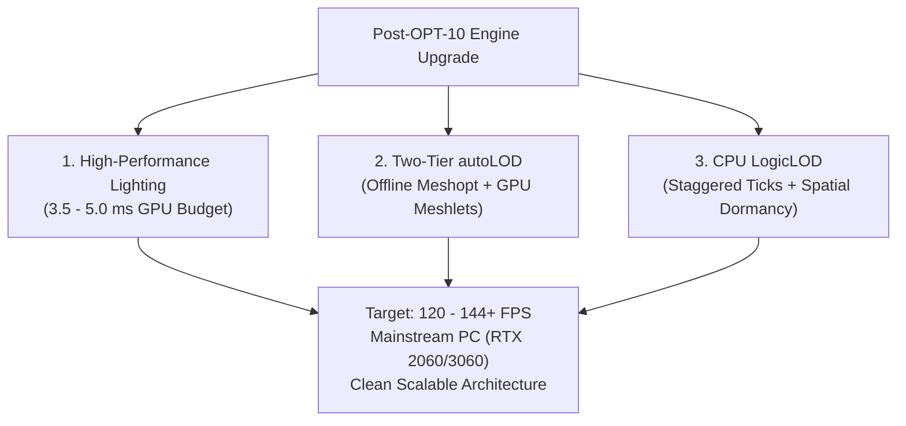

# Post-OPT-10 Engine Upgrade Master Roadmap

> **Status:** Strategic Architecture Specification (Deferred to Post-OPT-10 Engine Evolution Phase)  
> **Core Objective:** Deliver AAA-grade visual fidelity and massive scale with a **Performance-First** mandate: maintaining **120–144+ FPS** on mainstream PC hardware without sluggish overhead or bloated complexity.

---

## 1. Executive Summary & The Triad of Optimization

Following the formal completion and acceptance of the architectural stabilization sequence (**OPT-00 through OPT-10**), AxleEngine will transition from core foundation hardening into the **Engine Evolution & Upgrade Phase**.

This roadmap consolidates three interconnected, high-performance systems into a unified master blueprint:
1. **Performance-First Lighting Stack:** Cinematic lighting (3.5ms – 5.0ms GPU budget) delivering 90% of Lumen's visual impact at 5–10x higher frame rates.
2. **Two-Tier Automated Geometry LOD (`autoLOD`):** Zero manual 3D modeling effort, combining offline algorithmic simplification with real-time continuous GPU Meshlet virtual geometry.
3. **CPU Logic & Simulation LOD (`LogicLOD`):** Significance-based CPU scaling, allowing tens of thousands of active entities through staggered ticks, spatial hibernation, fast-path math, and animation throttling.



---

## 2. Pillar I: Performance-First Practical Lighting Stack

### Strict GPU Time Budget: 3.5ms – 5.0ms (Target: 1080p / 1440p @ 120–144+ FPS)

| Component | GPU Budget | Implementation Strategy |
| :--- | :--- | :--- |
| **1. Image-Based Lighting (IBL)** | `~0.1 - 0.2 ms` | Pre-filtered environment cubemaps + 2D BRDF LUT (already grounded in `RHISceneRenderer`). Zero runtime lighting cost. |
| **2. Cascaded Shadow Maps (CSM)** | `~0.8 - 1.2 ms` | 3 to 4 depth cascades with Percentage-Closer Filtering (PCF 5x5). GPU-driven frustum culling ensures only shadow casters render. |
| **3. Ground Truth Ambient Occlusion (GTAO)** | `~0.6 - 0.9 ms` | **Half-Resolution Compute:** Evaluated at 1/2 resolution ($960 \times 540$) and upscaled via bilateral depth-aware reconstruction. Saves 75% GPU compute. |
| **4. Volumetric Fog & God Rays** | `~0.8 - 1.2 ms` | Low-resolution Frustum Voxel Grid (*Froxel* $160 \times 90 \times 64$) with temporal reprojection. Creates breathtaking sun shafts at negligible cost. |
| **5. Dynamic Diffuse GI (DDGI Probes)** | `~1.2 - 1.8 ms` | **Temporal Staggering:** Axis-aligned irradiance probe grid where only 25% of probes update per frame. Delivers realistic color bleeding without ray-tracing slowdown. |
| **6. Film-Grade Post-Processing** | `~0.4 - 0.6 ms` | ACES Filmic Tone Mapping, PBR eye adaptation (auto-exposure), and thresholded bloom. |
| **TOTAL LIGHTING PIPELINE** | **~3.5 - 5.0 ms** | **Leaves over 60% of frame time free for game logic, physics, and draw calls!** |

### Scalability Presets
* **Ultra/High (RTX 3070/4070+):** Full DDGI probes, 4-cascade CSM, Volumetric Fog, GTAO $\rightarrow$ **144+ FPS**.
* **Medium (RTX 2060 / GTX 1660):** 3-cascade CSM, Half-Res GTAO, Froxel Fog, Staggered DDGI $\rightarrow$ **100–120+ FPS**.
* **Low / Mobile Fallback:** IBL + Single Directional Shadow, SSAO, Fog disabled $\rightarrow$ **60–100+ FPS**.

---

## 3. Pillar II: Two-Tier Automated Geometry LOD (`autoLOD`)

Eliminates manual LOD authoring in DCC tools (Blender, Maya, 3ds Max) while unlocking rendering of massive, dense geometry scenes.

### Tier 1: Automated Offline Whole-Mesh LOD (The Universal Fallback)
* **Pipeline Integration:** Embedded directly into the **Asset Cooker** (OPT-09).
* **Decimation Engine:** Uses the industry-standard C++ library **`meshoptimizer`** (`meshopt_simplify`).
* **Generation Ratios:** Automatically generates discrete levels upon asset import:
  * `LOD 0`: 100% original geometry.
  * `LOD 1`: 50% triangle count.
  * `LOD 2`: 25% triangle count.
  * `LOD 3`: 10% triangle count (culled boundary).
* **Runtime Transition:** Screen-space dither cross-fading avoids sudden popping.
* **Scope:** Universal compatibility for skinned/skeletal characters, animated wind foliage, translucent meshes, and legacy GPU / mobile targets.

### Tier 2: Continuous Meshlet Virtual Geometry (The Nanite-Style Pipeline)
* **Meshletization:** In Asset Cooker, dense static geometry is partitioned into clusters of up to 64 vertices and 126 primitives (`meshopt_buildMeshlets`).
* **Cluster DAG Hierarchy:** Recursively simplifies and groups adjacent clusters into a Directed Acyclic Graph. Locks shared boundary loops between neighbor groups to guarantee **watertight, 100% crack-free transitions**.
* **Hardware Mesh Shaders (D3D12 & Vulkan via NRI):**
  1. **Task Shader (Amplification):**
     * Frustum culling, backface/cone culling, and Hi-Z occlusion culling per meshlet cluster.
     * Evaluates projected screen-space error: if a cluster occupies fewer pixels than a threshold, the coarser parent cluster is selected seamlessly.
  2. **Mesh Shader:** Direct parallel hardware emission of cluster primitives into the rasterizer.
* **Result:** Infinite geometric density without discrete LOD popping; 3D artists simply drag raw high-poly assets into the engine.

---

## 4. Pillar III: CPU Logic & Simulation LOD (`LogicLOD`)

Prevents CPU saturation and frame hitching when populating large worlds with thousands of complex AI agents, vehicles, and animated entities.

### 1. Staggered Multi-Tier Tick Scheduling
* **Tier 1 (Immediate Horizon - `< 20m`):** Ticked every frame (60/144 Hz). Full AI decision trees, precise sensor raycasting, and detailed physics.
* **Tier 2 (Mid Horizon - `20m to 100m`):** Ticked once every 4 frames (15–30 Hz). Intermediate frames execute lightweight kinematic translation ($P += V \times \Delta t$).
* **Tier 3 (Far Horizon - `100m to 250m`):** Ticked once every 30–60 frames (1–2 Hz). Macro-goal updates and coarse waypointing.
* **Deterministic Modulo Staggering:**  
  $$\text{ShouldTick} = (\text{CurrentTick} + \text{EntityID}) \pmod{\text{Interval}} == 0$$  
  Ensures entity updates are evenly distributed across successive frames, completely eliminating periodic CPU latency spikes.

### 2. Fast-Path Simulation Math
* **Jolt Physics Throttling:** Beyond 50m, rigid bodies are removed from expensive narrowphase contact solving via `JoltBodyInterface::DeactivateBody`, transitioning to kinematic position updates.
* **Raycast Elimination:** Distance queries replace collision line-of-sight sweeps with $Distance^2 \le R^2$ sphere tests and dot-product vision cones.

### 3. Spatial Hash Grid & Dormancy Bubble
* Worlds are partitioned into $64\text{m} \times 64\text{m}$ grid cells.
* Cells within the active player horizon ($< 250\text{m}$) are tagged with `ActiveSimulationTag`.
* Cells outside the active horizon transition to **Hibernation (`DormantTag`)**:
  * EnTT simulation views exclude dormant entities (`entt::exclude<DormantTag>`).
  * State remains preserved in memory with **0.000% CPU overhead**.
  * Approaching entities receive a smooth wake-up event with state continuity.

### 4. Animation Update Rate Optimization (URO) & Bone LOD
* **Bone LOD:** Fingers, facial joints, and secondary cloth/hair physics chains are frozen beyond 30m.
* **URO Sampling:** Skeletal pose evaluations run at 15 Hz for distant characters; joint transformation matrices are cached and reused across intermediate render frames (saving 70%–80% animation CPU time).

---

## 5. Architectural Subsystem Mapping in AxleEngine

| Feature | Engine Layer | Existing Core Component Utilized |
| :--- | :--- | :--- |
| **Froxel Fog & GTAO** | `Engine/Renderer` | `RenderService`, `RenderGraph`, Compute Passes |
| **DDGI Probes** | `Engine/Scene` | `RHISceneRenderer`, NRI Texture Arrays |
| **autoLOD (Tier 1)** | `Engine/Asset` | `AssetCooker`, `meshoptimizer` integration |
| **autoLOD (Tier 2)** | `Engine/RHI` | `RHIMeshShader`, NRI Task/Mesh Shader pipelines |
| **Tick Staggering** | `Engine/Scene` | `SimulationClock` (`TickCount`), EnTT Registry |
| **Spatial Dormancy** | `Engine/SceneData` | EnTT Sparse Sets (`ActiveTag`, `DormantTag`) |
| **Physics Throttling** | `Engine/Physics` | `PhysicsSystem` (Jolt `BodyInterface`) |
| **Animation URO** | `Engine/Animation` | `Animator`, `Skeleton`, Matrix Cache |

---

## 6. Implementation Phasing Matrix

```
[OPT-06..10 Foundation Acceptance] 
            │
            ▼
┌────────────────────────────────────────────────────────┐
│ Phase 1: High-ROI Visuals & Workflow Automation       │
│ - Integrate meshoptimizer into Asset Cooker (Tier 1)   │
│ - Half-Res GTAO Compute Pass & Volumetric Froxel Fog   │
│ - Cascaded Shadow Maps (CSM) 3-cascade culling        │
└───────────────────────────┬────────────────────────────┘
                            │
                            ▼
┌────────────────────────────────────────────────────────┐
│ Phase 2: CPU Scale & Simulation Efficiency             │
│ - Spatial Hash Grid & Dormancy Bubble (0% dormant CPU) │
│ - Modulo Tick Staggering & Fast-Path Physics Bypass    │
│ - Animation Bone LOD & URO Pose Throttling            │
└───────────────────────────┬────────────────────────────┘
                            │
                            ▼
┌────────────────────────────────────────────────────────┐
│ Phase 3: Cutting-Edge Hardware GPU Pipelines          │
│ - Continuous Meshlet DAG Hierarchy & Mesh Shaders      │
│ - Dynamic Diffuse GI (DDGI Staggered Probes)          │
│ - Full Scene Indirect Draw & Hi-Z Occlusion Culling    │
└────────────────────────────────────────────────────────┘
```
