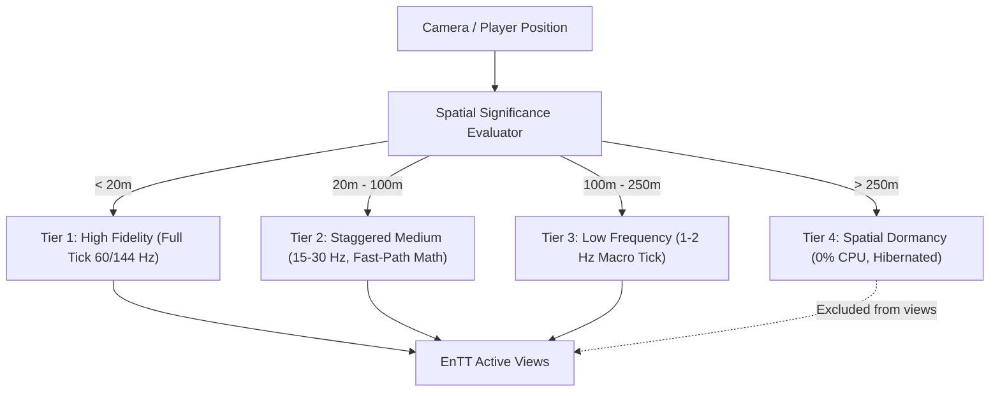

# Post-OPT-10 Logic & Simulation LOD Architecture Roadmap

## 1. Executive Summary & Strategic Scope

As visual fidelity scales through **Post-OPT-10** (Meshlet virtual geometry, GPU-driven culling, and clustered lighting), scene density increases dramatically to tens of thousands of active world entities. Without a disciplined CPU simulation budget, gameplay logic, physics, pathfinding, and skeletal animations will quickly saturate the Main Thread and worker cores.

This roadmap establishes the formal architecture for **Logic & Simulation LOD** (also known as **Significance Management & Tick Rate Optimization**), ensuring that:
- CPU computational effort is strictly proportional to player-perceived significance.
- Distant and offscreen entities do not degrade frame rates or cause frame-time spikes.
- The system integrates natively with AxleEngine's existing **EnTT ECS**, **enkiTS task scheduler**, **Jolt Physics**, and **SimulationClock**.

---

## 2. Core Architectural Pillars

### Pillar 1: Staggered Multi-Tier Tick Frequency (Tick LOD)

* **Objective:** Eliminate CPU simulation saturation by dynamically assigning entity update rates while preventing frame-time spikes via deterministic distribution.
* **Tier Specifications:**
  * **Tier 1 (High Priority - `< 20m` or In-Focus):**
    * Ticked **every simulation frame** (60 Hz / 144 Hz).
    * Full behavior tree evaluation, sensory raycasting, precise collision, and micro-interactions.
  * **Tier 2 (Medium Priority - `20m to 100m`):**
    * Ticked **once every 4 ticks** (15 Hz to 30 Hz).
    * Logic is executed on scheduled frames; intermediate frames perform lightweight kinematic linear interpolation ($Position += Velocity \times \Delta t$).
  * **Tier 3 (Low Priority - `100m to 250m`):**
    * Ticked **once every 30 to 60 ticks** (1 Hz to 2 Hz).
    * Macro-level updates only (e.g. goal transitions, coarse destination movement, high-level health regeneration).
* **Deterministic Staggering Algorithm:**
  * To avoid all Tier 2/3 entities executing on the exact same frame (which causes periodic frame spikes), execution is distributed across frames using the entity's unique ID:
    $$\text{ShouldTick} = (\text{SimulationTick} + \text{EntityID}) \pmod{\text{Interval}} == 0$$
  * Guarantees perfectly uniform CPU utilization across all frames.

---

### Pillar 2: Fast-Path & Simplified Simulation Math

* **Objective:** Substitute expensive physics and query algorithms with algebraic approximations when visual fidelity requirements permit.
* **Physics Simplification (Jolt Integration):**
  * When an entity transitions to Tier 2 or Tier 3:
    * Deactivate the dynamic rigid body in Jolt (`JoltBodyInterface::DeactivateBody(bodyID)`) to remove it from narrowphase collision and constraint solving.
    * Switch movement to pure kinematic delta translation.
    * Re-activate Jolt simulation only if an external force/explosion occurs nearby or the entity re-enters Tier 1.
* **Sensory & Query Simplification:**
  * Disable per-frame line-of-sight raycasts and detailed volume sweeps.
  * Replace with fast bounding-sphere distance checks ($DistanceSq(A, B) \le R^2$) or cone dot-product vision checks ($Dot(Forward, DirToTarget) \ge \cos(\theta)$).

---

### Pillar 3: Spatial Partitioning & Dormancy Bubble (Hibernation)

* **Objective:** Ensure entities beyond the active player horizon consume exactly **0.000% CPU time**.
* **Spatial Hash Grid:**
  * The game world is partitioned into uniform 2D cells (e.g., $64\text{m} \times 64\text{m}$ or $128\text{m} \times 128\text{m}$).
  * An entity tracking system updates cell occupancy only upon crossing cell boundaries.
* **Dormancy State Transitions:**
  * **Active Bubble:** Cells within the player's active horizon (e.g., $250\text{m}$) are marked active. All resident entities receive active EnTT tags.
  * **Dormant Zone:** Cells outside the active horizon are put into **Hibernation**:
    * Tagged with `DormantTag`.
    * EnTT simulation views explicitly exclude `DormantTag` (`m_Registry.view<ScriptComponent>(entt::exclude<DormantTag>)`).
    * Full state (health, inventory, position) is retained in memory with zero active tick cost.
  * When the player approaches, dormant cells receive a **Wakeup Event**, restoring entities into the appropriate active tier with state continuity.

---

### Pillar 4: Animation Update Rate Optimization (URO) & Bone LOD

* **Objective:** Mitigate CPU bottlenecks caused by skeletal hierarchy evaluations, Forward/Inverse Kinematics (FK/IK), and skinning matrix generation.
* **Bone LOD Levels:**
  * **LOD 0 (`< 15m`):** Full skeleton evaluation (facial bones, fingers, secondary physics cloth/hair chains).
  * **LOD 1 (`15m to 40m`):** Primary bones only (torso, limbs, head). Finger and facial joints are frozen to reference pose.
  * **LOD 2 (`> 40m`):** Ultra-simplified root and limb pivots.
* **Update Rate Optimization (URO):**
  * Distant character animators skip curve sampling and matrix calculation on intermediate frames.
  * Cached joint transformation matrices from the last evaluated tick are reused by `RenderWorld` extraction, yielding a 70%–80% CPU reduction in dense crowd scenarios.

---

## 3. Subsystem Integration in AxleEngine

| Subsystem | Existing Architecture Asset | Logic LOD Role |
| :--- | :--- | :--- |
| **ECS Engine** | `EnTT` Sparse Sets & Tag Views | Tags (`Tier1Tag`, `Tier2Tag`, `DormantTag`) enable zero-cost query filtering. |
| **Task Scheduler**| `enkiTS` (`JobSystem`) | Tier 2 and Tier 3 batch updates are dispatched asynchronously across worker threads. |
| **Clock Service** | `SimulationClock` (`TickCount`) | Provides deterministic monotonic tick indices for staggered modulo scheduling. |
| **Physics** | `Jolt Physics` (`PhysicsSystem`) | Programmatic body activation/deactivation and kinematic translation bypasses. |
| **Animation** | `Engine/Animation` (`Animator`) | Throttles pose evaluation frequency and bone matrix generation intervals. |
| **Plugins SDK** | `PluginSDK.hpp` (`PluginRuntime`) | Exposes `ILogicLODHandler` interface so project plugins declare custom simulation tiers. |

---

## 4. Implementation Phasing

* **Phase 1 (Post-OPT-10 Foundation):** Implement the `SpatialHashGrid` and `ActiveBubble` dormancy manager. Add `DormantTag` filtering to EnTT system updates.
* **Phase 2 (Staggered Tick & Fast-Path):** Implement deterministic modulo tick staggering and Jolt physics deactivation for distant entities.
* **Phase 3 (Animation URO):** Extend `AnimatorComponent` with `UpdateRateOptimization` intervals and bone LOD level masking.
* **Phase 4 (Plugin Integration):** Expose simulation significance tiers to project scripts and custom C++ plugins via the Plugin SDK.
