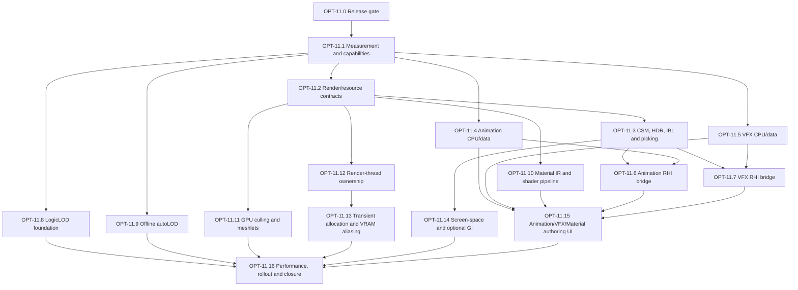

# Post-OPT-10 micro-OPT program plan

Updated: **2026-11-09**

This document redesigns the three Post-OPT-10 roadmaps into small, separately
reviewable OPT units. It is a planning document only. It does not activate any
implementation, close OPT-10 or change the current task card.

The aggregate label remains **OPT-11: Post-OPT-10 evolution**. The units below
are its internal sequence. Each unit must have its own base commit, source
scope, tests, evidence and acceptance record. A later unit is not released by
reading this plan.

## Program rules

- Finish or explicitly defer the remaining OPT-10 acceptance gates before
  accepting any Post-OPT-10 unit.
- Keep CPU/data work separate from GPU/RHI work and Editor/UI work.
- Every performance claim needs a fixed scene, resolution, backend, hardware
  tier, quality preset, percentile and image-quality threshold.
- Every optional hardware feature needs a capability query, a deterministic
  fallback and a negative-path test.
- Do not make RenderThread, VRAM aliasing, mesh shaders or DDGI prerequisites for
  ordinary Editor/Runtime startup.
- Existing VFX and Animation history is evidence, not an automatic PASS. Re-audit
  the current source before marking a historical package complete.

## Dependency graph

The graph shows required design dependencies. It does not require one large
branch or one large merge. CPU units E/F/I/J can be developed as separate
branches after B, but a shared checkout should still complete one bounded unit
at a time.

## OPT-11.0 — release gate and current-source audit

**Purpose:** Establish that Post-OPT-10 work is allowed to start and that old
feature reports match the current source.

**Small packages:**

- **11.0.1:** Record the final OPT-10 state, open gates and accepted limitations.
- **11.0.2:** Re-audit the active Renderer, RHI, Asset, Animation, VFX, Scene and
  Plugin targets; remove proposed/nonexistent API names from active plans.
- **11.0.3:** Reconcile historical Phase 39/40 reports with current source and
  classify each item as accepted, implemented-not-accepted, deferred or stale.

**Acceptance:** No stale task authority remains in the active indexes; a clean
base commit and a written list of open prerequisites exist. No source feature
implementation belongs here.

## OPT-11.1 — capabilities and measurement contract

**Purpose:** Replace unsupported performance promises with reproducible gates.

**Small packages:**

- **11.1.1:** Define backend capability schema: D3D12, Vulkan, OpenGL,
  ray tracing, mesh shader, compute, HDR and async compute.
- **11.1.2:** Add a fixed benchmark scene description and deterministic camera
  paths for empty, medium and dense workloads.
- **11.1.3:** Define CPU/GPU frame-time, memory, draw/dispatch and image-diff
  capture formats.
- **11.1.4:** Add negative tests for unsupported features and fallback selection.

**Acceptance:** The same command produces comparable Debug/Release and backend
reports. No unit is allowed to claim `120 FPS`, a GPU budget or a VRAM saving
without this evidence.

## OPT-11.2 — render and resource contracts

**Purpose:** Make the existing `RenderWorld`, `RenderService` and sequential
`RenderGraph` safe extension points.

**Small packages:**

- **11.2.1:** Freeze `RenderWorld` extraction ownership and revision semantics.
- **11.2.2:** Define depth, normal, velocity, shadow and history target contracts.
- **11.2.3:** Extend RenderGraph resource descriptions and pass validation without
  introducing transient allocation yet.
- **11.2.4:** Define frame invalidation for resize, device loss, camera cuts and
  history reset.
- **11.2.5:** Add CPU graph tests for dependency order, state transitions,
  lifetime leases and rejected invalid graphs.

**Acceptance:** Existing Editor, Runtime, preview and OpenGL paths remain green;
new contracts do not create a second renderer or resource owner.

## OPT-11.3 — first visual correctness slice

**Purpose:** Deliver the rendering prerequisites explicitly listed after OPT-10.

**Small packages:**

- **11.3.1:** Port directional-light cascade split calculation and camera-space
  stabilization to a backend-neutral CPU contract.
- **11.3.2:** Add native RHI shadow depth targets and one cascade on D3D12.
- **11.3.3:** Add the Vulkan equivalent with capability/failure diagnostics.
- **11.3.4:** Add cascade sampling, bias and PCF tests; preserve the OpenGL path.
- **11.3.5:** Add authored HDR skybox/IBL resource resolution and fallback.
- **11.3.6:** Make animated geometry/picking use the same extracted pose and
  material data as the main draw.

**Acceptance:** Backend image/readback tests, resize/device-failure tests and
OpenGL compatibility checks pass. This unit does not introduce meshlets, DDGI or
render-thread execution.

## OPT-11.4 — Animation CPU and authored data

**Purpose:** Finish the graphics-independent Animation foundation before editor
and RHI authoring.

**Small packages:**

- **11.4.1:** Re-audit A0–A3/B1/B2/G1 delivery evidence and retain only current
  source claims.
- **11.4.2:** Validate skeleton topology, partial bind-pose transforms and
  malformed-input diagnostics.
- **11.4.3:** Isolate animator instances, clocks, triggers, transitions and
  copy/duplicate behavior.
- **11.4.4:** Freeze versioned skeleton, clip, controller and skeletal-mesh
  definitions with atomic save/load and failed-save preservation.
- **11.4.5:** Add deterministic CPU tests for sampling, blending, events,
  root-motion policy and resource binding.

**Acceptance:** Device-free Release tests pass; no OpenGL, RHI or Editor UI is
required for this unit. This is the first Animation work to do after the shared
render contract, but it does not close the full Animation phase.

## OPT-11.5 — VFX CPU and authored data

**Purpose:** Close the data/simulation part of Phase 39 without coupling it to
GPU preview or Editor widgets.

**Small packages:**

- **11.5.1:** Re-audit current VFX asset, emitter and panel evidence.
- **11.5.2:** Define versioned multi-emitter effect definitions, stable IDs and
  resource references.
- **11.5.3:** Separate effect definitions from independent runtime instances and
  preview state.
- **11.5.4:** Implement deterministic seed, fixed-step playback, looping,
  scrubbing, duration and event budgets.
- **11.5.5:** Add bounded child/sub-emitter relationships, collision policy and
  missing-resource diagnostics.
- **11.5.6:** Add scene/assembly round-trip and failed-save tests without GPU
  handles or ImGui dependencies.

**Acceptance:** Device-free CPU tests prove repeatability, ownership isolation,
asset round-trip and bounded event behavior. GPU/UI acceptance remains open.

## OPT-11.6 — Animation RHI bridge

**Purpose:** Connect accepted Animation data to the active Renderer/RHI path.

**Small packages:**

- **11.6.1:** Convert validated skeletal geometry to the existing RHI vertex
  layout without constructing OpenGL resources.
- **11.6.2:** Upload per-draw bone palettes with generation/lease ownership.
- **11.6.3:** Add D3D12 skinned PBR and depth variants.
- **11.6.4:** Add Vulkan variants and explicit shader/pipeline diagnostics.
- **11.6.5:** Match animated picking, resize, teardown and shadow limitations.

**Acceptance:** Two distinct poses produce distinct backend readbacks; resource
leases survive submission and retire correctly. No editor authoring is included.

## OPT-11.7 — VFX RHI bridge

**Purpose:** Connect the accepted VFX runtime to safe native preview and scene
submission.

**Small packages:**

- **11.7.1:** Define per-emitter instance buffers, descriptor ownership and
  submission lifetime.
- **11.7.2:** Render one emitter through RenderService on D3D12.
- **11.7.3:** Render multiple emitters/resources without host-buffer overwrite.
- **11.7.4:** Add Vulkan readback and explicit fallback diagnostics.
- **11.7.5:** Add depth, blend, resize, restart and device-loss coverage.

**Acceptance:** Actual multi-emitter GPU tests pass on requested backends; CPU
particle counts alone are not accepted as rendering evidence.

## OPT-11.8 — LogicLOD foundation

**Purpose:** Reduce CPU simulation cost without silently changing physics
semantics.

**Small packages:**

- **11.8.1:** Add a public monotonic simulation tick index to the existing clock.
- **11.8.2:** Define significance input, tier policy and hysteresis data.
- **11.8.3:** Implement deterministic modulo scheduling with bounded per-frame
  work and reproducible entity ordering.
- **11.8.4:** Add a scene-owned spatial index and cell migration tests.
- **11.8.5:** Add explicit dormant/wakeup events and persistence rules.
- **11.8.6:** Add interpolation for skipped logic ticks without changing the
  authoritative fixed-step state.
- **11.8.7:** Add plugin SDK read-only significance/tier queries.

**Acceptance:** Existing simulation, script and plugin lifecycle tests remain
unchanged; first release keeps Jolt bodies active. No `DeactivateBody` policy is
closed by this unit.

## OPT-11.9 — offline autoLOD

**Purpose:** Add deterministic geometry reduction at the AssetCooker boundary.

**Small packages:**

- **11.9.1:** Freeze derived-LOD schema, source hash, tool version and settings.
- **11.9.2:** Integrate meshoptimizer behind a small Engine wrapper and license
  record.
- **11.9.3:** Generate discrete LODs for static meshes with deterministic output.
- **11.9.4:** Add cook-cache invalidation and package inclusion.
- **11.9.5:** Add runtime selection and original-mesh fallback.
- **11.9.6:** Define skinned, transparent, collision and unsupported-mesh policy.

**Acceptance:** Clean checkout/cook reproducibility, corrupted artifact rejection,
source-change invalidation and visual LOD tests pass. Continuous meshlets are
not part of this unit.

## OPT-11.10 — material IR and shader pipeline

**Purpose:** Establish a stable material representation before optional Slang or
node-editor work.

**Small packages:**

- **11.10.1:** Define versioned material graph/value IR and stable node IDs.
- **11.10.2:** Lower a minimal graph to current HLSL/DXIL/SPIR-V compilation.
- **11.10.3:** Add reflection/layout compatibility and last-known-good reload.
- **11.10.4:** Add texture color-space, sampler and fallback diagnostics.
- **11.10.5:** Evaluate Slang as an optional backend; do not require it for the
  existing material path.
- **11.10.6:** Define a separate OpenGL compatibility lowering or explicit
  unsupported-feature diagnostic.

**Acceptance:** Cross-backend shader/layout tests pass and an invalid graph never
replaces the last valid program.

## OPT-11.11 — GPU-driven culling and meshlet experiment

**Purpose:** Explore scalable geometry without making mesh shaders mandatory.

**Small packages:**

- **11.11.1:** Add capability-gated GPU instance/bounds buffers.
- **11.11.2:** Add compute frustum and Hi-Z culling with indexed-draw fallback.
- **11.11.3:** Measure CPU-culling versus GPU-culling on the fixed benchmark.
- **11.11.4:** Define meshlet asset metadata and a non-mesh-shader debug viewer.
- **11.11.5:** Add D3D12 task/mesh pipeline only when capability and fallback
  tests are green.
- **11.11.6:** Add the Vulkan pipeline and reject unsupported devices cleanly.

**Acceptance:** Identical visibility and image results are proven against the
indexed fallback; no Nanite-style DAG or 100k-instance claim is accepted yet.

## OPT-11.12 — render-thread ownership

**Purpose:** Move rendering work only after an explicit ownership redesign.

**Small packages:**

- **11.12.1:** Specify owner transfer for RHI device, resources, RenderService and
  presentation; include shutdown and device-loss sequences.
- **11.12.2:** Add a bounded snapshot queue and back-pressure policy.
- **11.12.3:** Run an offscreen render worker with no window presentation.
- **11.12.4:** Add native presentation handoff and resize synchronization.
- **11.12.5:** Add plugin callback and resource-retirement stress tests.

**Acceptance:** No cross-thread `CanSubmit`/resource-owner violations, bounded
latency, clean shutdown and identical image results. Moving `RenderView` to a
worker thread without these packages is prohibited.

## OPT-11.13 — transient resources and VRAM aliasing

**Purpose:** Add real transient allocation only after the render-thread/resource
contract is stable.

**Small packages:**

- **11.13.1:** Compute resource lifetime intervals from the compiled graph.
- **11.13.2:** Add transient texture/buffer descriptors and an allocator.
- **11.13.3:** Add placed/shared-memory allocation for D3D12 and Vulkan.
- **11.13.4:** Emit and validate aliasing/state barriers.
- **11.13.5:** Add fallback non-aliased allocation and device-loss recovery.
- **11.13.6:** Measure actual peak VRAM against the non-aliased baseline.

**Acceptance:** Resource lifetime, barrier, resize and failure tests pass. A VRAM
percentage is reported only from the benchmark harness.

## OPT-11.14 — screen-space and optional GI

**Purpose:** Deliver lower-risk image improvements before ray-traced DDGI.

**Small packages:**

- **11.14.1:** Add depth/normal history and temporal invalidation.
- **11.14.2:** Add SSAO/GTAO with OpenGL fallback or explicit disablement.
- **11.14.3:** Add SSR with bounded ray marching and fallback.
- **11.14.4:** Define irradiance-probe data and update budget without ray tracing.
- **11.14.5:** Prototype ray-traced DDGI behind a capability flag.
- **11.14.6:** Add temporal stability, light-leak and thin-wall tests.

**Acceptance:** Image-quality and performance reports exist for each capability
`tier`; DDGI remains optional until the evidence justifies promotion.

## OPT-11.15 — Animation, VFX and material authoring UI

**Purpose:** Finish user-facing authoring only after CPU/data and RHI contracts are
stable.

**Small packages:**

- **11.15.1:** Animation document open/save/dirty/history and private preview.
- **11.15.2:** Animation graph/dopesheet/events/picking interactions.
- **11.15.3:** VFX document open/save/dirty/history and isolated preview.
- **11.15.4:** VFX multi-emitter controls, curves/gradients and resource pickers.
- **11.15.5:** Material graph editor and last-known-good compile feedback.
- **11.15.6:** Real UI matrix: narrow/wide layout, restart, failed save, undo,
  selection changes and close/reopen.

**Acceptance:** UI interactions are recorded separately from CPU/GPU tests; no
panel count or CPU assertion is treated as a rendering PASS.

## OPT-11.16 — performance, rollout and closure

**Purpose:** Decide which Post-OPT-10 features are production-ready.

**Small packages:**

- **11.16.1:** Run the complete benchmark matrix on fixed hardware tiers.
- **11.16.2:** Compare image quality, frame time, memory and fallback behavior.
- **11.16.3:** Stress restart, resize, device loss, export and plugin selection.
- **11.16.4:** Record accepted limits and remove only proven temporary adapters.
- **11.16.5:** Update the roadmap and close each micro-OPT independently.

**Acceptance:** Every promoted feature has a reproducible report and fallback;
unsupported or unmeasured features remain deferred instead of being marked PASS.

## VFX versus Animation order

Do not attempt to close the complete VFX or Animation phase before the shared
Post-OPT-10 render contracts are available. Their safe split is:

1. **Animation CPU/data (11.4)** and **VFX CPU/data (11.5)** can be prepared as
   independent branches after 11.1; neither closes the full feature phase.
2. **Animation RHI (11.6)** and **VFX RHI (11.7)** follow the first visual
   correctness slice (11.3). With one shared checkout, complete Animation RHI
   first because skinning/picking is a direct renderer prerequisite for future
   character workflows.
3. **Authoring UI (11.15)** comes after both runtime bridges and the material
   contract. VFX and Animation UI should not create private renderer/resource
   ownership.
4. The existing roadmap's “outstanding VFX acceptance, then Animation authoring,
   then VFX expansion” remains valid when interpreted this way: close existing
   VFX evidence gaps first, finish Animation authoring, then expand VFX features.

## Status vocabulary

Use four separate states in future reports: **planned**, **implemented**,
**verified**, and **accepted**. A package can be implemented and CPU-verified
while its native GPU or UI gate remains NOT RUN. This plan itself marks every
unit **planned only**.
