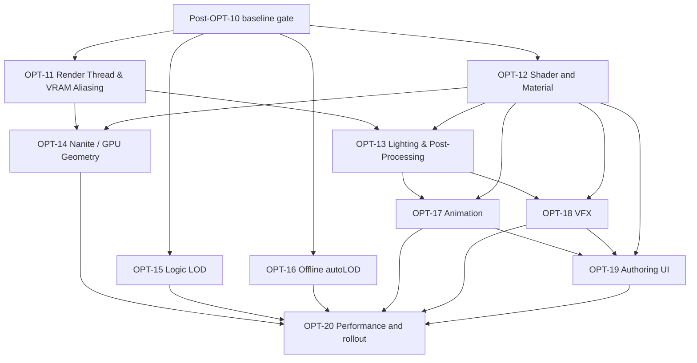

# Post-OPT-10 OPT-11..OPT-20 program plan

Updated: **2026-11-09**

This document splits Post-OPT-10 into independent top-level OPTs. It is a
planning document only: it does not close OPT-10, activate a task, or authorize
source implementation.

The common **Post-OPT-10 baseline gate** comes first: OPT-10 must be accepted or
explicitly deferred, the capability matrix and benchmark contract must exist,
and the RenderWorld/RenderService/RenderGraph ownership contracts must be
frozen. These are entry conditions, not a large feature OPT.

## Dependency graph

Each OPT has its own base commit, implementation scope, tests, evidence and
acceptance record. A plan or a completed earlier OPT does not release the next
one.

## Commit-unit convention

Every numbered package below is one implementation/review unit. The `Cxx-yy`
label is the suggested commit identifier (`C11-01`, `C12-03`, and so on). Use
one coherent local commit per unit, with production changes and focused tests
kept together. Documentation-only acceptance updates may use a second commit
with the same unit label and an `acceptance` suffix. Do not combine unrelated
units or start the next unit before the previous evidence is recorded.

## Post-OPT-10 baseline gate

Before OPT-11 begins:

- Record the final OPT-10 state and all unavailable gates.
- Re-audit current Renderer, RHI, Asset, Animation, VFX, Scene and Plugin APIs.
- Define fixed benchmark scenes, camera paths, hardware tiers, resolutions,
  quality presets, frame-time percentiles and image-diff thresholds.
- Freeze capability/fallback reporting for D3D12, Vulkan and OpenGL.
- Freeze RenderWorld snapshot ownership, RenderService lifetime and RenderGraph
  pass/resource contracts.

No performance number such as `120 FPS`, `3.5 ms`, `50% VRAM` or `0% dormant
CPU` is accepted without this baseline.

## OPT-11 — Render Thread, parallel command recording and VRAM aliasing

**Goal:** Design and measure decoupled simulation/render ownership, parallel draw
recording and transient GPU memory strategies without violating RHI owner
thread, resource lifetime or cache coherency rules. The recording and aliasing
paths remain prototypes until backend contracts are verified.

Packages:

- **C11-01 / 11.1 Ownership design:** specify device, resource, RenderService,
  presentation, shutdown and device-loss ownership.
- **C11-02 / 11.2 Snapshot queue:** bounded `RenderWorld` lock-free queue, back-pressure,
  frame-drop policy and one-frame latency diagnostics.
- **C11-03 / 11.3 Offscreen worker & presentation:** run a dedicated render worker and
  transfer resize, acquire, present and surface rebuild safely without
  cross-thread `CanSubmit` violations.
- **C11-04 / 11.4 Parallel command recording:** evaluate NRI command-allocator and
  `enkiTS` worker-job support, record independent passes only where the actual
  backend contract permits it, and merge into the primary command list.
- **C11-05 / 11.5 Transient VRAM aliasing:** integrate topological lifetime analysis into
  `RenderGraph`, evaluate shared-heap/placed-resource strategies for each
  backend, and validate aliasing barriers before enabling the optimization.
- **C11-06 / 11.6 Plugin/lifetime stress:** test plugin callbacks, resource leases,
  shutdown and restart while frames are queued and transient heaps are active.
- **C11-07 / 11.7 Acceptance:** identical image output, bounded latency, clean shutdown,
  measured CPU overlap, verified VRAM reduction from aliased passes, and
  device-loss recovery.

Out of scope: mesh shaders and DDGI (owned by OPT-14 and OPT-13).

## OPT-12 — Shader and Material pipeline

**Goal:** Establish a versioned material representation before optional Slang or
node-editor work.

**Authoring format decision (2026-11-10):** the user approved the
[Material Graph format](OPT_12_MATERIAL_GRAPH_FORMAT.md), including the complete
example: `.axleasset` blocks with explicit pins, `Connections` inside `Graph`,
parameter `name` as its sole key, and one-line/two-line/multiline parameter
declarations. The user subsequently released C12-01 directly to Codex for CPU
document parsing, validation, IR and persistence; see the
[C12-01 delivery](../reviews/OPT_12_C12_01_DELIVERY.md) for current evidence.
The user then directly released C12-02 for the existing HLSL/DXIL/SPIR-V compiler
backend; see the [C12-02 delivery](../reviews/OPT_12_C12_02_DELIVERY.md) for the
completed registry-driven lowering, bounded native baseline and exact verification state.
The user subsequently released C12-03 directly to Codex for strict graph
reflection/layout, pipeline identities and last-known-good reload; see the
[C12-03 delivery](../reviews/OPT_12_C12_03_DELIVERY.md) for current verification.
The user then released C12-04 directly to Codex for texture/sampler/fallback and
authored dependency semantics; see the [C12-04 delivery](../reviews/OPT_12_C12_04_DELIVERY.md)
for its implementation and verification boundary. The user subsequently released
C12-05 directly to Codex for an optional Slang compiler evaluation; see the
[C12-05 delivery](../reviews/OPT_12_C12_05_DELIVERY.md). DXC remains the default;
C12-06 is now the final remaining package in OPT-12.

Packages:

- **C12-01 / 12.1 Material IR:** implement the approved authoring schema, stable node
  IDs and parameter-name keys, schema version, parsing, validation and serialization;
  keep authored graph data distinct from compiler IR.
- **C12-02 / 12.2 Existing compiler backend (complete):** registry-driven graph
  lowering to HLSL, real DXIL/SPIR-V compilation and bounded native D3D12/Vulkan
  graph rendering, including explicit sRGB/LinearRepeat baseline semantics.
- **C12-03 / 12.3 Reflection/layout (complete):** strict descriptor/storage
  compatibility, backend-scoped shader and pipeline identities, bounded code cache,
  immutable native-ready generations, last-known-good reload, named instance
  overrides and atomic programmatic parameter rename.
- **C12-04 / 12.4 Resource semantics (complete):** rooted raw/descriptor/VFS image
  dependencies, explicit color/sampler/fallback and normal contracts, resource-aware
  transactional native generations and authored node/path diagnostics.
- **C12-05 / 12.5 Optional Slang evaluation:** explicit optional compiler prototype
  for generated graph HLSL, actual DXIL/SPIR-V output/reflection and native DXC
  equivalence. Build option defaults OFF; existing materials keep DXC. The bounded
  evaluation does not establish full Slang authoring or default compiler migration.
- **C12-06 / 12.6 OpenGL policy (complete):** material graph compilation now carries
  an explicit RHI target policy. OpenGL targets fail transactionally with
  `MG_OPENGL_UNSUPPORTED` until a dedicated GLSL lowering exists; DXIL/SPIR-V and
  CPU targets retain their existing behavior. HLSL is never claimed to run through
  the OpenGL compatibility renderer.

Acceptance requires cross-backend shader/layout tests, invalid-graph rollback and
stable authored asset round-trips.

## OPT-13 — Performance-First Lighting, Volumetric Atmosphere, DDGI and Post-Processing

**Goal:** Deliver a measurable high-fidelity lighting stack, with the existing budget retained as a target hypothesis, featuring Cascaded Shadows,
Screen-Space Ambient/Reflections, Froxel Volumetric Fog, Dynamic Diffuse GI
probes with capability fallback, and Film-Grade Post-Processing.

Packages:

- **C13-01 / 13.1 Cascade contract & implementation:** camera-space split, texel
  stabilization, depth bias, 3–4 cascades with PCF 5x5 sampling across D3D12
  and Vulkan, preserving the OpenGL compatibility fallback.
  Directly released 2026-11-11 and divided into [execution checkpoints](OPT_13_C13_01_EXECUTION_PLAN.md).
  All three C13-01 checkpoints are complete for the documented built-in PBR
  scope; see [CPU delivery](../reviews/OPT_13_C13_01_CPU_DELIVERY.md) and
  [native acceptance](../reviews/OPT_13_C13_01_NATIVE_DELIVERY.md).
  Debug 109/109, Release focused 18/18 and native backend parity pass.
  C13-02 onward remain unreleased.
- **C13-02 / 13.2 HDR Environment & IBL:** authored HDR skyboxes, pre-filtered
  radiance/irradiance cubemaps, split-sum 2D BRDF LUT integration, and diffuse
  ambient fallback.
- **C13-03 / 13.3 Screen-space ambient & reflections:** depth/normal history,
  configurable-resolution GTAO/SSAO compute pass with bilateral depth-aware
  reconstruction, and bounded SSR ray-marching with temporal invalidation.
- **C13-04 / 13.4 Volumetric Fog & God Rays:** low-resolution Frustum Voxel Grid
  (*Froxel*) with a measured starting resolution, temporal reprojection, phase
  function scattering and directional sun shaft integration.
- **C13-05 / 13.5 Dynamic Diffuse Global Illumination (DDGI Probes):** 3D axis-aligned
  probe grid, dual octahedral texture atlases for irradiance and distance/
  variance, Chebyshev visibility experiments and temporally staggered ray
  updates. Hardware ray tracing remains optional with an IBL/ambient fallback.
- **C13-06 / 13.6 Film-Grade Post-Processing:** ACES Filmic Tone Mapping, PBR eye
  adaptation (auto-exposure compute pass with luminance histogram), thresholded
  bloom with dual-filtering blur, and color grading LUTs.
- **C13-07 / 13.7 Acceptance & Budget verification:** backend readbacks, resize/device-failure
  tests, quality thresholds, measured budget reports at stated resolutions and
  hardware, and fallback parity on non-RT/OpenGL devices. The 5 ms target is
  reported as met or missed; it is not assumed as a gate before measurement.

## OPT-14 — Nanite-style virtual geometry and GPU culling

**Goal:** Evaluate scalable GPU-driven geometry through meshlet clustering,
cluster hierarchy and hardware task/mesh shaders on D3D12/Vulkan, with strict
capability-gated indexed fallback. Dense-scene scale is a benchmark target, not
an acceptance promise.

Packages:

- **C14-01 / 14.1 GPU instance data:** bounds, transforms, material IDs and generation
  ownership in unified structured buffers.
- **C14-02 / 14.2 GPU-driven culling (Hi-Z):** compute shader frustum culling, cone
  backface culling, two-phase occlusion culling against a Hierarchical-Z depth
  pyramid, and indirect draw argument generation (`ExecuteIndirect` /
  `vkCmdDrawIndexedIndirect`).
- **C14-03 / 14.3 Meshlet asset generation & schema:** cluster generation via
  `meshoptimizer` (`meshopt_buildMeshlets`, $\le 64$ vertices, $\le 126$
  primitives), cluster bounding spheres/cones, source hashing, and
  deterministic debug cluster coloring.
- **C14-04 / 14.4 Cluster DAG hierarchy:** experiment with recursive cluster grouping
  into a Directed Acyclic Graph and locked shared boundary loops; validate
  watertight transitions with geometry fixtures rather than assuming them.
- **C14-05 / 14.5 Hardware Task & Mesh Shader pipeline:** Task (Amplification) Shaders
  evaluating projected screen-space error per cluster for dynamic continuous
  LOD selection and frustum/cone culling; Mesh Shaders emitting primitives
  directly to rasterizer on D3D12 and Vulkan via NRI.
- **C14-06 / 14.6 Capability gate & indexed fallback:** robust feature detection with
  seamless, automatic fallback to offline discrete LOD indexed draws on devices
  without native mesh shader support.
- **C14-07 / 14.7 Scale verification & acceptance:** benchmark representative dense
  scenes, report any scale target with the scene/hardware definition, verify
  crack tolerances and visibility/image parity against indexed fallback, and
  validate dynamic device recovery.

## OPT-15 — Logic LOD and simulation scaling

**Goal:** Reduce CPU simulation cost while preserving authoritative semantics.

Packages:

- **C15-01 / 15.1 Tick identity:** public monotonic tick index in `SimulationClock`.
- **C15-02 / 15.2 Significance policy:** tier data, distance/visibility inputs and
  hysteresis.
- **C15-03 / 15.3 Deterministic scheduler:** modulo staggering, bounded work and stable
  entity ordering.
- **C15-04 / 15.4 Spatial index:** scene-owned cells, migration and query tests.
- **C15-05 / 15.5 Dormancy:** explicit sleep/wake events, persistence and excluded-view
  rules.
- **C15-06 / 15.6 Interpolation:** visual interpolation for skipped logic ticks without
  changing fixed-step authority.
- **C15-07 / 15.7 Physics policy:** sleeping/interest hints first; body deactivation only
  after contacts, joints, triggers, characters and wake-up are specified.
- **C15-08 / 15.8 Plugin API:** read-only significance/tier queries for project plugins.
- **C15-09 / 15.9 Animation URO:** update intervals and cached pose invalidation only after
  event, root-motion and VFX semantics are covered.

The first accepted slice keeps Jolt bodies active. “0% dormant CPU” is a measured
target, not a design assumption.

## OPT-16 — Offline autoLOD

**Goal:** Generate deterministic discrete LOD data at the AssetCooker boundary.

Packages:

- **C16-01 / 16.1 Derived schema:** source hash, settings, tool version and provenance.
- **C16-02 / 16.2 Simplifier wrapper:** integrate meshoptimizer behind a narrow Engine
  wrapper with license and version records.
- **C16-03 / 16.3 Static LOD generation:** deterministic ratios, bounds and material groups.
- **C16-04 / 16.4 Cooker/cache:** invalidation, package inclusion and failed-artifact
  rejection.
- **C16-05 / 16.5 Runtime selection:** screen-space policy, original-mesh fallback and
  diagnostics.
- **C16-06 / 16.6 Special meshes:** explicit skinned, transparent, collision and
  unsupported-mesh behavior.

Acceptance requires clean-checkout reproducibility, source-change invalidation
and visual/runtime fallback tests. Continuous meshlets belong to OPT-14.

## OPT-17 — Animation completion

**Goal:** Complete Animation in data, runtime bridge and acceptance layers.

Packages:

- **C17-01 / 17.1 Foundation audit:** reclassify existing A0–A3/B1/B2/G1 evidence against
  current source.
- **C17-02 / 17.2 CPU correctness:** skeleton topology, bind fallback, sampling, blending,
  events, root motion and malformed input.
- **C17-03 / 17.3 Authored resources:** versioned skeleton/clip/controller/mesh definitions,
  atomic save and failed-save preservation.
- **C17-04 / 17.4 Instance isolation:** copy/duplicate clocks, triggers, transitions and
  independent runtime state.
- **C17-05 / 17.5 RHI geometry:** backend-neutral skeletal conversion and palette leases.
- **C17-06 / 17.6 RHI draw:** D3D12 and Vulkan skinned PBR/depth variants, resize and
  teardown.
- **C17-07 / 17.7 Picking/shadows:** pose-consistent picking and explicit shadow limits.
- **C17-08 / 17.8 Acceptance:** CPU, GPU, private preview and native UI evidence kept as
  separate states.

OPT-17 starts after OPT-13's render contracts. It does not create a private
renderer or depend on VFX merely to reuse preview behavior.

## OPT-18 — VFX completion

**Goal:** Complete VFX data, deterministic runtime and native rendering layers.

Packages:

- **C18-01 / 18.1 Evidence audit:** reclassify Phase 39 reports and current panel/runtime
  behavior.
- **C18-02 / 18.2 Effect assets:** versioned multi-emitter definitions, stable IDs and
  resource references.
- **C18-03 / 18.3 Runtime instances:** independent RNG, playback, duration, looping,
  scrubbing and bounded events.
- **C18-04 / 18.4 Child systems:** bounded sub-emitter relationships, collision policy and
  missing-resource diagnostics.
- **C18-05 / 18.5 Scene persistence:** scene/assembly round-trip without GPU handles or
  ImGui dependencies.
- **C18-06 / 18.6 RHI submission:** per-emitter buffers, descriptors and resource leases.
- **C18-07 / 18.7 Backend coverage:** D3D12/Vulkan multi-emitter readback, depth/blend,
  resize and device-loss tests.
- **C18-08 / 18.8 Acceptance:** CPU, GPU, preview and native UI evidence separated.

OPT-18 follows the shared render/material contracts. CPU work can be prepared
alongside OPT-17, but the full VFX phase is not closed until native GPU and UI
gates pass.

## OPT-19 — authoring UI and integration

**Goal:** Connect accepted runtime/data contracts to user workflows.

Packages:

- **C19-01 / 19.1 Animation documents:** open/save/dirty/history and private preview.
- **C19-02 / 19.2 Animation tools:** graph, dopesheet, events, selection, picking and
  input routing.
- **C19-03 / 19.3 VFX documents:** open/save/dirty/history and isolated preview.
- **C19-04 / 19.4 VFX tools:** emitter order, curves/gradients, resource pickers and
  multi-emitter controls.
- **C19-05 / 19.5 Material editor:** graph editing, compile diagnostics and last-good
  program behavior.
- **C19-06 / 19.6 Real UI matrix:** narrow/wide layout, restart, failed save, undo,
  selection changes, close/reopen and project reload.

No CPU count or panel existence is accepted as GPU/UI proof. UI must use the
existing RenderService, PluginSession and resource ownership contracts.

## OPT-20 — performance, rollout and closure

**Goal:** Decide which Post-OPT-10 features are production-ready.

Packages:

- **C20-01 / 20.1 Benchmark matrix:** fixed scenes, backends, hardware tiers and presets.
- **C20-02 / 20.2 Image quality:** golden images, tolerance policy and fallback parity.
- **C20-03 / 20.3 Performance:** CPU/GPU frame time, memory, submissions and percentile
  reports.
- **C20-04 / 20.4 Reliability:** resize, device loss, restart, export and plugin selection.
- **C20-05 / 20.5 Cutover:** remove only measured temporary adapters and update docs.
- **C20-06 / 20.6 Acceptance:** close OPT-11..OPT-19 independently; keep unsupported or
  unmeasured features deferred.

## VFX and Animation order

The correct relationship is not “finish one entire phase before touching the
other.” Use this split:

1. Prepare CPU/data work for OPT-17 and OPT-18 after the baseline gate.
2. Complete OPT-13 lighting/resource contracts.
3. Complete Animation runtime bridge (OPT-17) before VFX runtime bridge (OPT-18)
   in the shared checkout because skinning/picking is a direct renderer contract.
4. Complete both runtime bridges before OPT-19 authoring UI.
5. Keep historical order explicit: outstanding VFX acceptance is reviewed first,
   then Animation authoring, then VFX feature expansion.

## Status vocabulary

Every report uses **planned**, **implemented**, **verified** and **accepted** as
separate states. This document marks every OPT as **planned only**.
