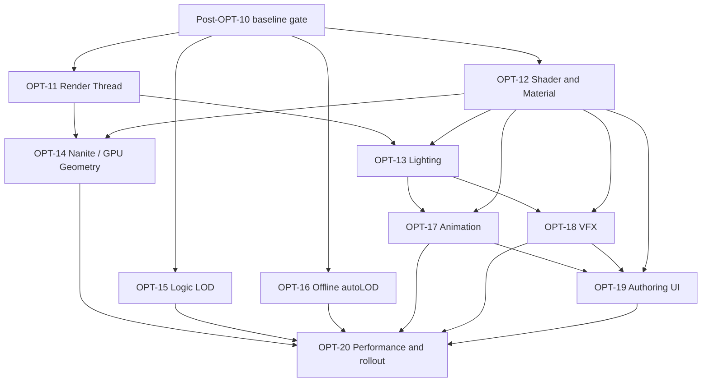

# Post-OPT-10 OPT-11..OPT-20 program plan

Updated: **2026-11-09**

This document splits Post-OPT-10 into independent top-level OPTs. It is a
planning document only: it does not close OPT-10, activate a task, or authorize
source implementation.

The common **Post-OPT-10 baseline gate** comes first: OPT-10 must be accepted or
explicitly deferred, the capability matrix and benchmark contract must exist,
and the RenderWorld/RenderService/RenderGraph ownership contracts must be
frozen. These are entry conditions, not a large feature OPT.

## Dependency graph

Each OPT has its own base commit, implementation scope, tests, evidence and
acceptance record. A plan or a completed earlier OPT does not release the next
one.

## Post-OPT-10 baseline gate

Before OPT-11 begins:

- Record the final OPT-10 state and all unavailable gates.
- Re-audit current Renderer, RHI, Asset, Animation, VFX, Scene and Plugin APIs.
- Define fixed benchmark scenes, camera paths, hardware tiers, resolutions,
  quality presets, frame-time percentiles and image-diff thresholds.
- Freeze capability/fallback reporting for D3D12, Vulkan and OpenGL.
- Freeze RenderWorld snapshot ownership, RenderService lifetime and RenderGraph
  pass/resource contracts.

No performance number such as `120 FPS`, `3.5 ms`, `50% VRAM` or `0% dormant
CPU` is accepted without this baseline.

## OPT-11 — Render Thread and frame ownership

**Goal:** Decouple simulation from rendering without violating current RHI owner
thread and resource lifetime rules.

Packages:

- **11.1 Ownership design:** specify device, resource, RenderService,
  presentation, shutdown and device-loss ownership.
- **11.2 Snapshot queue:** bounded `RenderWorld` queue, back-pressure,
  frame-drop policy and one-frame latency diagnostics.
- **11.3 Offscreen worker:** run a render worker without window presentation and
  prove no cross-thread `CanSubmit` or resource-owner violation.
- **11.4 Native presentation:** transfer resize, acquire, present and surface
  rebuild safely.
- **11.5 Plugin/lifetime stress:** test plugin callbacks, resource leases,
  shutdown and restart while frames are queued.
- **11.6 Acceptance:** identical image output, bounded latency, clean shutdown,
  device-loss recovery and measured CPU overlap.

Out of scope: VRAM aliasing, mesh shaders and DDGI.

## OPT-12 — Shader and Material pipeline

**Goal:** Establish a versioned material representation before optional Slang or
node-editor work.

Packages:

- **12.1 Material IR:** stable node/value IDs, schema version, validation and
  serialization.
- **12.2 Existing compiler backend:** lower a minimal graph to current HLSL,
  DXIL and SPIR-V compilation.
- **12.3 Reflection/layout:** descriptor compatibility, pipeline cache keys and
  last-known-good reload.
- **12.4 Resource semantics:** texture color space, sampler, fallback and
  authored dependency diagnostics.
- **12.5 Optional Slang evaluation:** prototype Slang as a backend; it must not
  be required by existing materials.
- **12.6 OpenGL policy:** define a separate lowering path or explicit unsupported
  feature diagnostic; never claim HLSL works on OpenGL automatically.

Acceptance requires cross-backend shader/layout tests, invalid-graph rollback and
stable authored asset round-trips.

## OPT-13 — Lighting and image quality

**Goal:** Complete the first measurable lighting slice before experimental GI.

Packages:

- **13.1 Cascade contract:** camera-space split, stabilization, bias and light
  resource definitions.
- **13.2 D3D12 CSM:** native depth targets and one-to-four cascade rendering.
- **13.3 Vulkan CSM:** equivalent pass, diagnostics and fallback.
- **13.4 Sampling:** PCF/filtering, cascade transitions and shadow regression
  images; preserve the OpenGL implementation.
- **13.5 HDR/IBL:** authored HDR skybox, environment resources and fallback.
- **13.6 Screen-space passes:** depth/normal history, SSAO/GTAO and bounded SSR
  with temporal invalidation.
- **13.7 Optional GI:** probe data and budget first; ray-traced DDGI is a later
  capability-gated experiment, not a mandatory baseline.

Acceptance requires backend readbacks, resize/device-failure tests, quality
thresholds and measured frame cost per preset.

## OPT-14 — Nanite-style virtual geometry and GPU culling

**Goal:** Add scalable geometry only with a complete indexed fallback.

Packages:

- **14.1 GPU instance data:** bounds, transforms, material IDs and generation
  ownership.
- **14.2 Hi-Z culling:** compute frustum/occlusion culling and indirect indexed
  draws.
- **14.3 Capability gate:** D3D12/Vulkan mesh/task shader queries, diagnostics and
  fallback selection.
- **14.4 Meshlet asset schema:** cluster metadata, bounds, source hash and
  deterministic debug viewer.
- **14.5 D3D12 mesh pipeline:** task/mesh shader submission behind capability
  checks.
- **14.6 Vulkan mesh pipeline:** equivalent path, fallback and device rejection.
- **14.7 Hierarchy experiment:** only after the flat meshlet path is correct;
  measure whether a DAG is justified instead of assuming a Nanite equivalent.

Acceptance requires identical visibility/image results against indexed fallback;
no `100k instances` claim is accepted without the benchmark matrix.

## OPT-15 — Logic LOD and simulation scaling

**Goal:** Reduce CPU simulation cost while preserving authoritative semantics.

Packages:

- **15.1 Tick identity:** public monotonic tick index in `SimulationClock`.
- **15.2 Significance policy:** tier data, distance/visibility inputs and
  hysteresis.
- **15.3 Deterministic scheduler:** modulo staggering, bounded work and stable
  entity ordering.
- **15.4 Spatial index:** scene-owned cells, migration and query tests.
- **15.5 Dormancy:** explicit sleep/wake events, persistence and excluded-view
  rules.
- **15.6 Interpolation:** visual interpolation for skipped logic ticks without
  changing fixed-step authority.
- **15.7 Physics policy:** sleeping/interest hints first; body deactivation only
  after contacts, joints, triggers, characters and wake-up are specified.
- **15.8 Plugin API:** read-only significance/tier queries for project plugins.
- **15.9 Animation URO:** update intervals and cached pose invalidation only after
  event, root-motion and VFX semantics are covered.

The first accepted slice keeps Jolt bodies active. “0% dormant CPU” is a measured
target, not a design assumption.

## OPT-16 — Offline autoLOD

**Goal:** Generate deterministic discrete LOD data at the AssetCooker boundary.

Packages:

- **16.1 Derived schema:** source hash, settings, tool version and provenance.
- **16.2 Simplifier wrapper:** integrate meshoptimizer behind a narrow Engine
  wrapper with license and version records.
- **16.3 Static LOD generation:** deterministic ratios, bounds and material groups.
- **16.4 Cooker/cache:** invalidation, package inclusion and failed-artifact
  rejection.
- **16.5 Runtime selection:** screen-space policy, original-mesh fallback and
  diagnostics.
- **16.6 Special meshes:** explicit skinned, transparent, collision and
  unsupported-mesh behavior.

Acceptance requires clean-checkout reproducibility, source-change invalidation
and visual/runtime fallback tests. Continuous meshlets belong to OPT-14.

## OPT-17 — Animation completion

**Goal:** Complete Animation in data, runtime bridge and acceptance layers.

Packages:

- **17.1 Foundation audit:** reclassify existing A0–A3/B1/B2/G1 evidence against
  current source.
- **17.2 CPU correctness:** skeleton topology, bind fallback, sampling, blending,
  events, root motion and malformed input.
- **17.3 Authored resources:** versioned skeleton/clip/controller/mesh definitions,
  atomic save and failed-save preservation.
- **17.4 Instance isolation:** copy/duplicate clocks, triggers, transitions and
  independent runtime state.
- **17.5 RHI geometry:** backend-neutral skeletal conversion and palette leases.
- **17.6 RHI draw:** D3D12 and Vulkan skinned PBR/depth variants, resize and
  teardown.
- **17.7 Picking/shadows:** pose-consistent picking and explicit shadow limits.
- **17.8 Acceptance:** CPU, GPU, private preview and native UI evidence kept as
  separate states.

OPT-17 starts after OPT-13's render contracts. It does not create a private
renderer or depend on VFX merely to reuse preview behavior.

## OPT-18 — VFX completion

**Goal:** Complete VFX data, deterministic runtime and native rendering layers.

Packages:

- **18.1 Evidence audit:** reclassify Phase 39 reports and current panel/runtime
  behavior.
- **18.2 Effect assets:** versioned multi-emitter definitions, stable IDs and
  resource references.
- **18.3 Runtime instances:** independent RNG, playback, duration, looping,
  scrubbing and bounded events.
- **18.4 Child systems:** bounded sub-emitter relationships, collision policy and
  missing-resource diagnostics.
- **18.5 Scene persistence:** scene/assembly round-trip without GPU handles or
  ImGui dependencies.
- **18.6 RHI submission:** per-emitter buffers, descriptors and resource leases.
- **18.7 Backend coverage:** D3D12/Vulkan multi-emitter readback, depth/blend,
  resize and device-loss tests.
- **18.8 Acceptance:** CPU, GPU, preview and native UI evidence separated.

OPT-18 follows the shared render/material contracts. CPU work can be prepared
alongside OPT-17, but the full VFX phase is not closed until native GPU and UI
gates pass.

## OPT-19 — authoring UI and integration

**Goal:** Connect accepted runtime/data contracts to user workflows.

Packages:

- **19.1 Animation documents:** open/save/dirty/history and private preview.
- **19.2 Animation tools:** graph, dopesheet, events, selection, picking and
  input routing.
- **19.3 VFX documents:** open/save/dirty/history and isolated preview.
- **19.4 VFX tools:** emitter order, curves/gradients, resource pickers and
  multi-emitter controls.
- **19.5 Material editor:** graph editing, compile diagnostics and last-good
  program behavior.
- **19.6 Real UI matrix:** narrow/wide layout, restart, failed save, undo,
  selection changes, close/reopen and project reload.

No CPU count or panel existence is accepted as GPU/UI proof. UI must use the
existing RenderService, PluginSession and resource ownership contracts.

## OPT-20 — performance, rollout and closure

**Goal:** Decide which Post-OPT-10 features are production-ready.

Packages:

- **20.1 Benchmark matrix:** fixed scenes, backends, hardware tiers and presets.
- **20.2 Image quality:** golden images, tolerance policy and fallback parity.
- **20.3 Performance:** CPU/GPU frame time, memory, submissions and percentile
  reports.
- **20.4 Reliability:** resize, device loss, restart, export and plugin selection.
- **20.5 Cutover:** remove only measured temporary adapters and update docs.
- **20.6 Acceptance:** close OPT-11..OPT-19 independently; keep unsupported or
  unmeasured features deferred.

## VFX and Animation order

The correct relationship is not “finish one entire phase before touching the
other.” Use this split:

1. Prepare CPU/data work for OPT-17 and OPT-18 after the baseline gate.
2. Complete OPT-13 lighting/resource contracts.
3. Complete Animation runtime bridge (OPT-17) before VFX runtime bridge (OPT-18)
   in the shared checkout because skinning/picking is a direct renderer contract.
4. Complete both runtime bridges before OPT-19 authoring UI.
5. Keep historical order explicit: outstanding VFX acceptance is reviewed first,
   then Animation authoring, then VFX feature expansion.

## Status vocabulary

Every report uses **planned**, **implemented**, **verified** and **accepted** as
separate states. This document marks every OPT as **planned only**.
