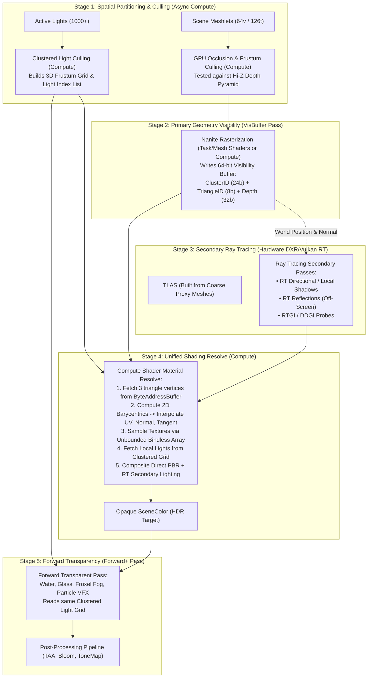

# RFC: Next-Gen Hybrid Rendering Pipeline Architecture
## (Visibility Buffer / Nanite + Clustered Forward+ + Hardware Ray Tracing)

> **Document Type:** Technical RFC & Architecture Proposal  
> **Target Milestones:** Milestone 15 (Fidelity closure), Milestone 16 (Ray Tracing Backend), Milestone 17 (Virtual Geometry & Nanite VisBuffer), Milestone 18+ (Simulation & Rollout)  
> **Audience:** AxleEngine Architects & Agent Review (Codex / Gemini)  
> **Baseline Commit:** Post-M15 U3 batch 4 / Roadmap shift (`fad0df92`)  
> **Independent review:** [M16/M17 Hybrid Rendering RFC Review](../reviews/M16_M17_HYBRID_RENDERING_RFC_REVIEW.md). The proposal is conditionally feasible; the readiness table is not an implementation acceptance gate.  

---

## 1. Executive Summary & Objective

This RFC outlines the architectural blueprint, feasibility audit, and required modifications to transition AxleEngine from its current traditional forward raster pipeline into a **Next-Gen Hybrid Rendering Pipeline** combining three state-of-the-art paradigms:

1. **Virtual Geometry via Visibility Buffer (Nanite-Style Micro-Polygon Rasterization):** Solves geometry scaling, eliminate quad-overdraw waste, and decouple geometry complexity from material shading.
2. **Clustered Forward+ Lighting:** Solves light count scalability (hundreds/thousands of analytical lights) while natively preserving single-pass forward transparency (water, glass, VFX particles) without G-Buffer reconstruction hacks.
3. **Hardware-Accelerated Hybrid Ray Tracing (DXR / Vulkan RT):** Solves secondary visibility (accurate contact shadows, off-screen reflections, and indirect diffuse bounces) where raster screen-space techniques fail.

---

## 2. Target Pipeline Topology & Data Flow

The three paradigms operate at distinct, complementary stages of the frame lifecycle:



---

## 3. Current Engine Readiness Audit

AxleEngine’s foundation is uniquely well-suited for this pipeline because recent architectural milestones (M11–M15) made future-proof choices:

| Subsystem | Current State in AxleEngine | Readiness for Hybrid Pipeline |
| :--- | :--- | :--- |
| **Low-Level RHI** | NVIDIA NRI (DirectX 12 & Vulkan 1.3 Native) | **100% Ready:** NRI exposes `NRIRayTracing.h` (BLAS/TLAS), `NRIMeshShader.h`, and `NRIStreamer.h`. |
| **Shader Tooling** | Slang Compiler & DXC | **100% Ready:** Supports Mesh Shaders, Compute Shaders, and Ray Tracing stages (`RayGen`, `ClosestHit`, `Miss`) under unified syntax. |
| **Render Graph** | `RenderGraph` DAG with Transient VRAM Aliasing | **100% Ready:** Automatic resource barrier insertion and memory aliasing (M13). |
| **View Decoupling** | `ViewContext` & `RenderWorld` Snapshot | **100% Ready:** Immutable per-view snapshot separates Simulation from GPU command recording. |
| **Occlusion Infrastructure** | Hi-Z Depth Pyramid (M15 U5) | **100% Ready:** Hi-Z downsampling is directly reusable for GPU-driven Meshlet occlusion culling. |
| **Data Architecture** | EnTT ECS v3.14 + Zero-Allowance CI | **100% Ready:** Contiguous data structures allow sub-millisecond instance streaming to GPU. |

---

## 4. Required Architectural Gaps & Modifications

While the foundation is solid, the active implementation (as of M15) retains several legacy constraints that must be evolved:

### Gap 1: CPU Draw-Call Dispatch -> GPU-Driven Indirect Pipeline
* **Current Bottleneck:** `RHISceneRenderer.cpp` loops over CPU `DrawItem` lists and calls `CmdDrawIndexed` individually with push constants.
* **Modification:**
  - Transition to a global GPU Instance Buffer: `StructuredBuffer<GPUInstanceData> g_Instances`.
  - Geometry passes must be driven by `CmdDrawIndirect` or `CmdDispatchMesh` (Task/Mesh Shader), bypassing per-draw CPU overhead.

### Gap 2: Fixed-Slot Descriptors -> Unbounded Tier-2/3 Bindless Textures
* **Current Bottleneck:** `RHISceneRendererPasses.cpp` defines fixed texture slot counts (`ForwardTextureCount = 15`) and binds descriptor sets per draw call.
* **Modification:**
  - In the VisBuffer Resolve compute pass, pixels on the same wave belong to arbitrary materials.
  - Must expose the full descriptor heap as an unbounded array in HLSL/Slang:
    ```hlsl
    Texture2D g_Textures[] : register(t0, space1);
    SamplerState g_Samplers[] : register(s0, space1);
    ```
  - Material instances simply pass uint32 texture indices into the resolve shader.

### Gap 3: Fixed Uniform Light Array -> 3D Clustered Light Grid
* **Current Bottleneck:** Lights are passed via `RHIMultiLightBufferData` with static limits (`MaxLightingPointLights == MAX_POINT_LIGHTS`).
* **Modification:**
  - Implement a `ClusterLightCullingPass` (Compute Shader):
    1. Divide the camera frustum into a 3D AABB grid ($16 \times 16 \text{ tiles} \times 32 \text{ depth slices}$).
    2. Intersect active lights with cluster bounds; write light indices into a `LightIndexList` buffer and cluster offsets into `ClusterGridBuffer`.
  - Both the VisBuffer Resolve compute pass (opaque) and the Forward transparent pass consume this identical light grid.

### Gap 4: Nanite Micro-Polygon RT Hazard -> Coarse Proxy Mesh BLAS
* **Current Bottleneck:** Building Hardware Ray Tracing BLAS directly over 10M–50M Nanite micro-triangles will exhaust VRAM and tank BVH build times.
* **Modification:**
  - Leverage `meshoptimizer` (`meshopt_simplify`) during asset cooking (M16 autoLOD) to generate a coarse simplified proxy mesh (10%–20% polygon budget).
  - Ray Tracing BLAS/TLAS is built exclusively over these coarse proxy geometries for secondary shadow and reflection queries, while primary visibility displays full-fidelity Nanite geometry.

---

## 5. Milestone Alignment & Execution Phasing

This hybrid architecture cleanly aligns with the newly shifted repository roadmap:

1. **Milestone 15 (Current - Fidelity Closure):**
   - Complete progressive pass extraction (`RHISceneRendererPasses.cpp` -> `Passes/` + `RenderPassScheduler`).
   - Finalize Hi-Z depth pyramid and Tier-2 Bindless runtime contracts.
2. **Milestone 16 (Ray Tracing Backend Architecture):**
   - Implement `RTAccelerationStructureService` with coarse proxy BLAS.
   - Deliver RT capability discovery, TLAS build/update, and RT pipeline/SBT.
   - Implement dedicated RT secondary passes (`RayTracingShadow`, `RayTracingReflection`).
3. **Milestone 17 (Scalable Geometry & Nanite-Style Virtual Geometry):**
   - Deliver `meshoptimizer` meshlet generation (`meshopt_buildMeshlets`).
   - Implement `NaniteGeometryPass` writing 64-bit Visibility Buffer.
   - Implement `VisBufferResolvePass` using Barycentric coordinate interpolation.
   - Deliver Clustered Light Culling (replacing static light uniforms).
4. **Milestone 18+ (Simulation Scale & Master Rollout):**
   - Scale active entity simulation (Significance / Logic LOD) and consolidate multi-backend visual parity.

---

## 6. Review Questions for Codex

1. **Orchestration Seam:** Should the VisBuffer Resolve pass be implemented as a dedicated node in `RenderPassScheduler`, or should it be owned as an internal phase of the Forward Material pipeline?
2. **Material Divergence Mitigation:** In complex scenes with hundreds of unique material graphs, what sorting strategy (e.g., 64-thread wave material classification vs tile-based binning) does Codex recommend for the compute resolve pass?
3. **Fallback Parity:** For devices lacking Mesh Shaders or DXR (e.g., OpenGL 4.5 fallback), does Codex agree with keeping the existing traditional Forward raster pass intact as the explicit fallback path?
