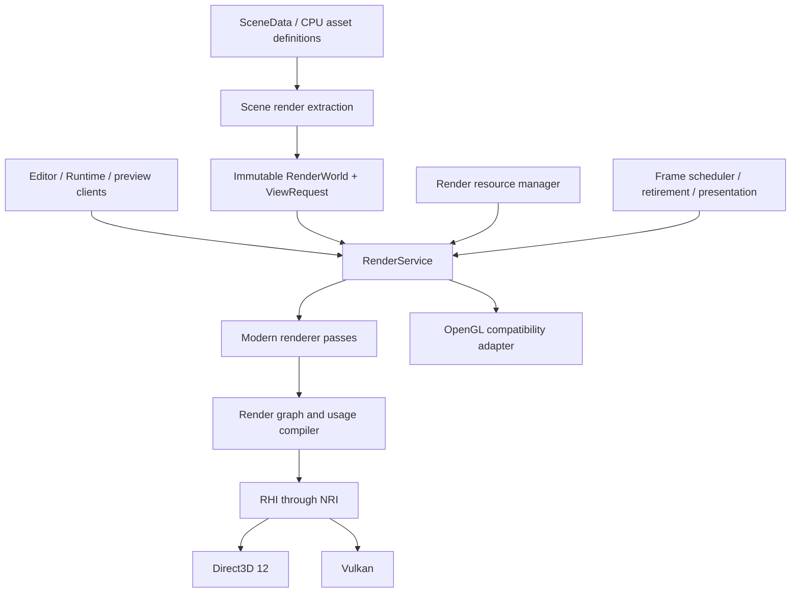

# Phase 41: RHI-Primary Rendering Architecture

> **Execution:** follow [OPT-00..11](../ROADMAP.md). This document is a
> technical contract, not a separate phase queue. Old Phase/G labels and
> source-audit baselines are retained for traceability. Early Vehicle retirement
> is delivered; acceptance and new plugin implementation remain open.

Date: 2026-11-03 (Asia/Saigon). Inspected source baseline: `492e6d1`.
Status: **current rendering contract; P41-01..26 implementation evidence is recorded in OPT-04/05/09 and OPT-10**.

The [Architecture Foundation master plan](ARCHITECTURE_FOUNDATION_MASTER_PLAN.md)
now coordinates this Phase 41 workstream with Phase 42 ECS/jobs and Phase 43
plugins/Vehicle. The latest priority is clean architecture before feature expansion;
read its external prerequisites and the [NRI contract](NRI_INTEGRATION_CONTRACT.md).
Unsuitable architecture may be replaced. Preserve authored projects through explicit
compatibility/migration contracts. This planning turn does not release production
implementation. Read the [execution plan](RHI_PRIMARY_RENDERER_IMPLEMENTATION_PLAN.md),
[coding guide](RHI_PRIMARY_RENDERER_IMPLEMENTATION_GUIDE.md), and
[live exchange](../agents/CODEX_GEMINI_EXCHANGE.json) before work.

## 1. Decision and scope

Use the modern renderer through NRI/D3D12 and NRI/Vulkan as the primary path.
Keep OpenGL as a maintained compatibility renderer behind the same product-level
render contract. NRI does not supply an OpenGL backend; do not pass OpenGL through
NRI calls or fabricate an NRI device to represent compatibility mode.

Editor, standalone Runtime, asset/material/VFX/assembly previews and thumbnails
must share resource resolution, view requests and lifetime policy. Rendering a
game must not require Editor panels or an ImGui-owned presentation loop.

Replace ownership and integration seams incrementally while keeping a runnable
vertical slice. Retain reviewed mesh generation, import codecs, material/VFX
algorithms and animation CPU data where they meet the new contracts. A rewrite
permission is not a reason to discard working algorithms or authored assets.

The broader [layered architecture proposal](../architecture/TARGET_LAYERED_ARCHITECTURE.md)
remains a long-term module direction. Phase 41 implements the rendering-related
boundaries and product dependencies; it is not a rewrite of every engine system.

## 2. Current evidence and gaps

These are source observations unless a historical runtime check is explicitly
identified. Re-inspect the active revision before implementing them.

| ID | Source evidence | Required correction |
| --- | --- | --- |
| AR-01 | [Primitive creation](../../Engine/UI/src/SceneHierarchyPanel.cpp) gates Cube/Sphere/Cylinder/Cone mesh components on GL mesh pointers | Backend-independent creation and canonical builtin identity |
| AR-02 | [Fallback initialization](../../Engine/RHI/src/RHIDevice.cpp) can mark OpenGL initialized without NRI; [mesh loading](../../Engine/Asset/src/AssetSerializer.cpp) interprets `IsInitialized()` as modern GPU availability | Separate selection, context readiness and native-device readiness |
| AR-03 | [RHITexture](../../Engine/RHI/src/RHITexture.cpp) leaves a possible wrapper on committed-allocation failure; `IsValid()` tests its pointer | Transactional creation/replacement and complete validation |
| AR-04 | [Viewport mutation](../../Engine/UI/src/RHIViewportDescriptor.cpp) immediately unregisters/recreates resources | Deferred retirement of the entire old resource generation |
| AR-05 | [Scene submission](../../Engine/Scene/src/RHISceneRenderer.cpp) ignores submit result and waits the queue idle per render | Checked submission, frame ownership and bounded reuse |
| AR-06 | Scene passes manually assume prior color/depth layouts; the [state tracker](../../Engine/RHI/src/RHIBarrier.cpp) is not integrated in the main renderer | Declared usage, first-use state, submission-aware tracking |
| AR-07 | [ImGuiLayer](../../Engine/UI/src/ImGuiLayer.cpp) owns native swapchains/present/fences while [RHISwapChain](../../Engine/RHI/src/RHISwapChain.cpp) is separate | One frame/presentation owner; UI becomes a render consumer |
| AR-08 | [MeshInstance3D](../../Engine/Scene/include/Axle/Components.hpp) stores GL and RHI resources; scene renderer/picker duplicate resolution and name guessing | CPU identity, shared resolver and immutable render snapshots |
| AR-09 | [Runtime](../../Runtime/src/RuntimeLayer.cpp) uses GL rendering; plugin build targets pull Editor UI into Runtime | Shared render service and Runtime-only composition/build |
| AR-10 | [Assembly preview](../../Engine/UI/src/AssemblyEditorPanel.cpp) and mesh/assembly [thumbnails](../../Engine/UI/src/AssetThumbnailManager.cpp) require GL | Service-driven private views and previews |
| AR-11 | GL has skeletal/shadow/HDR environment paths; modern scene renderer lacks equivalent complete integration | Separately accepted modern passes and capability reporting |
| AR-12 | Some [legacy RHI tests](../../Tests/src/Test_Milestone8_Part2.cpp) place operations in `assert`; physical GPU registration is opt-in | Always-active checks and explicit CPU/GPU/native/product gates |

Historical evidence: `5a9662e` fixed Inspector texture retirement, with a
before-fix descriptor-reuse failure and after-fix RTX 3070/D3D12 pixel checks.
`4649528` fixed VFX preview input ownership. Keep these regressions. Neither fix
establishes engine-wide lifetime safety or full backend acceptance.

## 3. Target data flow

This diagram describes logical responsibilities, not a requirement to create a
separate CMake library or virtual dispatch layer for every box.

| Boundary | Owns | Must not own |
| --- | --- | --- |
| SceneData / asset definitions | Stable IDs, transforms, materials, rig/pose and import settings | VAOs, descriptors, device pointers |
| Scene extraction | ECS-to-render conversion and world transforms | GPU allocation, command submission or live registry references in snapshots |
| RenderService | View orchestration, renderer selection and result diagnostics | Product-specific panels or gameplay simulation |
| Renderer | Mesh/material/light representation and render passes | Editor state or concrete ECS registry ownership |
| Resource manager | GPU generations, caches, uploads, external leases | Persistent scene serialization of native objects |
| Frame scheduler | Frame slots, submission tokens, fences, retirement and present | ImGui/widget behavior |
| RHI | Device, resources, commands, queues, barriers and pipelines | EnTT traversal, PBR authoring rules or gameplay lights |
| UI rendering bridge | ImGui draw-data recording and texture leases | Independent swapchain/frame ownership |

## 4. Binding contracts

### Backend readiness and failures

- Backend selection returns the actual backend, readiness, capabilities and a
  structured reason for each failed attempt. An OpenGL context is ready only
  after window/context creation and entry-point loading succeed.
- Explicit GL and automatic GL fallback follow the same asset/resource path.
- Modern resource creation requires a live native NRI device and required
  interfaces; a generic initialized flag is insufficient.
- Distinguish unsupported requests, invalid input, out-of-memory, transient
  surface changes and device loss. A lost device stops new submissions.
- Capture the first failure and backend diagnostics. A device-loss path must not
  repeatedly create fences or wait indefinitely during teardown.
- Initial policy: startup/restart fallback. Live backend switching or automatic
  recovery of every GPU object is outside this phase's required scope.

### CPU identities and GPU generations

- Persist asset UUID/path identities and explicit `builtin://cube`, `sphere`,
  `cylinder`, `cone`, `plane` identities. Entity names do not identify geometry.
- Use a validated runtime handle with slot/generation and device epoch, or an
  equivalent contract. A reused address or slot must not validate stale handles.
- A view/frame holds leases on the exact resource generation it records. An
  asset reload may publish a new generation without destroying the old one while
  submitted or unsubmitted draw data still uses it.
- Build a candidate resource completely before publishing it. A failed creation
  on a new object leaves it invalid; a failed replacement retains a usable
  previous generation unless the device itself is lost.
- Validate dimensions, format/usage, mip/layer/sample counts and device limits
  before narrowing to native types. Unsupported combinations produce diagnostics.
- Cache GPU resources by source/import interpretation and device generation.
  Preserve linear/sRGB distinctions and last-good shader/material behavior.
- Share immutable GPU assets where useful; per-view render targets remain private.

### Frame ownership and retirement

One owner coordinates acquire, upload dependencies, view rendering, UI recording,
submission, presentation, completion and retirement. Preview clients request
views; they do not each wait the device idle or submit unmanaged command streams.

The minimum implementation may use one graphics queue and synchronous extraction.
Use explicit frame slots and completion tokens before introducing overlap. Wait
only before reusing a busy slot or a resource that requires it. Do not remove
existing waits until descriptor pools, uniform/upload allocations, command
allocators and resources are all covered by the completion contract.

Retirement covers both CPU-recorded/unsubmitted work and GPU-submitted work.
Queueing deletion against only the last submitted fence cannot protect a texture
already referenced by this frame's UI draw data. Register a frame recording lease
before returning a UI texture token. Never capture a panel or dead UI-layer pointer
in a callback that can outlive that owner.

Resize/format changes allocate a replacement target set transactionally, preserve
the prior valid result on recoverable failure, and retire old texture/view/GUI
registrations together. Minimized views request no zero-sized GPU allocations.

### Resource states and render graph

Start with a small sequential graph. Passes declare reads/writes, subresource
ranges, attachments, clear/load/store and access/stage requirements. Track first
use and imported-resource state explicitly; do not invent `ShaderResource` as a
new texture's previous layout.

Maintain pending state during recording and commit it to submitted state only
when submission succeeds. Discard abandoned recording state. Track resource
generation, not recycled pointer identity. External/native UI commands participate
in the same contract through a documented import/export boundary.

Graph-owned transient images and persistent/external assets have different
lifetimes. The graph handles pass dependencies and temporary allocations;
resource manager/fence retirement handles external/UI leases across frames.
No memory aliasing or async compute is required for the first accepted graph.

### RenderWorld and view isolation

Snapshot resolved mesh/material references, world transforms, world-space lights,
camera data, optional skin palettes and stable selection mappings. Do not retain
mutable ECS references. Extract on the owning thread initially; a dedicated render
thread is optional later. A snapshot is immutable during its recording lifetime.

Render and picking use the same geometry resolver and transform/pose generation.
Readback results carry enough frame/entity identity to reject deleted/reused
entities. Compatibility selection may use a documented CPU method but must obey
the same identity and transform contract.

Each view owns camera/options/targets and history. Main scene, material/VFX/assembly
preview and thumbnail jobs cannot share mutable per-draw descriptor storage or
simulation instances accidentally. A preview texture stays valid through UI
submission, including when that view is closed or resized in the same UI frame.

### Shader, color and capability contract

User lighting correction (2026-11-07): ordinary Editor/Runtime Lit views contain
no synthesized sun, studio ambient/reflection or sky. `ResolveSceneLighting`
resolves only authored lights and an explicitly enabled environment; absent or
zero illumination contributes zero radiance. The default empty background is
black. Emissive materials and deliberately unlit particles remain visible.
Private previews author their own studio lights in their private world.

Basic isotropic material shading uses matching light-unit conversions, point
falloff/cone/window attenuation, ambient tint, Smith geometry and display
exposure/gamma conventions across native and GL. The shared numerical GPU probe
is `scripts/run_render_color_probe.py`; it verifies black output and bounded
RGB differences for identical scenes. This does not claim parity for features
explicitly deferred by backend capability reporting. GL fallback shaders embed
the canonical source at build time. HDR IBL generation establishes/restores its
own raster/binding state before view targets or uniforms are installed.

- Define canonical vertex attributes, skin palette layout, material constants,
  texture slots, linear-light/sRGB handling, tone-map ownership and depth/clip
  conventions. Translate API differences at documented backend boundaries.
- Reuse HLSL/reflection for D3D12/Vulkan. Preserve GL shaders behind compatibility
  translation/binding; a new universal shader language is not required.
- Separate physical device capabilities from implemented renderer features and
  per-view enabled features. A device's ray-tracing tier does not mean the engine
  implements ray-traced rendering.
- Query sample/format/usage support. Reject or explicitly downgrade unsupported
  options; never silently mutate authored material settings.
- Modern D3D12/Vulkan target the same required behavior. GL has an explicit
  compatibility baseline and diagnostics for advanced unsupported features.
- Baseline includes static primitives/imported meshes, textures/material basics,
  hierarchy transforms, selection, resize, scene round trips and product startup.
  Existing GL shadows/animation must survive migration. Advanced parity is
  accepted only where each backend has implementation and evidence.

## 5. Modules and migration seams

Proposed contracts are `RenderWorld`, `ViewRequest`, `RenderResult`,
`RenderService`, resource handles/leases and completion tokens. Names may adapt
to existing APIs; ownership and behavior are mandatory.

Keep current GL/RHI fields as transitional non-serialized caches while callers
migrate. Introduce the common resolver/factory first, then remove the duplicated
fields only after serialization, cloning, plugins and both renderers use it.
Do not change every subsystem in one commit.

Move ECS extraction above RHI; move PBR/light policy into Renderer. Separate
animation/VFX CPU data from GPU adapters where a real build boundary is needed.
Split runtime and editor plugin targets so standalone can build with Editor
disabled. Remove Core's hidden rendering/physics include dependencies as the
application/composition boundary is extracted. Preserve current public adapters
temporarily where needed for scripts or plugins.

## 6. Relationship to existing phases

- Phase 38.3 and 39 acceptance remains open where previously recorded. Migration
  must rerun affected material/VFX tests and preserve their authoring behavior.
- Phase 40 G1 remains delivered, independently unreviewed. Do not mark it accepted
  because this architecture document exists.
- Phase 40 D1/D2 and authoring expansion are deferred behind Phase 41 foundations.
  Phase 41 skinning/picking packages map to Phase 40 F1-F3 contracts; implement
  once and cross-reference evidence, never create competing animation renderers.
- GPU VFX graphs, ray tracing, mesh shaders, a new editor UI and full engine-wide
  module replacement are not prerequisites for Phase 41 completion.

## 7. Completion and references

OPT-05 implementation references (2026-11-07; acceptance evidence remains in the
review report): Scene owns extraction and RenderService. RenderWorld carries
owned material/pose/particle values and immutable imported CPU sources; captured
native mesh views retain exact buffer generations. Renderer owns the sequential
RenderGraph, canonical material contracts and Canvas GPU adapter. Platform owns
CPU font rasterization. UI2D owns documents, layout, input and Canvas collection.
RuntimePlayer shares project/package resolution, the game layer and sampled
presentation with the actual player executable and physical product probes.

The initial graph is whole-texture and sequential: declared reads/writes,
attachment load/store, first use and dependency validation precede recording.
Imported resources remain leased external generations; the RHI transactional
command journal supplies actual queue state and submission retirement. This does
not claim transient aliasing, parallel recording or asynchronous compute. Modern
shadow/skinning/authored-HDR environment passes remain later packages; floating
point target support alone does not imply those scene features are implemented.

Completion requires the [execution plan's acceptance matrix](RHI_PRIMARY_RENDERER_IMPLEMENTATION_PLAN.md#acceptance-matrix),
including standalone and real windowed Editor checks. No percentage or parity
claim follows from class names, successful shader compilation or CPU tests alone.

These sources motivate the design; they do not prescribe Axle's exact interfaces:

- [Godot rendering architecture](https://docs.godotengine.org/en/stable/engine_details/architecture/internal_rendering_architecture.html): modern RenderingDevice and compatibility rendering boundaries.
- [Unreal Render Dependency Graph](https://dev.epicgames.com/documentation/en-us/unreal-engine/render-dependency-graph-in-unreal-engine): declared dependencies, transitions, transient lifetimes and validation.
- [Unity render graph introduction](https://docs.unity3d.com/6000.0/Documentation/Manual/urp/render-graph-introduction.html): graph-owned versus imported resources and pass ordering.
