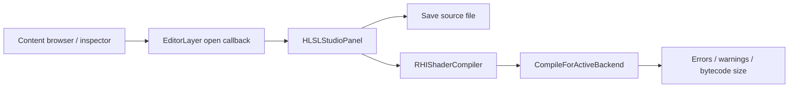

# Materials and HLSL Shader Authoring

Status: current workflow and boundaries, reviewed **2026-11-01**. Source locations are linked below; future authoring proposals are kept in the [tooling roadmap](../archive/design/deferred/EDITOR_TOOLING_ROADMAP.md).

## 1. Resource model

Material descriptors use a Material-root `.axleasset`. AssetManager caches resources by path and UUID. MaterialComponent retains identity, shared resources and instance overrides; both Material and RHI::RHIMaterial participate in current rendering paths.

An asset change, a component override, compiling shader source and replacing an active GPU pipeline are different operations. Verify each intended path rather than assuming one operation completes all of them.

Sources: [Material](../../Engine/Renderer/include/Axle/Material.hpp), [RHIMaterial](../../Engine/RHI/include/Axle/RHI/RHIMaterial.hpp), [MaterialComponent](../../Engine/Scene/include/Axle/Components.hpp), [AssetManager](../../Engine/Asset/src/AssetManager.cpp).

## 2. Descriptor editing

The [SilverCarPaint descriptor](../../Tests/Fixtures/Assets/materials/SilverCarPaint.axleasset) shows a compact material definition:

```text
Material {
    name: "SilverCarPaint"
    shader: "ForwardPBR"
    albedoColor: "#EBEFF5"
    metallic: 0.92
    roughness: 0.14
    uvScale: [1.0, 1.0]
}
```

Actual supported properties and defaults are defined by the material loaders and shaders. Surface type, culling, depth/blend state, texture color spaces and custom properties must agree with the active pipeline. See the [asset reference](../reference/ASSET_FORMAT.md) and [rendering guide](RENDERING.md).

Use AssetInspector to edit supported material fields and AssetPreviewPanel for preview. Preserve the descriptor's asset identity on save. Preview resources and scene resources have distinct lifetimes and can use different backend paths.

## 3. HLSL Studio

EditorLayer wires open callbacks from ContentBrowserPanel and SceneHierarchyPanel and renders HLSLStudioPanel. The panel owns its editable/saved source buffers, path, stage selection, entry points and diagnostics. It supports a forward vertex/pixel pair or vertex, pixel and compute stage selection.

When the panel is focused, Ctrl+S and F5 invoke save and compile in the current implementation. These keys may have different meanings elsewhere in the editor. Save paths default to a project-style shader location; confirm the current path before saving a template.



Compilation uses DXC through RHIShaderCompiler with source/include directories and stage entry points. Read the returned diagnostics and backend selection; a message mentioning DXIL/SPIR-V is not evidence that every backend was compiled and visually checked in that operation.

Sources: [Editor wiring](../../Editor/src/EditorLayer.cpp), [Studio implementation](../../Engine/UI/src/HLSLStudioPanel.cpp), [shader compiler](../../Engine/RHI/src/RHIShader.cpp).

## 4. Save, reload and pipeline boundaries

AssetInspector has material save/reload paths through AssetManager. RHIShaderCompiler creates bytecode; scene rendering has its own pipeline/layout/cache lifecycle. A successful compile does not by itself demonstrate that all live pipelines or existing descriptor sets were replaced.

Before adding automatic shader reload, define dependency tracking for include files, cache invalidation, last-known-good fallback, layout compatibility and safe GPU resource retirement. Before adding reflection-driven inspector controls, define a stable mapping from declared properties to stored values and shader bindings.

## 5. Current limits and verification

- OpenGL SceneRenderer and RHISceneRenderer coexist; standalone Runtime currently uses the OpenGL path.
- Do not claim cross-backend parity or a production material feature merely because a descriptor field or UI control exists.
- Existing reflection APIs do not establish a complete reflection-driven material inspector or safe hot-swap workflow.
- Packed ORM, clearcoat, anisotropy, environment controls and diagnostics navigation should each have explicit schema, shader, UI and behavioral/visual acceptance evidence before being documented as complete end-to-end features.

Useful verification workloads include descriptor round-trip, shared asset versus instance override behavior, compile errors and recovery, pipeline/layout change handling and representative rendering on each selected backend. This documentation does not report a test run or visual benchmark.
