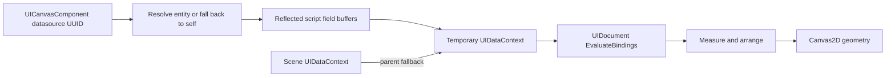

# UI Documents, Layout and Data Binding

Status: current implementation guide, reviewed **2026-11-01**. For ownership diagrams and detailed execution order, see [SDD](../architecture/SDD.md#13-ui2d-binding-and-authoring) and [Runtime UI flow](../architecture/RUNTIME_FLOWS.md#9-runtime-ui-binding-and-geometry).

## 1. Main concepts

| Type | Purpose |
|---|---|
| UICanvasComponent | Scene-level asset path, datasource UUID, visibility/sort order and document reference |
| UIDocument | Node arena, ID lookup, layout, bindings, input and serialization |
| UINode and subclasses | Canvas, rectangle, text, image, progress/gauge, row/column and button behavior |
| RectTransform | Anchors, pivot, size and position alongside the legacy layout fields |
| UIDataContext | Typed values/actions with parent-context fallback |
| Canvas2D | CPU geometry, clipping and batch statistics |
| UICanvasDesignerPanel | Editor document authoring and mock-data preview |
| UICanvasImGuiRenderer | ImGui preview adapter |

UIDocument owns nodes in a unique_ptr arena. Parent/children, root, ID map and binding targets are observers into that arena. Do not delete child pointers independently or retain them across document clear/reload without revalidation.

## 2. Canvas assets

Use a Canvas-root `.axleasset` descriptor for new UI assets. Legacy `.axleui` paths remain in some loading/fallback code. See the [asset format reference](../reference/ASSET_FORMAT.md) and the maintained [RacingHUD asset](../../assets/ui/RacingHUD.axleasset) for syntax.

```text
Canvas {
    id: "hud"
    referenceResolution: [1920, 1080]
    Text {
        id: "speed"
        text: "Speed: {SpeedKmh}"
        fontSize: 24
        color: "#FFFFFFFF"
    }
}
```

This example demonstrates parsing and binding syntax, not an assertion that the standalone GPU canvas path is complete.

## 3. Datasource selection and scoping

UICanvasComponent::DataSourceEntityID stores a persistent entity UUID. Zero selects the canvas entity itself. A valid nonzero UUID selects another entity; unresolved references currently fall back to the canvas entity. See [GetDataSourceEntity](../../Engine/Scene/src/Entity.cpp).

The current Editor/Runtime render paths create a temporary UIDataContext whose parent is Scene::GetUIDataContext(). They resolve the datasource, synchronize NativeScriptComponent fields from its instance, copy supported scalar/string field buffers into the temporary context and evaluate document bindings against it.



This gives each evaluation its own datasource field values. Shared Scene keys can still collide if multiple scripts publish the same global name. The current Entity API does not provide the per-entity GetLocalUIDataContext method described by older plans; do not use that as an existing API.

UIDataContext currently supports integers, floats, booleans, strings and vec4 values, action callbacks and parent lookup. Vehicle.* compatibility aliases also exist. Further generic scoping should make naming and lifetime rules explicit instead of silently adding more domain aliases.

## 4. Layout, input and reload

UIDocument uses measure/arrange passes and tracks layout dirtiness. Bindings can use direct values, interpolated text or supported ternary expressions. Buttons route named actions through UIDataContext and provide focus/navigation behavior.

Runtime collects visible canvases, sorts them, processes input against existing documents, then loads/reloads documents, evaluates bindings, updates layout and emits geometry. Missing documents therefore do not have a newly computed layout for the earlier input pass in that frame. See [RuntimeLayer](../../Runtime/src/RuntimeLayer.cpp) before changing this order.

CheckAndHotReload uses file state to refresh documents. Node pointers and bindings must remain consistent after reload. Save/reload of a UI document is distinct from scene serialization of UICanvasComponent.

## 5. Editor workflow

Configure the canvas asset and datasource through the scene inspector; use the canvas designer for document editing/preview. Keep the internal UI node tree separate from the 3D entity hierarchy. Designer mock context values are preview data and do not prove gameplay bindings are populated in Runtime.

Key implementations: [inspector](../../Engine/UI/src/EntityInspector.cpp), [designer](../../Engine/UI/src/UICanvasDesignerPanel.cpp), [document](../../Engine/UI/src/UI2D/UIDocument.cpp), [parser](../../Engine/UI/src/UI2D/UIParser.cpp).

## 6. Rendering boundary and future work

Canvas2D currently retains vertices/indices and statistics. EndCanvas updates draw-call statistics but does not submit GPU work. Runtime::RenderUI ends at that call. Actual runtime presentation needs an explicit upload, binding, draw and resource-lifecycle implementation; ImGui editor preview is a separate path.

Future work includes a UI render backend, consistent input/layout ordering, well-defined datasource lifetime/isolation and tests with multiple canvases/entities. See the [architecture assessment](../architecture/ASSESSMENT.md) and [tooling roadmap](../design/EDITOR_TOOLING_ROADMAP.md).
