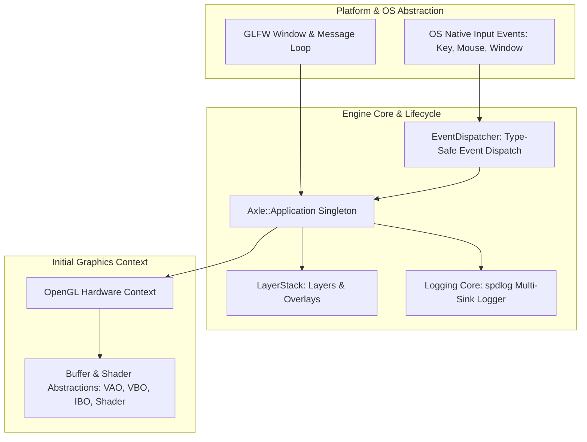
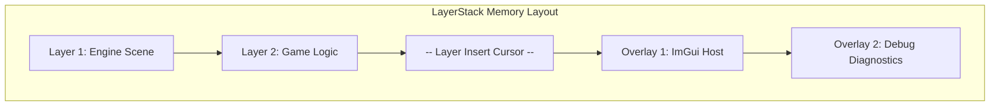

# Milestone 01 — Foundations & Core Infrastructure Architecture

## 1. Target and Mandate

Milestone 01 (Phases 1 through 4) establishes the bedrock infrastructure of AxleEngine. Its architectural mandate establishes:
1. **Engine Foundation & Build Matrix** (Phase 1): Modern modular CMake target tree (`Engine/Core`, `Engine/Scene`, `Engine/Renderer`, `Editor`, `Runtime`).
2. **Application Lifecycle & Layer Stack** (Phase 2): Central `Axle::Application` coordinator, bidirectional `LayerStack`, and `spdlog` diagnostic logging.
3. **Platform Windowing & Event Bus** (Phase 3): Operating system window abstraction via `GLFW` and type-safe `EventDispatcher`.
4. **Rendering Hardware Spike** (Phase 4): Baseline OpenGL context creation, hardware shader compilation, and buffer abstractions (`VertexArray`, `VertexBuffer`, `IndexBuffer`).

---

## 2. LayerStack & Application Coordination

AxleEngine structures execution logic across an ordered `LayerStack`:
- **Normal Layers**: Pushed onto the lower half of the stack (e.g. `GameLogicLayer`, `SceneLayer`). Executed in forward order during updates, and reverse order during event handling.
- **Overlays**: Pushed onto the upper half of the stack (e.g. `ImGuiLayer`, `ProfilerOverlay`). Always updated and rendered *after* normal layers to ensure debug tools and HUDs draw on top.

---

## 3. Platform Abstraction & Event Bus

### 3.1 Event Dispatch Architecture

- **Event Category & Type**: Bitmask categories (`EventCategoryApplication`, `EventCategoryInput`, `EventCategoryKeyboard`, `EventCategoryMouse`) allow layers to filter events efficiently without downcasting.
- **Immediate Dispatching**: Events generated by platform callbacks (e.g. GLFW window resize, key pressed) are dispatched immediately through `EventDispatcher::Dispatch<T>(Callback)`:
  - If a layer marks an event as handled (`Handled = true`), propagation down the layer stack stops immediately.
- **Zero-Allocation Invariants**: Event objects are transient stack-allocated payloads passed by reference, incurring zero heap allocations during high-frequency input polling or window resizing.
