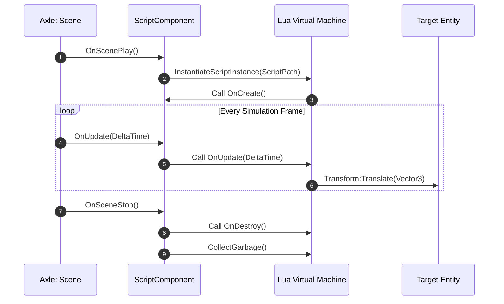

# Milestone 03 — Asset Pipeline, Serialization & Scripting Architecture

## 1. Target and Mandate

Milestone 03 (Phases 8 through 13) provides AxleEngine with data persistence, asset virtualization, and gameplay scripting. Its architectural mandate establishes:
1. **Virtual File System & Asset Registry** (Phase 8): 128-bit GUIDs, metadata sidecars (`.axleasset`), and `axle://` virtual path resolution.
2. **Asset Import Pipeline** (Phase 9): Concrete importers for textures (`stb_image`) and 3D meshes (`Assimp`), compiling source assets into engine-ready binaries.
3. **Structured Serialization Schema** (Phase 10): Human-readable YAML emitter and parser for entities and components.
4. **Project Configuration Architecture** (Phase 11): `.axleproj` workspace descriptors and path resolution.
5. **Lua Scripting Runtime** (Phases 12 & 13): Sandboxed Lua state machine, C++ reflection bindings, and script lifecycle hooks.

```mermaid
flowchart TD
    subgraph VFS [Virtual File System & Registry]
        AssetReg[AssetRegistry: GUID to Metadata Map]
        VirtualPath[Virtual Path Resolver: axle://assets/...]
        DiskWatcher[Directory Watcher & Hot-Reload Listener]
    end

    subgraph Importers [Asset Compilation Pipeline]
        TexImporter[Texture Importer: stb_image -> Raw Pixel Buffers]
        MeshImporter[Mesh Importer: Assimp -> Axle Mesh Geometry]
        MatImporter[Material Importer: PBR Parameter JSON/YAML]
    end

    subgraph ScriptingCore [Lua Gameplay Scripting Runtime]
        LuaState[Sandboxed lua_State Context]
        CPPBinder[C++ / Lua API Glue Layer: sol2 / Native C-API]
        ScriptHooks[Lifecycle Callbacks: OnCreate, OnUpdate, OnDestroy]
    end

    VirtualPath --> AssetReg
    AssetReg --> Importers
    DiskWatcher --> AssetReg
    ScriptingCore --> CPPBinder
    CPPBinder --> LuaState
    LuaState --> ScriptHooks


---

## 2. Asset Pipeline & Virtual File System (VFS)

### 2.1 GUID-Centric Asset Identity

- **UUID Representation**: 128-bit RFC 4122 compliant unique identifiers ensure asset references remain completely immune to file renaming or moving on disk.
- **Sidecar Metadata**: Every authored asset (e.g. `Wood_Albedo.png`) pairs with a companion sidecar file (`Wood_Albedo.png.axleasset`) storing:
  - Asset UUID.
  - Asset Type (`Texture2D`, `Mesh`, `Material`, `Scene`, `Script`).
  - Import settings (sRGB color space, compression format, generate mipmaps).

### 2.2 VFS Mount Scheme

```
Authoring Project:    [ D:/WorkSpace/MyGame/assets/textures/Wood.png ]
                             | (Normalized by VFS)
                             v
Virtual URI:          [ axle://textures/Wood.png ]
                             | (Resolved by AssetRegistry)
                             v
Asset Handle:         [ AssetHandle { UUID: 7f3b... } ]
```

---

## 3. Lua Scripting Architecture

### 3.1 Script Lifecycle & Sandboxing



- **Safety & Error Handling**: Lua execution runs within protected `pcall` boundaries, routing Lua script syntax errors and runtime exceptions to the AxleEngine logger (`AXLE_CORE_ERROR`) without crashing the editor or simulation thread.
