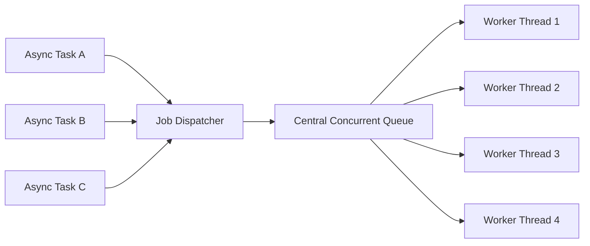

# Milestone 04 — Scene Graph & Multithreading Architecture

## 1. Target and Mandate

Milestone 04 (Phases 14 through 19) introduces hierarchical spatial structures and asynchronous job scheduling to AxleEngine. Its architectural mandate establishes:
1. **Scene Graph & Transform Propagation** (Phase 14): Parent-child transform DAG, dirty-flag caching, and hierarchical coordinate transformations.
2. **Camera & Frustum Subsystem** (Phase 15): View-projection matrices and frustum plane extraction for culling.
3. **Interactive Manipulation Gizmos** (Phase 16): Viewport gizmo manipulation in Local and World coordinate frames.
4. **Job System & Thread Pool Architecture** (Phase 17): Work-stealing thread pools for parallel CPU simulation and asset processing.
5. **Robust Scene Serialization** (Phase 18): Backward-compatible human-readable YAML scene schemas.
6. **Pixel-Perfect Entity Picking** (Phase 19): 32-bit integer Entity ID color-buffer picking in viewport frames.

```mermaid
flowchart TD
    subgraph SceneHierarchy ["Hierarchical Scene Graph"]
        RootEntity["Root Entity: Transform"]
        ChildEntity["Child Entity: Local Transform"]
        Grandchild["Grandchild Entity: Local Transform"]
        DirtyFlag["Dirty State Propagation Flag"]
    end

    subgraph ThreadingCore ["Job System & ThreadPool"]
        MasterThread["Main Application Thread"]
        WorkQueue["Thread-Safe Task Queue"]
        WorkerThreads["Worker Thread Pool: std::thread x HardwareConcurrency"]
    end

    subgraph ViewportPicking ["Viewport Selection & Picking"]
        ColorBuffer["Offscreen 32-bit Integer Framebuffer: GL_R32UI"]
        PixelReadback["Pixel Readback at Mouse Cursor X,Y"]
        SelectionMgr["Selection Context: Selected Entity ID"]
    end

    RootEntity --> ChildEntity
    ChildEntity --> Grandchild
    DirtyFlag -.->|Invalidates| ChildEntity
    DirtyFlag -.->|Invalidates| Grandchild
    MasterThread --> WorkQueue
    WorkQueue --> WorkerThreads
    PixelReadback --> ColorBuffer
    ColorBuffer --> SelectionMgr


```

---

## 2. Hierarchical Transform Propagation

### 2.1 Transform Invariants

- **Component Structure**: `TransformComponent` maintains:
  - Local state: Translation $(\mathbf{"t"})$, Rotation quaternion $(\mathbf{"q"})$, Scale $(\mathbf{"s"})$.
  - World matrix: $4 \times 4$ floating-point matrix $(\mathbf{"M"}_{"\text{world"}})$.
  - Relationship links: `Parent` Entity handle, `FirstChild` Entity handle, `NextSibling` Entity handle.
  - State flags: `bIsDirty` boolean bit.
- **Propagation Order**: Top-down depth-first traversal ensures parent world matrices are fully recomputed before child world matrices are evaluated:
  $$\mathbf{"M"}_{"\text{world"}}^{\text{"child"}} = \mathbf{"M"}_{"\text{world"}}^{\text{"parent"}} \cdot \mathbf{"M"}_{"\text{local"}}^{\text{"child"}}$$

---

## 3. Asynchronous Job System Architecture

### 3.1 `Axle::ThreadPool` Work-Stealing Model

- **Thread Allocation**: Default count equals $\max(1, \text{hardware\_concurrency} - 1)$, reserving the main thread for OS event dispatch, input polling, and render submission.
- **Synchronization**: Tasks return standard `std::future<T>` handles or accept completion counter barriers for fan-out / fan-in workloads (such as parallel frustum culling or particle updates).

---

## 4. Entity Picking via Color Readback

- **Picking Texture**: Viewport framebuffers attach an auxiliary integer render target (`GL_R32I` / `DXGI_FORMAT_R32_SINT`).
- **Pass Encoding**: Each geometry draw command passes the entity's 32-bit `entt::entity` index as a flat integer shader output.
- **Picking Query**: When the user clicks the viewport at $(x, y)$, the engine queries the single pixel at $(x, y)$ from the GPU picking buffer. Background pixels read as $-1$, while entity pixels instantly identify the clicked entity in $O(1)$ time regardless of mesh polygon count.
