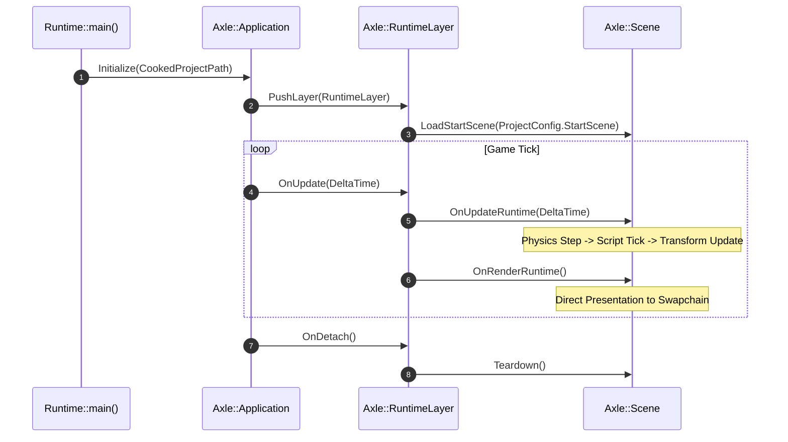

# Milestone 05 — Component Architecture & Standalone Runtime Architecture

## 1. Target and Mandate

Milestone 05 (Phases 20 through 23) transitions AxleEngine from monolithic object-oriented hierarchies to a modern Data-Oriented Entity Component System (ECS) powered by `EnTT`, and establishes the architectural separation between the authoring Editor and the standalone game Runtime.

Its architectural mandate establishes:
1. **ECS Foundation via EnTT** (Phase 20): Contiguous memory component pools, sparse sets, and cache-friendly entity iteration.
2. **Component Reflection & Extension** (Phase 21): Dynamic component registration, inspector UI reflection, and serialization adapters.
3. **Standalone Runtime Player Architecture** (Phase 22): Decoupled `AxleRuntime.exe` stripped of Editor UI and authoring dependencies.
4. **Standalone Packaging & Cooker Pipeline** (Phase 23): Cooked asset packaging and standalone game executable distribution.

```mermaid
flowchart TD
    subgraph Products [Target Executables]
        Editor[AxleEditor.exe: Interactive Authoring & Tooling]
        Runtime[AxleRuntime.exe: Standalone Game Client]
        Headless[AxleHeadless: Automated CTest & CI Runner]
    end

    subgraph ECSCore [EnTT Entity Component Subsystem]
        Registry[entt::registry: Entity ID & Sparse Set Storage]
        Views[entt::view / entt::group: Cache-Friendly Iterators]
        CompPools[Contiguous Component Arrays: Transform, Mesh, Light, Physics]
    end

    subgraph RuntimeBoundary [Runtime Abstraction Layer]
        RuntimeLayer[Axle::RuntimeLayer: Scene Lifecycle & Game Logic]
        CookedLoader[Cooked Asset VFS Loader]
        Presentation[Direct Window Swapchain Presentation]
    end

    Editor --> Registry
    Runtime --> RuntimeLayer
    Headless --> Registry
    RuntimeLayer --> Registry
    Registry --> Views
    Views --> CompPools
    RuntimeLayer --> CookedLoader
    RuntimeLayer --> Presentation


---

## 2. ECS Data Layout & Memory Model

### 2.1 Sparse Set Component Storage

AxleEngine utilizes `EnTT` sparse set storage to achieve maximum memory locality:
- **Entity Identifier**: 32-bit integer decomposed into 20-bit index and 12-bit generation version (preventing use-after-free bugs when entities are recycled).
- **Sparse Array**: Maps entity index to packed array position.
- **Packed Array**: Stores contiguous component instances without holes, enabling SIMD vectorization and prefetching during system updates.

```
Entity Index:     [ 0 | 1 | 2 | 3 | 4 | 5 ]  <- Sparse Array (May have holes)
                    |       |       |
                    v       v       v
Packed Density:   [ C0  |  C2  |   C4   ]     <- Packed Array (Cache-line friendly)
```

---

## 3. Product Separation: Editor vs. Standalone Runtime

### 3.1 Decoupling Contract

| Architectural Facet | AxleEditor.exe | AxleRuntime.exe |
| :--- | :--- | :--- |
| **ImGui Dependency** | Required (Docking, Inspectors, Viewport frames) | **Zero Linkage / Excluded** |
| **Presentation Model**| Rendered into offscreen framebuffer $\rightarrow$ ImGui texture | Rendered directly to backbuffer swapchain |
| **Asset Resolution** | Raw asset files + hot-reload file watchers | Cooked binary packages via virtual mount |
| **Input Model** | ImGui window-focus routing & Gizmo capture | Direct GLFW raw input polling |
| **Binary Footprint** | Complete development suite & debug symbols | Stripped minimal player executable |

### 3.2 Runtime Lifecycle


