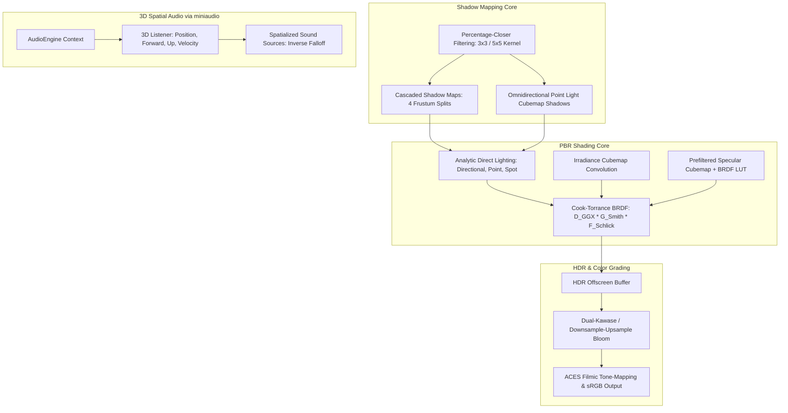

# Milestone 06 — High-Fidelity Rendering, PBR & Audio Architecture

## 1. Target and Mandate

Milestone 06 (Phases 24 through 28) establishes the photorealistic visual and spatial audio foundation of AxleEngine. Its architectural mandate establishes:
1. **Cook-Torrance PBR Shading Model** (Phase 24): Energy-conserving metallic-roughness BRDF.
2. **Image-Based Lighting (IBL)** (Phase 25): Split-Sum approximation for ambient diffuse and specular reflections.
3. **Advanced Shadow Mapping** (Phase 26): Cascaded Shadow Maps (CSM) for directional lights and cubemap shadows for local point lights.
4. **Post-Processing & HDR Tone-Mapping** (Phase 27): High dynamic range color grading, Bloom, and ACES curve fitting.
5. **Spatial Audio Architecture** (Phase 28): High-performance 3D positional audio via `miniaudio`.

---

## 2. Photometric Shading Math & Contracts

### 2.1 The Cook-Torrance Specular BRDF

The specular reflectance $f_{\text{spec}}$ is defined as:
$$f_{\text{spec}}(\mathbf{l}, \mathbf{v}) = \frac{D(\mathbf{h}) \cdot G(\mathbf{l}, \mathbf{v}, \mathbf{h}) \cdot F(\mathbf{v}, \mathbf{h})}{4 \cdot (\mathbf{n} \cdot \mathbf{l}) \cdot (\mathbf{n} \cdot \mathbf{v})}$$

- **Normal Distribution Function ($D$)**: GGX / Trowbridge-Reitz:
  $$D(\mathbf{h}) = \frac{\alpha^2}{\pi \left( (\mathbf{n} \cdot \mathbf{h})^2 (\alpha^2 - 1) + 1 \right)^2}, \quad \text{where } \alpha = \text{roughness}^2$$
- **Fresnel Reflectance ($F$)**: Schlick's approximation:
  $$F(\mathbf{v}, \mathbf{h}) = F_0 + (1 - F_0) \cdot (1 - (\mathbf{v} \cdot \mathbf{h}))^5$$
- **Geometric Shadowing ($G$)**: Smith's separable formulation with Schlick-GGX:
  $$G(\mathbf{l}, \mathbf{v}) = G_1(\mathbf{v}) \cdot G_1(\mathbf{l})$$

### 2.2 Split-Sum Image-Based Lighting (IBL)

Ambient specular reflections are approximated by decomposing the radiance integral:
$$L_{\text{spec}} \approx \underbrace{\int_{\Omega} L_i(\mathbf{l}) \, d\mathbf{l}}_{\text{Prefiltered Environment Map}} \cdot \underbrace{\int_{\Omega} f_{\text{spec}} \cdot (\mathbf{n} \cdot \mathbf{l}) \, d\mathbf{l}}_{\text{2D BRDF Integration LUT}}$$

---

## 3. Shadow Mapping Architecture

### 3.1 Cascaded Shadow Maps (CSM)

- **Split Scheme**: Logarithmic/practical split scheme divides the view camera frustum into 4 discrete depth cascades:
  $$z_i = \lambda \cdot z_{\text{near}} \cdot \left(\frac{z_{\text{far}}}{z_{\text{near}}}\right)^{\frac{i}{m}} + (1 - \lambda) \cdot \left( z_{\text{near}} + \frac{i}{m}(z_{\text{far}} - z_{\text{near}}) \right)$$
- **Texel Snapping**: Cascade projection matrices snap light-space bounds to discrete shadow map texel increments, eliminating shimmering artifacts during camera movement.
- **Filtering**: Percentage-Closer Filtering (PCF) with $3 \times 3$ or $5 \times 5$ Poisson disk taps.

---

## 4. 3D Spatial Audio Architecture

- **Subsystem Core**: Powered by `miniaudio`, running on a dedicated low-latency real-time thread.
- **Spatial Parameters**:
  - `Listener`: Camera world position, forward direction, up vector, and linear velocity (for Doppler shift).
  - `Sound Source`: 3D position, rolloff model (inverse distance, linear, exponential), min/max attenuation radii, and cone directionality.
