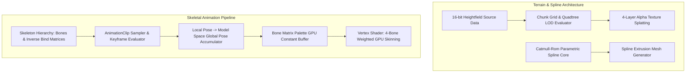
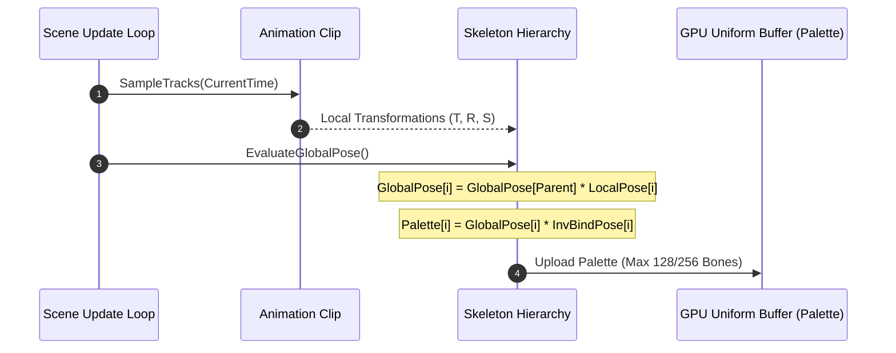

# Milestone 07 — Landscape, Splines & Skeletal Animation Architecture

## 1. Target and Mandate

Milestone 07 (Phases 29 through 30) introduces outdoor environment authoring and character deformation to AxleEngine. Its architectural mandate establishes:
1. **Terrain & Spline Architecture** (Phase 29): Chunked heightfield terrain rendering, quadtree LOD, multi-texture splatting, and parametric Catmull-Rom spline path systems.
2. **Skeletal Animation Pipeline** (Phase 30): Hierarchical bone transform evaluation, keyframe interpolation, and GPU vertex skinning via bone matrix palettes.

---

## 2. Terrain & Spline Architecture

### 2.1 Chunked Grid and Quadtree LOD

- **Chunk Granularity**: Terrain is divided into $32 \times 32$ or $64 \times 64$ vertex patch tiles (chunks).
- **LOD Metric**: Continuous distance evaluation between chunk bounding box and active camera position selects geometric mip-levels ($0$ to $4$).
- **Crack Prevention**: Adjacent chunks with disparate LODs apply edge stitching or skirt geometry to eliminate T-junction cracks.

### 2.2 Parametric Spline Interpolation

- **Catmull-Rom Formulation**: Computes smooth curves passing through authoring control points $P_0, P_1, P_2, P_3$ with uniform or centripetal parameterization.
- **Extrusion Mesh Generation**: Sweeps 2D cross-sections (e.g. road, pipe, track) along the evaluated spline tangent frame $(T, N, B)$ to generate runtime triangle strips and collision meshes.

---

## 3. Skeletal Animation Architecture

### 3.1 Pose Evaluation and Bone Matrix Palette

### 3.2 Vertex Shader Skinning Formula

Vertices carry up to 4 bone influences: indices $(b_0, b_1, b_2, b_3)$ and normalized weights $(w_0, w_1, w_2, w_3)$ such that $\sum w_i = 1.0$.

The deformed vertex position $P'$ is calculated as:
$$P' = \sum_{i=0}^{3} w_i \cdot \left( \mathbf{M}_{b_i} \cdot P \right)$$
where $\mathbf{M}_{b_i}$ is the final skinning matrix: $\mathbf{M}_b = \mathbf{G}_b \cdot \mathbf{B}_b^{-1}$.
