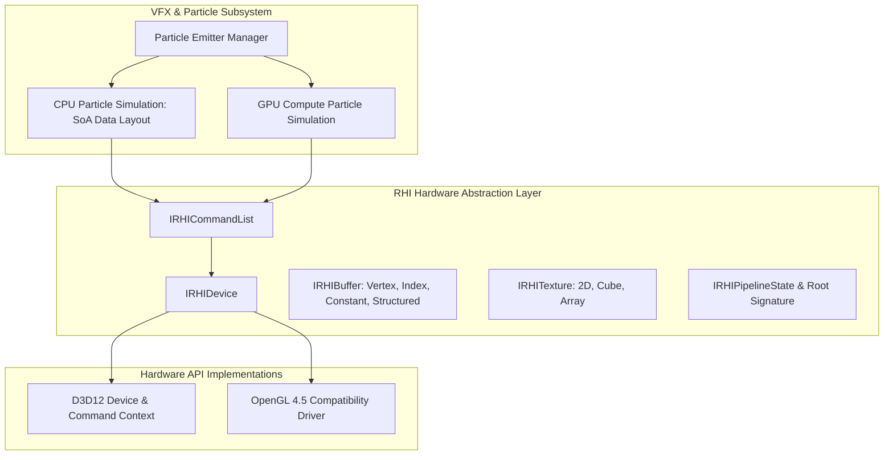

# Milestone 08 — VFX, Primary RHI & Cross-Platform Architecture

## 1. Target and Mandate

Milestone 08 (Phases 31 through 34) introduces the foundational Hardware Abstraction Layer (`Engine/RHI`) and the dual-path Particle & Visual Effects engine (`Engine/VFX`). Its architectural mandate establishes:
1. **Visual Effects & Particle Architecture** (Phase 31): Flexible emitter modules, CPU and GPU compute simulation paths, and point/billboard renderers.
2. **Initial RHI Abstraction Core** (Phase 32): Unified device interfaces decoupling graphics passes from underlying platform APIs.
3. **Direct3D 12 Device Implementation** (Phase 33): Modern explicit low-level execution on Windows.
4. **Cross-Platform Toolchain & CI Infrastructure** (Phase 34): Multi-compiler build verification across MSVC and Clang.

---

## 2. Visual Effects Architecture

### 2.1 Dual Simulation Paths

| Feature | CPU Simulation Path | GPU Compute Path |
| :--- | :--- | :--- |
| **Capacity** | $1,000 - 50,000$ particles | $100,000 - 1,000,000+$ particles |
| **Memory Layout** | Structure-of-Arrays (SoA) for SIMD vectorization | GPU StructuredBuffer / ByteAddressBuffer |
| **Collision Handling**| CPU Raycast against physics colliders | Depth-buffer / Distance field collision in compute shader |
| **Sorting** | Multithreaded CPU Radix Sort by depth | GPU Bitonic Merge Sort |

### 2.2 Modular Particle Emitter Pipeline

Emitters execute sequentially through modular evaluation phases:
1. **Spawn Phase**: Calculates emission count per tick based on rate over time or bursts.
2. **Initialization Phase**: Evaluates initial position (sphere, box, cone, mesh surface), velocity, color, size, and lifetime.
3. **Update Phase**: Applies gravity, linear drag, curl noise turbulence, vortex forces, and point attractors.
4. **Render Output Phase**: Generates camera-facing quad billboard vertices or passes structured buffer offsets directly to instanced indirect draws.

---

## 3. Foundational RHI Interface Contract

### 3.1 Core RHI Abstractions

- `IRHIDevice`: Factory for device memory, textures, buffers, samplers, shaders, and pipeline states.
- `IRHICommandList`: Explicit recording context supporting draw commands, dispatch compute, copies, and pipeline barriers.
- `IRHIPipelineState`: Encapsulates vertex input layout, blend state, rasterizer state, depth-stencil state, and compiled shader bytecodes into an immutable pipeline object.
- `IRHIDescriptorHeap`: Ring-buffered descriptor management for CBVs, SRVs, UAVs, and samplers.
