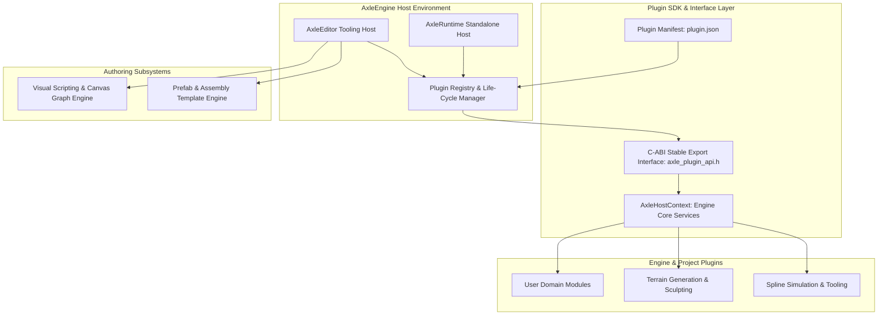
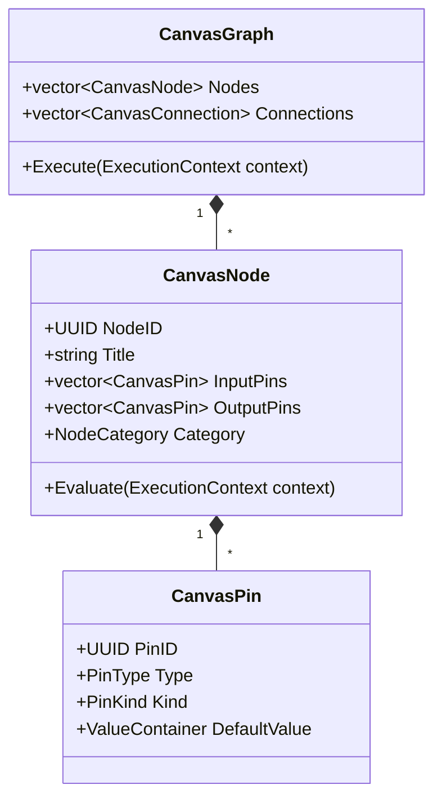

# Milestone 10 — Tooling Ecosystem & Extension Architecture

## 1. Target and Mandate

Milestone 10 (Phases 38 through 40) expands AxleEngine into an extensible authoring platform. Its architectural mandate establishes:
1. **Plugin Architecture & C-ABI SDK** (Phase 40): Enabling decoupled engine extensions, dynamic library loading in the Editor, and static linkage for shipping runtimes.
2. **Prefab & Assembly System** (Phase 39): Hierarchical prefab templates, component overrides, and instance synchronization.
3. **Node-Based Visual Scripting & Canvas** (Phase 38): Dataflow node graphs, execution graphs, and visual logic composition.



---

## 2. Plugin Architecture & C-ABI Boundary

### 2.1 Dynamic vs. Static Loading Matrix

| Execution Environment | Loading Mechanism | Linkage | Life-Cycle Invariants |
| :--- | :--- | :--- | :--- |
| **AxleEditor** | Dynamic Shared Library (`.dll` / `.so`) | Explicit `LoadLibrary` / `dlopen` | Loaded at startup based on project selection; unloaded during shutdown. No live hot-reload in v1. |
| **AxleRuntime (Shipped Game)** | Static Library (`.lib` / `.a`) | Static Compilation Linkage | Registered at build-time via generated code; zero external plugin DLL requirements. |

### 2.2 Stable C-ABI Contract

To avoid C++ ABI name mangling and compiler runtime incompatibilities across DLL boundaries, the plugin host exposes a strictly typed C-ABI contract:

```c
typedef struct AxlePluginDescriptor {
    const char* Name;
    const char* Version;
    uint32_t EngineVersionMajor;
    uint32_t EngineVersionMinor;
    void (*OnLoad)(const AxleHostContext* context);
    void (*OnUpdate)(float deltaTime);
    void (*OnUnload)(void);
} AxlePluginDescriptor;

AXLE_PLUGIN_EXPORT const AxlePluginDescriptor* AxlePlugin_GetDescriptor(void);
```

### 2.3 Single Source of Truth: Manifest Schema

Every plugin provides a `plugin.json` manifest located at its root directory:
- **Identifier**: Globally unique namespace (e.g. `Axle.Spline`).
- **Dependencies**: Explicit list of required engine modules or prerequisite plugins.
- **Module Types**: Classification into `Runtime` (compiled into both Editor and Shipped game) and `Editor` (compiled solely for AxleEditor).

---

## 3. Prefab & Assembly Archetype Architecture

The Assembly subsystem provides reusable object templates:
- **Archetype Template**: Serialized `.axleassembly` file defining root entity, child hierarchy, and default components.
- **Instance Synchronization**: Instances in scenes maintain a reference to the source Archetype GUID.
- **Delta Override Tracking**: Property modifications on an instance are recorded as local diffs (overrides); non-overridden fields dynamically inherit updates made to the master template.

---

## 4. Visual Scripting & Canvas Architecture

The Canvas graph architecture provides visual dataflow and logic execution:



- **Pin Kinds**:
  - `Execution Flow Pin`: Controls instruction sequencing (white arrows).
  - `Data Pin`: Typed parameters (floats, vectors, entity references, booleans).
- **Execution Model**: Topological execution triggered by event entry points (e.g. `OnStart`, `OnUpdate`, `OnCollision`), evaluating data dependencies upstream on-demand.
