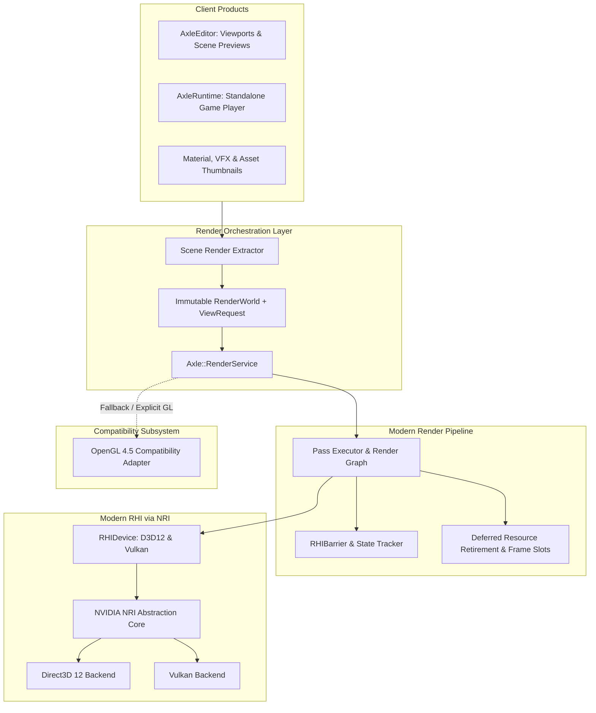
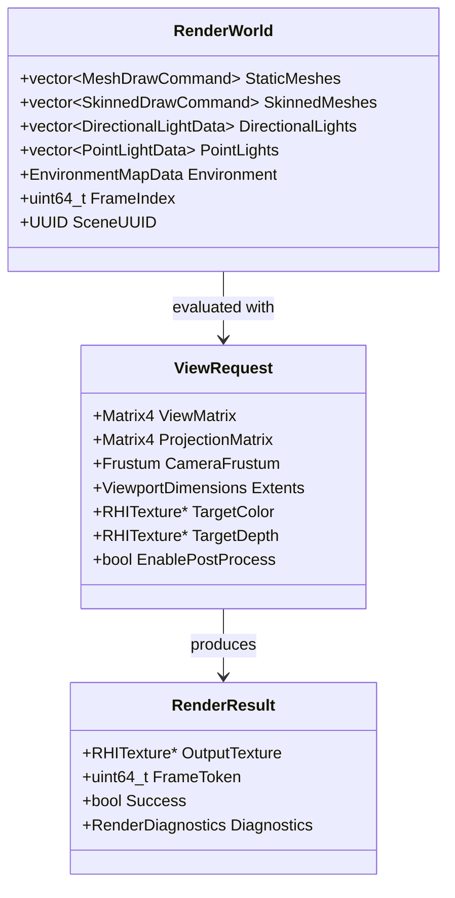
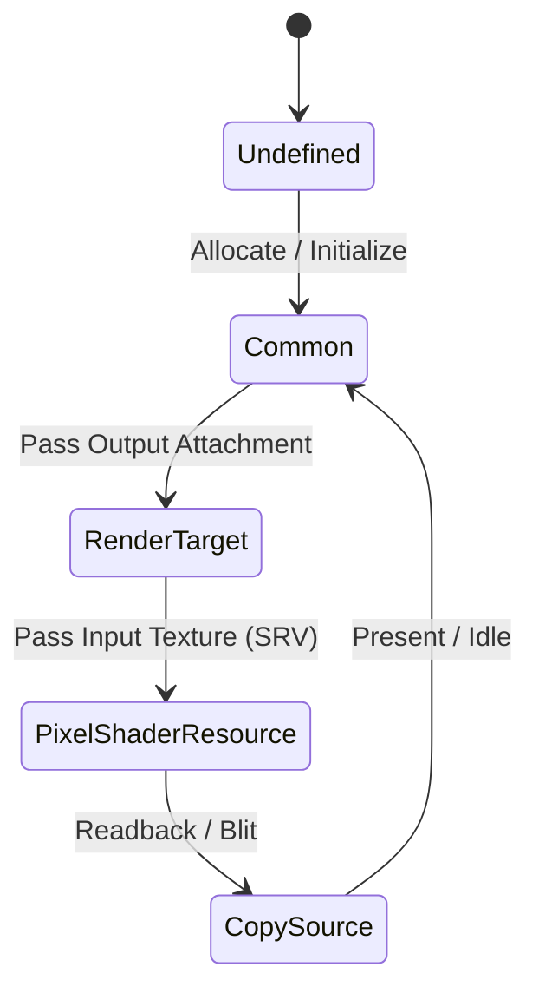

# Milestone 11 — RHI Primary Foundation Architecture

## 1. Target and Mandate

Milestone 11 (Phase 41) establishes the modern Hardware Abstraction Layer (RHI) as AxleEngine's primary, canonical rendering path. By integrating the NVIDIA Render Hardware Interface (NRI), AxleEngine transitions from legacy monolithic OpenGL calls to explicit, multi-backend GPU execution across **Direct3D 12** and **Vulkan**.

Legacy OpenGL 4.5 is strictly retained as a secondary **compatibility fallback adapter** operating behind the exact same product-level rendering contracts.

---

## 2. Architectural Boundaries & Data Flow

### 2.1 Single Ownership Principles

| Boundary | Owns | Must Not Own |
| :--- | :--- | :--- |
| **Scene Data / Asset System** | Stable Asset UUIDs, raw meshes, material definitions, transforms, bone hierarchies | Device pointers, GPU resource handles, ImGui descriptor sets |
| **Scene Extraction** | Snapshot extraction of active visible geometry and light states | Direct GPU allocation, command submission, or live ECS component mutations |
| **RenderService** | View registration, renderer selection, device lifecycle, and frame dispatch | Product-specific Editor panels, GUI widgets, or game simulation ticks |
| **Pass Pipeline** | Lighting evaluation, shadow map passes, geometry culling, forward/deferred passes | Editor inspection states or concrete EnTT registry references |
| **Frame Scheduler** | In-flight frame slots, submission tokens, GPU fences, and deferred resource retirement | Application event loops or widget rendering |
| **RHI Layer** | Device contexts, memory heaps, command lists, pipeline states, and barrier transitions | Shading math, game light structures, or asset loading logic |
| **UI Bridge** | Recording ImGui draw lists into external render targets | Swapchain ownership or presentation loop control |

---

## 3. Core Subsystems and Invariants

### 3.1 Immutable `RenderWorld` Snapshot

To guarantee thread safety and eliminate race conditions between gameplay updates and render recording, rendering does not access the live `EnTT` registry directly. Instead, rendering operates on an immutable snapshot:

### 3.2 Resource Generation and Handle Safety

1. **Transactional Resource Creation**:
   - Resources (`RHITexture`, `RHIBuffer`) must be completely created, validated, and bound to physical device memory before publishing to external consumers.
   - If allocation fails, the wrapper remains explicitly invalid (`IsValid() == false`).
   - If replacing an existing resource (e.g. on viewport resize), the prior valid generation is retained until the new resource successfully initialises.

2. **Handle Invalidation**:
   - Runtime handles are tracked via a compound generation tuple: `(SlotIndex, Generation, DeviceEpoch)`.
   - Reused memory addresses or recycled slots immediately increment their generation counter, preventing stale handles from referencing newer objects.

### 3.3 State Tracking and `RHIBarrier`

Modern graphics APIs (Direct3D 12 and Vulkan) require strict resource state transitions. The `RHIBarrier` subsystem tracks resource usage across passes:
- **Declared Usage**: Each pass declares explicit read and write dependencies.
- **First-Use Transition**: Track the incoming state upon pass entry.
- **Automatic Barrier Generation**: Synchronize resource access transitions between stages (e.g., `PixelShaderResource` $\rightarrow$ `RenderTarget` $\rightarrow$ `CopySource`).
- **Pending vs. Submitted State**: State transitions are tracked locally during command list recording and committed to the global state tracker only upon verified command buffer submission.

### 3.4 Frame Scheduling & Deferred Retirement

To support overlapping GPU/CPU frames without stalls, AxleEngine employs a multi-frame in-flight architecture:

- **Frame Slots**: Managed across $N$ ring slots (typically $N=2$ or $3$).
- **Completion Tokens**: Every command buffer submission returns an epoch fence token.
- **Retirement Queue**: Destroyed resources, textures, and descriptors are registered in a retirement queue tied to the current submission token.
- **Reclamation**: Memory is physically released only after the GPU fence for that frame slot signals completion on the host.

---

## 4. Lighting, Shading & Capability Contract

### 4.1 Canonical Lighting Rules

1. **Zero-Radiance Baseline**:
   - In ordinary Lit viewports (Editor and Runtime), illumination is strictly derived from authored lights and explicitly assigned environment maps.
   - If no lights or environment maps are configured in the scene, the resulting radiance is strictly zero (absolute black: $\text{RGB} = (0, 0, 0)$).
   - No implicit "studio sunlight" or default ambient bounce is injected into user scenes.

2. **Isotropic BRDF Consistency**:
   - Shading utilizes the Cook-Torrance microfacet model:
     - Normal Distribution Function ($D$): GGX / Trowbridge-Reitz.
     - Geometric Attenuation ($G$): Smith's separable shadow-masking.
     - Fresnel Term ($F$): Schlick's approximation.
   - Native D3D12/Vulkan HLSL pipelines and OpenGL GLSL shaders share unified light attenuation and unit conversions verified by `scripts/run_render_color_probe.py`.

### 4.2 Multi-Backend Capability Matrix

| Feature | Direct3D 12 (NRI) | Vulkan (NRI) | OpenGL 4.5 (Fallback) |
| :--- | :--- | :--- | :--- |
| **PBR Cook-Torrance** | Yes | Yes | Yes |
| **Cascaded Shadow Maps**| Yes | Yes | Yes |
| **HDR Environment IBL** | Yes | Yes | Yes |
| **Multi-Frame In-Flight**| Yes ($N=2..3$) | Yes ($N=2..3$) | Synchronous CPU Wait |
| **Explicit Barriers** | Native D3D12 ResourceBarrier | Native VkPipelineBarrier | Emulated / No-op |
| **State Caching** | Native PSO | Native VkPipeline | Context State Cache |
