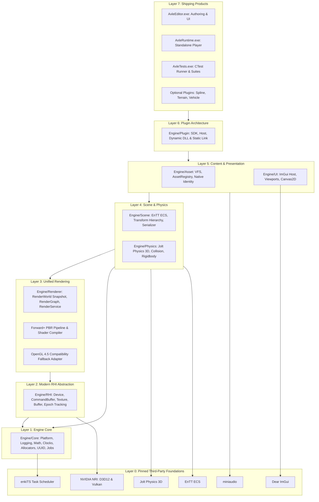

# Milestone 12 — Architecture Foundation Architecture

## 1. Target and Scope

Phase 00 defines the foundational architecture of AxleEngine. Its mandate is to enforce strict, unidirectional layering across the entire engine, eliminate monolithic coupling (such as retiring legacy built-in vehicle subsystems into decoupled plugins), establish modern multi-backend RHI rendering (Direct3D 12 and Vulkan via NVIDIA NRI), and guarantee that the engine core operates without depending on the Editor or windowing systems.

All subsystems follow the **Single Ownership Principle**: every engine capability (simulation clock, job scheduler, physics world, asset registry, RHI device, and presentation swapchain) is owned by exactly one service and exposed through clean, testable interfaces.

---

## 2. Architectural Layers and Hierarchy

AxleEngine is structured into strict, unidirectional layers. A lower layer may never include, link against, or depend upon a higher layer.



---

## 3. Subsystem Contracts & Core Invariants

### 3.1. Unified Rendering & RenderWorld CPU Snapshots
- **Immutable Snapshots:** Scene state is never read directly by GPU rendering threads. Instead, ExtractRenderWorld(const Scene&) extracts a compact, immutable Plain Old Data (POD) snapshot (RenderWorld) on the main thread in sub-millisecond time.
- **RenderService:** Central coordinator leasing rendering targets and executing sequential RenderGraph passes across all engine consumers (Editor Viewport, Asset Previewers, VFX Studio, and Standalone Runtime).
- **Backend Policy:** Direct3D 12 and Vulkan via NRI serve as first-class primary backends; an OpenGL 4.5 compatibility adapter ensures non-destructive fallback.

### 3.2. Modern RHI & GPU Lifetime Management
- **Hardware Agnostic:** NVIDIA NRI abstracts native Direct3D 12 and Vulkan API calls behind unified interfaces.
- **Generational Resource Handles & Device Epochs:** All GPU allocations (Buffers, Textures, Descriptors) are tracked via generational handles and device epochs, preventing use-after-free conditions and race conditions during device reset or window resizing.
- **Fence-Safe Retirement:** Transient resources and descriptor tables are held until frame completion fences signal GPU retirement.

### 3.3. Multithreaded Job System (enkiTS)
- Pinned worker threads matching hardware concurrency (JobSystem).
- Task graph dependencies without busy-waits or thread starvation.
- Fiber/worker safety: background workers never perform unsafe operations or block the main game loop.

### 3.4. Fixed-Step Physics Simulation (Jolt Physics)
- **Clock Authority:** Physics stepping is strictly tied to SimulationClock fixed monotonic intervals (e.g., 60 Hz), completely decoupled from variable frame rates.
- **Physics Boundary:** Engine/Physics is completely isolated from graphics rendering. Debug visualizations are published via Axle::PhysicsDebug interface, preventing physics code from referencing rendering headers.

### 3.5. Data-Oriented Component Architecture (EnTT ECS)
- High-performance, cache-aligned sparse sets.
- Entities are lightweight integer identifiers; components are flat data structs; systems contain pure logic.
- Hierarchical parent-child transforms evaluated in derived topological order.

### 3.6. Sidecar-Free Asset Identity & Persistence
- **Native Assets:** Embed a canonical first-line header: # AxleFileIdentity: 1 <UUID>. Native assets survive file renaming, external moves, and project relocation.
- **Raw Media:** External files (PNG, JPEG, WAV, OBJ, glTF) are referenced by project-root-relative canonical paths.
- **Zero Sidecar Files:** Eliminates fragile .meta / .uid files; asset registry rebuilds fast in-memory indexes on startup.

### 3.7. Decoupled Modular Plugins
- **Plugin SDK:** Clean C-compatible ABI boundary.
- **Editor vs. Runtime:** Plugins compile as dynamic DLLs during Editor authoring, enabling rapid iteration, and link statically into shipping standalone AxleRuntime.exe.
- **Domain Independence:** Game-specific mechanics (such as vehicles, tracks, terrain) exist exclusively as plugins outside Engine/.

---

## 4. Verification and Architectural Enforcement

- **Automated Verification:** scripts/check_architecture.py analyzes 576+ source files and 25 CMake targets on every build and CI run.
- **Zero Tolerance:** All historical baseline allowances have been permanently retired. Any upward dependency (e.g. Core including Scene, or Physics linking Renderer) immediately triggers build failure:
  ```text
  Files scanned: 576; CMake files: 25
  AXLE_ARCH_CHECK PASS
  ```
